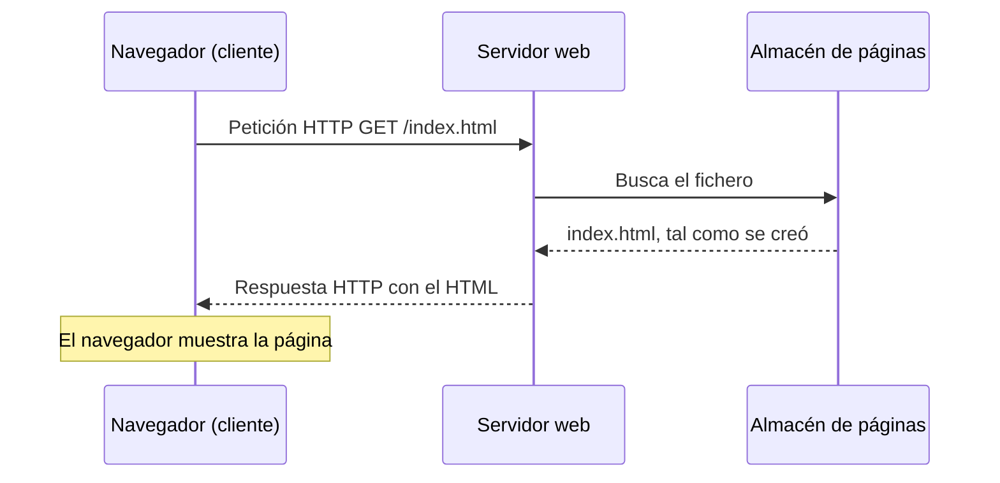
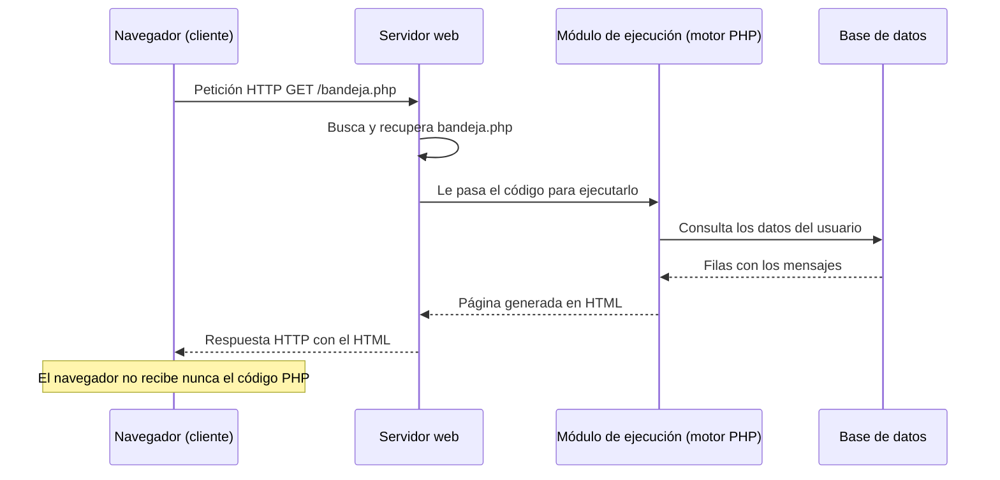
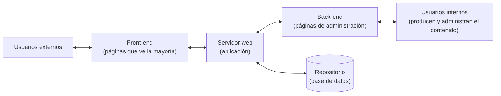
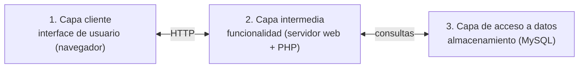
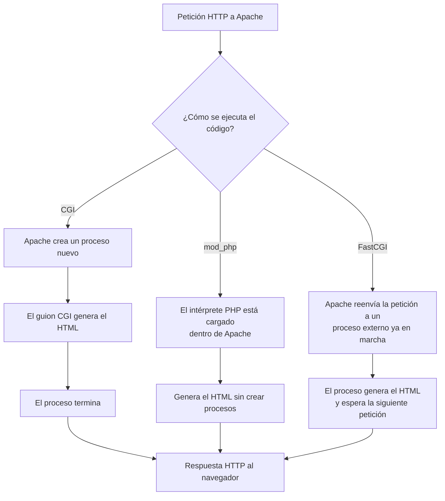
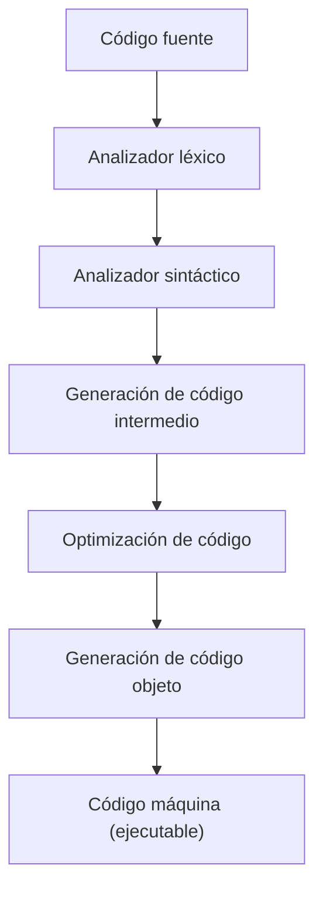
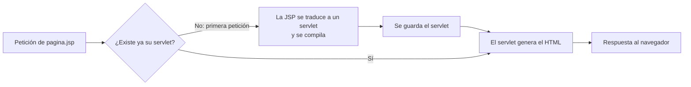
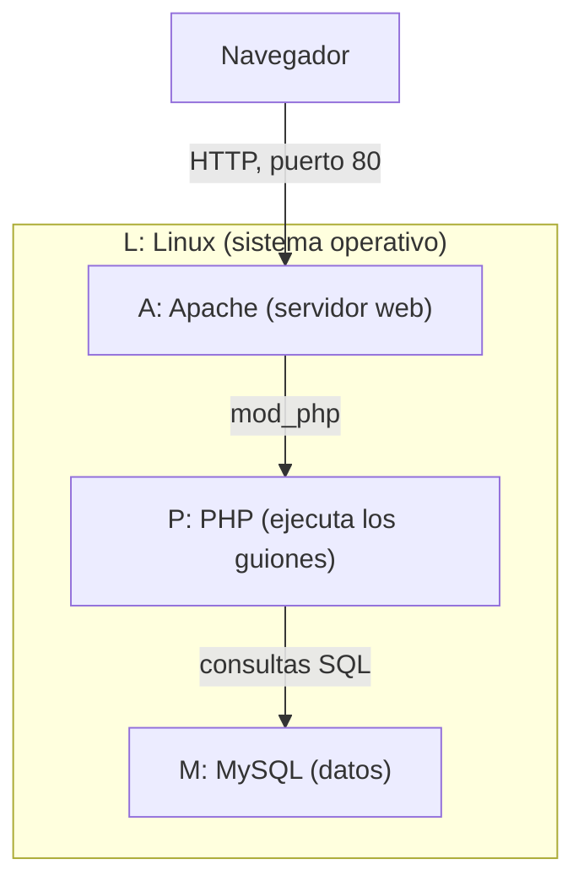

# Unidad 1. Plataformas de programación web en entorno servidor. Aplicaciones LAMP

Esta unidad presenta los conceptos en que se basa todo el módulo: qué significa ejecutar código en el servidor, qué componentes intervienen, en qué se diferencia de una página estática y de la ejecución de código en el navegador, y qué tecnologías existen para programar aplicaciones web. Termina con la instalación de una plataforma LAMP y los fundamentos del lenguaje PHP.

La unidad se divide en tres partes:

1. **Características de la programación web**: páginas estáticas y dinámicas, aplicaciones web y dónde se ejecuta el código.
2. **Tecnologías para programación web del lado del servidor**: componentes, arquitecturas en capas, plataformas (Java EE, AMP, CGI/Perl, ASP.Net, Node.js) y su integración con el servidor web.
3. **Lenguajes**: cómo se ejecutan, cómo se integran con el HTML, herramientas, instalación de la plataforma y primeros pasos en PHP.

> **Sobre la vigencia del temario.** Parte del temario cita versiones antiguas (PHP 7.3, Ubuntu 20.04, Windows 10) y tecnologías en desuso (servidores Java EE de BEA, ASP clásico). Se expone tal como lo recoge; lo que ha cambiado se indica en recuadros **Contexto actual**.

---

## 1. Características de la programación web

Cuando un navegador muestra una página, su contenido está escrito en un **lenguaje de marcado** (HTML o XHTML), formado por etiquetas que indican qué es cada parte: un encabezado, una tabla, un párrafo. Si la página está bien estructurada, el estilo con que se muestra cada parte está en otro fichero, una **hoja de estilos (CSS)**, que la página referencia y que el navegador descarga junto a ella.

Las **primeras páginas web** que se crearon fueron **estáticas**, y se sirven así:

1. El ordenador solicita a un servidor web una página con extensión `.htm`, `.html` o `.xhtml`.
2. El servidor busca esa página en un almacén de páginas (normalmente, un fichero por página).
3. Si la encuentra, la recupera.
4. Se la envía al navegador, que muestra su contenido.

Es una comunicación **cliente-servidor**: el cliente (el navegador) hace la petición e inicia la comunicación; el servidor la recibe y la atiende.

El intercambio para una página estática se reduce a una petición y una respuesta:



> **Error frecuente**: **sí se puede ver una página web sin que intervenga un servidor web**. Una página estática guardada en el propio equipo se abre directamente con el navegador; el servidor solo sirve para enviarla cuando está en otro equipo.

> **Error frecuente**: **CSS no es una tecnología de programación web en entorno servidor**. Es una hoja de estilos que interpreta el navegador.

### 1.1 Páginas web estáticas y dinámicas

| | Página estática | Página dinámica |
|---|---|---|
| Qué se almacena | La página en su forma definitiva, tal como se creó | Un programa que genera la página |
| Contenido | No varía: muestra siempre la misma información | Cambia según el navegador, el usuario identificado, sus acciones anteriores… |
| Cómo cambia | Solo si un programador la edita a mano | Automáticamente, en cada petición |
| Extensiones típicas | `.htm`, `.html`, `.xhtml` | **`.php`, `.asp`, `.jsp`, `.cgi`, `.aspx`** |

Dentro de las páginas dinámicas se distinguen dos tipos:

- **Con código que ejecuta el navegador**, normalmente **JavaScript**, incluido en el HTML y descargado con la página. Puede mostrar animaciones o cambiar la apariencia y el contenido de la página. Este módulo no lo estudia, salvo cuando se relaciona con el servidor.
- **Con código que se ejecuta en el servidor**: lo que se almacena **no es lo mismo que se envía**. El HTML se forma como resultado de ejecutar un programa en el servidor web (aunque no necesariamente lo ejecute el propio servidor).

**Cómo se sirve una página dinámica:**

1. El navegador solicita una página con extensión `.asp`, `.php`, `.jsp`…
2. El servidor la busca y la recupera.
3. Como es dinámica, el servidor contacta con el **módulo responsable de ejecutar el código** y se lo envía.
4. Durante la ejecución puede consultarse un repositorio, por ejemplo una base de datos.
5. El resultado es una página **en formato HTML, similar a cualquier página no dinámica**.
6. El servidor envía ese resultado al navegador, que lo muestra.

La diferencia con la página estática está en los pasos intermedios: el servidor no envía lo que tiene almacenado, sino lo que devuelve el módulo que ejecuta el código.



Con PHP: el cliente hace la petición; el servidor web, que tiene incorporado un **"motor" PHP**, procesa los guiones de la página y genera el HTML; el servidor envía ese HTML al cliente.

El correo web (Gmail, Outlook) es el ejemplo típico: la bandeja de entrada no es la misma página para todos, se genera para cada usuario con sus datos.

#### 1.1.1 Páginas web estáticas y dinámicas (II)

**No siempre es preferible usar páginas dinámicas.** Son las que más potencia y flexibilidad dan, pero las estáticas tienen ventajas:

- **No hace falta saber programar**: basta con HTML, XHTML y CSS, o incluso un programa de diseño web.
- **Su contenido nunca varía**: un enlace guardado lleva siempre al mismo contenido, y los buscadores como Google pueden **indexarlas** por completo. El contenido generado de forma dinámica puede quedar, en parte, invisible para el buscador.
- **No necesitan recursos en el servidor**: solo un servidor web que las envíe, o ni eso, si se abren desde el propio equipo, un disco o una memoria USB. Las dinámicas necesitan un módulo que ejecute el código y, a menudo, una base de datos, que hay que instalar y mantener.

Su gran inconveniente: el contenido **se actualiza a mano**, editando cada página, lo que resulta prohibitivo en sitios con mucho contenido.

> **Error frecuente**: "siempre es preferible usar páginas dinámicas" es **falso**. Una web personal con información que casi no cambia se resuelve mejor con páginas estáticas.

#### 1.1.2 Aplicaciones web

Las **aplicaciones web** emplean páginas web dinámicas para crear aplicaciones que se ejecutan en un servidor web y se muestran en un navegador. Las primeras fueron los clientes de correo; hoy hay procesadores de texto, gestores de tareas, editores de imágenes…

| Ventajas | Inconvenientes |
|---|---|
| **No es necesario instalarlas** en los equipos en que se usan: se instalan **una sola vez, en el servidor**, y se usan desde muchos equipos a la vez | **El interface de usuario es la página que se muestra en el navegador**, con las limitaciones de una página web |
| Son fáciles de gestionar (copias de seguridad, correcciones, actualizaciones), porque solo están en un equipo | **Dependen de la conexión con el servidor**: si falla, no se puede usar la aplicación |
| **Funcionan en cualquier sistema con navegador**, sea cual sea su potencia o su sistema operativo | **La información que se muestra debe transmitirse desde el servidor**, lo que descarta algunas aplicaciones, como la edición de vídeo |
| Se usan desde cualquier lugar con conexión, también desde **teléfonos móviles** | |

> **Error frecuente**: una aplicación web **no "solo necesita un servidor web"** para ejecutarse: como usa páginas dinámicas, necesita además un módulo que ejecute el código y, normalmente, un gestor de bases de datos.

Muchas aplicaciones guardan casi todo su contenido en una base de datos. Las de gestión de contenidos, como **Drupal** o **Joomla!**, tienen dos partes:

- **Front-end**: el conjunto de páginas que ven **la gran mayoría de usuarios** (usuarios externos).
- **Back-end**: otro conjunto de páginas dinámicas que usan **las personas que producen el contenido y las que administran la aplicación** (usuarios internos) para crear contenido, organizarlo, decidir la apariencia externa, etc.

Las dos partes comparten el mismo servidor y el mismo repositorio de datos; lo que cambia es quién accede a cada una:



> **Error frecuente**: en el sentido del temario, el back-end es **el conjunto de páginas que se usa para la administración**, no el personal que administra ni los almacenes de datos.

> **Contexto actual**: hoy "back end" se usa casi siempre en un sentido más amplio: toda la parte del servidor (la lógica, la base de datos y los recursos que ejecutan la aplicación), frente al "front end", lo que se ejecuta en el navegador.

### 1.2 Ejecución de código en el servidor y en el cliente

**Las páginas web pueden contener código que se ejecuta en el servidor y código que se ejecuta en el navegador**, y las dos tecnologías se complementan:

| | En el servidor | En el cliente (navegador) |
|---|---|---|
| Cuándo se ejecuta | **Antes de enviar la página**: el servidor ejecuta, por sí mismo o por delegación, un programa que genera la página | **Cuando la página llega** al navegador |
| Lenguaje habitual | PHP, Java, ASP.Net… | **JavaScript** |
| Para qué | Obtener datos almacenados en el servidor: los mensajes de una bandeja de correo | Animaciones, **comprobar los datos de un formulario**, avisar de que falta el asunto de un correo |
| Módulo que lo estudia | Este (Desarrollo Web en Entorno Servidor) | Desarrollo Web en Entorno Cliente |

Por eso, **la página que resulta de ejecutar código en el servidor puede incluir también código JavaScript**, y **puede ser exactamente igual que una página estática**. Lo que no contiene nunca es código del servidor ni código intermedio, y no se almacena para futuras peticiones.

> **Error frecuente**: comprobar que una contraseña tiene una longitud mínima es preferible hacerlo **en el navegador**: no hace falta enviar la contraseña al servidor para eso. En cambio, comprobar si un dato ya existe en una base de datos del servidor exige ejecutar código **en el servidor**.

Tradicionalmente, el JavaScript del navegador no tenía acceso a los datos del servidor: para leer un correo nuevo había que generar otra página en el servidor. La técnica **AJAX** permite que **el código JavaScript que se ejecuta en el navegador se comunique con un servidor de Internet para obtener información** y modificar la página actual sin cargar otra.

Lo que puede contener una página que se descarga en el navegador: código **JavaScript**, **referencias a una hoja de estilos CSS** y llamadas **AJAX**. Nunca comentarios PHP: el código PHP se ejecuta en el servidor y no llega al navegador.

---

## 2. Tecnologías para programación web del lado del servidor

Los **componentes principales** para ejecutar aplicaciones web en un servidor son:

| Componente | Función | Ejemplos |
|---|---|---|
| **Servidor web** | Recibe las peticiones de los clientes y les envía la página una vez generada. Sabe qué módulo ejecuta el código y cómo comunicarse con él | Apache, Nginx, IIS |
| **Módulo encargado de ejecutar el código** | Ejecuta el programa y genera la página resultante; se integra con el servidor web y depende del lenguaje | mod_php, contenedor de servlets |
| **Aplicación de base de datos** | Almacena los datos. No es estrictamente necesaria, pero en la práctica la usan todas las aplicaciones con muchos datos | MySQL, MariaDB, SQLite |
| **Lenguaje de programación** | En el que se desarrolla la aplicación | PHP; en este módulo, también JavaScript para Node.js |

> **Error frecuente**: un IDE, los "lenguajes de guiones" o la "ejecución y depuración" no son componentes necesarios para **ejecutar** una aplicación web.

**Arquitectura en capas.** El diseño de una aplicación se divide en capas para separar sus funciones lógicas (presentación, lógica, persistencia y acceso a los datos), de modo que cada una pueda ejecutarse, si hace falta, en un servidor distinto. En las aplicaciones de **tres capas**:

1. **Capa cliente**: todo lo relacionado con el **interface de usuario**, la parte visible con la que interactúa el usuario.
2. **Capa intermedia**: la **funcionalidad** de la aplicación.
3. **Capa de acceso a datos**: **almacenar y recuperar la información** en una base de datos.

Cada capa solo se comunica con la contigua, y cada una puede residir en un equipo distinto:



> **Error frecuente**: no existe una "capa de integración" entre las tres capas.

> **Analogía con Java**: es la misma separación que en un programa de Programación con interfaz gráfica, clases de lógica y una clase que lee y escribe los ficheros.

### 2.1 Arquitecturas y plataformas

La primera decisión antes de programar es la arquitectura:

| Arquitectura | Lenguaje | Servidor y componentes | Rasgos |
|---|---|---|---|
| **Java EE** (antes J2EE) | Java | Servidor de aplicaciones o contenedor de servlets; varios gestores de bases de datos | Para aplicaciones medianas o grandes; muchas librerías y programadores. Tecnologías: **páginas JSP, servlets** (generan páginas dinámicas) y **EJB** (lógica de la aplicación) |
| **AMP** | **PHP, Perl o Python** (PHP, el más empleado) | **Apache** + **MySQL** (o MariaDB) | **Código abierto**; aplicaciones pequeñas o medianas; aprendizaje sencillo; gran comunidad. Según el sistema operativo: **LAMP** (Linux), WAMP (Windows), MAMP (Mac). Se puede usar PostgreSQL en lugar de MySQL |
| **CGI/Perl** | Perl (o cualquier otro) | CGI: estándar para que el servidor web ejecute **programas genéricos escritos en cualquier lenguaje** | La **más primitiva**. Inconveniente: **CGI es lento** |
| **ASP.Net** | **Visual Basic.Net o C#** | Servidor **IIS** de Microsoft; SQL Server, entre otros | **Arquitectura comercial de Microsoft**, evolución de ASP. Trae todo lo necesario, con su propio IDE, Visual Studio. Desventaja: es de **código propietario** |
| **Node.js** | JavaScript (ECMAScript) | Entorno de ejecución propio, basado en el motor V8 de Google | Multiplataforma, de código abierto, asíncrono y orientado a eventos |

> **Error frecuente**: la P de AMP es **PHP, Perl o Python**, nunca PostgreSQL (que sería una alternativa a la M). Y la programación en el servidor se hace con **PHP, Java o ASP.Net**, no con JavaScript del navegador.

**XAMPP** es un paquete que instala una plataforma AMP completa de una vez, con versiones para Linux, Windows y Mac.

#### 2.1.1 Selección de una arquitectura de programación web

**No hay una arquitectura mejor que las demás para todos los casos.** Para elegir, se consideran estas preguntas:

- ¿Qué **tamaño** tiene el proyecto?
- ¿Qué **lenguajes** se conocen? ¿Vale la pena aprender uno nuevo?
- ¿Herramientas de **código abierto o propietarias**? ¿Cuánto cuestan las comerciales?
- ¿Se programa **solo o en equipo**?
- ¿Hay ya un **servidor web o un gestor de bases de datos** disponible, o se puede elegir libremente?
- ¿Qué **licencia** tendrá la aplicación?

> **Error frecuente**: la tecnología que permite ejecutar programas **escritos en cualquier lenguaje** es **CGI**. Java EE exige Java; PHP es un lenguaje concreto, y en AMP solo se usan PHP, Perl o Python.

### 2.2 Integración con el servidor web

El navegador y el servidor web se comunican con el protocolo **HTTP**: lo que introduce el usuario viaja en una **petición HTTP** y el resultado vuelve en una **respuesta HTTP**. El servidor web (también llamado servidor HTTP) decide cómo procesar cada petición.

| Tecnología | Cómo se integra |
|---|---|
| **CGI** | La más antigua. Protocolo estándar que implementan casi todos los servidores web: define cómo **delegar en un programa externo** (un **guion CGI**) la generación de la página. Problema: **cada ejecución crea un proceso nuevo**, lo que consume más recursos y es más lento. Lo aceleran **FastCGI** o módulos como **mod_perl** |
| **PHP** | Se puede ejecutar por CGI, pero no es lo habitual. **La forma habitual en plataformas AMP es el módulo mod_php de Apache** (para Python, mod_python) |
| **Java EE** | Dos opciones: un **servidor de aplicaciones**, que implementa **toda** la especificación Java EE, o un **contenedor de servlets**, que solo implementa una parte. Después se integra con el servidor web, o se usa solo, porque **Tomcat** incluye su propio servidor HTTP |
| **ASP.Net** | El servidor **IIS** ya integra módulos para las páginas ASP y ASP.Net |

El esquema siguiente contrasta las tres formas de ejecutar código desde Apache. Con CGI cada petición arranca un proceso nuevo; con mod_php el intérprete vive dentro del propio Apache; con FastCGI hay procesos externos que permanecen en marcha y atienden una petición tras otra.



> **Contexto actual**: en las instalaciones actuales de PHP con Apache o Nginx es habitual **PHP-FPM**, una implementación de FastCGI para PHP, en lugar de mod_php.

**Servidores de aplicaciones Java EE completos**: los comerciales **IBM WebSphere** y BEA WebLogic, y los de código abierto **JBoss**, **Geronimo** (de la fundación Apache) y GlassFish. Cuando no se usan EJB, basta un **contenedor de servlets**, y el más destacado es **Tomcat**, la implementación de referencia, también de código abierto.

> **Error frecuente**: **Tomcat no es un servidor de aplicaciones Java EE completo**, sino un contenedor de servlets.

> **Contexto actual**: Java EE pasó a la Fundación Eclipse en 2017 y hoy se llama **Jakarta EE**. BEA WebLogic es de Oracle desde 2008, y JBoss se llama hoy WildFly.

---

## 3. Lenguajes

La gran diferencia entre lenguajes de programación web es **cómo se ejecutan en el servidor**:

| Tipo | Cómo se ejecuta | Lenguajes | Ventajas | Inconvenientes |
|---|---|---|---|---|
| **De guiones** (*scripting*) | Directamente desde el código fuente, guardado en texto plano: el servidor pasa la petición a un **intérprete** | **PHP**, Perl, Python, ASP | No hay que traducir nada: portables, y se modifican en el momento | Peor rendimiento |
| **Compilados a código nativo** | El código se traduce a binario, dependiente del procesador, antes de ejecutarse. El método principal es **CGI** | C y cualquier lenguaje de propósito general | Los más rápidos | Mala integración con el servidor web: un proceso nuevo por petición, y no son portables |
| **Compilados a código intermedio** | Se traducen a un código intermedio, independiente del procesador | Java EE (**servlets y JSP**) y **ASP.Net** | Equilibrio: muy buen rendimiento y portabilidad entre plataformas con la arquitectura instalada | |

La traducción de un lenguaje compilado pasa por varias fases, desde el código fuente hasta el código máquina que ejecuta el procesador:



En ASP.Net y en muchas implementaciones de Java EE se usa **compilación JIT** (*just in time*): al invocar un programa, el código intermedio se traduce a código nativo, que se guarda para reutilizarlo.

> **Error frecuente**: las páginas que **se compilan a código intermedio** antes de ejecutarse son las **JSP**. Las ASP (clásicas) y PHP son de guiones; CGI ejecuta binarios o guiones.

> **Analogía con Java**: los `.java` se compilan a `.class` (bytecode, código intermedio) y la máquina virtual los ejecuta en cualquier sistema. Un servlet es eso mismo, ejecutado dentro de un contenedor.

### 3.1 Código embebido en el lenguaje de marcas

Hay dos formas de combinar el código del programa con el HTML:

| | Las etiquetas HTML dentro del código | El código dentro de las etiquetas HTML |
|---|---|---|
| Cómo | El programa escribe el HTML con sentencias de salida (`echo`, `println`) | La parte fija de la página es HTML normal y el código se inserta solo donde algo varía |
| Tecnologías | **Guiones CGI** y **servlets** | **ASP, PHP y JSP** |

Guion CGI en `bash` (el HTML va dentro del código):

```bash
#!/bin/sh
echo "Content-Type: text/html"    # cabecera HTTP
echo ""
echo "<html><body>Prueba de guion bash CGI</body></html>"
```

Página PHP (el código va dentro del HTML):

```php
<!DOCTYPE html>
<html>
  <head><title>Prueba PHP</title></head>
  <body>
    El nombre del servidor es: <?php echo $_SERVER['SERVER_NAME']; ?>
  </body>
</html>
```

- **Servlets** y **JSP**: los servlets son programas Java compilados que se guardan en el contenedor; las páginas JSP llevan Java embebido en el HTML. **La primera vez que se pide una JSP, se convierte en un servlet**, que se guarda para las siguientes peticiones.
- **ASP.Net**: cada página se divide en dos ficheros, uno con el HTML y otro con el código. A partir de ellos se obtiene un código intermedio, **MSIL**, que es lo que guarda el servidor.

El tratamiento de una página JSP depende de si ya se ha pedido antes:



> **Error frecuente**: **no hay relación directa** entre cómo se ejecuta un lenguaje y cómo se integra con el HTML. Java, que es compilado, mete el HTML en el código en los servlets y el código en el HTML en las JSP; PHP, de guiones, mete el código en el HTML.

### 3.2 Herramientas de programación

Un **entorno integrado de desarrollo (IDE)** reúne en un programa muchas herramientas. **No es imprescindible** (basta un editor de texto), pero es muy conveniente:

- **Resaltado de texto** e indentado automático.
- **Completado automático**.
- **Navegación en el código**: buscar, por ejemplo, la definición de una variable.
- **Comprobación de errores** mientras se escribe.
- **Generación automática de código**: la estructura básica de una clase, por ejemplo.
- **Ejecución y depuración**: ejecución paso a paso, puntos de ruptura, inspección de variables.
- **Gestión de versiones**, junto con un sistema de control de versiones.

| IDE | Rasgos |
|---|---|
| **Visual Studio** (Microsoft) | Específico de la plataforma .Net (C#, Visual Basic) |
| **Eclipse** y **NetBeans** | Se adaptan a varios lenguajes y plataformas, como Java EE o PHP |
| **PhpStorm** (JetBrains) | Con licencia; gratuita durante un año para estudiantes y profesorado |
| **Visual Studio Code** (Microsoft) | Muy versátil gracias a sus extensiones |
| **Sublime Text** | Con extensiones; software propietario de uso libre en enseñanza |

> **Error frecuente**: **NetVibes no es un IDE**: es un portal personalizable de noticias. Y para programar en PHP **lo único prescindible es el IDE**; el servidor web, el sistema operativo y PHP sí son necesarios.

#### 3.2.1 Instalación de Visual Studio Code en Linux

1. Se descarga de su web el paquete adecuado (en Ubuntu y derivadas de Debian, el `.deb`).
2. Se abre con el gestor de software, que instala también las dependencias.
3. Se instalan las extensiones: en el icono **Extensions**, se busca "php" y se instala **PHP Extension Pack**, que reúne autocompletado, resaltado de sintaxis y otras ayudas.

#### 3.2.2 Instalación de una plataforma LAMP en Ubuntu

**LAMP**: **L**inux (sistema operativo), **A**pache (servidor web), **M**ySQL (gestor de bases de datos) y **P**HP (lenguaje de programación).

Cada componente se apoya en el de debajo; el navegador solo se comunica con Apache:



En WAMP y MAMP la estructura es la misma; solo cambia la capa inferior (Windows o macOS).

Los componentes se pueden instalar uno a uno o **todos con un único comando**, `tasksel`, que trae tareas predefinidas; una de ellas es `lamp-server`.

```bash
sudo apt install tasksel           # 1. instalar tasksel
sudo tasksel install lamp-server   # 2. instalar Apache, MySQL y PHP de una vez
sudo a2enmod userdir               # 3. activar el módulo userdir de Apache
sudo systemctl restart apache2     #    reiniciar Apache para que lo aplique
mkdir ~/public_html                # 4. carpeta personal publicada (sin sudo; el nombre es obligatorio)
```

- Por defecto, Apache publica lo que hay en `/var/www`. Con **userdir**, cada usuario publica su carpeta `~/public_html`, accesible en `http://127.0.0.1/~usuario/`, sin problemas de permisos.
- Por seguridad, Apache **no ejecuta PHP** en esas carpetas: hay que editar `/etc/apache2/mods-enabled/php7.x.conf` y reiniciar Apache.
- Para comprobarlo, se crea `public_html/info.php` con `<?php phpinfo(); ?>` y se abre en el navegador.

> **Error frecuente**: Ubuntu no trae una plataforma AMP instalada por defecto, pero sí se puede instalar entera con un solo comando.

#### 3.2.3 Instalación de una plataforma WAMP en Windows

Hay paquetes que lo integran todo (WampServer, **XAMPP**). Con XAMPP:

1. Se descarga el instalador.
2. Se ejecuta y se elige la carpeta de instalación.
3. Se eligen los componentes: suele bastar con **Apache, PHP, MySQL y phpMyAdmin**.
4. Desde el **panel de control** se inician Apache y MySQL.
5. Se crea `info.php` en `C:\xampp\htdocs\` y se abre en el navegador.

### 3.3 Programación web con Java

**Java** es un lenguaje orientado a objetos, basado en la sintaxis de C y C++, sin punteros; todo el código pertenece a una clase. Los `.java` se compilan a `.class`; para ejecutarlos hace falta el **JRE**, y para desarrollar, el **JDK**, que incluye el compilador.

Hay dos tecnologías para páginas dinámicas con Java EE:

- **JSP**: HTML con Java embebido entre `<%` y `%>`. Ejemplo: `La suma de 2 y 3 es: <% out.println(2+3); %>`.
- **Servlets**: clases Java que generan el HTML con `out.println(...)`.

**Todo lo que se hace con JSP se puede hacer con servlets** (de hecho, las JSP se convierten en servlets), pero los servlets son tediosos para generar HTML. Por eso se combinan: **los servlets procesan la información y las JSP construyen la interfaz** con los resultados.

### 3.4 Programación web con PHP

**PHP es un lenguaje de guiones** de propósito general, diseñado para páginas dinámicas con **código embebido en el lenguaje de marcas**. Su sintaxis viene de C/C++, muy parecida a la de Java. Los delimitadores recomendados son **`<?php` y `?>`**.

> **Error frecuente**: fijarse en cada carácter del delimitador. `<php`, sin la interrogación, **no es un delimitador válido**; los válidos son `<?php` y `?>` (y los cortos `<?` y `?>` solo si `short_open_tags` está activado).

**Configuración.** PHP se ejecuta en un entorno con el que se integra el servidor web (normalmente, Apache con **mod_php**). Apache se configura en **`httpd.conf`** y PHP en **`php.ini`**, que **puede estar en distintas ubicaciones**: `phpinfo()` indica cuál es; en Ubuntu, `/etc/php/7.x/apache2/php.ini`.

**Con mod_php, los cambios en `php.ini` se aplican cada vez que se reinicia Apache** (`sudo systemctl restart apache2`), no al recargar la página.

| Directiva | Qué hace |
|---|---|
| **`short_open_tags`** | Indica si se pueden usar los **delimitadores cortos `<?` y `?>`**. Mejor `Off`: dan problemas con XML. Por defecto suele estar a `On` |
| **`max_execution_time`** | **Número máximo de segundos que puede durar la ejecución de un script**. Evita que un error bloquee el servidor |
| **`display_errors`** | Muestra los errores del código. **`On` en desarrollo y `Off` en producción**; por defecto suele estar a `On` |
| **`error_reporting`** | Qué tipos de errores se muestran: `E_ALL` (todos), `E_ALL & ~E_NOTICE` (todos menos los avisos) |
| **`file_uploads`** | Si se pueden **subir ficheros al servidor por HTTP** |
| **`upload_max_filesize`** | **Tamaño máximo de cada fichero subido**, por ejemplo `1M` |
| **`post_max_size`** | Tamaño máximo de lo que se envía por POST; complementa al anterior |

> **Error frecuente**: para subir PDF de 5M por formulario no basta con `upload_max_filesize = 15M`: hace falta también `post_max_size` de al menos 5M y `file_uploads = On`. Con `short_open_tags = Off`, un código que empieza por `<?` no funciona. Y al pasar a **producción**, `display_errors` tiene que estar a `Off`; dejar el valor por defecto (`On`) es un error.

**Comentarios.** En el HTML van entre `<!--` y `-->`; dentro del código PHP hay tres formas:

```php
<?php
// comentario de una línea, como en C y Java
# comentario de una línea, como en los scripts de Linux
/* comentario
   de varias líneas */
?>
```

Los comentarios PHP **nunca llegan al navegador**; los del HTML, sí.

> **Error frecuente**: `<!-- -->` no es un comentario PHP.

#### 3.4.1 Variables y tipos de datos en PHP

- Las variables **empiezan siempre por `$`**.
- El nombre **empieza por una letra o por `_`** y puede contener **letras, números y `_`**.
- **No hace falta declararlas** ni indicar su tipo: basta con asignarles un valor (`$mi_variable = 7;`). El tipo depende del valor y **puede cambiar** si cambia el contenido.

> **Error frecuente**: un nombre no puede empezar por un número, pero sí por `_`, y sí puede contener números.

> **Analogía con Java**: en Java se escribe `int edad = 7;` y la variable es `int` para siempre. En PHP se escribe `$edad = 7;` y después `$edad = "siete";` es válido: la variable pasa a ser una cadena.

| Tipo | Valores | Ejemplo |
|---|---|---|
| **booleano** (`boolean`) | `true` y `false`. Cualquier entero distinto de 0 equivale a `true`; **el 0, a `false`** | `$b = false;` |
| **entero** (`integer`) | Sin decimales, en decimal, octal (empieza por `0`) o **hexadecimal (empieza por `0x`)** | `$e = 0x2A;` |
| **real** (`float`) | Con decimales, también en **notación científica** | `$r = 7.3e-1;` |
| **cadena** (`string`) | Caracteres entre **comillas simples o dobles** | `$c = "texto";` |
| **null** | La variable no tiene valor | `$v = null;` |

Al operar con tipos distintos, se convierten a uno común (entero + real = real). La conversión también se puede forzar: `(int) 2.3` vale 2. Para comprobar el tipo: `is_bool()`, `is_int()`, `is_float()`, `is_numeric()`, `is_string()`, `is_array()`, `is_object()`; devuelven `true` o `false` (`is_int('23')` devuelve `false`, porque es una cadena).

#### 3.4.2 Expresiones y operadores

Toda expresión tiene al menos un operando y un operador. Los operadores son casi los de Java:

- **Aritméticos**, con **incremento y decremento**: `++$a` suma uno **antes** de usar el valor; `$a++`, **después**.
- **De asignación**: `=`, `+=`, `-=`…
- **De comparación**: `>`, `>=`, etc., y dos de igualdad:
  - **`==`** compara solo los **valores**;
  - **`===`** exige **mismo valor y mismo tipo**.
  - Para la diferencia: `<>` y `!=` (equivalentes, comparan valores) y `!==` (distinto valor o distinto tipo).
- **Lógicos**: `and` o `&&`, `or` o `||`, `!`, `xor`.
- **De bits**.

```php
<?php
$a = 5;  $b = ++$a;   // $a vale 6 y $b, 6
$a = 5;  $b = $a++;   // $b vale 5 y $a, 6
$x = 0;               // $x == false es true; $x === false es false (entero frente a booleano)
?>
```

**Ejemplo resuelto**: si `$a` vale 2 y `$b` vale `"2"`:

| Expresión | Resultado | Por qué |
|---|---|---|
| `$b > 1` | `true` | `"2"` se convierte a número para comparar |
| `$a === $b` | `false` | Mismo valor, pero entero frente a cadena |
| `$b++` | 2 | Devuelve el valor antes de incrementarlo |
| `++$a` | 3 | Incrementa y después devuelve |

**Otro**: con `$a = 1`, `--$a == false` es **verdadera**: `$a` pasa a valer 0 antes de comparar, y 0 equivale a `false`. `"1" === $a` es falsa (cadena frente a entero), `$a == false` también (1 equivale a `true`), y `$a++ == 2` también, porque compara con el valor antiguo, 1.

#### 3.4.3 Ámbito de utilización de las variables

La **visibilidad** de una variable se decide la primera vez que aparece:

- Si aparece por primera vez **dentro de una función**, es **local**: una variable con el mismo nombre fuera de la función es otra distinta.
- Para usar dentro de una función una variable de fuera, se declara con **`global`**, o se usa el array **`$GLOBALS["nombre"]`**.
- Las variables locales desaparecen al acabar la función. Para que **conserve su valor entre llamadas**, se declara **`static`**, y se inicializa en la misma sentencia (solo se inicializa la primera vez).

> **Analogía con Java**: aquí está la gran diferencia con Java. En PHP, una función **no ve** las variables de fuera salvo que se declaren `global`. `static` en PHP equivale a una variable de clase que la función recuerda entre llamadas.

```php
<?php
$nombre = "Juan";
function saludo1() { echo "Hola $nombre"; }        // $nombre no existe aquí: no muestra "Juan"
function saludo2() { $nombre = "Pedro"; echo "Hola $nombre"; }   // muestra "Pedro" (local)
function saludo3() { global $nombre; $nombre = "Ana"; echo "Hola $nombre"; }
saludo3();
echo $nombre;   // muestra "Ana" otra vez: global ha modificado la variable de fuera
function contador() { static $n = 0; $n++; echo $n; }   // 1, 2, 3… en cada llamada
?>
```

> **Error frecuente**: `static` no impide modificar la variable, no es lo mismo que `global` ni la hace visible desde fuera de la función: solo **mantiene su valor aunque la función termine**.

---

## Ideas clave

- **Estáticas frente a dinámicas**: las estáticas no cambian, no requieren programación ni recursos en el servidor y se indexan bien; las dinámicas se generan en el servidor (`.php`, `.asp`, `.jsp`). No siempre son mejores las dinámicas.
- **Aplicación web**: se instala una vez, en el servidor, y se usa desde cualquier navegador. Inconvenientes: interfaz limitada a una página, dependencia de la conexión y transmisión de toda la información. Front-end para los usuarios; back-end, páginas de administración.
- **Cliente y servidor**: JavaScript en el navegador (validar formularios); PHP o Java en el servidor (datos). AJAX los comunica.
- **Componentes**: servidor web, módulo que ejecuta el código, base de datos y lenguaje. **Tres capas**: cliente, intermedia y acceso a datos.
- **Arquitecturas**: Java EE (JSP, servlets, EJB), AMP (Apache, MySQL y PHP/Perl/Python; LAMP en Linux), CGI/Perl (cualquier lenguaje; lento), ASP.Net (Microsoft, VB.Net y C#, IIS, MSIL) y Node.js.
- **Integración**: mod_php en Apache; servidores de aplicaciones Java EE completos (WebSphere, JBoss, Geronimo) o contenedor de servlets (Tomcat).
- **Lenguajes**: de guiones (PHP), compilados a código nativo (C por CGI) y compilados a código intermedio (JSP, servlets, ASP.Net). No hay relación directa con la forma de integrarse en el HTML.
- **PHP**: `<?php ?>`; configuración en `php.ini`, que se aplica al reiniciar Apache; comentarios `//`, `#` y `/* */`; variables con `$`, sin declarar, de tipo dinámico; `==` frente a `===`; `global` y `static`.
