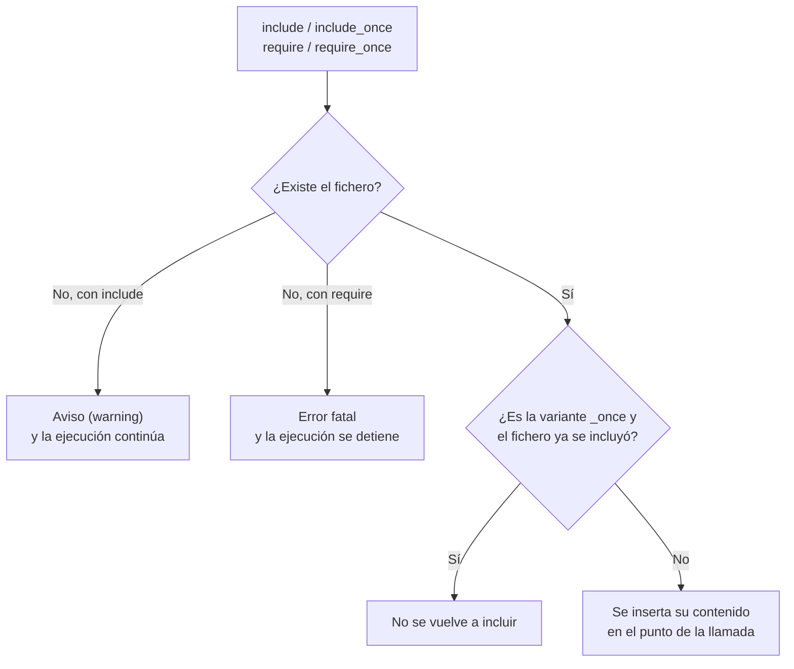
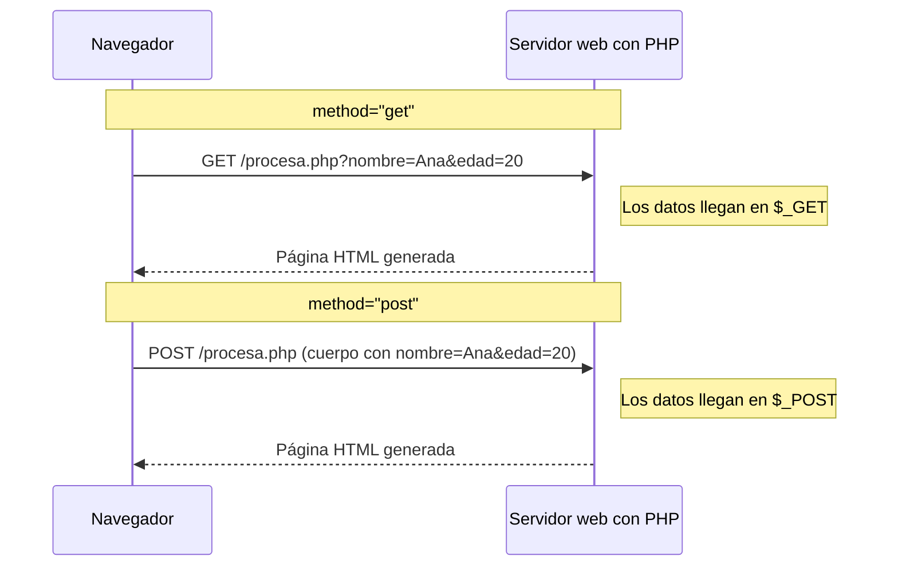
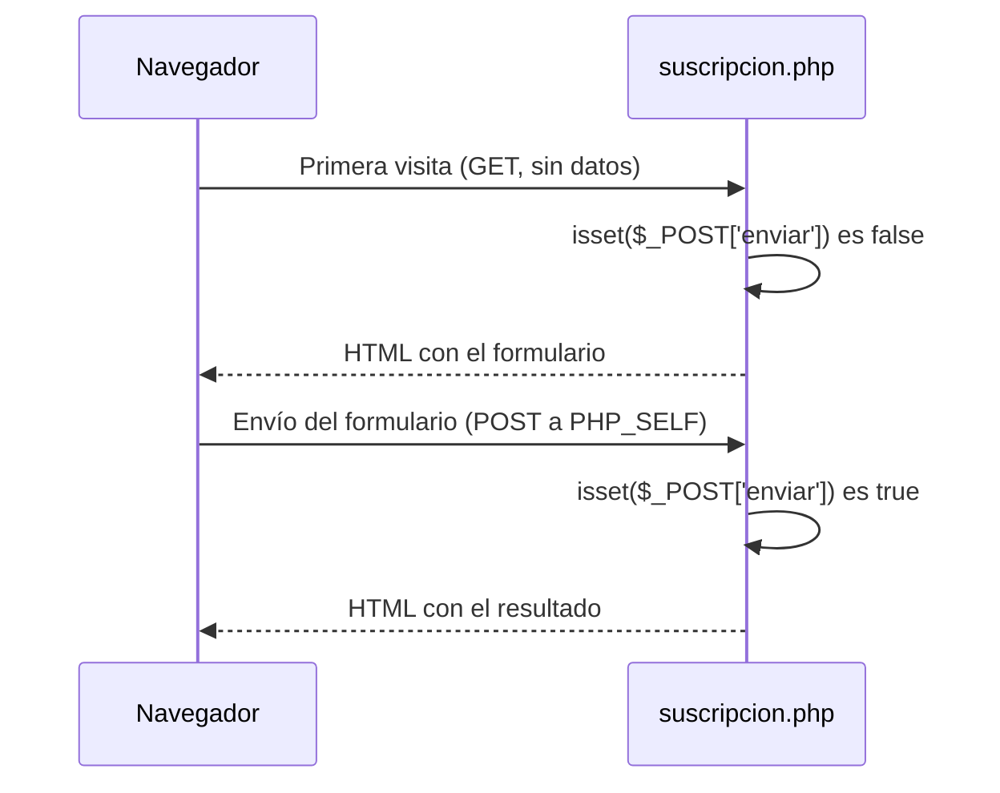
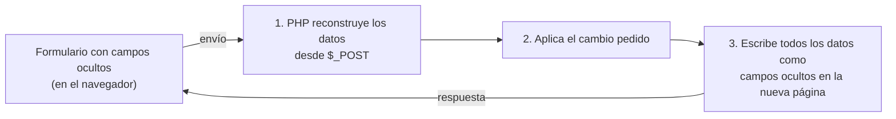
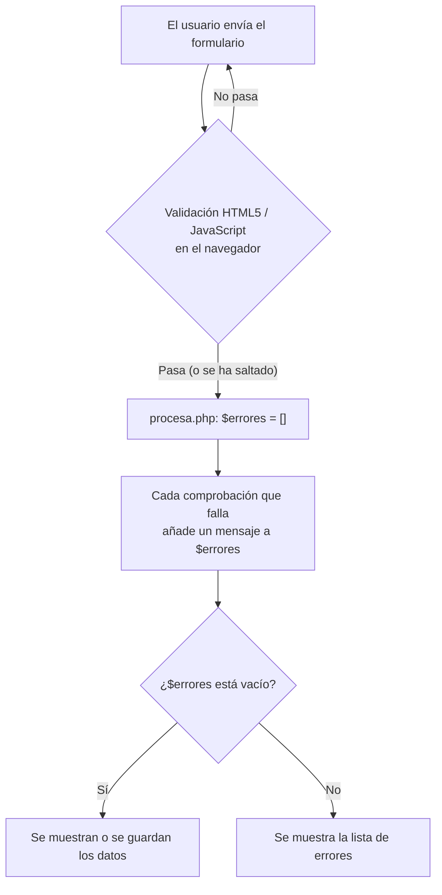
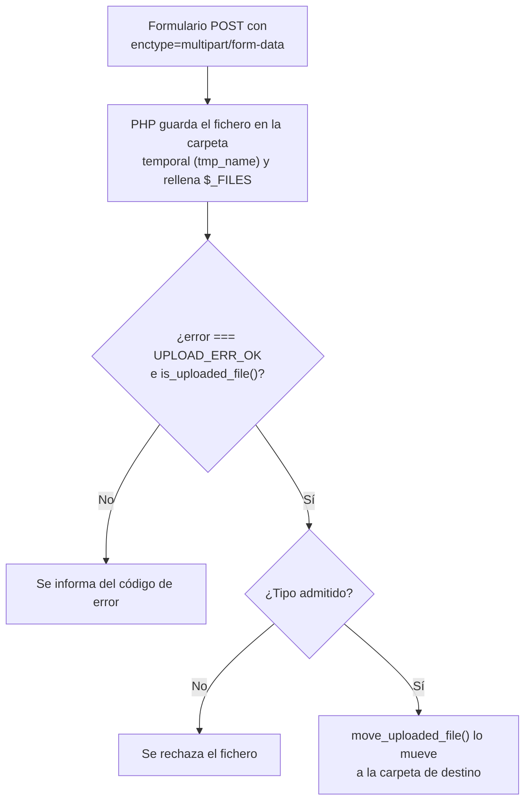

# Unidad 2. Características del lenguaje PHP

Esta unidad expone los elementos con los que se escribe un programa completo en PHP: cómo se genera la salida HTML, cómo se trabaja con cadenas, tipos, constantes y fechas, qué información ofrece el propio intérprete en sus variables superglobales, las estructuras de control, las funciones y la inclusión de ficheros, los arrays y, por último, los formularios web, que son el medio por el que el usuario envía datos al programa.

La unidad se divide en cinco partes:

1. **Elementos del lenguaje**: salida (`echo`, `print`, `printf`), cadenas, funciones de tipos, constantes, fechas y variables superglobales.
2. **Estructuras de control**: condicionales y bucles.
3. **Funciones**: inclusión de ficheros externos, definición, argumentos y valor devuelto.
4. **Tipos de datos compuestos**: arrays, cómo se recorren y funciones para manejarlos.
5. **Formularios web**: envío por GET y POST, procesamiento, validación y subida de ficheros.

Se parte de lo visto en la unidad 1 (delimitadores `<?php ?>`, variables con `$`, tipos simples, operadores, `global` y `static`). La comparación con Java aparece allí donde ayuda: la sintaxis de PHP procede de C, igual que la de Java, y gran parte de lo que sigue resultará familiar; las diferencias importantes se señalan en recuadros **Analogía con Java**.

> **Sobre la vigencia del temario.** El temario está escrito para PHP 7. Algunas funciones que explica (`each()`, `strftime()`, el tercer parámetro de `define()`) han desaparecido o están obsoletas en PHP 8. Se exponen tal como las recoge; lo que ha cambiado se indica en recuadros **Contexto actual**.

---

## 1. Elementos del lenguaje PHP

Un programa PHP suele estar repartido en varias páginas, y una misma página puede contener **varios bloques de código**, cada uno entre sus delimitadores. Si un bloque genera salida, esta se inserta en el HTML **en el mismo punto** en que figura el bloque. Todos los bloques de una página forman un único programa: una variable asignada en el primero conserva su valor en los siguientes.

```php
<body>
<?php $a = 1; ?>           <!-- primer bloque -->
<p>Página de prueba</p>
<?php $b = $a; ?>          <!-- segundo bloque: $a sigue valiendo 1 -->
</body>
```

**Organización de los proyectos.** Cada ejercicio o proyecto se guarda en una carpeta dentro de la raíz que sirve el servidor web y se abre como carpeta en el IDE:

| Plataforma | Carpeta | URL |
|---|---|---|
| Linux con `public_html` (unidad 1) | `~/public_html/tema2/` | `http://localhost/~usuario/tema2/` |
| Windows con XAMPP | `C:\xampp\htdocs\tema2\` | `http://localhost/tema2/` |

En Visual Studio Code, escribir `html` al comienzo de un fichero `.htm` o `.php` vacío y aceptar la sugerencia genera una plantilla HTML5 completa.

**Ficheros que solo contienen PHP.** Cuando un fichero no contiene HTML (por ejemplo, uno de funciones que se incluye en otros), se recomienda **no cerrar el bloque con `?>`**. Así se evita que un espacio o un salto de línea después del cierre se envíe al navegador como salida no deseada.

```php
<?php // fichero utilidades.php: solo PHP, sin cierre
function saludo($nombre) {
    return "Hola, $nombre";
}
```

### 1.1 Generación de código HTML

Hay varias formas de introducir en la página el resultado de ejecutar PHP.

| Construcción | Parámetros | Devuelve | Uso |
|---|---|---|---|
| **`echo`** | Uno o varios, separados por comas | Nada (`void`) | La forma más sencilla |
| **`print`** | **Solo uno** | **Siempre 1** | Igual que `echo`, pero puede usarse dentro de una expresión |
| **`printf`** | Una cadena de formato y los valores | La longitud de la salida | Salida con formato |
| **`sprintf`** | Igual que `printf` | **La cadena formateada**, sin mostrarla | Guardar el texto con formato en una variable |

`echo` y `print` **no son realmente funciones**, sino construcciones del lenguaje, de modo que los paréntesis no son obligatorios.

Por tanto, para **mostrar información en el navegador** sirven **`echo`, `print` y `printf`**; `sprintf` no muestra nada, solo devuelve la cadena.

```php
<?php
echo "PI: ", "3.1416";     // correcto: echo admite varios parámetros
echo "PI: " . "3.1416";    // correcto: un solo parámetro, resultado de concatenar
print "PI: " . "3.1416";   // correcto
print "PI: ", "3.1416";    // INCORRECTO: error de sintaxis, print solo admite un parámetro
?>
```

> **Error frecuente**: la línea incorrecta es **`print "PI: ","3.1416";`**. Con punto (concatenación) es un único parámetro y vale para los dos; con coma son dos parámetros y solo `echo` los admite.

> **Analogía con Java**: `echo` equivale a `System.out.print`; `printf` es el mismo `System.out.printf` de Java, con una sintaxis de formato casi idéntica, y `sprintf` equivale a `String.format`.

#### printf y los especificadores de conversión

`printf` (*print* con formato) recibe primero una **cadena de formato** y después los valores. La cadena contiene **un especificador de conversión por cada valor**, en el mismo orden.

```php
<?php
$ciclo = "DAW";
$modulo = "DWES";
printf("<p>%s es un módulo de %d curso de %s</p>", $modulo, 2, $ciclo);
// <p>DWES es un módulo de 2 curso de DAW</p>
?>
```

Cada especificador empieza por `%` y tiene estas partes, en este orden:

| Parte | Obligatoria | Qué indica | Cómo se escribe |
|---|---|---|---|
| **Signo** | No | Por defecto solo llevan signo los negativos; con `+`, también los positivos | `+` |
| **Relleno** | No | Carácter con que se completa el ancho: espacio (por defecto) o `0` | `0` |
| **Alineación** | No | Derecha (por defecto) o izquierda | `-` para la izquierda |
| **Ancho** | No | Número **mínimo** de caracteres de la salida | Un número |
| **Precisión** | No | Número de decimales de un número real | Un punto y un número: `.2` |
| **Tipo** | **Sí** | Cómo se trata el valor | Una letra de la tabla siguiente |

| Tipo | El valor se trata como | Y se presenta como |
|---|---|---|
| `b` | Entero | Número binario |
| `c` | Entero | El carácter con ese código ASCII |
| **`d`** | Entero | **Número entero con signo** (decimal) |
| **`u`** | Entero | **Número entero sin signo** |
| `o` | Entero | Número octal |
| `x` / `X` | Entero | Hexadecimal en minúsculas / mayúsculas |
| **`f`** | Doble | **Número real**, teniendo en cuenta la configuración regional |
| `F` | Doble | Número real, sin tener en cuenta la configuración regional |
| `e` / `E` | Doble | Notación científica con `e` / `E` (`1.2e+3`) |
| `g` / `G` | Doble | La forma más corta entre `%f` y `%e` / `%E` |
| **`s`** | Cadena | **Cadena de texto** |
| `%` | (sin valor) | El propio carácter `%` |

Ejemplos (la barra `|` marca dónde acaba la salida):

```php
<?php
printf("%d|", 42);        // 42|
printf("%5d|", 42);       //    42|   ancho 5, alineado a la derecha con espacios
printf("%-5d|", 42);      // 42   |   alineado a la izquierda
printf("%05d|", 42);      // 00042|   relleno con ceros
printf("%+d|", 42);       // +42|     signo también en positivos
printf("%.2f|", 3.14159); // 3.14|    dos decimales, con redondeo
printf("%b|", 5);         // 101|
printf("%X|", 255);       // FF|
printf("%c|", 65);        // A|
printf("%d%%|", 50);      // 50%|
?>
```

**Ejemplo resuelto**: ¿qué muestra `printf("PI vale %+07.3f", 3.1416);`?

1. `+`: el número lleva signo aunque sea positivo.
2. `0`: si falta ancho, se rellena con ceros.
3. `7`: la salida ocupa como mínimo 7 caracteres.
4. `.3`: tres decimales; 3.1416 se redondea a 3.142.
5. `+3.142` ocupa 6 caracteres; falta uno, que se rellena con un cero detrás del signo.

Resultado: **`PI vale +03.142`**.

**`sprintf` en lugar de `printf`.** Para mostrar una variable real con un número fijo de decimales **no hace falta `printf`**: **`sprintf("%.3f", $a)`** devuelve la cadena con tres decimales, que después se muestra con `echo` o se guarda.

```php
<?php
$txt_pi = sprintf("El número PI vale %+.2f", 3.1416);   // "El número PI vale +3.14"
echo $txt_pi;
?>
```

> **Ampliación**: además del `0` y el espacio, cualquier carácter puede servir de relleno si se precede de una comilla simple: `printf("%'*8s", "abc")` muestra `*****abc`. Para redondear sin formatear también existen `round($x, 2)` y `number_format($x, 2, ',', '.')`, que devuelve `1.234,57` a partir de `1234.567`.

### 1.2 Cadenas de texto

En PHP las cadenas pueden ir entre **comillas simples** o **comillas dobles**, y la diferencia es importante:

| | Comillas simples `'...'` | Comillas dobles `"..."` |
|---|---|---|
| ¿Sustituye las variables por su valor? | **No** | **Sí** |
| Secuencias de escape | Solo **`\'`** (comilla simple) y **`\\`** (barra invertida) | `\\`, `\"`, `\n`, `\r`, `\t`, `\v`, `\f`, `\$`… pero **no `\'`** |
| ¿Hay que escapar la otra comilla? | **No**: `'Dijo "hola"'` es válida | **No**: `"It's"` es válida |

```php
<?php
$modulo = "DWES";
echo "<p>Módulo: $modulo</p>";   // <p>Módulo: DWES</p>
echo '<p>Módulo: $modulo</p>';   // <p>Módulo: $modulo</p>  (sin sustitución)
?>
```

**Secuencias de escape:**

| Secuencia | Resultado |
|---|---|
| `\\` | Barra invertida |
| `\'` | Comilla simple (**solo entre comillas simples**) |
| `\"` | Comilla doble |
| **`\n`** | **Avance de línea** (LF, código 10) |
| **`\r`** | **Retorno de carro** (CR, código 13) |
| **`\t`** | **Tabulador** horizontal (HT, código 9) |
| `\v` | Tabulador vertical (VT, código 11) |
| **`\f`** | **Avance de página** (FF, código 12) |
| `\$` | Signo del dólar (evita que se tome como variable) |

En consecuencia, **entre comillas dobles no es necesario escapar las comillas simples**, y **entre comillas simples no es necesario escapar las comillas dobles**: solo se escapa la comilla del mismo tipo que delimita la cadena.

> **Error frecuente**: dentro de comillas dobles, `\'` **no es una secuencia de escape**: se muestra tal cual, con la barra. `echo "It\'s";` muestra `It\'s`. Dentro de comillas simples, `\n` tampoco lo es: `echo 'a\nb';` muestra `a\nb`.

> **Error frecuente**: `\n` produce un salto de línea **en el código HTML generado**, no en la página que ve el usuario, porque el navegador trata los saltos de línea como espacios. Para un salto visible se escribe `<br>`.

**Llaves para delimitar la variable.** Cuando el nombre de la variable va pegado a otro texto, o es un elemento de un array, se encierra entre llaves para que PHP sepa dónde acaba:

```php
<?php
$fruta = "manzana";
$datos = ["nombre" => "Ana"];
echo "Dos {$fruta}s";               // Dos manzanas  ("$frutas" buscaría una variable $frutas)
echo "Hola, {$datos['nombre']}";    // Hola, Ana
echo "Hola, $datos[nombre]";        // Hola, Ana     (sin llaves, la clave va sin comillas)
?>
```

> **Error frecuente**: `"Hola, $datos['nombre']"`, con la clave entre comillas y sin llaves, es un **error de sintaxis**. Con un elemento de array dentro de comillas dobles se usan llaves: `"{$datos['nombre']}"`.

> **Contexto actual**: el temario usa también la forma `"${modulo}"`. Desde PHP 8.2 está obsoleta y genera un aviso; la forma vigente es `"{$modulo}"`.

**Operadores de cadena.** PHP tiene dos operadores propios de las cadenas:

- **Concatenación**, el punto `.`: une dos cadenas.
- **Asignación con concatenación**, `.=`: añade al final de la variable de la izquierda la cadena de la derecha.

```php
<?php
$a = "Módulo ";
$b = $a . "DWES";   // $b contiene "Módulo DWES"
$a .= "DWES";       // $a también contiene "Módulo DWES"
?>
```

> **Analogía con Java**: en Java se concatena con `+`; en PHP **`+` es siempre suma aritmética**. `"3" + "4"` vale 7 (convierte las cadenas a número) y `"3" . "4"` vale `"34"`.

**Sintaxis heredoc.** Para cadenas largas de varias líneas se escribe `<<<` seguido de un identificador elegido; la cadena empieza en la línea siguiente, sin comillas, y termina con una línea que contiene **solo ese identificador**, como mucho seguido de un punto y coma. El texto se procesa **como si estuviera entre comillas dobles**: se sustituyen variables y secuencias de escape. Si el identificador de apertura va **entre comillas simples**, no se realiza ninguna sustitución (esta variante se llama *nowdoc*).

```php
<?php
$alumno = "Lucía";
$ficha = <<<FICHA
Alumna: $alumno<br>
Ciclo: Desarrollo de Aplicaciones Web
FICHA;
echo $ficha;            // Alumna: Lucía<br>Ciclo: ...

$plantilla = <<<'TXT'
El precio es $precio
TXT;
echo $plantilla;        // El precio es $precio  (nowdoc: sin sustitución)
?>
```

> **Contexto actual**: el temario dice que la línea de cierre no puede llevar ni siquiera espacios o sangría. Era así hasta PHP 7.2; desde PHP 7.3 el identificador de cierre puede ir sangrado, y esa sangría se elimina de todas las líneas de la cadena. Lo seguro, y lo que vale para ambas versiones, es escribirlo al principio de la línea.

#### Ampliación: funciones de cadena más usadas

El temario no las recoge, pero aparecen en cualquier programa:

| Función | Qué hace | Ejemplo | Resultado |
|---|---|---|---|
| `strlen($s)` | Longitud en bytes | `strlen("hola")` | `4` |
| `trim($s)` | Quita espacios al principio y al final | `trim("  ana ")` | `"ana"` |
| `strtoupper` / `strtolower` | Mayúsculas / minúsculas | `strtoupper("dwes")` | `"DWES"` |
| `ucfirst($s)` | Primera letra en mayúscula | `ucfirst("lunes")` | `"Lunes"` |
| `substr($s, $inicio, $long)` | Subcadena | `substr("servidor", 0, 4)` | `"serv"` |
| `str_replace($busca, $pon, $s)` | Reemplaza | `str_replace("a", "o", "casa")` | `"coso"` |
| `strpos($s, $busca)` | Posición, o `false` | `strpos("hola", "la")` | `2` |
| `explode($sep, $s)` | Cadena a array | `explode(",", "a,b")` | `["a", "b"]` |
| `implode($sep, $array)` | Array a cadena | `implode("-", ["a", "b"])` | `"a-b"` |

Una cadena también se puede tratar como un array de caracteres: `$s[0]` es el primero (apartado 4.1).

> **Error frecuente**: `strlen` cuenta **bytes**, no letras. En UTF-8, `strlen("año")` vale 4, porque la `ñ` ocupa dos bytes. Para contar caracteres está `mb_strlen("año")`, que vale 3 (extensión mbstring).

### 1.3 Funciones relacionadas con los tipos de datos

PHP ofrece funciones para **consultar** y **cambiar** el tipo de una variable.

- **`gettype($v)`** devuelve una cadena con el tipo: `"boolean"`, `"integer"`, `"double"` (los reales), `"string"`, `"array"`, `"object"`, `"resource"`, `"NULL"` o `"unknown type"`.
- **`is_array()`, `is_bool()`, `is_float()`, `is_integer()`, `is_null()`, `is_numeric()`, `is_object()`, `is_resource()`, `is_scalar()`, `is_string()`** devuelven `true` si la variable es del tipo indicado. `is_numeric` es especial: devuelve `true` también con una cadena que represente un número (`is_numeric("3.5")` es `true`).
- **`settype($v, "tipo")`** convierte la variable al tipo indicado (`"boolean"`, `"integer"`, `"float"`, `"string"`, `"array"`, `"object"` o `"null"`) y devuelve `true` si la conversión se ha hecho, o `false` si no.

```php
<?php
$a = $b = "3.1416";     // las dos variables reciben la misma cadena
settype($b, "float");   // $b pasa a ser un número real
print "\$a vale $a y es de tipo " . gettype($a);   // $a vale 3.1416 y es de tipo string
print "<br>";
print "\$b vale $b y es de tipo " . gettype($b);   // $b vale 3.1416 y es de tipo double
?>
```

`\$a` dentro de comillas dobles muestra el texto `$a` en lugar de su valor. Y aunque se convierta a `"float"`, `gettype` responde `"double"`: es el nombre histórico del mismo tipo.

**Definida, nula o vacía.** Tres funciones parecidas que no significan lo mismo:

- **`isset($v)`**: `true` si la variable **está definida y no es `null`**.
- **`unset($v)`**: **destruye** la variable o variables que recibe; después, `isset` devuelve `false`.
- **`empty($v)`**: `true` si la variable **se considera vacía** por su valor: no definida, `null`, `false`, **`0`**, `0.0`, `""`, **`"0"`** o un array vacío.

| Valor de `$v` | `isset($v)` | `empty($v)` | `is_null($v)` |
|---|---|---|---|
| No definida | `false` | `true` | `true` (con aviso) |
| `null` | `false` | `true` | `true` |
| `0` | `true` | **`true`** | `false` |
| `"0"` | `true` | **`true`** | `false` |
| `""` | `true` | `true` | `false` |
| `"hola"` | `true` | `false` | `false` |
| `[]` | `true` | `true` | `false` |

Así, para saber si una variable **se considera vacía (por ejemplo, cuando su valor es cero)**, la función es **`empty()`**.

> **Error frecuente**: usar `empty` para comprobar si un campo de formulario se ha rellenado. Si el usuario escribe `0` (una cantidad, una nota), `empty` lo da por vacío. Para comprobar que una cadena no está en blanco es más seguro `trim($v) === ''`.

**Constantes.** La función **`define()`** crea una constante: un identificador con un valor que no cambia durante la ejecución.

```php
bool define(string $identificador, mixed $valor [, bool $case_insensitive = false])
```

- El identificador **no va precedido de `$`** y **suele escribirse en mayúsculas**.
- Solo admite valores de tipo **integer, float, string, boolean y null**.
- El tercer parámetro, si vale `true`, hace que la constante se reconozca en mayúsculas o en minúsculas indistintamente.

```php
<?php
define("IVA", 0.21);
define("TIENDA", "Ferretería Pérez");
echo TIENDA . ": IVA del " . IVA * 100 . " %";   // Ferretería Pérez: IVA del 21 %
?>
```

> **Error frecuente**: escribir `$IVA`. Las constantes **no llevan `$`**; `$IVA` sería una variable distinta, sin definir.

> **Analogía con Java**: equivale a `static final double IVA = 0.21;`.

> **Contexto actual**: el tercer parámetro de `define` está obsoleto desde PHP 7.3 y en PHP 8 ya no tiene efecto: el ejemplo del temario `define("PI", 3.1416, true); print pi;` produce en PHP 8 el error *Undefined constant "pi"*. Desde PHP 7, `define` admite también arrays. Además existe la palabra clave **`const`** (`const IVA = 0.21;`), equivalente a `define` en el nivel superior del fichero y la única forma de declarar constantes dentro de una clase.

**Ejemplo resuelto**: ¿qué muestra este código?

```php
<?php
$a = "-3.1416";
printf("La variable \'\$a\' vale %+.2f", $a);
?>
```

1. La cadena va entre comillas dobles: `\'` no es secuencia de escape y se muestra tal cual, con la barra; `\$` sí lo es y muestra `$`.
2. `%+.2f` convierte la cadena `"-3.1416"` en número y la muestra con signo y dos decimales: `-3.14`. El `+` solo obliga a poner signo a los positivos; un negativo lo lleva siempre.

Resultado: **`La variable \'$a\' vale -3.14`**.

#### 1.3.1 Funciones de fecha I

**En PHP no existe un tipo de datos específico para fechas y horas.** Internamente, una fecha y hora se almacena como un **número entero**: la *marca de tiempo* (*timestamp*), el número de segundos transcurridos desde el 1 de enero de 1970 a las 00:00:00 UTC.

**`date($formato [, $marca])`** devuelve una cadena con la fecha formateada. Si no se pasa la marca de tiempo, usa **la fecha y hora actuales**.

| Carácter | Resultado | Carácter | Resultado |
|---|---|---|---|
| `d` | Día del mes, dos dígitos (`03`) | `j` | Día del mes sin ceros (`3`) |
| `z` | Día del año, desde 0 (0 = 1 de enero) | `t` | Número de días del mes |
| `N` | Día de la semana (1 = lunes … 7 = domingo) | `w` | Día de la semana (0 = domingo … 6 = sábado) |
| `l` | Día de la semana en inglés (`Monday`) | `D` | Día de la semana, tres letras (`Mon`) |
| `W` | Número de la semana del año | `L` | 1 si el año es bisiesto, 0 si no |
| `m` | Mes, dos dígitos (`06`) | `n` | Mes sin ceros (`6`) |
| `F` | Nombre del mes en inglés (`June`) | `M` | Nombre del mes, tres letras (`Jun`) |
| `Y` | Año con cuatro dígitos | `y` | Dos últimos dígitos del año |
| `H` | Hora de 0 a 23, dos dígitos | `G` | Hora de 0 a 23, sin ceros |
| `h` | Hora de 1 a 12, dos dígitos | `g` | Hora de 1 a 12, sin ceros |
| `i` | Minutos, dos dígitos | `s` | Segundos, dos dígitos |
| `a` | `am` o `pm` | `A` | `AM` o `PM` |
| `u` | Microsegundos | `r` | Fecha completa en formato RFC 2822 |

Cualquier otro carácter del formato (`/`, `-`, `:`, espacios) se copia tal cual.

**Zona horaria.** Para que la hora sea la correcta hay que indicar la zona horaria con **`date_default_timezone_set()`**. Si no se establece, PHP usa la de `php.ini` (directiva `date.timezone`) o, en su defecto, UTC. Fijando la zona de cualquier lugar, **`date()` da la hora actual en ese lugar del mundo**:

```php
<?php
date_default_timezone_set('Europe/Madrid');      // España peninsular
echo date("d/m/Y H:i");                          // hora de Madrid
date_default_timezone_set('Australia/Sydney');
print date("d/m/Y H:i");                         // la hora en ese momento en Sídney
?>
```

**Nombres en español.** `date()` escribe siempre los nombres de días y meses **en inglés**, porque **no tiene en cuenta la configuración regional** (los *locales*). La configuración regional se fija con `setlocale(LC_ALL, 'es_ES.UTF-8');`, y la función que sí la respeta es **`strftime()`**, con su propio formato (`%A` día de la semana, `%d` día, `%B` mes, `%Y` año, `%H:%M:%S` hora).

```php
<?php
setlocale(LC_ALL, 'es_ES.UTF-8');
date_default_timezone_set('Europe/Madrid');
echo strftime("Hoy es %A, %d de %B de %Y");   // p. ej.: Hoy es viernes, 13 de noviembre de 2026
?>
```

**Otras funciones de fecha:**

- **`getdate()`** devuelve **un array** con la información de la fecha y hora actuales (o de una marca dada): claves `seconds`, `minutes`, `hours`, `mday`, `wday`, `mon`, `year`, `yday`, `weekday`, `month` y `0` (la marca).
- **`mktime($hora, $min, $seg, $mes, $dia, $anio)`** hace el camino inverso a `date`: a partir de los componentes **devuelve la marca de tiempo**, es decir, **la representación interna** de esa fecha. Ojo al orden: hora, minuto, segundo, **mes, día**, año.
- **`checkdate($mes, $dia, $anio)`** devuelve `true` si la fecha existe: `checkdate(2, 29, 2024)` es `true` y `checkdate(2, 30, 2024)`, `false`.

**Ejemplo resuelto**: la representación interna de "23/12/2011 17:15:53" se obtiene con **`mktime(17, 15, 53, 12, 23, 2011)`**. Con esa marca, `date` puede mostrar cualquier dato de la fecha:

```php
<?php
date_default_timezone_set('Europe/Madrid');
$t = mktime(17, 15, 53, 12, 23, 2011);
echo date("d/m/Y H:i:s", $t);   // 23/12/2011 17:15:53
echo date("l, j F Y", $t);      // Friday, 23 December 2011
echo date("N w z t L", $t);     // 5 5 356 31 0
echo date("g:i a", $t);         // 5:15 pm
?>
```

> **Error frecuente**: `date("23/12/2011 17:15:53")` no interpreta nada: trata cada carácter como código de formato (`2` y `3` se copian, `/` también…). Y `getdate` no recibe los componentes de una fecha: recibe, como mucho, una marca de tiempo.

> **Contexto actual**: `strftime()` está obsoleta desde PHP 8.1. La alternativa oficial es la clase `IntlDateFormatter` (extensión intl). Otra opción, sin dependencias, es traducir con arrays propios, como en el ejemplo siguiente.

```php
<?php
$dias  = ['domingo', 'lunes', 'martes', 'miércoles', 'jueves', 'viernes', 'sábado'];
$meses = ['', 'enero', 'febrero', 'marzo', 'abril', 'mayo', 'junio', 'julio',
          'agosto', 'septiembre', 'octubre', 'noviembre', 'diciembre'];
$t = mktime(0, 0, 0, 6, 3, 2020);
echo $dias[date('w', $t)] . ' ' . date('j', $t) . ' de ' . $meses[date('n', $t)] . ' de ' . date('Y', $t);
// miércoles 3 de junio de 2020
?>
```

`date('w')` devuelve el número del día de la semana (0 = domingo), que sirve directamente de índice del array `$dias`; `date('n')`, el número del mes, de ahí el elemento vacío en la posición 0 de `$meses`.

#### 1.3.2 Funciones de fecha II

Desde PHP 5.2 existe la clase **`DateTime`**, más potente y cómoda que las funciones anteriores para crear fechas y convertirlas entre formatos. Es especialmente útil con las bases de datos, porque MySQL guarda las fechas como `'Y-m-d'` (`2020-12-31`) y en España se muestran como `'d/m/Y'` (`31/12/2020`).

| Operación | Estilo de funciones | Estilo de objetos |
|---|---|---|
| Fecha y hora actuales | `date_create()` | `new DateTime()` |
| Crear desde una cadena con formato conocido | `date_create_from_format('Y-m-d', '2020-12-31')` | `DateTime::createFromFormat('Y-m-d', '2020-12-31')` |
| Crear desde una cadena estándar o relativa | `date_create("yesterday")` | `new DateTime("2020-12-31")`, `new DateTime("last Monday")` |
| Pasar a cadena con formato | `date_format($f, 'd/m/Y')` | `$f->format('d/m/Y')` |
| Obtener la marca de tiempo | `date_timestamp_get($f)` | `$f->getTimestamp()` |

```php
<?php
date_default_timezone_set('Europe/Madrid');
$deBD  = "2020-12-31";                                   // como llega de MySQL
$fecha = DateTime::createFromFormat('Y-m-d', $deBD);
echo $fecha->format('d/m/Y');                            // 31/12/2020

$ayer = new DateTime("yesterday");                       // formatos relativos en inglés
$lunes = new DateTime("last Monday");
var_dump($ayer);                                         // muestra el objeto completo
echo "<br>Marca de tiempo: " . date_timestamp_get(new DateTime());
?>
```

**Recomendación**: al comienzo de cada fichero que trabaje con fechas se fijan la zona horaria y la configuración regional:

```php
<?php
setlocale(LC_ALL, 'es_ES.UTF-8');
date_default_timezone_set('Europe/Madrid');
?>
```

> **Analogía con Java**: `DateTime` cumple el papel de `java.time.LocalDateTime`, y `format('d/m/Y')` el de `DateTimeFormatter.ofPattern("dd/MM/yyyy")`. Los códigos de formato son distintos: en PHP es una letra por campo.

> **Ampliación**: la diferencia entre dos fechas se calcula con `diff`: `$a->diff($b)->days` devuelve el número de días entre ambas.

### 1.4 Variables especiales de PHP

PHP incluye unas variables internas predefinidas que se pueden usar **desde cualquier ámbito**, incluso dentro de una función **sin declararlas `global`**. Por eso se llaman **variables superglobales**. Todas son **arrays**.

| Variable | Contenido |
|---|---|
| **`$_SERVER`** | Información del servidor web y del entorno de ejecución |
| **`$_GET`** | Variables recibidas por el método **GET** (parámetros en la URL) |
| **`$_POST`** | Variables recibidas por el método **POST** |
| **`$_COOKIE`** | Variables recibidas en cookies |
| **`$_REQUEST`** | Une en uno solo el contenido de `$_GET`, `$_POST` y `$_COOKIE` |
| **`$_ENV`** | **Variables de entorno** pasadas a PHP desde el entorno en que se ejecuta |
| **`$_FILES`** | Ficheros subidos al servidor con el método POST |
| **`$_SESSION`** | **Variables de sesión** disponibles para el guion actual |
| **`$GLOBALS`** | Referencias a todas las variables del ámbito global; las claves son sus nombres |

Valores principales de `$_SERVER`:

| Clave | Contenido |
|---|---|
| **`$_SERVER['PHP_SELF']`** | **Guion que se está ejecutando** (ruta desde la raíz web: `/tema2/agenda.php`) |
| `$_SERVER['SERVER_ADDR']` | Dirección IP del servidor |
| `$_SERVER['SERVER_NAME']` | Nombre del servidor |
| **`$_SERVER['DOCUMENT_ROOT']`** | **Directorio raíz** bajo el que se ejecuta el guion actual (`/var/www/html`) |
| `$_SERVER['REMOTE_ADDR']` | IP desde la que el usuario ve la página |
| `$_SERVER['REQUEST_METHOD']` | Método de la petición: `'GET'`, `'HEAD'`, `'POST'` o `'PUT'` |

```php
<?php
function infoPeticion() {
    // no hace falta "global": las superglobales se ven en todas partes
    return "Pedida por " . $_SERVER['REMOTE_ADDR'] . " con " . $_SERVER['REQUEST_METHOD'];
}
echo infoPeticion();
?>
```

> **Analogía con Java**: en un servlet, esta información se obtiene del objeto `HttpServletRequest` (`request.getParameter("x")`, `request.getMethod()`). En PHP está ya cargada en estos arrays antes de que empiece el guion.

---

## 2. Estructuras de control

Los guiones PHP se construyen con **sentencias**. Con **llaves** se agrupan varias en un bloque, que se comporta como una sola. Hay dos tipos de estructuras de control, iguales que en Java:

- **Condicionales**: deciden si se ejecuta una sentencia o un bloque.
- **Bucles**: repiten una sentencia o un bloque mientras se cumpla una condición.

PHP tiene además la sentencia **`goto`**, que salta a una etiqueta del programa. **No se recomienda**, porque hace el código difícil de seguir.

```php
<?php
$a = 1;
goto salto;
$a++;          // esta sentencia no se ejecuta
salto:
echo $a;       // 1
?>
```

### 2.1 Condicionales

**`if` / `elseif` / `else`.** Si la expresión se evalúa a `true`, se ejecuta la sentencia; si no, la del `else`. `elseif` (una sola palabra) encadena una nueva condición.

```php
<?php
$nota = 6.5;
if ($nota < 5) {
    echo "Suspenso";
} elseif ($nota < 7) {
    echo "Aprobado";        // se muestra este
} elseif ($nota < 9) {
    echo "Notable";
} else {
    echo "Sobresaliente";
}
?>
```

Si cada rama tiene **una sola sentencia**, las llaves no son obligatorias; con más de una, sí.

**`switch`.** Compara **una misma variable** con varios valores, cada uno en un `case`. Cuando encuentra una coincidencia, **ejecuta las sentencias siguientes hasta el final del `switch` o hasta un `break`**: sin `break`, sigue ejecutando los `case` posteriores. Si ningún `case` coincide, se ejecuta el bloque `default`, si existe.

```php
<?php
$dia = 6;
switch ($dia) {
    case 6:
    case 7:
        echo "Fin de semana";   // 6 y 7 comparten código
        break;
    case 5:
        echo "Viernes";
        break;
    default:
        echo "Laborable";
}
?>
```

**Una sentencia `switch` siempre se puede sustituir por una o varias sentencias `if`**: cada `case` equivale a una condición que compara la variable con la constante correspondiente. Lo contrario no siempre es posible, porque `switch` solo compara igualdades.

**Ejemplo resuelto**: ¿qué muestra este `switch` según el valor de `$a`?

```php
switch ($a) {
    case 0: print "0";
    case 1: print "1";
    default: print "2";
}
```

Al no haber ningún `break`, la ejecución continúa desde el `case` que coincide hasta el final:

| `$a` | Empieza en | Salida |
|---|---|---|
| 0 | `case 0` | **`012`** |
| 1 | `case 1` | **`12`** |
| 3 | `default` | **`2`** |

> **Analogía con Java**: `if`, `else` y `switch` funcionan igual que en Java, con la misma "caída" entre `case` sin `break`. Diferencias: en PHP se escribe `elseif` junto (también vale `else if`), y `switch` compara con `==`, es decir, sin tener en cuenta el tipo.

> **Contexto actual**: PHP 8 añade la expresión `match`, que compara con `===`, no necesita `break` y devuelve un valor: `$tipo = match($motor) { 1 => "gasolina", 2 => "diésel", default => "otro" };`.

**Ejemplo resuelto** (análogo al del temario): según la variable `$talla` (`1` = S, `2` = M, `3` = L), mostrar su nombre, con `if` y con `switch`.

```php
<?php
$talla = 2;
// con if
if ($talla == 1) {
    echo "Talla S<br>";
} elseif ($talla == 2) {
    echo "Talla M<br>";
} elseif ($talla == 3) {
    echo "Talla L<br>";
} else {
    echo "Talla no válida<br>";
}
// con switch
switch ($talla) {
    case 1:
        echo "Talla S<br>";
        break;
    case 2:
        echo "Talla M<br>";
        break;
    case 3:
        echo "Talla L<br>";
        break;
    default:
        echo "Talla no válida<br>";
}
?>
```

> **Ampliación**: en páginas con mucho HTML se usa la **sintaxis alternativa**, que sustituye la llave de apertura por `:` y la de cierre por `endif;`, `endforeach;`, `endwhile;`… Es más legible cuando el bloque PHP se corta para escribir HTML:
>
> ```php
> <?php if ($hayDatos): ?>
>     <p>Hay datos.</p>
> <?php else: ?>
>     <p>No hay datos.</p>
> <?php endif; ?>
> ```

### 2.2 Bucles

| Bucle | Cuándo se evalúa la condición | Mínimo de ejecuciones | Uso típico |
|---|---|---|---|
| **`while`** | **Antes** de cada iteración | **0** | Repetir mientras se cumpla algo, sin saber cuántas veces |
| **`do … while`** | **Al final** de cada iteración | **1** | Cuando el cuerpo tiene que ejecutarse al menos una vez |
| **`for`** | Antes de cada iteración | 0 | Cuando se conoce el número de repeticiones |
| **`foreach`** | (recorre un array) | 0 | Recorrer arrays (apartado 4.1) |

```php
<?php
$a = 1;
while ($a < 8) {
    $a += 3;
}
echo $a;      // 10  (1 → 4 → 7 → 10)

$a = 5;
do {
    $a -= 3;
} while ($a > 10);
print $a;     // 2   (el cuerpo se ejecuta una vez aunque la condición sea falsa desde el principio)
?>
```

**Elección entre `while` y `do … while`.** Para mostrar una cadena letra a letra sin saber si está vacía se usa **`while`**: comprueba la condición antes de la primera vuelta y, si la cadena está vacía, no hace nada. Un `do … while` ejecutaría el cuerpo una vez e intentaría mostrar una letra que no existe.

```php
<?php
$texto = "PHP";
$i = 0;
while ($i < strlen($texto)) {
    echo $texto[$i] . "<br>";    // P, H, P, una por línea
    $i++;
}
?>
```

**`for`.** Igual que en C y en Java, tiene tres expresiones:

```php
for (expr1; expr2; expr3) {
    sentencias;
}
```

| Expresión | Cuándo se ejecuta | Para qué |
|---|---|---|
| **La primera** (`expr1`) | **Solo una vez, al comienzo del bucle** | Inicializar el contador |
| **La segunda** (`expr2`) | Antes de cada iteración | **Se evalúa para saber si se debe volver a ejecutar el bucle**: si es `false`, termina |
| **La tercera** (`expr3`) | **En cada iteración**, al final del cuerpo | Actualizar el contador |

```php
<?php
for ($a = 5; $a < 10; $a += 3) {
    print $a . "<br>";      // 5 y 8
}
?>
```

Como la tercera expresión se ejecuta al terminar cada vuelta, **podría ubicarse igualmente como última instrucción del cuerpo del bucle** con el mismo efecto. El `for` anterior equivale a:

```php
<?php
for ($a = 5; $a < 10; ) {
    print $a . "<br>";
    $a += 3;                // la tercera expresión, movida al final del cuerpo
}
?>
```

> **Error frecuente**: la equivalencia deja de ser exacta si el cuerpo contiene `continue`. En un `for`, `continue` salta a la tercera expresión; si se ha movido al cuerpo, `continue` se la salta y el contador no avanza.

**`break` y `continue`.** Un bucle **finaliza cuando no se cumple su condición** o **cuando se ejecuta `break`**. No existe una sentencia `end` para salir de un bucle (`end()` es una función de arrays, apartado 4.2).

- **`break`** sale del bucle (o del `switch`) inmediatamente.
- **`continue`** omite el resto del cuerpo y **hace que se compruebe la condición del bucle actual para evaluar si se debe ejecutar una nueva iteración**. No fuerza una nueva iteración: si la condición ya es falsa, el bucle termina.
- Los dos aceptan un **argumento numérico opcional**: `break 2` sale de dos bucles anidados; `continue 2` salta a la siguiente iteración del bucle que contiene al actual.

```php
<?php
for ($i = 1; $i <= 10; $i++) {
    if ($i % 2 == 0) continue;   // salta los pares
    if ($i > 7) break;           // al llegar a 9, sale
    echo $i . " ";               // 1 3 5 7
}

for ($fila = 1; $fila <= 3; $fila++) {
    for ($col = 1; $col <= 3; $col++) {
        if ($fila * $col == 4) break 2;   // sale de los DOS bucles
        echo "$fila×$col ";              // 1×1 1×2 1×3 2×1
    }
}
?>
```

> **Analogía con Java**: `while`, `do … while`, `for`, `break` y `continue` son idénticos. Lo que cambia es la salida de bucles anidados: Java usa etiquetas (`break externo;`) y PHP un número (`break 2;`).

---

## 3. Funciones

Una función asocia un **nombre** a un bloque de código, que se ejecuta cada vez que se llama. Ayuda a estructurar el programa, y sus variables son **locales**: no son visibles fuera de ella (unidad 1).

Gran parte de la potencia de PHP está en las **funciones que ya trae**. Muchas forman parte del núcleo; otras se agrupan en **extensiones** que hay que activar con una directiva `extension` en `php.ini` o, si no vienen con la distribución, descargar e instalar.

| Plataforma | Extensiones |
|---|---|
| XAMPP | Vienen todas habilitadas |
| Linux (Ubuntu) | Se instalan según se necesitan: `sudo apt install php-mbstring` (el paquete suele llamarse `php-nombre`). Para buscarlas: `apt-cache search php8.3-*` (con la versión instalada) |

### 3.1 Inclusión de ficheros externos

Cuando el programa crece, conviene agrupar funciones o bloques de código en ficheros aparte y hacer que PHP **incluya su contenido** en el programa actual. Hay cuatro sentencias:

| Sentencia | Si el fichero no existe | Si ya se había incluido |
|---|---|---|
| **`include`** | Da un **aviso** (*warning*) y **continúa** | Lo incluye otra vez |
| **`include_once`** | Aviso y continúa | **No lo vuelve a incluir** |
| **`require`** | **Error fatal: detiene la ejecución** | Lo incluye otra vez |
| **`require_once`** | **Error fatal: detiene la ejecución** | **No lo vuelve a incluir** |

Así, la diferencia entre `require` y `require_once` **no** está en detener la ejecución, que hacen las dos, sino en que `require_once` **solo incluye el fichero una vez**. La variante `_once` evita errores como definir dos veces la misma función, pero es más lenta, porque comprueba cada vez los ficheros ya incluidos: no se debe abusar de ella.

El comportamiento de las cuatro sentencias se resume en dos preguntas:



**Dónde busca el fichero.** Puede indicarse una ruta absoluta, aunque lo habitual es una relativa. Con ruta relativa, PHP busca primero en las rutas de la directiva **`include_path`** de `php.ini`, después en el directorio del guion actual y en el directorio de ejecución.

**El fichero incluido empieza en modo HTML.** Al evaluar el fichero externo, PHP sale del modo PHP y trata su contenido como HTML. Por eso, **las sentencias PHP del fichero incluido deben ir delimitadas con `<?php` y `?>`** dentro de él. Por la misma razón, **`include` y `require` sirven para incluir el mismo encabezado HTML en varias páginas**: no hace falta que el fichero externo contenga PHP.

```php
<!-- cabecera.inc.php: solo HTML -->
<header>
    <h1>Ferretería Pérez</h1>
    <nav><a href="index.php">Inicio</a> | <a href="catalogo.php">Catálogo</a></nav>
</header>
```

```php
<?php // config.inc.php: solo PHP, delimitado y sin cierre
$tienda = 'Ferretería Pérez';
$iva = 0.21;
```

```php
<!-- catalogo.php -->
<!DOCTYPE html>
<html lang="es">
<head><meta charset="UTF-8"><title>Catálogo</title></head>
<body>
<?php
echo "Tienda: $tienda<br>";       // aún no existe: muestra "Tienda: " y un aviso
require 'config.inc.php';         // a partir de aquí existen $tienda y $iva
include 'cabecera.inc.php';       // inserta el HTML de la cabecera
echo "IVA aplicado: " . $iva * 100 . " %";   // IVA aplicado: 21 %
?>
</body>
</html>
```

El contenido incluido se inserta **en el punto exacto** de la llamada: antes de ella, sus variables no existen. Muchos programadores usan la doble extensión **`.inc.php`** para los ficheros que solo se incluyen y nunca se ejecutan por sí mismos; la terminación `.php` hace que, si alguien los pide directamente, el servidor los ejecute en lugar de mostrar su código.

> **Analogía con Java**: `include` **no es** `import`. `import` solo da acceso a clases; `include` copia literalmente el contenido del fichero en ese punto, como si se hubiera escrito allí.

### 3.2 Ejecución y creación de funciones

Una función se llama escribiendo su nombre y unos paréntesis: `phpinfo();`. Para crear una propia se usa la palabra **`function`**.

**En PHP no es obligatorio definir una función antes de usarla**: el intérprete lee todo el fichero antes de ejecutarlo y conoce todas las funciones definidas en el nivel superior. La excepción son las funciones **definidas de forma condicional** (dentro de un `if`): esas solo existen cuando se ejecuta la definición, así que la definición tiene que procesarse antes de cualquier llamada.

```php
<?php
echo doble(4);              // 8: la función está más abajo, pero no es condicional

function doble($n) {
    return $n * 2;
}

$conDescuento = true;
// aplicarDescuento(100);   // daría error: aún no se ha ejecutado el if que la define
if ($conDescuento) {
    function aplicarDescuento($precio) {
        return $precio * 0.9;
    }
}
echo aplicarDescuento(100); // 90: ya está definida
?>
```

> **Error frecuente**: "en PHP siempre hay que definir una función antes de usarla" es **falso**. Solo hace falta con las funciones definidas condicionalmente.

### 3.3 Argumentos

Usar variables globales dentro de una función (`global $precio;` o `$GLOBALS["precio"]`) funciona, pero no es buena práctica. Lo correcto es pasar los datos como **argumentos** y que la función **devuelva** el resultado con **`return`**, que termina la función y devuelve el valor indicado.

```php
<?php
function precioFinal($precio) {
    return $precio * 1.21;
}
$p = precioFinal(50);
echo "Precio con IVA: $p";   // Precio con IVA: 60.5
?>
```

- Los argumentos se escriben como una **lista de variables separadas por comas**. **No se indica su tipo**, ni **si la función devuelve un valor**: si no hay `return`, devuelve `null`.
- **Valores por defecto**: un argumento puede tener un valor por defecto, que se usa si la llamada no lo indica. **Los argumentos con valor por defecto tienen que ir a la derecha de todos los que no lo tienen.**
- **Paso por valor** (por defecto): los cambios que la función hace en el argumento no se ven fuera.
- **Paso por referencia**: se pone **`&` delante del nombre del parámetro** (`&$precio`), y los cambios sí se reflejan en la variable original.

```php
<?php
function precioFinal($precio, $iva = 0.21) {
    return $precio * (1 + $iva);
}
echo precioFinal(100);         // 121   ($iva toma el valor por defecto)
echo precioFinal(100, 0.10);   // 110   ($iva = 0.10)

function aplicarIva(&$precio, $iva = 0.21) {   // $precio por referencia
    $precio *= (1 + $iva);
}
$p = 100;
aplicarIva($p);
echo $p;                       // 121: la variable original ha cambiado
?>
```

**Ejemplo resuelto**: ¿está bien definida `function precio_final(&$precio, $iva=0.18, $aplicar_iva)`? **No**: el argumento opcional `$iva` está a la izquierda de `$aplicar_iva`, que no tiene valor por defecto. Una forma correcta sería `function precio_final(&$precio, $aplicar_iva, $iva = 0.18)`.

> **Contexto actual**: PHP no rechaza ese encabezado con un error fatal: PHP 8 lo acepta con un aviso de obsolescencia y trata `$iva` como obligatorio, porque su valor por defecto nunca podría usarse. La definición sigue siendo incorrecta.

> **Error frecuente**: el `&` va **delante del `$`**: `&$precio`. Escribir `function iva($&precio)` es un error de sintaxis, no un paso por referencia.

> **Error frecuente**: escribir el tipo devuelto delante, al estilo de Java (`float function precio_con_iva()`), es un error de sintaxis. Para devolver un valor con `return` **no hay que indicar ningún tipo**.

**Declaración de tipos (PHP 7 y posteriores).** De forma opcional, se pueden indicar el tipo de cada argumento y, **detrás de los paréntesis y con dos puntos**, el tipo devuelto:

```php
<?php
function precioFinal(float $precio, float $iva = 0.21): float {
    return $precio * (1 + $iva);
}
echo precioFinal(100);   // 121
?>
```

> **Analogía con Java**: en Java los tipos son obligatorios y van delante (`double precioFinal(double precio)`); en PHP son opcionales y el de retorno va detrás (`: float`). Java no tiene valores por defecto (se simulan sobrecargando el método) y PHP no admite sobrecarga: dos funciones con el mismo nombre dan error. Y Java pasa todo por valor; el `&` de PHP no tiene equivalente directo.

**Ejemplo resuelto** (análogo al de los números primos del temario): una función que devuelve si un número es perfecto (igual a la suma de sus divisores propios) y otra que muestra los perfectos hasta un límite, 1000 por defecto. Las funciones van en un fichero aparte que se incluye.

```php
<?php // numeros.inc.php
function esPerfecto($n) {
    if ($n < 2) return false;
    $suma = 1;                          // 1 divide a todos
    for ($d = 2; $d <= $n / 2; $d++) {
        if ($n % $d == 0) $suma += $d;
    }
    return $suma == $n;
}
```

```php
<?php // perfectos.php
require_once 'numeros.inc.php';

function mostrarPerfectos($limite = 1000) {
    for ($i = 1; $i <= $limite; $i++) {
        if (esPerfecto($i)) echo "$i<br>";
    }
}

mostrarPerfectos();       // 6, 28, 496
mostrarPerfectos(30);     // 6, 28
```

---

## 4. Tipos de datos compuestos

Un tipo compuesto almacena **más de un valor**. PHP tiene dos: el **array** y el **objeto** (este se estudia en la unidad 5).

Un **array** guarda varios valores, cada uno en una posición identificada por una **clave**. Las claves pueden ser **numéricas** o **asociativas** (cadenas), y pueden mezclarse en el mismo array.

```php
<?php
// array numérico (indexado)
$modulos1 = array(0 => "Programación", 1 => "Bases de datos", 2 => "Desarrollo web en entorno servidor");
// array asociativo
$modulos2 = array("PR" => "Programación", "BD" => "Bases de datos", "DWES" => "Desarrollo web en entorno servidor");

// sintaxis corta (desde PHP 5.4): [] en lugar de array()
$modulos1 = [0 => "Programación", 1 => "Bases de datos", 2 => "Desarrollo web en entorno servidor"];
$modulos2 = ["PR" => "Programación", "BD" => "Bases de datos", "DWES" => "Desarrollo web en entorno servidor"];

echo $modulos1[2];        // Desarrollo web en entorno servidor
echo $modulos2["DWES"];   // Desarrollo web en entorno servidor
?>
```

> **Analogía con Java**: un array de PHP no es un array de Java. Es a la vez un `ArrayList` y un `LinkedHashMap`: no tiene tamaño fijo, crece al añadir elementos, admite claves de texto y **conserva el orden de inserción**. No hay que declarar su tamaño ni su tipo.

**Ver el contenido sin recorrerlo.** Para depurar se usan **`print_r($array)`** y **`var_dump($array)`**; la segunda muestra además el tipo y la longitud de cada valor.

```php
<?php
$p = ["nombre" => "Ana", "edad" => 20];
print_r($p);
// Array
// (
//     [nombre] => Ana
//     [edad] => 20
// )
var_dump($p);
// array(2) {
//   ["nombre"]=>
//   string(3) "Ana"
//   ["edad"]=>
//   int(20)
// }
?>
```

En el navegador, estos saltos de línea no se ven: se envuelve la llamada en `echo "<pre>"; … echo "</pre>";` para respetarlos.

**Arrays multidimensionales.** Cada elemento puede ser a su vez un array. Para acceder se indica una clave por dimensión:

```php
<?php
$ciclos = [
    "DAW" => ["PR" => "Programación", "DWES" => "Desarrollo web en entorno servidor"],
    "DAM" => ["PR" => "Programación", "PMDM" => "Programación multimedia"],
];
echo $ciclos["DAW"]["DWES"];   // Desarrollo web en entorno servidor
?>
```

**Crear asignando.** No es necesario declarar la variable ni su tamaño: basta con asignar valores. Y **si se omite la clave** (`$a[] = valor`), **el elemento se añade con una clave numérica consecutiva**: **la mayor clave numérica existente más uno**, o 0 si no hay ninguna. Las claves de texto no cuentan.

```php
<?php
$m[] = "Programación";        // clave 0
$m[] = "Bases de datos";      // clave 1
$m[7] = "Servidor";           // clave 7
$m[] = "Cliente";             // clave 8: la mayor numérica era 7
?>
```

**Ejemplo resuelto**: tras `$a[0]=0; $a["c"]=1; $a[2]=2; $a[]=3;`, **el valor 3 se asigna con la clave 3**. La clave `"c"` es de texto y no cuenta; la mayor clave numérica es 2.

> **Error frecuente**: una cadena que es un número entero se convierte en clave numérica: `$a["5"]` y `$a[5]` son el mismo elemento.

### 4.1 Recorrer arrays (I)

Las **cadenas de texto** se pueden tratar como arrays con una letra en cada posición, empezando por la 0: en `$s = "PHP"`, `$s[0]` es `"P"`.

Para recorrer un array existe un bucle específico, **`foreach`**, que asigna en cada iteración un elemento a una variable temporal. Tiene dos formas:

```php
<?php
$precios = ["pan" => 1.20, "leche" => 0.95, "huevos" => 2.40];

foreach ($precios as $precio) {               // solo los valores
    echo "$precio<br>";
}

foreach ($precios as $producto => $precio) {  // clave y valor a la vez
    echo "$producto cuesta $precio €<br>";      // pan cuesta 1.2 €…
}
?>
```

En `foreach ($a as $b => $c)`, **`$a` es el array**, **`$b` la clave** y **`$c` el valor** de cada elemento.

> **Analogía con Java**: `foreach ($a as $v)` equivale al `for (String v : a)` de Java. La forma con clave equivale a recorrer `map.entrySet()` con `getKey()` y `getValue()`.

> **Error frecuente**: `foreach` trabaja sobre una copia de cada valor; modificar `$precio` dentro del bucle no cambia el array. Para modificarlo se recorre por referencia, `foreach ($precios as &$precio)`, o se asigna por clave, `$precios[$producto] = …`.

**Claves mezcladas.** La inicialización `$a[0] = 0; $a[1] = "uno"; $a["tres"] = 3; $a[] = 8;` **no genera ningún error**: las claves pueden ser numéricas o de texto, mezclarse en el mismo array, o incluso omitirse (`$a[] = 8` recibe la clave 2). Los valores también pueden ser de tipos distintos.

**Ejemplo resuelto** (análogo al del temario con `$_SERVER`): mostrar en una tabla de dos columnas todos los parámetros recibidos por GET.

```php
<table border="1">
    <tr><th>Parámetro</th><th>Valor</th></tr>
<?php
foreach ($_GET as $clave => $valor) {
    echo "<tr><td>$clave</td><td>$valor</td></tr>";
}
?>
</table>
```

Con la URL `tabla.php?ciudad=León&curso=2`, la tabla tiene dos filas: `ciudad | León` y `curso | 2`. (En una página real, los valores que llegan del usuario se escapan con `htmlspecialchars` antes de mostrarlos: apartado 5.2.)

### 4.2 Recorrer arrays (II)

Cada array mantiene un **puntero interno** que señala uno de sus elementos. Con estas funciones se mueve y se consulta:

| Función | Qué hace | Devuelve |
|---|---|---|
| **`reset()`** | Sitúa el puntero al **comienzo** | El primer valor |
| **`next()`** | **Avanza** el puntero una posición | El nuevo valor, o `false` si se sale |
| **`prev()`** | **Retrocede** una posición | El nuevo valor, o `false` si se sale |
| **`end()`** | Sitúa el puntero al **final** | El último valor |
| **`current()`** | No lo mueve | El valor de la posición actual, o `false` fuera de los límites |
| **`key()`** | No lo mueve | La **clave** actual, o **`null` fuera de los límites** |
| **`each()`** | **Avanza** una posición | **Otro array** con la clave y el valor actuales, o `false` al final |

**Para avanzar el puntero** sirven, por tanto, **`next()` y `each()`**; `current()` y `key()` solo consultan.

```php
<?php
$t = ["lun" => 8, "mar" => 0, "mie" => 6];
echo current($t);   // 8
echo next($t);      // 0
echo key($t);       // mar
echo end($t);       // 6
echo prev($t);      // 0
echo reset($t);     // 8
end($t);
var_dump(next($t)); // bool(false): se ha salido del array
var_dump(key($t));  // NULL
?>
```

**El problema del valor `false`.** Las funciones que mueven el puntero devuelven `false` al salirse del array, pero un elemento puede **valer** `false` (o algo que se evalúa como falso: `0`, `""`, `"0"`). Al comprobar lo que devuelven no se distingue una cosa de la otra. Por eso, **para recorrer un array con `next`, es recomendable usar `key` para comprobar si se está dentro de los límites**: `key` devuelve `null` solo cuando el puntero está fuera.

```php
<?php
$t = ["lun" => 8, "mar" => 0, "mie" => 6];
reset($t);
while (key($t) !== null) {                       // dentro de los límites
    echo key($t) . ": " . current($t) . "<br>";  // lun: 8, mar: 0, mie: 6
    next($t);
}
?>
```

**`each()`** devuelve **un array de cuatro elementos**: las claves `0` y `'key'` contienen la clave actual; las claves `1` y `'value'`, el valor. Después avanza el puntero. Al llegar al final devuelve `false`, y con ello se escribía este recorrido:

```php
while ($par = each($t)) {
    echo $par['key'] . ": " . $par['value'] . "<br>";   // o $par[0] y $par[1]
}
```

Este bucle no tiene el problema del valor `false`, porque `each` devuelve siempre un array (que se evalúa como verdadero) mientras haya elementos.

> **Contexto actual**: `each()` quedó obsoleta en PHP 7.2 y **se eliminó en PHP 8.0**: en una instalación actual produce *Call to undefined function each()*. Para recorrer clave y valor se usa `foreach ($t as $clave => $valor)`.

### 4.3 Funciones relacionadas con los tipos de datos compuestos

**`array()`** crea un array en una línea: con claves explícitas, sin claves (array numérico con base 0) o sin parámetros (array vacío).

```php
<?php
$a = array();                                          // vacío (equivale a [])
$modulos = array("Programación", "Bases de datos", "Servidor");   // claves 0, 1 y 2
?>
```

Una vez creado se pueden **añadir** elementos (sin clave o con una clave nueva), **modificar** los existentes (con su clave) y **eliminar** con **`unset()`**. En un array numérico, al eliminar un elemento **las claves dejan de ser consecutivas**: no se renumeran.

```php
<?php
$modulos = ["Programación", "Bases de datos", "Servidor"];
unset($modulos[0]);
// ahora el primer elemento es $modulos[1] == "Bases de datos"; $modulos[0] ya no existe
$modulos = array_values($modulos);
// ahora: [0 => "Bases de datos", 1 => "Servidor"]
?>
```

Si una vez creado un array se elimina algún elemento intermedio, se puede utilizar la función **`array_values`** para **volver a tener los índices consecutivos**. **Recibe un array como parámetro y devuelve uno nuevo con los mismos elementos y con índices numéricos consecutivos con base 0.** Como devuelve un array nuevo, para que el propio `$a` quede reindexado se asigna el resultado: `$a = array_values($a);`.

Otras funciones del temario:

| Función | Qué hace | Devuelve |
|---|---|---|
| `is_array($v)` | Comprueba si `$v` es un array | `true` / `false` |
| `count($a)` | Cuenta los elementos | Un entero |
| `in_array($valor, $a)` | Busca un **valor** | `true` / `false` |
| `array_search($valor, $a)` | Busca un **valor** | **Su clave**, o `false` |
| `array_key_exists($clave, $a)` | Busca una **clave** | `true` / `false` |

```php
<?php
$modulos = ["Programación", "Bases de datos", "Servidor"];
if (in_array("Bases de datos", $modulos)) echo "Existe";       // Existe
$pos = array_search("Programación", $modulos);                 // 0
if ($pos !== false) echo "Está en la posición $pos";           // Está en la posición 0

$telefonos = ["Ana" => "600111222", "Luis" => "600333444"];
var_dump(array_key_exists("Ana", $telefonos));                 // bool(true)
?>
```

> **Error frecuente**: `if (array_search(...))` falla cuando el elemento está en la clave `0`, porque `0` se evalúa como falso. El resultado se compara siempre con `!== false`.

> **Error frecuente**: `isset($a[$clave])` parece equivaler a `array_key_exists($clave, $a)`, pero devuelve `false` si la clave existe y su valor es `null`.

**Ejemplo resuelto**: ¿sirve este bucle para recorrer **cualquier** array `$a`?

```php
while ($variable = current($a)) {
    …
    next($a);
}
```

**No.** Funciona solo si se tiene la certeza de que el array no contiene ningún valor que se evalúe como `false`. Con `$a = [5, 0, 7]`, el bucle se detiene en el `0` y no llega al `7`. El recorrido seguro es con `foreach` o comprobando `key($a) !== null`.

> **Ampliación**: otras funciones de array de uso diario (el manual recoge casi 80):
>
> | Función | Qué hace |
> |---|---|
> | `sort` / `rsort` | Ordena los valores ascendente / descendente y renumera las claves |
> | `asort` / `arsort` | Ordena por valor conservando la asociación clave-valor |
> | `ksort` / `krsort` | Ordena por clave |
> | `array_keys($a)` | Devuelve un array con las claves |
> | `array_push($a, $v)` / `array_pop($a)` | Añade al final / quita y devuelve el último |
> | `array_sum($a)` | Suma los valores |
> | `array_merge($a, $b)` | Une dos arrays |

---

## 5. Formularios web

La forma natural de enviar datos del usuario desde el navegador a la aplicación es un **formulario HTML**. Va entre las etiquetas `<form>` y `</form>` y contiene los controles sobre los que actúa el usuario: principalmente `<input>`, `<select>`, `<textarea>` y `<button>`.

Dos atributos de `<form>` deciden adónde y cómo viajan los datos:

- **`action`**: la página que recibe los datos; en este módulo, un guion PHP.
- **`method`**: el método de envío.

| | `get` | `post` |
|---|---|---|
| Dónde viajan los datos | **Añadidos a la URL**, tras un `?` y separados por `&`: `procesa.php?nombre=Ana&edad=20` | **En el cuerpo de la petición HTTP**, no en la URL |
| Visibles en la barra de direcciones y en el historial | Sí | No |
| Se pueden guardar en un marcador o un enlace | Sí | No |
| Tamaño | Limitado por la longitud de la URL | Mucho mayor; necesario para subir ficheros |
| Uso adecuado | Búsquedas, filtros, consultas que no cambian nada | Altas, modificaciones, contraseñas |
| Dónde los recoge PHP | **`$_GET`** | **`$_POST`** |

La diferencia se ve en la petición HTTP que genera el navegador al enviar el mismo formulario con cada método:



Cada control se envía con el **nombre de su atributo `name`** como clave. Un control sin `name` no se envía.

**Varios valores con el mismo nombre.** Cuando un control puede enviar más de un valor, como un grupo de casillas de verificación (*checkbox*) o un `<select multiple>`, se añaden **corchetes al nombre** (`name="modulo[]"`). PHP recibe entonces un **array** con todos los valores marcados.

```html
<form action="procesa.php" method="post">
    <p>Nombre: <input type="text" name="nombre" required></p>
    <p>Idiomas:
        <input type="checkbox" name="idioma[]" value="en"> Inglés
        <input type="checkbox" name="idioma[]" value="fr"> Francés
        <input type="checkbox" name="idioma[]" value="de"> Alemán
    </p>
    <input type="submit" name="enviar" value="Enviar">
    <input type="reset" value="Limpiar">
</form>
```

> **Error frecuente**: sin los corchetes, `name="idioma"`, PHP solo recibe **el último** valor marcado.

> **Error frecuente**: las casillas **no marcadas no se envían**. Si no se marca ninguna, `$_POST['idioma']` no existe; por eso se comprueba con `isset` antes de usarlo.

### 5.1 Procesamiento de la información devuelta por un formulario web

La página del `action` recoge los datos en **`$_POST`** o **`$_GET`**, según el método, o en **`$_REQUEST`**, que sirve para los dos.

```php
<?php // procesa.php
echo "Nombre: {$_POST['nombre']}<br>";
$total = 0;
if (isset($_POST['idioma'])) {               // ¿se ha marcado alguno?
    $total = count($_POST['idioma']);
    echo "<ol>";
    foreach ($_POST['idioma'] as $idioma) {
        echo "<li>$idioma</li>";
    }
    echo "</ol>";
}
echo "Idiomas elegidos: $total";
?>
```

**¿Se ha enviado el formulario?** Antes de procesar hay que comprobar que han llegado datos. Hay varias formas válidas:

| Comprobación | Qué significa |
|---|---|
| **`count($_REQUEST) > 0`** | Ha llegado algún dato (GET, POST o cookie): **sirve para comprobar si se ha enviado algún formulario** |
| `isset($_POST['enviar'])` | Se ha pulsado el botón que tiene `name="enviar"` |
| `$_SERVER['REQUEST_METHOD'] === 'POST'` | La petición se ha hecho por POST |

Que hayan llegado datos no significa que sean correctos: después hay que **validarlos**.

**Dónde validar.** Siempre que sea posible, los datos se validan **en el navegador con JavaScript** antes de enviarlos, para no cargar al servidor con peticiones inútiles. Pero hay validaciones que **solo pueden hacerse en el servidor**, como comprobar que un usuario no exista ya en la base de datos; esas se programan en PHP en la página del `action`.

**Formulario que se procesa a sí mismo.** Es muy habitual que el `action` sea **la misma página**. Se usa **`$_SERVER['PHP_SELF']`** como `action` y un condicional decide qué hacer: si ha llegado el formulario, se procesa; si no, se muestra.

```php
<!DOCTYPE html>
<html lang="es">
<head><meta charset="UTF-8"><title>Suscripción</title></head>
<body>
<?php
if (isset($_POST['enviar'])) {
    // se ha pulsado el botón: se procesan los datos
    echo "Suscrito: " . htmlspecialchars($_POST['correo']);
} else {
    // primera visita: se muestra el formulario
?>
    <form action="<?php echo htmlspecialchars($_SERVER['PHP_SELF']); ?>" method="post">
        <input type="email" name="correo" placeholder="correo" required>
        <input type="submit" name="enviar" value="Suscribirme">
    </form>
<?php
}   // aquí se cierra el else, después del HTML del formulario
?>
</body>
</html>
```

Obsérvese cómo el bloque PHP se corta a mitad del `else` para escribir el formulario en HTML, y se reabre después solo para cerrar la llave.

La misma página atiende así dos peticiones distintas:



#### 5.1.1 Ampliación: conservar datos entre envíos con campos ocultos

**HTTP es un protocolo sin estado**: cada petición es independiente. Cada vez que se envía un formulario, el guion PHP **se ejecuta desde cero**, y todas las variables de la ejecución anterior han desaparecido. Si una página tiene que acumular datos entre envíos (una lista que crece), hay que hacerlos viajar de alguna manera.

| Mecanismo | Dónde se guardan los datos | Unidad |
|---|---|---|
| **Campos ocultos** (`<input type="hidden">`) | En la propia página, que los reenvía en cada envío | Esta |
| Cookies y sesiones | En el navegador / en el servidor | 4 |
| Base de datos | En el servidor, de forma permanente | 3 |

Un **campo oculto** es un `<input type="hidden">`: no se ve, pero se envía con el formulario como cualquier otro. La técnica consiste en:

1. Al recibir el formulario, **reconstruir** los datos a partir de los campos ocultos que llegan.
2. Aplicar el cambio que pide el usuario (añadir, modificar, borrar).
3. Al generar la página, **escribir de nuevo todos los datos** como campos ocultos **dentro del formulario**, para que viajen en el siguiente envío.

Los datos dan así una vuelta completa en cada envío:



Los corchetes en el nombre permiten enviar un **array asociativo completo**: con `name="stock[Tornillos]"` y `value="40"`, PHP recibe `$_POST['stock']['Tornillos'] = "40"`.

```html
<input type="hidden" name="stock[Tornillos]" value="40">
<input type="hidden" name="stock[Tuercas]" value="15">
<!-- PHP recibe $_POST['stock'] = ["Tornillos" => "40", "Tuercas" => "15"] -->
```

> **Error frecuente**: escribir los campos ocultos **fuera** del `<form>`. Solo se envían los controles que están dentro del formulario que se envía; si la página tiene dos formularios, cada uno lleva sus propios campos.

> **Error frecuente**: todo lo que llega de un formulario llega como **cadena**, también los números: `$_POST['stock']['Tornillos']` vale `"40"`, no `40`. Se convierte con `(int)` cuando hay que operar.

**El operador `??` (PHP 7).** `$x = $_POST['producto'] ?? '';` toma el valor del campo si existe y no es `null`, y la cadena vacía si no. Equivale a `isset($_POST['producto']) ? $_POST['producto'] : ''` y evita los avisos por clave no definida.

### 5.2 Validación de formularios web en PHP

JavaScript se creó, entre otras cosas, para validar en el navegador y ahorrar trabajo al servidor. Pero **las validaciones del navegador se pueden saltar con facilidad**: el usuario puede desactivar JavaScript, modificar el HTML con las herramientas del navegador o enviar la petición con otro programa. Por eso **la validación en el servidor (back-end) nunca debe faltar**: es la única que garantiza que no entren datos incorrectos, por ejemplo, en una base de datos.

Para evitar peticiones inútiles, HTML5 ofrece validaciones en el propio formulario:

| Atributo o tipo | Qué valida |
|---|---|
| `required` | Que el campo no esté vacío (pero **acepta un campo con solo espacios**) |
| `maxlength`, `minlength` | Longitud del texto |
| `min`, `max`, `step` | Rango y saltos de un número o una fecha |
| `type="email"`, `"number"`, `"date"`, `"url"` | Que el valor tenga ese formato |
| `accept=".pdf"` en `type="file"` | Que el selector de archivos muestre solo ese tipo |
| `pattern="[0-9]{9}"` | Que el valor cumpla una expresión regular |

**Validación en PHP**: el esquema habitual acumula los errores en un array y, al final, muestra los datos si está vacío o la lista de errores si no.

Las dos capas de validación se combinan así:



**Ejemplo resuelto** (análogo al del temario): un formulario de inscripción a un taller con nombre, correo, edad (entero mayor que 0) y casillas `name="turno[]"`, de las que hay que marcar al menos una. `procesa.php`:

```php
<?php // procesa.php
$errores = [];

function campoTexto($clave, $etiqueta, &$errores) {
    $valor = trim($_POST[$clave] ?? '');
    if ($valor === '') {
        $errores[] = "El campo $etiqueta es obligatorio.";
    }
    return $valor;
}

$nombre = campoTexto('nombre', 'Nombre', $errores);
$correo = campoTexto('correo', 'Correo', $errores);
$edad = trim($_POST['edad'] ?? '');

if ($correo !== '' && filter_var($correo, FILTER_VALIDATE_EMAIL) === false) {
    $errores[] = "El correo no tiene un formato válido.";
}
if (filter_var($edad, FILTER_VALIDATE_INT, ['options' => ['min_range' => 1]]) === false) {
    $errores[] = "La edad tiene que ser un número entero mayor que 0.";
}
if (!isset($_POST['turno'])) {
    $errores[] = "Hay que elegir al menos un turno.";
}
?>
<!DOCTYPE html>
<html lang="es">
<head><meta charset="UTF-8"><title>Inscripción</title></head>
<body>
<?php
if (count($errores) > 0) {
    echo "<p>Se han encontrado " . count($errores) . " errores:</p><ul>";
    foreach ($errores as $error) {
        echo "<li>" . htmlspecialchars($error) . "</li>";
    }
    echo "</ul>";
} else {
    echo "<p>" . htmlspecialchars($nombre) . " (" . htmlspecialchars($correo) . "), $edad años.</p>";
    echo "<p>Turnos: " . htmlspecialchars(implode(", ", $_POST['turno'])) . "</p>";
}
?>
</body>
</html>
```

- `trim` impide que un campo con solo espacios pase por relleno, lo que `required` no detecta.
- `$errores` se pasa **por referencia** a la función, en lugar de declararlo `global`.
- `filter_var` (*Ampliación*: no está en el temario) valida formatos habituales; devuelve el valor filtrado o `false`.

**Comprobar una fecha.** **`checkdate($mes, $dia, $anio)`** devuelve si la fecha existe. Con ella se valida, por ejemplo, un formulario de día, mes y año antes de mostrar la fecha en castellano con el método del apartado 1.3.1.

```php
<?php
$dia = (int) ($_POST['dia'] ?? 0);
$mes = (int) ($_POST['mes'] ?? 0);
$anio = (int) ($_POST['anio'] ?? 0);
if (checkdate($mes, $dia, $anio)) {
    echo date('d/m/Y', mktime(0, 0, 0, $mes, $dia, $anio));
} else {
    echo "La fecha no existe.";
}
?>
```

#### 5.2.1 Ampliación: escapar la salida con htmlspecialchars

Todo lo que el usuario envía y la página vuelve a mostrar puede contener HTML. Si alguien escribe en el campo nombre `<script>alert('hola')</script>` y la página hace `echo $nombre;`, el navegador **ejecuta** ese script. Es el ataque *Cross-Site Scripting* (XSS).

**`htmlspecialchars($texto)`** convierte los caracteres especiales de HTML en entidades (`<` en `&lt;`, `>` en `&gt;`, `&` en `&amp;`, `"` en `&quot;` y, desde PHP 8.1, `'` en `&#039;`), de modo que el navegador los **muestra** en lugar de interpretarlos.

| Código | El usuario escribe `<b>Ana</b>` y ve |
|---|---|
| `echo $nombre;` | **Ana** en negrita: se ha interpretado su HTML |
| `echo htmlspecialchars($nombre);` | `<b>Ana</b>`, tal cual |

Se aplica **al mostrar**, no al guardar, y también en los atributos (`value="..."`, `action="..."`). `$_SERVER['PHP_SELF']` también se escapa, porque la URL la controla el usuario.

> **Analogía con Java**: es lo que hace `<c:out>` en JSP o cualquier motor de plantillas (Thymeleaf, OWL en Odoo) de forma automática. En PHP puro hay que hacerlo a mano.

### 5.3 Subiendo archivos al servidor

Para subir un fichero (una imagen, un PDF) hacen falta tres cosas en el formulario y un tratamiento específico en el servidor.

**En `php.ini`** (unidad 1), las directivas que lo permiten y lo limitan:

| Directiva | Qué controla |
|---|---|
| `file_uploads` | Si se permite subir ficheros |
| `upload_max_filesize` | Tamaño máximo de cada fichero |
| `post_max_size` | Tamaño máximo de toda la petición POST |

**En el formulario:**

1. `method="post"`.
2. **`enctype="multipart/form-data"`**: sin él, el fichero no se envía.
3. Un **`<input type="file">`**.
4. Opcionalmente, **antes** del campo de fichero, un campo oculto **`MAX_FILE_SIZE`** con el tamaño máximo en bytes (no puede superar lo fijado en `php.ini`).

```html
<form action="subir.php" method="post" enctype="multipart/form-data">
    <input type="hidden" name="MAX_FILE_SIZE" value="200000">
    <input type="file" name="foto" accept="image/jpeg,image/png">
    <input type="submit" name="enviar" value="Subir">
</form>
```

**En el servidor**, la información del fichero llega en **`$_FILES`**, un array con una entrada por campo y cinco datos por fichero:

| Elemento | Contenido |
|---|---|
| `$_FILES['foto']['name']` | Nombre original del fichero en el equipo del cliente |
| `$_FILES['foto']['type']` | Tipo MIME, si el navegador lo indica (`image/png`) |
| `$_FILES['foto']['size']` | Tamaño en bytes |
| `$_FILES['foto']['tmp_name']` | Nombre temporal con el que se ha guardado en el servidor |
| `$_FILES['foto']['error']` | Código de error de la subida |

| Código de error | Constante | Significado |
|---|---|---|
| 0 | `UPLOAD_ERR_OK` | Sin errores |
| 1 | `UPLOAD_ERR_INI_SIZE` | Supera `upload_max_filesize` de `php.ini` |
| 2 | `UPLOAD_ERR_FORM_SIZE` | Supera el `MAX_FILE_SIZE` del formulario |
| 3 | `UPLOAD_ERR_PARTIAL` | Solo se subió una parte |
| 4 | `UPLOAD_ERR_NO_FILE` | No se subió ningún fichero |
| 6 | `UPLOAD_ERR_NO_TMP_DIR` | Falta la carpeta temporal |
| 7 | `UPLOAD_ERR_CANT_WRITE` | No se pudo escribir el fichero en el disco |
| 8 | `UPLOAD_ERR_EXTENSION` | Una extensión de PHP detuvo la subida |

**Pasos en el servidor:**

1. Comprobar que se ha subido un fichero: **`is_uploaded_file($_FILES['foto']['tmp_name'])`**.
2. Si hace falta, comprobar su tipo con `$_FILES['foto']['type']`.
3. Moverlo de la carpeta temporal a su destino con **`move_uploaded_file($_FILES['foto']['tmp_name'], $destino)`**. El servidor web necesita **permiso de escritura** en la carpeta de destino.

El recorrido completo del fichero, desde el equipo del usuario hasta su carpeta definitiva:



```php
<?php // subir.php
if (isset($_POST['enviar'])) {
    $f = $_FILES['foto'];
    if ($f['error'] === UPLOAD_ERR_OK && is_uploaded_file($f['tmp_name'])) {
        if (in_array($f['type'], ['image/jpeg', 'image/png'])) {
            $destino = __DIR__ . '/fotos/' . basename($f['name']);
            if (move_uploaded_file($f['tmp_name'], $destino)) {
                echo "Foto subida.";
            } else {
                echo "No se pudo guardar la foto.";
            }
        } else {
            echo "Solo se admiten JPEG y PNG.";
        }
    } else {
        echo "Error en la subida, código " . $f['error'];
    }
}
?>
```

`__DIR__` es la carpeta del guion actual; `basename` se queda solo con el nombre del fichero y descarta cualquier ruta que pudiera venir en él.

> **Error frecuente**: `$_FILES['foto']['type']` lo envía el navegador y se puede falsificar. Para una comprobación fiable del tipo real del contenido se usa `mime_content_type($f['tmp_name'])`.

### 5.4 Ampliación: ejemplo completo de una página que conserva sus datos

Este ejemplo reúne todo lo anterior: una sola página PHP, `inventario.php`, que mantiene el inventario de un pequeño almacén (producto y unidades) **sin base de datos**, con campos ocultos.

**Reglas:**

- No puede haber productos repetidos: el nombre del producto es la clave del array.
- Si el producto está vacío, se muestra un aviso.
- Si el producto **no existe** y se indican unidades, se añade.
- Si el producto **ya existe** y se indican unidades, **se suman** a las que había.
- Si el producto ya existe y **no** se indican unidades, se elimina.
- Si el producto no existe y no se indican unidades, se avisa.
- Cuando hay al menos un producto, aparece un segundo formulario para **vaciar** el inventario, que envía en la URL la variable `vaciar` a la misma página.

```php
<?php
// inventario.php: inventario de un almacén en una única página
$inventario = [];
$aviso = '';

if (isset($_GET['vaciar'])) {
    // llega ?vaciar=1 en la URL: no se recupera nada, el inventario queda vacío
    $inventario = [];
} elseif ($_SERVER['REQUEST_METHOD'] === 'POST') {
    $inventario = $_POST['stock'] ?? [];          // 1. recuperar lo que viajaba en los campos ocultos
    $producto = trim($_POST['producto'] ?? '');
    $unidades = trim($_POST['unidades'] ?? '');

    if ($producto === '') {                       // 2. aplicar el cambio pedido
        $aviso = 'El nombre del producto es obligatorio.';
    } elseif (array_key_exists($producto, $inventario)) {
        if ($unidades === '') {
            unset($inventario[$producto]);                    // existe, sin unidades: se elimina
        } else {
            $inventario[$producto] += (int) $unidades;        // existe, con unidades: se suman
        }
    } elseif ($unidades !== '') {
        $inventario[$producto] = (int) $unidades;             // nuevo, con unidades: se añade
    } else {
        $aviso = "El producto $producto no está en el inventario.";
    }
}
$self = htmlspecialchars($_SERVER['PHP_SELF']);
?>
<!DOCTYPE html>
<html lang="es">
<head>
    <meta charset="UTF-8">
    <title>Inventario</title>
</head>
<body>
<?php
if ($aviso !== '') {
    echo '<p style="color: red">' . htmlspecialchars($aviso) . '</p>';
}
?>
<h1>Inventario</h1>

<?php if (count($inventario) > 0) { ?>
<fieldset>
    <legend>Existencias</legend>
    <table>
        <?php
        foreach ($inventario as $prod => $uds) {          // 3a. mostrar los datos
            echo '<tr><td>' . htmlspecialchars($prod) . '</td><td>' . htmlspecialchars($uds) . '</td></tr>';
        }
        ?>
    </table>
</fieldset>
<?php } ?>

<fieldset>
    <legend>Entrada o salida de producto</legend>
    <form action="<?php echo $self; ?>" method="post">
        <?php
        foreach ($inventario as $prod => $uds) {          // 3b. reenviar los datos ocultos
            echo '<input type="hidden" name="stock[' . htmlspecialchars($prod) . ']" value="' . htmlspecialchars($uds) . '">';
        }
        ?>
        <p><label>Producto: <input type="text" name="producto"></label></p>
        <p><label>Unidades: <input type="number" name="unidades" min="1"></label></p>
        <input type="submit" value="Guardar">
        <input type="reset" value="Limpiar campos">
    </form>
</fieldset>

<?php if (count($inventario) > 0) { ?>
<fieldset>
    <legend>Vaciar inventario</legend>
    <form action="<?php echo $self; ?>?vaciar=1" method="post">
        <input type="submit" value="Vaciar">
    </form>
</fieldset>
<?php } ?>
</body>
</html>
```

**Cómo funciona:**

1. **Primera visita** (GET, sin parámetros): ni `$_GET['vaciar']` ni POST; `$inventario` queda vacío y solo se ve el formulario de entrada.
2. **Se envía "Tornillos" con 40**: llega por POST, `$_POST['stock']` no existe (aún no había campos ocultos) y `??` da un array vacío; el producto es nuevo y se añade. Al generar la página, el inventario se escribe en la tabla y, dentro del formulario, como `<input type="hidden" name="stock[Tornillos]" value="40">`.
3. **Se envía "Tornillos" con 10**: llega `$_POST['stock'] = ["Tornillos" => "40"]`; el producto existe y `"40" + 10` da 50.
4. **Se envía "Tornillos" sin unidades**: se elimina con `unset`.
5. **Se pulsa "Vaciar"**: el segundo formulario no contiene campos ocultos y su `action` lleva `?vaciar=1`; `isset($_GET['vaciar'])` es verdadero y el inventario empieza vacío. Aunque el formulario sea POST, lo que va en la URL del `action` llega en `$_GET`.

Puntos que conviene observar:

- La lógica va **antes** del HTML: primero se calcula el estado y después se pinta.
- `$self` usa `PHP_SELF`, que **no incluye la parte `?vaciar=1`** de la URL. Así, el siguiente envío del formulario principal ya no lleva esa variable.
- El formulario de vaciado solo se genera si hay productos, con un `if` que envuelve HTML.
- Todo lo que procede del usuario se escapa con `htmlspecialchars` al escribirlo, también dentro del `name` y del `value` de los campos ocultos. Las unidades también: las que no se han tocado en este envío vuelven tal como llegaron en `$_POST`, y un usuario puede haberlas manipulado.

> **Error frecuente**: con un formulario GET para vaciar, el parámetro tiene que ir en un campo (`<input type="hidden" name="vaciar" value="1">`), porque el navegador **sustituye** la parte `?…` del `action` por los campos del formulario. Con POST, la `?vaciar=1` del `action` sí se conserva.

---

## Ideas clave

- **Salida**: `echo` (uno o varios parámetros), `print` (uno, devuelve 1), `printf` (con formato); `sprintf` devuelve la cadena sin mostrarla. Especificador: `%[signo][relleno][alineación][ancho][.precisión]tipo`; `d` entero, `u` sin signo, `f` real, `s` cadena. `%+07.3f` de 3.1416 da `+03.142`.
- **Cadenas**: las dobles sustituyen variables y escapes; las simples, solo `\'` y `\\`. No hace falta escapar la otra comilla. Concatenación con `.` y `.=`; heredoc `<<<ID` (como dobles) y nowdoc `<<<'ID'` (como simples).
- **Tipos y constantes**: `gettype`, `is_*`, `settype`; `isset` (definida y no nula), `unset` (destruye), `empty` (vacía: también `0` y `"0"`). `define("NOMBRE", valor)`, sin `$`, en mayúsculas.
- **Fechas**: no hay tipo fecha; se usa un entero (marca de tiempo). `date(formato, marca)`, `mktime(h, min, s, mes, día, año)`, `checkdate(mes, día, año)`, `getdate()` (array), `date_default_timezone_set()`. `date` escribe en inglés; `strftime` usaba la configuración regional (obsoleta). `DateTime` para convertir entre formatos.
- **Superglobales**: arrays visibles en todas partes: `$_SERVER` (`PHP_SELF`, `DOCUMENT_ROOT`, `REQUEST_METHOD`…), `$_GET`, `$_POST`, `$_COOKIE`, `$_REQUEST`, `$_ENV`, `$_FILES`, `$_SESSION`, `$GLOBALS`.
- **Control**: `if`/`elseif`/`else`, `switch` (sin `break`, sigue ejecutando; siempre sustituible por `if`), `while` (0 o más vueltas), `do … while` (1 o más), `for` (inicio una vez; condición; actualización en cada vuelta), `break n`, `continue n`.
- **Ficheros**: `include` avisa y sigue; `require` detiene; `_once` incluye una sola vez. El fichero incluido empieza en modo HTML.
- **Funciones**: no hace falta definirlas antes salvo si son condicionales; parámetros sin tipo; por defecto a la derecha; `&$x` por referencia; sin `return`, devuelven `null`; tipos opcionales con `: tipo` detrás.
- **Arrays**: claves numéricas, de texto o mezcladas; `$a[] = v` usa la mayor clave numérica + 1. `foreach ($a as $k => $v)`. Puntero: `reset`, `next`, `prev`, `end`, `current`, `key` (null fuera de límites), `each` (eliminada en PHP 8). `unset` deja huecos; `array_values` devuelve un array nuevo renumerado. `count`, `in_array`, `array_search` (comparar con `!== false`), `array_key_exists`.
- **Formularios**: `action` y `method`; GET en la URL, POST en el cuerpo; `name="x[]"` para varios valores. Validar en el navegador por comodidad y **siempre** en el servidor. Formulario autoprocesado con `$_SERVER['PHP_SELF']`. HTTP no tiene estado: los datos se conservan entre envíos con campos ocultos. Mostrar lo que envía el usuario siempre con `htmlspecialchars`.
- **Subida de ficheros**: `enctype="multipart/form-data"`, `type="file"`, `MAX_FILE_SIZE` opcional, `$_FILES` (`name`, `type`, `size`, `tmp_name`, `error`), `is_uploaded_file` y `move_uploaded_file`.
