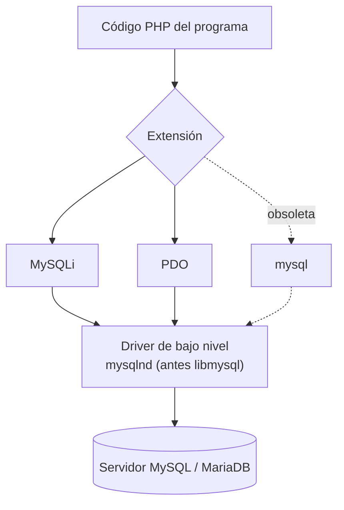
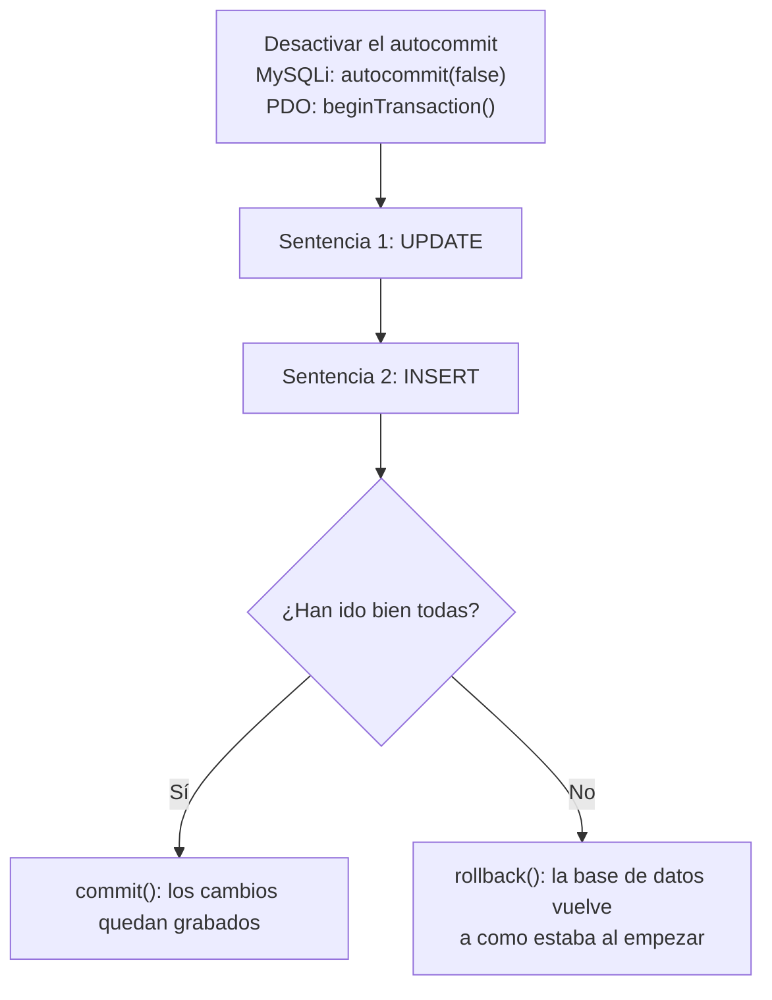
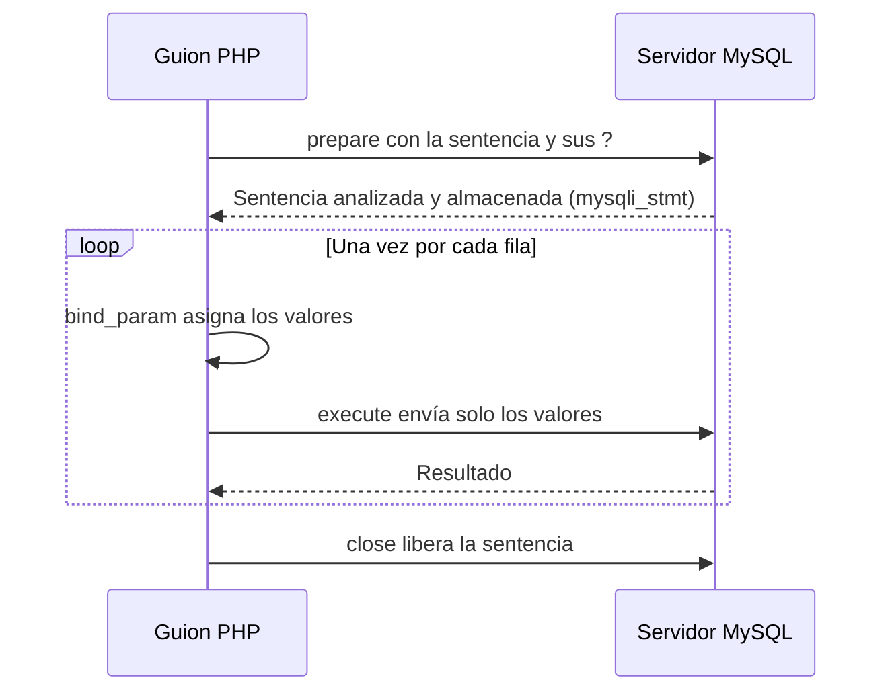
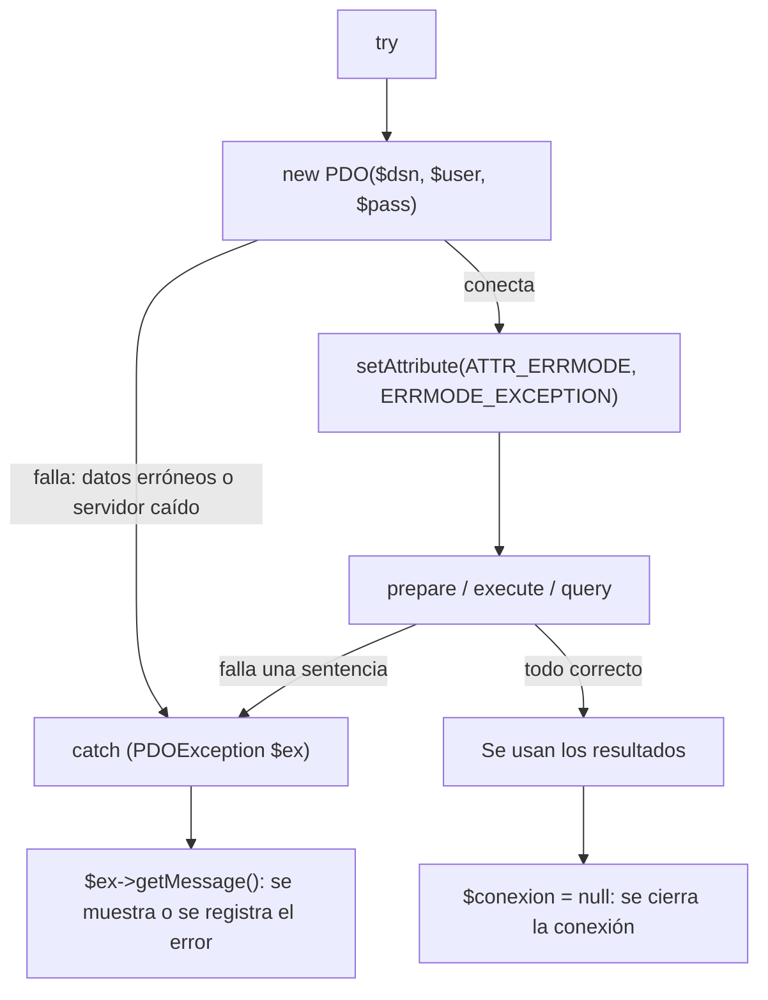
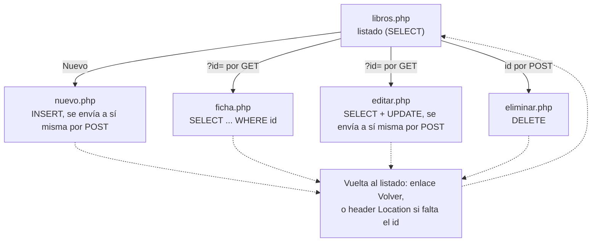

# Unidad 3. Trabajar con bases de datos en PHP

Una aplicación web casi nunca guarda sus datos en ficheros sueltos: los guarda en un **sistema gestor de bases de datos** (SGBD) y los consulta o modifica desde el código del servidor. Esta unidad explica cómo hacerlo desde PHP con el gestor más usado junto a él, MySQL.

La unidad se divide en cuatro partes:

1. **Acceso a bases de datos desde PHP**: extensiones nativas frente a PDO, y lo mínimo de objetos que hace falta para usarlas.
2. **MySQL**: instalación, configuración y herramientas de administración (`mysql`, `mysqladmin`, phpMyAdmin). Se añade una introducción al lenguaje SQL desde cero (apartado 2.3), porque todo lo que sigue envía sentencias SQL al servidor.
3. **Utilización de MySQL en PHP**: las dos extensiones recomendadas, **MySQLi** y **PDO**, con conexiones, consultas, transacciones, recorrido de resultados y consultas preparadas.
4. **Errores y excepciones**: niveles de error de PHP, `try`/`catch` y excepciones de PDO. Termina con una aplicación completa de altas, bajas, modificaciones y consultas con PDO (apartado 4.2).

> **Sobre la vigencia del temario.** Parte del temario describe el comportamiento de versiones antiguas de MySQL y PHP (motor por defecto, modo de errores de PDO y de MySQLi, valor por defecto de `error_reporting`). Se expone tal como lo recoge; lo que ha cambiado se indica en recuadros **Contexto actual**.

---

## 1. Acceso a bases de datos desde PHP

Una de las aplicaciones más frecuentes de PHP es generar una interfaz web para consultar y gestionar la información de una base de datos: mostrar en una página datos extraídos de ella, o enviar al gestor sentencias para que inserte, actualice o elimine registros.

PHP soporta **más de 15 sistemas gestores**: SQLite, Oracle, SQL Server, PostgreSQL, IBM DB2, MySQL, etc. Hay dos maneras de comunicarse con ellos:

| | Extensión nativa | PDO |
|---|---|---|
| Qué es | Una extensión específica para un gestor concreto (por ejemplo, MySQLi para MySQL) | Una extensión que accede **de forma común a distintos gestores** |
| Desde cuándo | Era la forma habitual hasta PHP 5 | Se introdujo en PHP 5 |
| Sintaxis | Funciones y objetos distintos para cada gestor | La misma, aunque cambie el gestor |
| Ventajas | Más potencia (acceso a funciones específicas del gestor) y, a veces, más velocidad | Si se cambia de gestor, el código apenas cambia |

**MySQL** es un gestor de bases de datos relacionales de código abierto, con licencia GNU GPL, y el **más empleado con PHP**: es la "M" de AMP y de XAMPP. La unidad explica cómo acceder a él con las dos opciones: **PDO** y la extensión nativa **MySQLi**.

### Nociones básicas de objetos en PHP

Las dos extensiones se usan a través de objetos. La programación orientada a objetos en PHP se estudia en una unidad posterior; aquí basta con dos operaciones:

- **Crear un objeto** instanciando una clase, con `new`.
- **Acceder a sus miembros** (métodos y propiedades) con el operador flecha `->`.

```php
$a = new A();       // crea un objeto de la clase A
$a->fecha();        // llama al método fecha() del objeto
echo $a->nombre;    // lee la propiedad nombre (sin $ delante del nombre de la propiedad)
```

> **Analogía con Java**: `new` funciona igual. Lo que en Java se escribe `a.fecha()`, en PHP se escribe `$a->fecha()`. Las constantes de una clase se leen con `::`, como los miembros estáticos de Java: `PDO::FETCH_ASSOC` equivale a algo como `PDO.FETCH_ASSOC`.

---

## 2. MySQL

MySQL es un **sistema gestor de bases de datos (SGBD) relacionales**. Es de código abierto (GNU GPL), aunque también ofrece una licencia comercial para quien quiera desarrollar aplicaciones de código propietario. Desde la versión 5.1 hay varios productos: uno libre (**Community Edition**) y otros comerciales (**Standard Edition**, **Enterprise Edition**).

Incorpora varios **motores de almacenamiento**, cada uno con características propias; al crear una tabla se elige el que convenga. Los dos que hay que conocer:

| | MyISAM | InnoDB |
|---|---|---|
| Por defecto | Sí: **es el que se utiliza por defecto** | No |
| Velocidad | **Es más rápido** | Un poco más lento |
| Transacciones | No | **Soporta transacciones** (tablas transaccionales) |
| Integridad referencial | No | **Soporta integridad referencial** |

Por eso, de las cuatro características, las que **no son ventajas del motor de almacenamiento InnoDB sobre MyISAM** son "es el que se utiliza por defecto" y "es más rápido": las dos son de MyISAM.

> **Contexto actual**: desde MySQL 5.5 (2010) el motor por defecto es **InnoDB**, y MariaDB hace lo mismo. MyISAM ya casi no se usa.

MySQL se usa en multitud de aplicaciones web, casi siempre junto a PHP y Apache. Gestiona, consulta y modifica la información con **SQL**; soporta la mayor parte de ANSI SQL 99 y añade extensiones propias.

**MariaDB** es un gestor derivado de MySQL, también GPL, desarrollado por la comunidad de MySQL antes de que Oracle comprara el proyecto. Es el que trae XAMPP. Salvo ligeros cambios, los dos son altamente compatibles y a efectos del módulo da igual usar uno u otro.

**Siglas que conviene no confundir.** **PDO** no es un motor de almacenamiento: es **una extensión de PHP que permite acceder a varios gestores de bases de datos**. Los motores son MyISAM, InnoDB y sus equivalentes en MariaDB.

### 2.1 Instalación y configuración

En Linux, MySQL se reparte en dos paquetes que se instalan por separado según lo que haga falta:

- **mysql-server**: el servidor en sí. Gestiona las bases de datos y acepta conexiones desde el propio equipo o desde la red.
- **mysql-client**: los **programas cliente**, necesarios para conectarse a un servidor MySQL. Solo hacen falta en los equipos que se vayan a conectar.

Aunque son paquetes distintos, el servidor depende del cliente: **al instalar el paquete correspondiente al servidor MySQL en un sistema Linux, se instalan también los programas cliente que permiten conectarse con el mismo**. En cambio, en un equipo que solo tenga que conectarse a un servidor remoto basta con instalar el paquete cliente.

El servicio se gestiona como cualquier otro del sistema:

| Orden | Qué hace |
|---|---|
| `sudo systemctl start mysql` | Inicia el servicio |
| `sudo systemctl stop mysql` | Lo detiene |
| `sudo systemctl restart mysql` | Lo reinicia |
| `sudo systemctl status mysql` | Informa de su estado |

Si se instaló LAMP en Ubuntu, el usuario `root` de MySQL/MariaDB no tiene contraseña y usa el plugin de autenticación **auth_socket**: solo puede entrar un usuario de Ubuntu con permisos de administrador, con `sudo mysql -u root`. Se recomienda no cambiarlo y, para cada proyecto, crear una base de datos y un usuario propio:

```sql
-- 1. En la terminal de Linux: sudo mysql -u root
CREATE DATABASE biblioteca;                                    -- 2. crea la base de datos
CREATE USER bibliotecario@'localhost' IDENTIFIED BY 'secreto'; -- 3. crea el usuario con su contraseña
GRANT ALL ON biblioteca.* TO bibliotecario@'localhost';        -- 4. le da todos los permisos sobre esa BD
QUIT;                                                          -- 5. vuelve a la terminal
-- 6. Comprobación, en la terminal: mysql -u bibliotecario -p biblioteca
```

- `biblioteca.*` significa "todas las tablas de la base de datos `biblioteca`"; `*.*` sería todas las tablas de todas las bases de datos.
- `'localhost'` limita el usuario a conexiones desde el propio equipo.

Después, phpMyAdmin o cualquier otro programa puede administrar la base de datos con las credenciales de ese usuario. En **XAMPP para Windows**, phpMyAdmin se abre desde el panel de control (botón **Admin** junto a MySQL) y entra directamente como `root`.

Datos de configuración que hay que conocer:

- **Puerto**: el servidor escucha por defecto en el **TCP 3306**. Hay que tenerlo en cuenta para abrir el cortafuegos en configuraciones en red.
- **Fichero de configuración**: **`my.cnf`**, en `/etc/mysql`. No se configura en `httpd.conf` (Apache) ni en `php.ini` (PHP). En Windows se llama `my.ini`.
- Se divide en **secciones**, cada una para un módulo:
  - `[client]`: parámetros que afectan a los clientes que se conectan al servidor.
  - `[mysqld]`: opciones de ejecución del servidor.
- Parámetros destacados: **`port`** (puerto TCP de escucha), **`user`** (usuario del sistema que ejecuta el servidor) y **`datadir`** (directorio donde se guardan las bases de datos).

### 2.2 Herramientas de administración

Hay muchas herramientas para conectarse a un servidor MySQL y administrarlo: de línea de comandos o gráficas (web o nativas del sistema operativo), incluidas con el servidor o instaladas aparte, de propósito concreto o general.

Con el servidor se incluyen tres herramientas de línea de comandos:

- **`mysql`**: se conecta a un servidor para **ejecutar sentencias**.
- **`mysqladmin`**: cliente específico para **tareas de administración**.
- **`mysqlshow`**: muestra información sobre bases de datos y tablas.

Comparten las opciones de conexión:

| Opción larga | Abreviada | Significado | Si se omite |
|---|---|---|---|
| `--user=nombre` | `-u nombre` | Usuario con permisos para conectarse | El usuario actual del sistema operativo |
| `--password=clave` | `-pclave` | Contraseña. En la forma corta va **pegada a la `p`**, sin espacio | Si hace falta, se pide al conectar |
| `--host=equipo` | `-h equipo` | Equipo servidor | `localhost` |

Ejemplos:

- `sudo mysql -u root`: entra como `root` con la configuración recomendada de Ubuntu.
- `mysql -u juan -p proyecto`: entra como `juan`, pide la contraseña y selecciona directamente la base de datos `proyecto`.
- En Windows con XAMPP, el ejecutable está en `c:\xampp\mysql\bin\`; desde una consola abierta ahí basta `mysql -u root`.

> **Error frecuente**: `-p proyecto` no es "la contraseña es proyecto": con espacio, `proyecto` es el nombre de la base de datos y la contraseña se pide aparte. Y se recomienda **no escribir nunca la contraseña en la línea de comandos**, porque quedaría guardada en el historial del sistema.

Dos herramientas independientes muy usadas:

- **MySQL Workbench**: herramienta genérica con **interfaz gráfica nativa** para administrar el servidor y sus bases de datos. La desarrollan los creadores de MySQL; tiene una edición GPL.
- **phpMyAdmin**: **aplicación web** escrita en PHP (GPL) para administrar las bases de datos y la información del servidor.

| Herramienta | Tipo de interfaz |
|---|---|
| MySQL Workbench | Nativo |
| mysql | Línea de comandos |
| phpMyAdmin | Web |
| mysqladmin | Línea de comandos (administración) |

> **Error frecuente**: **`myadmin` no es una herramienta de administración de MySQL**. Existen `mysql`, `mysqladmin`, `mysqlshow`, phpMyAdmin y MySQL Workbench; "myadmin" es un nombre inventado parecido.

> **Ojo con el término**: el temario dice "un interface" en masculino. Es el mismo concepto que "una interfaz".

#### 2.2.1 mysql y mysqladmin

**`mysql`** se usa normalmente en **modo interactivo**: tras conectarse, presenta una línea de órdenes donde se escriben sentencias SQL, que **terminan en `;`**, y algunos comandos especiales:

| Comando | Qué hace |
|---|---|
| `connect` | Establece una conexión con un servidor |
| `use` | Selecciona una base de datos: `use biblioteca;` |
| `exit` o `quit` | Termina la sesión |
| `help` | Muestra la lista de comandos |

También ejecuta todas las sentencias de un **fichero de procesamiento por lotes** (texto plano con instrucciones, normalmente `.sql`), redirigiéndolo a la entrada:

```bash
mysql -u bibliotecario -p biblioteca < crearTablas.sql   # ejecuta el fichero sobre la BD biblioteca
sudo mysql -u root < biblioteca.sql                       # el fichero crea él mismo la BD, el usuario y los permisos
```

Si todo va bien, vuelve a la consola sin ningún mensaje; si algo falla, muestra el error.

Para saber si **existe o no un registro en una tabla** se usa **`mysql`**, porque permite ejecutar consultas sobre el contenido. `mysqladmin` hace tareas administrativas, pero no consulta datos.

**Emojis y utf8mb4.** El antiguo `utf8` de MySQL usa hasta 3 bytes por carácter y no admite emojis. Desde MySQL 5.5.3 existe **`utf8mb4`**, hasta 4 bytes por carácter. Se elige al crear la base de datos:

```sql
CREATE DATABASE mi_base_de_datos CHARACTER SET = utf8mb4 COLLATE = utf8mb4_unicode_ci;
```

**La base de datos `proyecto`.** Los ejemplos del temario usan una base de datos llamada `proyecto`, con usuario `gestor` y contraseña `secreto`, que se crea con un fichero `proyecto.sql` y se carga con `sudo mysql -u root < proyecto.sql`. Tiene cuatro tablas:

| Tabla | Columnas | Relación |
|---|---|---|
| `productos` | `id`, `nombre`, `nombre_corto`, `descripcion`, `pvp`, `familia` | `familia` apunta a `familias.cod` |
| `tiendas` | `id`, `nombre`, `tlf` | |
| `familias` | `cod`, `nombre` | |
| `stocks` | `producto`, `tienda`, `unidades` | `producto` apunta a `productos.id`; `tienda`, a `tiendas.id` |

Después se cargan los datos (`datosProyecto.sql`) desde phpMyAdmin (apartado 2.2.2).

**`mysqladmin`** es **no interactiva**: la tarea se indica como parámetro en la línea de comandos. Permite:

- Crear y eliminar bases de datos.
- Mostrar la configuración y el estado del servidor.
- Cambiar contraseñas.
- Detener el servidor.

```bash
mysqladmin --help                   # lista los comandos disponibles
sudo mysqladmin status              # estado actual del servidor
sudo mysqladmin version             # versión instalada
sudo mysqladmin -u root create miBase   # crea la base de datos miBase (necesita sudo y root)
```

#### 2.2.2 phpMyAdmin

Al contrario que las anteriores, **phpMyAdmin no se instala con el servidor MySQL**. En Ubuntu hay dos formas:

- Con el gestor de paquetes: `sudo apt install phpmyadmin`. Pregunta el servidor web (se elige **apache2**) y crea una base de datos propia. Se accede en `http://localhost/phpmyadmin/`.
- Descargando el paquete de phpmyadmin.net y descomprimiéndolo en `/var/www/html` (la raíz de Apache en Ubuntu), en una carpeta renombrada `phpmyadmin`.

Para entrar hacen falta usuario y contraseña de MySQL: con `gestor`/`secreto` se gestiona solo la base de datos `proyecto`. Para entrar con todos los permisos en Ubuntu, sin tocar la autenticación de `root`, se crea un usuario administrador:

```sql
-- en la terminal: sudo mysql -u root
CREATE USER admin@'localhost' IDENTIFIED BY 'secreto';
GRANT ALL ON *.* TO admin@'localhost' WITH GRANT OPTION;  -- todos los permisos, y además puede concederlos
FLUSH PRIVILEGES;                                         -- recarga la tabla de permisos
```

La interfaz tiene un panel de navegación a la izquierda con las bases de datos y un panel principal con un menú superior. Al seleccionar una base de datos, ese menú permite:

- Ver y modificar la estructura.
- Ejecutar sentencias SQL.
- Buscar información en toda la base de datos o en parte.
- Generar una consulta con un asistente (pestaña **Generar una consulta**).
- **Exportar** e **importar** estructura y datos (Exportar genera un `.sql` con las instrucciones para recrear tablas y datos; Importar ejecuta un `.sql`).
- Diseñar las relaciones entre tablas (**Diseñador**).
- Otras operaciones, como copiar la base de datos.

Con una tabla seleccionada se hacen operaciones similares a nivel de tabla (examinar, estructura, buscar, insertar, vaciar, eliminar).

**Cargar un fichero de datos**: se selecciona la base de datos en el panel izquierdo, pestaña **Importar**, **Examinar** para elegir el `.sql`, **Continuar**, y se comprueba en el mensaje final que no ha habido errores.

### 2.3 Ampliación: el lenguaje SQL desde cero

PHP no consulta la base de datos por sí mismo: le envía al servidor MySQL una **sentencia SQL** como cadena de texto, y el servidor la ejecuta. Por eso hay que saber escribir esas sentencias. Este apartado cubre las cuatro que usa la unidad: **SELECT, INSERT, UPDATE y DELETE**.

#### 2.3.1 Tablas, filas y columnas

Una base de datos relacional guarda la información en **tablas**. Cada **fila** (o **registro**) es un elemento; cada **columna** (o **campo**) es un dato de ese elemento. Ejemplo con la base de datos `biblioteca` que se usa en toda la unidad:

Tabla `generos`:

| cod | nombre |
|---|---|
| NOV | Novela |
| POE | Poesía |
| ENS | Ensayo |

Tabla `libros`:

| id | titulo | autor | paginas | genero | sinopsis |
|---|---|---|---|---|---|
| 1 | La Regenta | Leopoldo Alas | 720 | NOV | Vetusta, una ciudad de provincias… |
| 2 | Campos de Castilla | Antonio Machado | 210 | POE | NULL |
| 3 | El árbol de la ciencia | Pío Baroja | 300 | NOV | NULL |
| 4 | Meditaciones del Quijote | José Ortega y Gasset | 180 | ENS | NULL |

- **Clave primaria**: columna que identifica cada fila sin repetirse (`id` en `libros`, `cod` en `generos`).
- **Clave ajena**: columna que guarda la clave primaria de otra tabla (`libros.genero` guarda un `generos.cod`). Con InnoDB, el gestor impide que apunte a un género que no existe y, salvo que se configure otra cosa, impide borrar un género que tiene libros.
- **`NULL`**: ausencia de valor. No es una cadena vacía ni un cero.
- **`AUTO_INCREMENT`**: el gestor asigna solo el siguiente número a la clave primaria al insertar; por eso en las altas no se indica el `id`.

La tabla se crea así (no se usa en la unidad, pero permite leer ficheros como `proyecto.sql`):

```sql
CREATE TABLE generos (
    cod    VARCHAR(6)  PRIMARY KEY,           -- texto de hasta 6 caracteres; clave primaria
    nombre VARCHAR(50) NOT NULL               -- obligatorio
) ENGINE = InnoDB;

CREATE TABLE libros (
    id       INT AUTO_INCREMENT PRIMARY KEY,  -- entero numerado por el gestor
    titulo   VARCHAR(150) NOT NULL,
    autor    VARCHAR(100) NOT NULL,
    paginas  INT,                             -- puede quedar a NULL
    genero   VARCHAR(6) NOT NULL,
    sinopsis TEXT,                            -- texto largo
    FOREIGN KEY (genero) REFERENCES generos(cod)   -- clave ajena
) ENGINE = InnoDB;
```

Tipos habituales: `INT` (entero), `DECIMAL(10,2)` (número con 2 decimales exactos, el adecuado para precios), `VARCHAR(n)` (texto de hasta n caracteres), `TEXT` (texto largo), `DATE` (fecha).

> **Analogía con Java**: una tabla es como una clase con solo atributos (`Libro` con `id`, `titulo`…), y cada fila, un objeto de esa clase. La clave ajena es como un atributo que guarda la referencia a otro objeto, pero escrita como su identificador.

#### 2.3.2 Reglas generales de escritura

- Cada sentencia termina en `;` (en la herramienta `mysql`; desde PHP se puede omitir).
- Las palabras clave (`SELECT`, `FROM`…) no distinguen mayúsculas; se escriben en mayúsculas por costumbre, para distinguirlas de los nombres de tablas y columnas.
- Los **textos y las fechas van entre comillas** (`'Novela'`, `'2026-11-13'`); los **números, sin comillas** y con **punto decimal** (`19.95`).
- Comentario de una línea: `-- texto` (con espacio tras los guiones).

> **Error frecuente**: el SQL estándar delimita los textos con comillas simples. MySQL acepta también dobles, y el temario las usa (`VALUES ("TABLET", "Tablet PC")`) porque así la cadena PHP puede ir entre comillas simples. Lo que no se puede es mezclar sin cuidado: `'SELECT * FROM libros WHERE autor = 'Baroja''` rompe la cadena PHP en la segunda comilla simple.

#### 2.3.3 SELECT: consultar

```sql
SELECT columnas FROM tabla WHERE condición ORDER BY columna;
```

Solo `SELECT` y `FROM` son obligatorias. El resultado es una tabla nueva (el **conjunto de resultados**), que no modifica nada.

```sql
SELECT * FROM libros;                       -- todas las columnas (*) de todas las filas
SELECT id, titulo FROM libros;              -- solo dos columnas
SELECT titulo FROM libros WHERE genero = 'NOV';        -- La Regenta, El árbol de la ciencia
SELECT * FROM libros WHERE id = 3;                     -- una sola fila: la del id 3
SELECT titulo, paginas FROM libros WHERE paginas < 250;  -- Campos de Castilla, Meditaciones…
SELECT id, titulo FROM libros ORDER BY titulo;         -- ordenados alfabéticamente por título
SELECT titulo FROM libros ORDER BY paginas DESC;       -- de más a menos páginas
```

Operadores de la condición `WHERE`:

| Operador | Significado | Ejemplo |
|---|---|---|
| `=` | igual (uno solo, no `==`) | `genero = 'POE'` |
| `<>` o `!=` | distinto | `genero <> 'POE'` |
| `<`, `>`, `<=`, `>=` | comparación | `paginas >= 300` |
| `AND`, `OR`, `NOT` | combinan condiciones | `genero = 'NOV' AND paginas > 500` |
| `LIKE` | patrón de texto: `%` = cualquier secuencia | `titulo LIKE '%Castilla%'` |
| `IS NULL`, `IS NOT NULL` | comprueba la ausencia de valor | `sinopsis IS NULL` |

> **Error frecuente**: `sinopsis = NULL` no encuentra nada, porque `NULL` no es igual a nada, ni siquiera a sí mismo. Se escribe `sinopsis IS NULL`.

#### 2.3.4 INSERT: añadir filas

```sql
INSERT INTO tabla (columna1, columna2, …) VALUES (valor1, valor2, …);
```

Los valores van **en el mismo orden** que las columnas listadas.

```sql
INSERT INTO generos (cod, nombre) VALUES ('TEA', 'Teatro');
INSERT INTO libros (titulo, autor, paginas, genero)
VALUES ('Luces de bohemia', 'Ramón del Valle-Inclán', 160, 'TEA');   -- id lo pone AUTO_INCREMENT; sinopsis queda a NULL
```

> **Error frecuente**: insertar una clave primaria que ya existe (`INSERT INTO generos … VALUES ('NOV', …)`) da error de **clave duplicada**. Y en una clave ajena solo valen valores que existan en la otra tabla: `genero = 'XYZ'` da error de integridad referencial.

#### 2.3.5 UPDATE: modificar filas

```sql
UPDATE tabla SET columna1 = valor1, columna2 = valor2 WHERE condición;
```

```sql
UPDATE libros SET paginas = 712 WHERE id = 1;                       -- cambia un dato de una fila
UPDATE libros SET titulo = 'La Regenta (ed. crítica)', paginas = 900 WHERE id = 1;  -- varias columnas
UPDATE libros SET sinopsis = 'Pendiente' WHERE sinopsis IS NULL;    -- varias filas a la vez
```

#### 2.3.6 DELETE: borrar filas

```sql
DELETE FROM tabla WHERE condición;
```

```sql
DELETE FROM libros WHERE id = 4;            -- borra una fila
DELETE FROM libros WHERE paginas < 100;     -- borra todas las que cumplan la condición
```

> **Error frecuente**: **sin `WHERE`, `UPDATE` y `DELETE` afectan a todas las filas de la tabla**. `DELETE FROM libros;` vacía la tabla entera y `UPDATE libros SET paginas = 0;` pone a cero todos los libros. No hay "¿está seguro?".

> **Error frecuente**: en `DELETE` no se escriben columnas (`DELETE * FROM` es incorrecto): se borran filas enteras.

#### 2.3.7 Consultas de selección y consultas de acción

| | Consulta de selección | Consulta de acción |
|---|---|---|
| Sentencias | `SELECT` | `INSERT`, `UPDATE`, `DELETE` |
| Qué devuelve | Un **conjunto de resultados** (filas) | Nada, salvo el **número de registros afectados** |
| Modifica datos | No | Sí |

Esta distinción decide qué método se usa en PHP para ejecutar cada sentencia (apartados 3.1.2 y 3.2.2).

---

## 3. Utilización de bases de datos MySQL en PHP

Hay dos formas de comunicarse con una base de datos desde PHP: una **extensión nativa**, programada para un gestor concreto, o una extensión que **soporte varios gestores**.

Tradicionalmente se usaba la extensión nativa **`mysql`**. **Se ha usado habitualmente para acceder a bases de datos MySQL, pero hoy en día su uso está desaconsejado**: se mantenía solo para dar soporte a aplicaciones antiguas. **Las dos extensiones más recomendables para acceder a MySQL desde PHP** son **MySQLi** (nativa) y **PDO**.

> **Contexto actual**: la extensión `mysql` (funciones `mysql_connect`, `mysql_query`…) se eliminó en PHP 7.0 (2015). Hoy ni siquiera existe.

Con cualquiera de las dos se puede:

- Establecer conexiones.
- Ejecutar sentencias SQL.
- Obtener los registros afectados o devueltos por una sentencia.
- Emplear transacciones.
- Ejecutar procedimientos almacenados.
- Gestionar los errores de conexión o de ejecución.

Por debajo, PDO, MySQLi (y la antigua `mysql`) usan un **driver de bajo nivel** para hablar con el servidor. Antes solo existía **libmysql**, no optimizado para PHP. Desde PHP 5.3 existe el driver nativo **mysqlnd**: **un driver de bajo nivel para MySQL, que se puede usar tanto con la extensión MySQLi como con PDO, y sustituye al habitual libmysql**.

> **Error frecuente**: `libmysql` y `mysqlnd` son drivers, no extensiones. Las extensiones son `mysql`, MySQLi y PDO.

| Capa | Opciones |
|---|---|
| Código PHP del programa | llama a una extensión |
| Extensión | `mysql` (obsoleta), **MySQLi**, **PDO** |
| Driver de bajo nivel | libmysql (antiguo), **mysqlnd** |
| Servidor | MySQL / MariaDB |

Cada capa solo habla con la de debajo:



### 3.1 Extensión MySQLi

MySQLi se desarrolló para aprovechar las versiones 4.1.3 y posteriores de MySQL y viene con PHP desde la versión 5. Ofrece una **interfaz de programación dual**: **procedimental y orientada a objetos**. Cada operación puede hacerse con un método de un objeto o con una función equivalente:

```php
// Orientado a objetos: constructor y métodos/propiedades
$conexion = new mysqli('localhost', 'bibliotecario', 'secreto', 'biblioteca');
print $conexion->server_info;                    // versión del servidor

// Procedimental: funciones
$conexion = mysqli_connect('localhost', 'bibliotecario', 'secreto', 'biblioteca');
print mysqli_get_server_info($conexion);
```

En los dos casos `$conexion` es un objeto; la forma orientada a objetos suele dar un código más corto y legible.

**Mejoras respecto a la antigua extensión `mysql`**:

- **Interface orientado a objetos**.
- **Soporte para transacciones**.
- **Soporte para consultas preparadas**.
- Mejores opciones de depuración y seguridad.

> **Error frecuente**: "es una extensión nativa" no es una ventaja sobre `mysql`, porque **las dos son nativas**. Y "permite utilizar excepciones" tampoco: MySQLi usa el sistema de errores clásico de PHP; las excepciones son propias de PDO (apartado 4.1).

> **Contexto actual**: desde PHP 8.1, MySQLi lanza por defecto excepciones `mysqli_sql_exception` cuando falla una conexión o una consulta.

La **configuración de MySQLi** se hace en **`php.ini`**, en la sección propia de la extensión (no hay un `mysqli.conf`, y `httpd.conf` y `my.ini` son de Apache y de MySQL):

| Directiva | Para qué sirve |
|---|---|
| `mysqli.allow_persistent` | Permite crear conexiones persistentes |
| `mysqli.default_port` | Puerto TCP por defecto para conectar |
| `mysqli.reconnect` | Reconectar automáticamente si se pierde la conexión |
| `mysqli.default_host` | Servidor por defecto |
| `mysqli.default_user` | Usuario por defecto |
| `mysqli.default_pw` | Contraseña por defecto |

#### 3.1.1 Establecimiento de conexiones

Toda comunicación con el servidor se hace a través de una **conexión**, que se abre primero. Con MySQLi, abrirla es **crear una instancia de la clase `mysqli`**. El constructor admite seis parámetros, todos opcionales; lo habitual son los cuatro primeros:

1. Nombre o IP del servidor.
2. Usuario.
3. Contraseña.
4. Base de datos.
5. Puerto.
6. Socket o tubería con nombre (*named pipe*).

Para conectar con MySQLi **se puede utilizar indistintamente el constructor o el método `connect`**:

```php
// 1. Con el constructor
$conexion = new mysqli('localhost', 'bibliotecario', 'secreto', 'biblioteca');

// 2. Creando primero el objeto y conectando después con connect
$conexion = new mysqli();
$conexion->connect('localhost', 'bibliotecario', 'secreto', 'biblioteca');

// 3. Con la interfaz procedimental
$conexion = mysqli_connect('localhost', 'bibliotecario', 'secreto', 'biblioteca');
```

Hay que **comprobar que la conexión se ha establecido**. Para ello, la clase `mysqli` tiene dos propiedades (y dos funciones equivalentes):

| Propiedad | Función | Devuelve |
|---|---|---|
| `connect_errno` | `mysqli_connect_errno()` | El **número** de error (0 si no hay error) |
| **`connect_error`** | `mysqli_connect_error()` | El **mensaje** de error, o `null` si no hay error |

El mensaje del error se obtiene, por tanto, con la propiedad **`connect_error`**.

```php
@$conexion = new mysqli('localhost', 'bibliotecario', 'secreto', 'biblioteca');
$error = $conexion->connect_errno;
if ($error != null) {          // hay error
    echo "<p>Error $error conectando a la base de datos: $conexion->connect_error</p>";
    die();                     // termina la ejecución del guion
}
```

- **`@`** es el **operador de control de errores**: delante de una expresión, hace que se ignore el aviso que pudiera producir (aquí, para que no aparezca el *warning* de PHP y solo se vea el mensaje propio).
- **`die()`** termina el guion; puede recibir un mensaje que se muestra antes de terminar.

Otras operaciones con la conexión:

- **`select_db('otra_bd')`** (o `mysqli_select_db`): cambia de base de datos sin reconectar. El usuario necesita permisos en la nueva.
- **`close()`** (o `mysqli_close`): **al acabar una conexión se debe ejecutar el método `close` para liberar los recursos que utiliza**.

```php
$conexion->select_db('otra_bd');
$conexion->close();
```

> **Contexto actual**: desde PHP 8.1, si la conexión falla, `new mysqli(...)` lanza una excepción y el `@` no la detiene, así que el `if` no llega a ejecutarse; habría que capturarla con `try`/`catch` (apartado 4.1).

#### 3.1.2 Ejecución de consultas

La forma más directa de ejecutar una consulta con MySQLi es **el método `query`**, equivalente a **la función `mysqli_query`**. No existen `exec` ni `mysqli_exec` en MySQLi (`exec` es de PDO).

- **Consulta de acción** (`INSERT`, `UPDATE`, `DELETE`): devuelve `true` si se ejecuta bien y `false` si no. El número de registros afectados está en la propiedad **`affected_rows`** (o `mysqli_affected_rows`).
- **Consulta de selección** (`SELECT`): devuelve un **objeto resultado** de la clase **`mysqli_result`** (apartado 3.1.4).

```php
@$conexion = new mysqli('localhost', 'bibliotecario', 'secreto', 'biblioteca');
if ($conexion->connect_errno == null) {
    $resultado = $conexion->query('DELETE FROM libros WHERE paginas < 100');
    if ($resultado) {
        echo "<p>Se han borrado $conexion->affected_rows libros.</p>";
    }
    $conexion->close();
}
```

`query()` admite un segundo parámetro que afecta a **cómo se traen internamente** los resultados, no a cómo se usan después:

| Opción | Cómo trae los datos | Cuándo conviene |
|---|---|---|
| `MYSQLI_STORE_RESULT` (por defecto) | **Todos juntos**, y los guarda en local | Resultados de tamaño normal |
| `MYSQLI_USE_RESULT` | **Según se van necesitando**, de forma progresiva | Consultas que devuelven **una enorme cantidad de datos** |

```php
$resultado = $conexion->query('SELECT titulo, paginas FROM libros', MYSQLI_USE_RESULT);
```

> **Error frecuente**: es al revés de lo que sugiere "store": `MYSQLI_STORE_RESULT` **no** recupera los datos de forma progresiva, los **almacena todos** de golpe. El progresivo es `MYSQLI_USE_RESULT`, y por eso es el adecuado para resultados enormes (no llena la memoria).

Otra forma es **`real_query`** (o `mysqli_real_query`), que siempre devuelve `true` o `false`. Si la consulta devuelve filas, se recogen después con **`store_result`** (todas) o **`use_result`** (según se necesiten).

Los resultados ocupan memoria mientras se usan; cuando ya no hacen falta se liberan con **`free()`** de `mysqli_result` (o `mysqli_free_result`):

```php
$resultado->free();
```

#### 3.1.3 Transacciones

Una **transacción** es un grupo de sentencias que se aplican **todas o ninguna**. Ejemplo: prestar el último ejemplar de un libro exige restar uno del inventario y apuntar el préstamo; si la segunda falla, la primera debe deshacerse.

- **`commit`**: confirma los cambios de la transacción; quedan grabados.
- **`rollback`**: revierte los cambios; la base de datos vuelve a como estaba al empezar.

Las transacciones solo funcionan si el **motor** de las tablas las soporta (InnoDB sí; MyISAM no). Con InnoDB, **por defecto cada consulta va en su propia transacción y se confirma sola** (modo *autocommit*). Por eso, **en el modo por defecto no es posible revertir los cambios de una consulta de acción**: cada una se confirma en cuanto se ejecuta.

Para **utilizar transacciones por código con MySQLi** se usa **el método `autocommit`** (función `mysqli_autocommit`) **para deshabilitar el comportamiento por defecto**. No es una propiedad, y `beginTransaction` es de PDO.

```php
$conexion->autocommit(false);   // deshabilita la confirmación automática
```

A partir de ahí, las operaciones abren una transacción que se cierra con:

- **`commit()`** (o `mysqli_commit`): confirma; devuelve `true` o `false`.
- **`rollback()`** (o `mysqli_rollback`): revierte; devuelve `true` o `false`.

Al terminar una transacción empieza otra automáticamente.

Ejemplo análogo al del temario: mover un ejemplar de un libro de una sede a otra en una tabla `ejemplares (libro, sede, cantidad)`, donde la sede 1 tiene 2 ejemplares del libro 3 y la sede 2 no tiene ninguna fila de ese libro:

```php
$conexion = new mysqli('localhost', 'bibliotecario', 'secreto', 'biblioteca');
$conexion->autocommit(false);
$ok1 = $conexion->query('UPDATE ejemplares SET cantidad = 1 WHERE libro = 3 AND sede = 1');
$ok2 = $conexion->query('INSERT INTO ejemplares (libro, sede, cantidad) VALUES (3, 2, 1)');
if ($ok1 && $ok2) {
    $conexion->commit();      // las dos han ido bien: se graban
    echo '<p>Ejemplar trasladado.</p>';
} else {
    $conexion->rollback();    // alguna ha fallado: se deshace también la otra
    echo '<p>No se ha podido trasladar el ejemplar.</p>';
}
$conexion->close();
```

La segunda vez que se ejecuta, el `INSERT` falla (la fila ya existe) y el `rollback` deshace también el `UPDATE`.

El flujo de una transacción es el mismo con las dos extensiones; solo cambia cómo se abre:



Con un motor sin transacciones (MyISAM), el `rollback` no puede deshacer nada: cada sentencia ya quedó grabada al ejecutarse.

> **Error frecuente**: con MyISAM no hay transacciones **con ninguna extensión**. No es cierto que MySQLi pueda usarlas sobre MyISAM y PDO no: depende del motor, no de la extensión.

#### 3.1.4 Obtención y utilización de conjuntos de resultados

Un `SELECT` devuelve un objeto `mysqli_result`, que también tiene interfaz dual (cada método tiene su función). **Para obtener un array a partir de un conjunto de resultados con MySQLi** se usan **`fetch_array`**, **`fetch_assoc`** o **`fetch_row`**. Cada llamada devuelve **un registro** y avanza al siguiente.

| Método (función) | Devuelve | Acceso al título |
|---|---|---|
| `fetch_array()` (`mysqli_fetch_array`) | Array con claves **numéricas y asociativas** (por defecto) | `$fila['titulo']` o `$fila[0]` |
| `fetch_array(MYSQLI_ASSOC)` = `fetch_assoc()` | Array asociativo | `$fila['titulo']` |
| `fetch_array(MYSQLI_NUM)` = `fetch_row()` | Array numérico | `$fila[0]` |
| `fetch_object()` | Objeto con una propiedad por campo | `$fila->titulo` |

El parámetro de `fetch_array` admite `MYSQLI_NUM`, `MYSQLI_ASSOC` y `MYSQLI_BOTH` (el comportamiento por defecto).

> **Error frecuente**: en MySQLi **no existe `fetch` en `mysqli_result`**. `fetch` es de PDO y, en MySQLi, de las consultas preparadas (`mysqli_stmt`, apartado 3.1.5).

```php
$resultado = $conexion->query('SELECT titulo, paginas FROM libros WHERE paginas < 250');
$libro = $resultado->fetch_array();        // primer registro
echo "<p>{$libro['titulo']}: {$libro[1]} páginas.</p>";   // vale el nombre o el número
```

Para recorrer todos los registros se aprovecha que los métodos devuelven **`null` cuando no quedan más**:

```php
$resultado = $conexion->query('SELECT titulo, paginas FROM libros WHERE paginas < 250');
$libro = $resultado->fetch_object();
while ($libro != null) {
    echo "<p>$libro->titulo: $libro->paginas páginas.</p>";
    $libro = $resultado->fetch_object();
}
```

Forma abreviada habitual, que asigna y comprueba en la misma condición:

```php
while ($libro = $resultado->fetch_assoc()) {
    echo "<p>{$libro['titulo']}</p>";
}
```

> **Error frecuente**: dentro de una cadena con comillas dobles, `"$libro->titulo"` funciona, pero `"$libro['titulo']"` no: un índice entre comillas exige llaves, `"{$libro['titulo']}"`, o concatenar con `.`.

**Bootstrap.** Para no perder tiempo en CSS se recomienda un framework de estilos ya hecho como **Bootstrap**, que da páginas *responsive* con clases predefinidas (`container`, `table`, `btn btn-success`…). Basta enlazar su hoja de estilos en el `<head>`.

**Ejemplo resuelto (página con formulario de selección).** Página que muestra los libros de un género elegido en una lista desplegable de la misma página:

```php
<?php
$conexion = new mysqli('localhost', 'bibliotecario', 'secreto', 'biblioteca');
$generos = $conexion->query('SELECT cod, nombre FROM generos ORDER BY nombre');
?>
<form action="" method="post">          <!-- action vacío: se envía a la misma página -->
    <select name="genero">
        <?php while ($g = $generos->fetch_object()) { ?>
            <option value="<?= $g->cod ?>"><?= $g->nombre ?></option>
        <?php } ?>
    </select>
    <button type="submit" name="ver">Ver libros</button>
</form>
<?php
if (isset($_POST['ver'])) {               // solo si se ha enviado el formulario
    $cod = $conexion->real_escape_string($_POST['genero']);
    $libros = $conexion->query("SELECT titulo FROM libros WHERE genero = '$cod'");
    while ($l = $libros->fetch_object()) {
        echo "<p>$l->titulo</p>";
    }
}
$conexion->close();
```

- `<?= expr ?>` es la forma corta de `<?php echo expr; ?>`.
- `real_escape_string` neutraliza las comillas del dato recibido. La forma recomendada es la del apartado siguiente: consultas preparadas.

#### 3.1.5 Consultas preparadas

Cada consulta que llega al servidor se **analiza** antes de ejecutarse. Una **consulta preparada** se analiza una vez, queda almacenada en el servidor y se ejecuta las veces que haga falta. Tiene dos ventajas:

- **Rapidez** en sentencias que se repiten (por ejemplo, muchas inserciones).
- **Seguridad frente a la inyección SQL**: los valores de los parámetros se envían después, por un protocolo distinto, y **no necesitan ser escapados**.

**Inyección SQL**: ocurre cuando un dato de un formulario se pega dentro de la sentencia. Si un usuario escribe en el campo de búsqueda `' OR '1'='1`, la consulta `"SELECT * FROM usuarios WHERE nombre = '$nombre'"` pasa a ser `SELECT * FROM usuarios WHERE nombre = '' OR '1'='1'`, que devuelve todas las filas. Con una consulta preparada, ese texto se trata como un valor, nunca como SQL.

Con MySQLi, las consultas preparadas usan la clase **`mysqli_stmt`**. Un objeto de esa clase se obtiene con **`stmt_init()`** de `mysqli` (o `mysqli_stmt_init`). Pasos:

1. **`stmt_init()`**: obtener el objeto `mysqli_stmt`.
2. **`prepare($sql)`** (`mysqli_stmt_prepare`): preparar la consulta en el servidor.
3. **`execute()`** (`mysqli_stmt_execute`): ejecutarla, tantas veces como haga falta.
4. **`close()`** (`mysqli_stmt_close`): liberarla cuando ya no se necesite.

El intercambio entre PHP y el servidor muestra por qué la sentencia se analiza una sola vez:



Lo habitual es saltarse el paso 1: **el primer paso para crear una consulta preparada con MySQLi es utilizar el método `prepare` para hacerle llegar el SQL al servidor**. `$conexion->prepare($sql)` devuelve directamente el objeto `mysqli_stmt`, así que `stmt_init` solo hace falta si se quiere crear el objeto antes de tener la sentencia.

**Parámetros.** Preparar una sentencia con valores fijos sirve de poco. En su lugar se pone un **`?`** en la posición de cada valor:

```php
$stmt->prepare('INSERT INTO generos (cod, nombre) VALUES (?, ?)');
```

Antes de ejecutar, los `?` se sustituyen por valores con **`bind_param`** (o `mysqli_stmt_bind_param`), en **una sola llamada** que recibe todos los valores. Su primer argumento es una cadena con **un carácter por parámetro** que indica su tipo:

| Carácter | Tipo del parámetro |
|---|---|
| `i` | Número entero |
| `d` | Número real (doble precisión) |
| `s` | Cadena de texto |
| `b` | Contenido binario (BLOB) |

```php
$conexion = new mysqli('localhost', 'bibliotecario', 'secreto', 'biblioteca');
$stmt = $conexion->stmt_init();
$stmt->prepare('INSERT INTO generos (cod, nombre) VALUES (?, ?)');
$cod = 'TEA';
$nombre = 'Teatro';
$stmt->bind_param('ss', $cod, $nombre);   // una llamada: 'ss' = dos cadenas
$stmt->execute();
$stmt->close();
$conexion->close();
```

> **Error frecuente**: con MySQLi, **antes de ejecutar una consulta preparada se asignan los valores con una llamada al método `bind_param`**, no una llamada por parámetro (eso es `bindParam` de PDO, apartado 3.2.4).

> **Error frecuente**: `bind_param` exige **variables**, no literales. `$stmt->bind_param('ss', 'TEA', 'Teatro');` da error, porque los parámetros se pasan **por referencia** (la función guarda un enlace a la variable, no una copia del valor).

Como `bind_param` enlaza variables, basta cambiar su valor y volver a llamar a `execute()` para repetir la consulta con otros datos.

**Recoger resultados.** En las preparadas que devuelven filas, **`bind_result`** (`mysqli_stmt_bind_result`) asigna cada campo a una variable, y **`fetch`** (`mysqli_stmt_fetch`) avanza de registro y rellena esas variables:

```php
$stmt = $conexion->stmt_init();
$stmt->prepare('SELECT titulo, paginas FROM libros WHERE genero = ?');
$genero = 'NOV';
$stmt->bind_param('s', $genero);
$stmt->execute();
$stmt->bind_result($titulo, $paginas);   // el 1.er campo irá a $titulo y el 2.º a $paginas
while ($stmt->fetch()) {
    echo "<p>$titulo: $paginas páginas.</p>";
}
$stmt->close();
```

**Control de errores.** `prepare()` y `execute()` devuelven un booleano, que permite detectar fallos:

```php
$stmt = $conexion->stmt_init();
$id = 1;
if (!$stmt->prepare('SELECT titulo FROM libros WHERE id = ?')) {
    echo 'Se ha producido un error: ' . $conexion->error;   // error es una propiedad, sin paréntesis
    die();
}
$stmt->bind_param('i', $id);
if (!$stmt->execute()) {
    echo 'Error al ejecutar: ' . $stmt->error;
}
```

**Ejemplo resuelto (actualizar con preparada).** Formulario que cambia el número de páginas de un libro elegido:

```php
<?php
$conexion = new mysqli('localhost', 'bibliotecario', 'secreto', 'biblioteca');
if (isset($_POST['actualizar'])) {
    $id = (int) $_POST['id'];
    $paginas = (int) $_POST['paginas'];
    $stmt = $conexion->stmt_init();
    $stmt->prepare('UPDATE libros SET paginas = ? WHERE id = ?');
    $stmt->bind_param('ii', $paginas, $id);    // dos enteros, en el orden de los ?
    $stmt->execute();
    echo "<p>Filas modificadas: $stmt->affected_rows</p>";
    $stmt->close();
}
$conexion->close();
?>
<form action="" method="post">
    Id: <input type="number" name="id">
    Páginas: <input type="number" name="paginas">
    <button type="submit" name="actualizar">Actualizar</button>
</form>
```

### 3.2 PHP Data Objects (PDO)

MySQLi es buena opción si la aplicación va a usar siempre MySQL: da acceso a todas sus características y es rápida. Pero si algún día hay que cambiar de gestor, habrá que reprogramar gran parte del acceso a datos. Si existe esa posibilidad, conviene una **capa de abstracción** de acceso a datos; hay varias (ODBC, por ejemplo), y la más recomendable hoy es **PDO**.

El objetivo de PDO es que, si se cambia de servidor, los cambios en el código sean **mínimos**, no nulos. **PDO no abstrae por completo el gestor**: **no modifica las sentencias SQL** para adaptarlas a cada servidor. Por eso, **usando PDO no se puede cambiar de gestor sin más que adaptar las sentencias de conexión**: si el SQL usa algo propio de MySQL, también habrá que cambiarlo. Para eso haría falta una capa de abstracción completa.

Otras características:

- Necesita un **driver o controlador** específico para cada tipo de base de datos; los disponibles se ven con **`phpinfo()`**.
- Es **solo orientada a objetos**: al contrario que MySQLi, **no ofrece interfaz dual**; no hay funciones alternativas.
- Su máximo partido se saca con POO, creando una clase por tabla con los métodos de su CRUD; eso se verá en la unidad de POO.

**CRUD** son las siglas de las cuatro operaciones básicas sobre una tabla: *Create* (`INSERT`), *Read* (`SELECT`), *Update* (`UPDATE`) y *Delete* (`DELETE`).

#### 3.2.1 Establecimiento de conexiones

La conexión es un objeto de la clase **`PDO`**. Su constructor recibe (solo el primero es obligatorio):

1. **Origen de datos (DSN)**: cadena que indica el controlador y, tras **dos puntos**, sus parámetros.
2. Usuario.
3. Contraseña.
4. Opciones de conexión, en un array.

```php
$host = "localhost";
$db   = "biblioteca";
$user = "bibliotecario";
$pass = "secreto";
$dsn  = "mysql:host=$host;dbname=$db";   // controlador mysql y sus parámetros
$conexion = new PDO($dsn, $user, $pass);
// Los datos en variables: si cambian, se cambian en un solo sitio
```

Parámetros de la DSN del controlador MySQL, **separados por punto y coma** tras el prefijo `mysql:`:

| Parámetro | Significado |
|---|---|
| `host` | Nombre o IP del servidor |
| **`port`** | **Puerto TCP** en que escucha el servidor |
| `dbname` | Base de datos |
| `unix_socket` | Socket de MySQL en sistemas Unix |
| `charset` | Codificación de los datos transmitidos |

El **número de puerto TCP se indica en la cadena DSN** que indica el origen de datos, con `port`, no en el array de opciones. La codificación UTF-8 con emojis se indica también ahí:

```php
$dsn = "mysql:host=$host;port=3306;dbname=$db;charset=utf8mb4";
```

**Atributos de la conexión.** `getAttribute` consulta el estado de la conexión y `setAttribute` cambia parámetros:

```php
$version = $conexion->getAttribute(PDO::ATTR_SERVER_VERSION);   // versión del servidor
echo "Versión: $version";
$conexion->setAttribute(PDO::ATTR_CASE, PDO::CASE_UPPER);      // nombres de columna en mayúsculas
```

El atributo más importante es **`PDO::ATTR_ERRMODE`**, que decide qué hace PDO ante un error:

| Valor | Comportamiento | Uso |
|---|---|---|
| `PDO::ERRMODE_SILENT` | Por defecto: establece el código de error y no muestra nada | Producción |
| `PDO::ERRMODE_WARNING` | Además emite un `E_WARNING`, sin interrumpir la ejecución | Depuración y pruebas |
| `PDO::ERRMODE_EXCEPTION` | Además lanza una **`PDOException`**, que se captura con `try`/`catch` (apartado 4.1) | Control de errores |

```php
$conexion->setAttribute(PDO::ATTR_ERRMODE, PDO::ERRMODE_EXCEPTION);
```

> **Contexto actual**: desde PHP 8.0 el modo por defecto es `ERRMODE_EXCEPTION`, no `ERRMODE_SILENT`. Aun así se fija siempre de forma explícita, como hace el temario.

**Si la conexión falla**, `new PDO(...)` lanza siempre una `PDOException`, sea cual sea el modo de errores (que solo se aplica una vez creada la conexión). Por eso, **al utilizar PDO, si no se puede establecer una conexión con el gestor, se lanza una excepción que es conveniente capturar**; si no se captura, el guion se detiene con un error fatal (*Uncaught PDOException*). El apartado 4.1 muestra cómo capturarla.

**Cerrar la conexión.** La conexión vive mientras viva el objeto. Se cierra destruyéndolo: asignando **`null`** a la variable (y a cualquier otra que lo referencie). No hay método `close`.

```php
$conexion = null;
```

#### 3.2.2 Ejecución de consultas

PDO separa las dos clases de sentencias del apartado 2.3.7, y **no se pueden usar indistintamente `query` y `exec`**:

| Método | Para | Devuelve |
|---|---|---|
| **`exec`** | Consultas de **acción** (`INSERT`, `DELETE`, `UPDATE`) | El **número de registros afectados** |
| **`query`** | Consultas que **devuelven datos** (`SELECT`) | Un objeto **`PDOStatement`** con el conjunto de resultados |

```php
$registros = $conexion->exec('DELETE FROM libros WHERE paginas < 100');
echo "<p>Se han borrado $registros libros.</p>";

$resultado = $conexion->query('SELECT id, titulo FROM libros');   // PDOStatement
```

> **Analogía con Java**: es la misma separación que JDBC: `executeUpdate` devuelve un `int` con las filas afectadas y `executeQuery` devuelve un `ResultSet`.

**Transacciones.** PDO trabaja por defecto en modo *autocommit*: confirma cada sentencia automáticamente. **Para usar transacciones por código con PDO se ejecuta el método `beginTransaction`**:

- **`beginTransaction()`**: deshabilita el *autocommit* y comienza una transacción.
- **`commit()`**: confirma la transacción.
- **`rollback()`**: revierte sus cambios.

Tras `commit` o `rollback` se vuelve al modo automático.

```php
$ok = true;
$conexion->beginTransaction();
if ($conexion->exec('UPDATE ejemplares SET cantidad = 1 WHERE libro = 5 AND sede = 1') != 1) $ok = false;
if ($conexion->exec('INSERT INTO ejemplares (libro, sede, cantidad) VALUES (5, 2, 2)') != 1) $ok = false;
if ($ok) {
    $conexion->commit();     // todo bien: se graban los cambios
} else {
    $conexion->rollback();   // algo falló: se deshacen
}
```

Aquí se comprueba que cada sentencia afecta exactamente a un registro, y si no, se revierte todo.

**Motores sin transacciones.** No todos los motores las soportan: MyISAM no. En ese caso, **PDO ejecuta `beginTransaction` sin errores**, pero **no podrá revertir los cambios** si se llama a `rollback`. Por eso:

- **Usar `beginTransaction` correctamente no garantiza que siempre se pueda revertir con `rollback`**: depende del motor.
- **Intentar comenzar una transacción con un motor que no las soporta no da ningún error**.

> **Error frecuente**: la trampa está en la palabra "error": `beginTransaction` no falla con MyISAM; lo que falla en silencio es el `rollback`.

#### 3.2.3 Obtención y utilización de conjuntos de resultados

**Con PDO, para obtener un array a partir de un conjunto de resultados se usa el método `fetch`** de `PDOStatement` (no existen `fetch_array`, `fetch_assoc` ni `fetch_row`, que son de MySQLi). Devuelve un registro, o **`false`** cuando no quedan más:

```php
$resultado = $conexion->query('SELECT titulo, paginas FROM libros');
while ($registro = $resultado->fetch()) {
    echo $registro['titulo'] . ': ' . $registro['paginas'] . '<br>';
}
```

**El comportamiento por defecto de `fetch` es devolver un array con claves numéricas y asociativas** (equivale a `PDO::FETCH_BOTH`). Se cambia con un parámetro:

| Constante | Devuelve |
|---|---|
| `PDO::FETCH_ASSOC` | Solo array asociativo |
| `PDO::FETCH_NUM` | Solo array numérico |
| `PDO::FETCH_BOTH` | Array numérico y asociativo (**por defecto**) |
| `PDO::FETCH_OBJ` | Objeto con una propiedad por campo |
| `PDO::FETCH_LAZY` | El objeto y el array con clave dual a la vez |
| `PDO::FETCH_BOUND` | `true`, y asigna los campos a variables enlazadas con `bindColumn` |

```php
$resultado = $conexion->query('SELECT titulo, paginas FROM libros');
while ($libro = $resultado->fetch(PDO::FETCH_OBJ)) {
    echo $libro->titulo . ': ' . $libro->paginas . '<br>';
}
```

Con `PDO::FETCH_BOUND`, `bindColumn` se llama una vez por columna con su número (**empezando en 1**) y la variable:

```php
$resultado = $conexion->query('SELECT titulo, paginas FROM libros');
$resultado->bindColumn(1, $titulo);
$resultado->bindColumn(2, $paginas);
while ($resultado->fetch(PDO::FETCH_BOUND)) {
    echo "$titulo: $paginas<br>";
}
```

**`fetchAll`** trae **todas las filas de golpe** en un array. Es cómodo cuando no se esperan muchos resultados; con muchísimas filas puede agotar la memoria.

```php
$resultado = $conexion->query('SELECT cod, nombre FROM generos ORDER BY nombre');
$generos = $resultado->fetchAll(PDO::FETCH_ASSOC);
foreach ($generos as $g) {
    echo $g['cod'] . ' ' . $g['nombre'] . '<br>';
}
```

> **Analogía con Java**: `fetch` hace lo que `rs.next()` y los `getString()` juntos de JDBC: avanza y devuelve la fila. `fetchAll` es como volcar el `ResultSet` en una `List`.

#### 3.2.4 Consultas preparadas

El procedimiento es el mismo que con MySQLi y los métodos se llaman casi igual. **`prepare`** de la clase `PDO` devuelve un **`PDOStatement`**. Los parámetros se marcan con **`?`** o con **nombre**, precedido de dos puntos:

```php
$stmt = $conexion->prepare('INSERT INTO generos (cod, nombre) VALUES (?, ?)');
$stmt = $conexion->prepare('INSERT INTO generos (cod, nombre) VALUES (:cod, :nombre)');
```

**Con PDO, antes de ejecutar una consulta preparada se asignan los valores con una llamada al método `bindParam` por cada parámetro**. Con `?`, se indica la posición (desde 1, como en `bindColumn`); con nombres, el nombre:

```php
$cod = 'TEA';
$nombre = 'Teatro';

// Con signos de interrogación
$stmt = $conexion->prepare('INSERT INTO generos (cod, nombre) VALUES (?, ?)');
$stmt->bindParam(1, $cod);
$stmt->bindParam(2, $nombre);
$stmt->execute();

// Con parámetros con nombre
$stmt = $conexion->prepare('INSERT INTO generos (cod, nombre) VALUES (:cod, :nombre)');
$stmt->bindParam(':cod', $cod);
$stmt->bindParam(':nombre', $nombre);
$stmt->execute();
```

Igual que en MySQLi, `bindParam` exige **variables**, no literales.

| | MySQLi | PDO |
|---|---|---|
| Preparar | `stmt_init()` + `prepare()` | `prepare()` |
| Marcadores | Solo `?` | `?` o `:nombre` |
| Asignar valores | **`bind_param('tipos', $v1, $v2…)`**: una llamada | **`bindParam(pos o nombre, $v)`**: una por parámetro |
| Ejecutar | `execute()` | `execute()` |
| Leer resultados | `bind_result()` + `fetch()` | `fetch()` |

**Valores en `execute` (forma *lazy*).** También se pueden pasar los valores en un array directamente a `execute()`, sin `bindParam`. Es la forma más cómoda y la habitual:

```php
$stmt = $conexion->prepare('INSERT INTO generos (cod, nombre) VALUES (:cod, :nombre)');
$stmt->execute([':cod' => 'TEA', ':nombre' => 'Teatro']);   // aquí sí valen literales

$stmt = $conexion->prepare('SELECT * FROM libros WHERE id = ?');
$stmt->execute([3]);                                         // con ?, un array en orden
$libro = $stmt->fetch(PDO::FETCH_ASSOC);
```

El nombre viene de la **carga diferida** (*lazy loading*), patrón que retrasa la carga o inicialización de un objeto hasta el momento en que se usa.

---

## 4. Errores y manejo de excepciones

Hay errores de programación (que el editor detecta o que aparecen al ejecutar) y errores ajenos al programa: el servidor de bases de datos no está disponible, un registro se ha borrado mientras se usaba… La aplicación tiene que comportarse de forma sólida también en esos casos.

PHP clasifica los errores en **niveles**, cada uno con una **constante**:

| Constante | Nivel |
|---|---|
| `E_ERROR` | Errores fatales: interrumpen la ejecución |
| `E_WARNING` | Advertencias: el guion continúa |
| `E_NOTICE` | Avisos que pueden indicar un error |
| `E_ALL` | Todos los niveles |

La configuración inicial se hace en **`php.ini`**:

- **`error_reporting`**: **indica qué niveles de error se notifican**. Su valor combina constantes con operadores de bits; el predeterminado es `E_ALL & ~E_NOTICE` (todos salvo los avisos). No existen `error_notice` ni `show_errors`.
- **`display_errors`**: con `On` (por defecto), los mensajes se envían a la salida y se ven en el navegador. **Se desactiva (`Off`) en producción.**

> **Error frecuente**: `display_errors` no elige **qué** errores se notifican, sino **si se muestran** en la página. Lo que se notifica lo decide `error_reporting`.

> **Contexto actual**: desde PHP 8.0 el valor por defecto de `error_reporting` es `E_ALL`.

Leer `E_ALL & ~E_NOTICE`: `~` invierte los bits de `E_NOTICE` y `&` los combina, es decir, "todos **y no** los avisos".

Desde el código, la **función `error_reporting()`** cambia el nivel en un punto concreto:

```php
error_reporting(E_ALL & ~E_NOTICE & ~E_WARNING);   // deja de notificar advertencias
$media = $total / $cantidad;                        // si $cantidad es 0, no se ve el aviso
error_reporting(E_ALL & ~E_NOTICE);                 // restaura el nivel anterior
```

> **Contexto actual**: desde PHP 8.0 dividir entre cero lanza una excepción `DivisionByZeroError`; ya no es un *warning*.

Para tener más control, **`set_error_handler`** sustituye el tratamiento de PHP por una función propia, que se ejecuta cada vez que se produce un error: permite personalizar el comportamiento de PHP cuando se produce un error, pero **no sea cual sea su nivel**: los errores fatales (`E_ERROR`, `E_PARSE`, `E_CORE_ERROR`…) no se pueden tratar con ella y detienen el guion igualmente. La función recibe dos parámetros obligatorios (**nivel** y **mensaje**) y hasta tres opcionales (fichero, línea y volcado de variables). **`restore_error_handler`** vuelve al manejador anterior.

```php
set_error_handler("miGestorDeErrores");
$valor = $datos['clave_inexistente'];     // provoca un aviso
restore_error_handler();

function miGestorDeErrores($nivel, $mensaje)
{
    switch ($nivel) {
        case E_WARNING:
            echo "Error de tipo WARNING: $mensaje.<br>";
            break;
        default:
            echo "Error de tipo no especificado: $mensaje.<br>";
    }
}
```

### 4.1 Excepciones

Desde PHP 5 existe un **modelo de excepciones** como el de otros lenguajes:

- El código que puede fallar va en un bloque **`try`**.
- Cuando se produce un error, se **lanza** una excepción con **`throw`**.
- Tras el `try` va normalmente uno o más bloques **`catch`** que procesan el error. Pero **no es cierto que cada bloque `try` deba tener al menos un bloque `catch` asociado**: desde PHP 5.5 existe **`finally`**, y un `try` puede llevar solo `finally`, sin ningún `catch`. Se ejecuta el `catch` cuyo tipo coincida con la excepción lanzada (tiene sentido con varias clases de excepción derivadas de `Exception`).
- Si el `try` termina sin excepciones, la ejecución sigue tras el último `catch`.

```php
try {
    if ($cantidad == 0) {
        throw new Exception("División por cero.");
    }
    $media = $total / $cantidad;
} catch (Exception $e) {
    echo "Se ha producido el siguiente error: " . $e->getMessage();
}
```

PHP ofrece la clase base **`Exception`**. Al lanzarla se puede pasar, opcionalmente, un mensaje y un código de error, que se recuperan con:

- **`getMessage()`**: el mensaje.
- **`getCode()`**: el código de error.

> **Analogía con Java**: es el mismo `try`/`catch`/`throw`, con dos diferencias: en PHP el `catch` lleva el tipo y la variable con `$` (`catch (Exception $e)`), y no existe `throws` en la cabecera de los métodos ni excepciones comprobadas.


Las funciones internas de PHP y extensiones como MySQLi usan el **sistema de errores** del apartado anterior. Las extensiones modernas orientadas a objetos, como **PDO**, usan **excepciones**, y definen su propia clase heredando de `Exception`: **PDO lanza `PDOException`**. Por eso **no se puede configurar PDO para que genere excepciones con el manejador base `Exception`**: con `PDO::ERRMODE_EXCEPTION` lanza siempre `PDOException`.

> **Ampliación**: la clase `ErrorException` permite convertir los errores clásicos de PHP en excepciones.

Para usar excepciones con PDO se configura la conexión:

```php
$conexion->setAttribute(PDO::ATTR_ERRMODE, PDO::ERRMODE_EXCEPTION);
```

Ejemplo con una contraseña equivocada:

```php
$host = "localhost";
$db   = "biblioteca";
$user = "bibliotecario";
$pass = "1234";                          // la buena es "secreto"
$dsn  = "mysql:host=$host;dbname=$db";
try {
    $conexion = new PDO($dsn, $user, $pass);
    $conexion->setAttribute(PDO::ATTR_ERRMODE, PDO::ERRMODE_EXCEPTION);
} catch (PDOException $ex) {
    die("Error en la conexión, mensaje de error: " . $ex->getMessage());
}
```

Muestra:

```text
Error en la conexión, mensaje de error: SQLSTATE[HY000] [1045] Access denied for user 'bibliotecario'@'localhost' (using password: YES)
```

> **Error frecuente**: si el `catch` captura `Exception`, también atrapa la `PDOException`, porque `PDOException` hereda de `Exception`. Lo incorrecto es pensar que PDO **lanza** `Exception`: lanza `PDOException`.

El patrón completo de una conexión PDO con excepciones queda así:



### 4.2 Ampliación: aplicación CRUD completa con PDO

Este apartado reúne toda la unidad en una aplicación de gestión de la tabla `libros` de la base de datos `biblioteca` (apartado 2.3.1), con usuario `bibliotecario` y contraseña `secreto`. Tiene cinco páginas:

| Página | Operación | Recibe | SQL |
|---|---|---|---|
| `libros.php` | Listado con botones | Nada | `SELECT id, titulo … ORDER BY titulo` |
| `nuevo.php` | Alta (formulario) | El formulario, por POST | `INSERT` (y `SELECT` de `generos` para la lista) |
| `ficha.php` | Detalle de un libro | `id` por GET | `SELECT * … WHERE id = :id` |
| `editar.php` | Modificación (formulario relleno) | `id` por GET y el formulario por POST | `SELECT` + `UPDATE … WHERE id = :id` |
| `eliminar.php` | Baja y mensaje | `id` por POST | `DELETE … WHERE id = ?` |

La navegación entre las cinco páginas parte siempre del listado:



Antes del código, cinco piezas de PHP que se usan en todas las páginas:

- **`require 'conexion.php';`** incluye el contenido de otro fichero en ese punto (para escribir la conexión una sola vez). Si el fichero no existe, el guion se detiene.
- **`$_GET['id']`** lee un parámetro de la URL (`ficha.php?id=3`); **`$_POST['titulo']`**, un campo de un formulario enviado con `method="post"`. **`isset()`** comprueba si existe.
- **`header('Location: libros.php');`** redirige el navegador a otra página. Tiene que ejecutarse **antes de enviar nada de HTML** (ni un espacio), y va seguido de **`exit;`** para que el resto del guion no se ejecute.
- **`htmlspecialchars($texto)`** convierte `<`, `>`, `&` y las comillas en entidades al mostrar datos, para que un título con `<script>` se vea como texto y no se ejecute.
- **Sintaxis alternativa** para mezclar con HTML: `<?php foreach ($libros as $l): ?> … <?php endforeach; ?>` y `<?php if (…): ?> … <?php else: ?> … <?php endif; ?>`.

**`conexion.php`**: conexión común, con las excepciones activadas.

```php
<?php
$host = "localhost";
$db   = "biblioteca";
$user = "bibliotecario";
$pass = "secreto";
$dsn  = "mysql:host=$host;dbname=$db;charset=utf8mb4";
try {
    $conexion = new PDO($dsn, $user, $pass);
    $conexion->setAttribute(PDO::ATTR_ERRMODE, PDO::ERRMODE_EXCEPTION);
} catch (PDOException $ex) {
    die("<p>Error de conexión: " . $ex->getMessage() . "</p>");
}
```

> **Error frecuente**: un fichero que solo contiene PHP no lleva `?>` al final. Un salto de línea detrás del cierre se enviaría como salida y haría fallar los `header()` posteriores.

**`libros.php`**: listado.

```php
<?php
require 'conexion.php';
try {
    $resultado = $conexion->query('SELECT id, titulo FROM libros ORDER BY titulo');
    $libros = $resultado->fetchAll(PDO::FETCH_ASSOC);
} catch (PDOException $ex) {
    $error = $ex->getMessage();
}
$conexion = null;
?>
<!DOCTYPE html>
<html lang="es">
<head>
    <meta charset="UTF-8">
    <title>Libros</title>
    <link rel="stylesheet" href="https://cdn.jsdelivr.net/npm/bootstrap@5.3.3/dist/css/bootstrap.min.css">
</head>
<body class="container">
    <h1 class="text-center">Gestión de libros</h1>
    <a href="nuevo.php" class="btn btn-success mb-2">Nuevo</a>
    <?php if (isset($error)): ?>
        <p class="text-danger">Error: <?= htmlspecialchars($error) ?></p>
    <?php else: ?>
        <table class="table table-dark">
            <tr><th>Ficha</th><th>Id</th><th>Título</th><th>Acciones</th></tr>
            <?php foreach ($libros as $libro): ?>
                <tr>
                    <td><a href="ficha.php?id=<?= $libro['id'] ?>" class="btn btn-info">Ficha</a></td>
                    <td><?= $libro['id'] ?></td>
                    <td><?= htmlspecialchars($libro['titulo']) ?></td>
                    <td>
                        <a href="editar.php?id=<?= $libro['id'] ?>" class="btn btn-warning">Editar</a>
                        <form action="eliminar.php" method="post" class="d-inline">
                            <input type="hidden" name="id" value="<?= $libro['id'] ?>">
                            <button type="submit" class="btn btn-danger">Eliminar</button>
                        </form>
                    </td>
                </tr>
            <?php endforeach; ?>
        </table>
    <?php endif; ?>
</body>
</html>
```

- El `id` viaja en la URL de los enlaces (`ficha.php?id=3`) y se lee con `$_GET['id']`.
- El botón de eliminar es un formulario con un campo oculto (`type="hidden"`): una operación que modifica datos no debería ir en un simple enlace, que cualquiera puede abrir sin querer (o un buscador, al rastrear la página).

**`ficha.php`**: detalle de un libro.

```php
<?php
if (!isset($_GET['id'])) {              // sin id no hay nada que mostrar
    header('Location: libros.php');
    exit;
}
require 'conexion.php';
try {
    $stmt = $conexion->prepare('SELECT * FROM libros WHERE id = :id');
    $stmt->execute([':id' => $_GET['id']]);
    $libro = $stmt->fetch(PDO::FETCH_OBJ);   // false si no existe ese id
} catch (PDOException $ex) {
    die('<p>Error: ' . $ex->getMessage() . '</p>');
}
$conexion = null;
if (!$libro) {                           // id inexistente: de vuelta al listado
    header('Location: libros.php');
    exit;
}
?>
<!DOCTYPE html>
<html lang="es">
<head>
    <meta charset="UTF-8">
    <title>Ficha</title>
    <link rel="stylesheet" href="https://cdn.jsdelivr.net/npm/bootstrap@5.3.3/dist/css/bootstrap.min.css">
</head>
<body class="container">
    <h1><?= htmlspecialchars($libro->titulo) ?></h1>
    <p>Id: <?= $libro->id ?></p>
    <p>Autor: <?= htmlspecialchars($libro->autor) ?></p>
    <p>Páginas: <?= $libro->paginas ?></p>
    <p>Género: <?= $libro->genero ?></p>
    <p><?= htmlspecialchars($libro->sinopsis ?? '') ?></p>
    <a href="libros.php" class="btn btn-secondary">Volver</a>
</body>
</html>
```

- La comprobación de `isset` y la redirección van **antes** de cualquier salida.
- `$libro->sinopsis ?? ''` (operador de fusión de null) usa `''` si la sinopsis es `NULL`; desde PHP 8.1, pasar `null` a `htmlspecialchars` da un aviso de obsolescencia.

**`nuevo.php`**: alta. El formulario se envía a la misma página; arriba se procesa si llega.

```php
<?php
require 'conexion.php';
$mensaje = '';
if (isset($_POST['crear'])) {                 // se ha pulsado el botón Crear
    $titulo = trim($_POST['titulo']);
    $autor  = trim($_POST['autor']);
    if ($titulo == '' || $autor == '') {
        $mensaje = 'El título y el autor son obligatorios.';
    } else {
        try {
            $stmt = $conexion->prepare(
                'INSERT INTO libros (titulo, autor, paginas, genero, sinopsis)
                 VALUES (:titulo, :autor, :paginas, :genero, :sinopsis)');
            $stmt->execute([
                ':titulo'   => $titulo,
                ':autor'    => $autor,
                ':paginas'  => $_POST['paginas'] === '' ? null : (int) $_POST['paginas'],
                ':genero'   => $_POST['genero'],
                ':sinopsis' => $_POST['sinopsis'],
            ]);
            $mensaje = 'Libro creado con el id ' . $conexion->lastInsertId() . '.';
        } catch (PDOException $ex) {
            $mensaje = 'No se ha podido crear: ' . $ex->getMessage();
        }
    }
}
try {
    $generos = $conexion->query('SELECT cod, nombre FROM generos ORDER BY nombre')
                        ->fetchAll(PDO::FETCH_OBJ);
} catch (PDOException $ex) {
    die('<p>Error: ' . $ex->getMessage() . '</p>');
}
$conexion = null;
?>
<!DOCTYPE html>
<html lang="es">
<head>
    <meta charset="UTF-8">
    <title>Nuevo libro</title>
    <link rel="stylesheet" href="https://cdn.jsdelivr.net/npm/bootstrap@5.3.3/dist/css/bootstrap.min.css">
</head>
<body class="container">
    <h1 class="text-center">Nuevo libro</h1>
    <p><?= htmlspecialchars($mensaje) ?></p>
    <form action="nuevo.php" method="post">
        <label class="form-label">Título</label>
        <input type="text" name="titulo" class="form-control">
        <label class="form-label">Autor</label>
        <input type="text" name="autor" class="form-control">
        <label class="form-label">Páginas</label>
        <input type="number" name="paginas" class="form-control">
        <label class="form-label">Género</label>
        <select name="genero" class="form-select">
            <?php foreach ($generos as $g): ?>
                <option value="<?= $g->cod ?>"><?= htmlspecialchars($g->nombre) ?></option>
            <?php endforeach; ?>
        </select>
        <label class="form-label">Sinopsis</label>
        <textarea name="sinopsis" rows="6" class="form-control"></textarea>
        <button type="submit" name="crear" class="btn btn-primary mt-2">Crear</button>
        <button type="reset" class="btn btn-success mt-2">Limpiar</button>
        <a href="libros.php" class="btn btn-info mt-2">Volver</a>
    </form>
</body>
</html>
```

- El `id` no se pide: lo asigna `AUTO_INCREMENT`. **`lastInsertId()`** devuelve el que se acaba de generar.
- El desplegable **muestra el nombre del género pero envía su código**: el texto visible va entre `<option>` y `</option>`, y lo que se envía es el atributo `value`.
- `trim` quita los espacios de los extremos; `(int)` convierte a entero; un campo numérico vacío se guarda como `NULL`.
- `type="reset"` vacía el formulario sin enviarlo.

**`editar.php`**: modificación. Recibe el `id` por GET y el formulario por POST.

```php
<?php
if (!isset($_GET['id'])) {
    header('Location: libros.php');
    exit;
}
require 'conexion.php';
$id = $_GET['id'];
$mensaje = '';
try {
    if (isset($_POST['guardar'])) {
        $stmt = $conexion->prepare(
            'UPDATE libros SET titulo = :titulo, autor = :autor, paginas = :paginas,
                               genero = :genero, sinopsis = :sinopsis
             WHERE id = :id');
        $stmt->execute([
            ':titulo'   => trim($_POST['titulo']),
            ':autor'    => trim($_POST['autor']),
            ':paginas'  => $_POST['paginas'] === '' ? null : (int) $_POST['paginas'],
            ':genero'   => $_POST['genero'],
            ':sinopsis' => $_POST['sinopsis'],
            ':id'       => $id,
        ]);
        $mensaje = 'Cambios guardados.';
    }
    $stmt = $conexion->prepare('SELECT * FROM libros WHERE id = :id');   // datos actuales
    $stmt->execute([':id' => $id]);
    $libro = $stmt->fetch(PDO::FETCH_OBJ);
    $generos = $conexion->query('SELECT cod, nombre FROM generos ORDER BY nombre')
                        ->fetchAll(PDO::FETCH_OBJ);
} catch (PDOException $ex) {
    die('<p>Error: ' . $ex->getMessage() . '</p>');
}
$conexion = null;
if (!$libro) {
    header('Location: libros.php');
    exit;
}
?>
<!DOCTYPE html>
<html lang="es">
<head>
    <meta charset="UTF-8">
    <title>Editar libro</title>
    <link rel="stylesheet" href="https://cdn.jsdelivr.net/npm/bootstrap@5.3.3/dist/css/bootstrap.min.css">
</head>
<body class="container">
    <h1 class="text-center">Editar libro</h1>
    <p><?= $mensaje ?></p>
    <form action="editar.php?id=<?= $libro->id ?>" method="post">
        <label class="form-label">Título</label>
        <input type="text" name="titulo" class="form-control"
               value="<?= htmlspecialchars($libro->titulo) ?>">
        <label class="form-label">Autor</label>
        <input type="text" name="autor" class="form-control"
               value="<?= htmlspecialchars($libro->autor) ?>">
        <label class="form-label">Páginas</label>
        <input type="number" name="paginas" class="form-control" value="<?= $libro->paginas ?>">
        <label class="form-label">Género</label>
        <select name="genero" class="form-select">
            <?php foreach ($generos as $g): ?>
                <option value="<?= $g->cod ?>" <?= $g->cod == $libro->genero ? 'selected' : '' ?>>
                    <?= htmlspecialchars($g->nombre) ?>
                </option>
            <?php endforeach; ?>
        </select>
        <label class="form-label">Sinopsis</label>
        <textarea name="sinopsis" rows="6" class="form-control"><?= htmlspecialchars($libro->sinopsis ?? '') ?></textarea>
        <button type="submit" name="guardar" class="btn btn-primary mt-2">Guardar</button>
        <a href="libros.php" class="btn btn-info mt-2">Volver</a>
    </form>
</body>
</html>
```

- **`action="editar.php?id=…"`**: al enviar el formulario por POST, la URL conserva el `id`, así que `$_GET['id']` sigue existiendo en la segunda carga. Sin eso, la página redirigiría al listado al guardar.
- Los campos de texto se rellenan con el atributo **`value`**; el `<textarea>`, con su **contenido** entre etiquetas (no tiene `value`).
- En el `<select>` se marca con **`selected`** la opción cuyo código coincide con el género actual del libro, usando el operador ternario `condición ? 'selected' : ''`.
- Se lee el libro **después** del `UPDATE`, para que el formulario muestre los datos ya guardados.

**`eliminar.php`**: baja y mensaje.

```php
<?php
if (!isset($_POST['id'])) {
    header('Location: libros.php');
    exit;
}
require 'conexion.php';
try {
    $stmt = $conexion->prepare('DELETE FROM libros WHERE id = ?');
    $stmt->execute([$_POST['id']]);
    $mensaje = $stmt->rowCount() == 1 ? 'Libro eliminado.' : 'No existía ningún libro con ese id.';
} catch (PDOException $ex) {
    $mensaje = 'No se ha podido eliminar: ' . $ex->getMessage();
}
$conexion = null;
?>
<!DOCTYPE html>
<html lang="es">
<head>
    <meta charset="UTF-8">
    <title>Eliminar libro</title>
    <link rel="stylesheet" href="https://cdn.jsdelivr.net/npm/bootstrap@5.3.3/dist/css/bootstrap.min.css">
</head>
<body class="container">
    <p class="mt-3"><?= htmlspecialchars($mensaje) ?></p>
    <a href="libros.php" class="btn btn-secondary">Volver</a>
</body>
</html>
```

- **`rowCount()`** de `PDOStatement` devuelve los registros afectados por la última sentencia (como `exec` en una consulta directa).

> **Error frecuente**: si otra tabla tiene una clave ajena que apunta al registro (por ejemplo, préstamos de ese libro) y no se definió `ON DELETE CASCADE`, el gestor **rechaza el borrado** por integridad referencial. Con `ERRMODE_EXCEPTION` llega como `PDOException`, y el `catch` muestra el motivo en lugar de dejar la página en blanco.

> **Error frecuente**: construir el SQL concatenando datos del usuario (`"DELETE FROM libros WHERE id = " . $_POST['id']`) abre la puerta a la inyección SQL. Todo dato que llega de un formulario o de la URL va por un parámetro de una consulta preparada.

---

## Ideas clave

- **Dos vías desde PHP**: extensión nativa (potencia y velocidad, un gestor) o **PDO** (misma sintaxis para varios gestores, pero **no adapta el SQL**). La antigua `mysql` está desaconsejada; las recomendables son **MySQLi y PDO**. Ambas pueden usar el driver **mysqlnd**, que sustituye a libmysql.
- **MySQL**: GPL con ediciones comerciales; motores **MyISAM** (rápido, por defecto en el temario, sin transacciones ni integridad referencial) e **InnoDB** (con ambas). Puerto **3306**, configuración en **`my.cnf`** (`[client]`, `[mysqld]`, `port`, `user`, `datadir`). Servidor y clientes son paquetes distintos, pero al instalar el servidor se instalan también los clientes.
- **Herramientas**: `mysql` (sentencias, interactiva o por lotes con `<`), `mysqladmin` (administración, no interactiva), `mysqlshow`; **phpMyAdmin** (web, se instala aparte) y **MySQL Workbench** (nativa). `-pclave` sin espacio; mejor solo `-p`.
- **SQL**: `SELECT … FROM … WHERE … ORDER BY`; `INSERT INTO t (cols) VALUES (vals)`; `UPDATE t SET c = v WHERE …`; `DELETE FROM t WHERE …`. Sin `WHERE`, `UPDATE` y `DELETE` afectan a toda la tabla. Textos entre comillas; `IS NULL`.
- **MySQLi**: interfaz **dual**; configuración en **`php.ini`**; conexión con **constructor o `connect`**; error en **`connect_errno`/`connect_error`**; **`close`**. **`query`/`mysqli_query`** (acción: `true`/`false` y `affected_rows`; selección: `mysqli_result`). **`MYSQLI_USE_RESULT`** para resultados enormes. Transacciones con **`autocommit(false)`**, `commit`, `rollback`. Arrays con **`fetch_array`** (ambas claves por defecto), **`fetch_assoc`**, **`fetch_row`**; `fetch_object`. Preparadas: **`stmt_init`**, `prepare`, **una** llamada a **`bind_param('tipos', …)`** con variables, `execute`, `bind_result` + `fetch`, `close`.
- **PDO**: solo objetos. **`new PDO($dsn, $user, $pass)`**, con **`port`** y `charset` en la **DSN**. **`exec`** para acción (devuelve registros afectados) y **`query`** para `SELECT` (`PDOStatement`); no son intercambiables. **`beginTransaction`**, `commit`, `rollback`; con MyISAM no da error, pero no revierte. **`fetch`** (por defecto `FETCH_BOTH`), `FETCH_ASSOC`, `FETCH_OBJ`, `fetchAll`. Preparadas con `?` o `:nombre`, **`bindParam` por cada parámetro** o array en `execute`. Se cierra con `= null`.
- **Errores**: niveles con constantes (`E_ERROR`, `E_WARNING`, `E_NOTICE`, `E_ALL`); **`error_reporting`** decide qué se notifica y **`display_errors`** si se muestra (`Off` en producción); **`set_error_handler`** y `restore_error_handler`.
- **Excepciones**: `try`, `throw`, **uno o más `catch`**; `Exception` con `getMessage` y `getCode`. PDO con **`ERRMODE_EXCEPTION`** lanza **`PDOException`**, no `Exception`; un fallo de conexión con `new PDO` lanza siempre excepción y conviene capturarla.
- **CRUD con PDO**: datos de conexión en un fichero común; `id` por GET con `isset` y redirección con `header('Location: …')` + `exit` antes de cualquier salida; consultas preparadas para todo dato del usuario; `htmlspecialchars` al mostrar; `<select>` que muestra nombres y envía códigos, con `selected` al editar.
