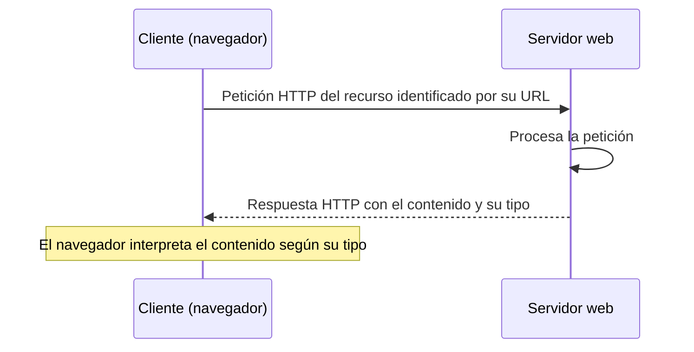
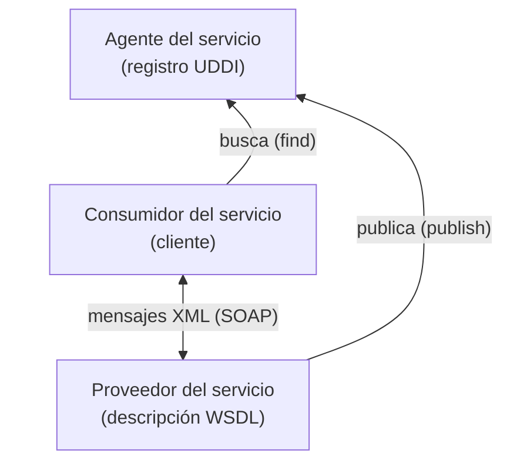
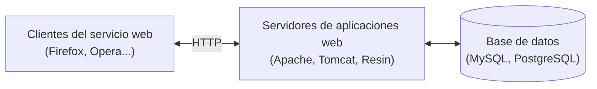
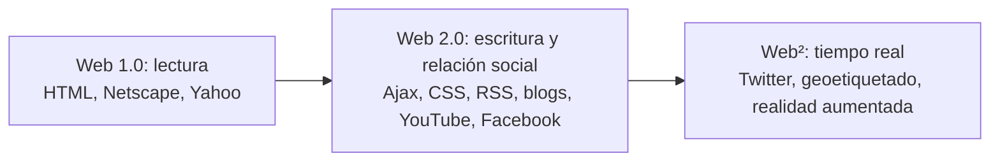
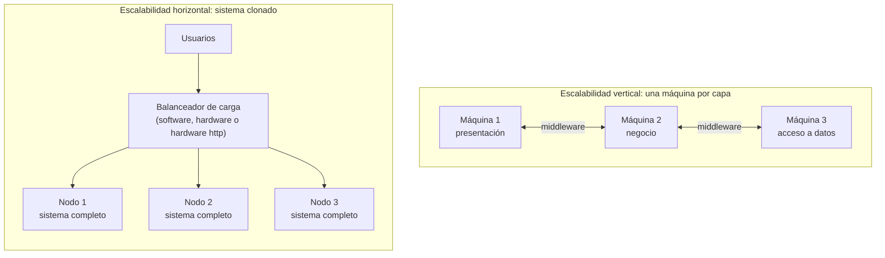
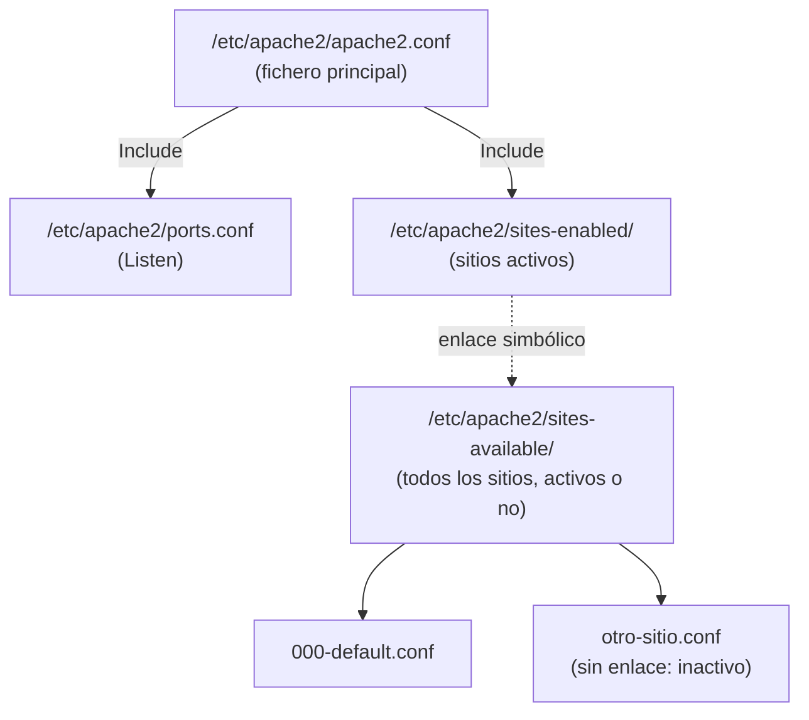
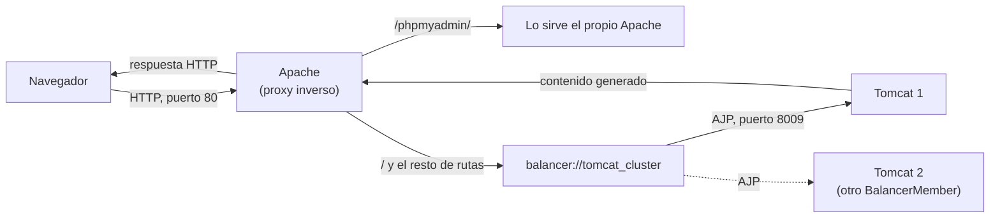
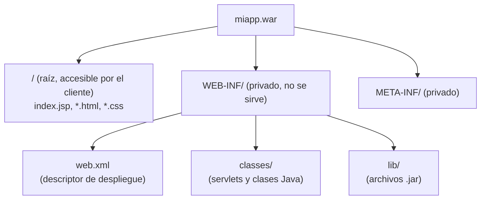

# Unidad 1. Implantación de arquitecturas web

Esta unidad presenta los conceptos sobre los que se apoya todo el módulo: qué es una arquitectura web y en qué capas se divide, qué tecnologías intervienen en una aplicación web y dónde se ejecuta cada una, qué plataformas existen y cómo crece un sistema cuando aumenta el número de usuarios. Después instala y pone en marcha un servidor web (Apache) y un servidor de aplicaciones (Tomcat), y termina con la estructura de una aplicación web Java, los archivos WAR y el descriptor de despliegue.

La unidad se divide en cuatro partes:

1. **Aspectos generales de arquitecturas web**: servicios web, tecnologías, tipos de aplicaciones, modelos, plataformas y escalabilidad.
2. **Servidor web Apache**: arquitectura, instalación, configuración básica y arranque.
3. **Aplicaciones web y servidores de aplicaciones**: diferencia con el servidor web; instalación y arranque de Tomcat; Apache como proxy inverso de Tomcat.
4. **Estructura y despliegue de una aplicación web**: estructura de directorios, archivos WAR, despliegue en Tomcat y descriptor de despliegue.

> **Sobre la vigencia del temario.** El temario trabaja con Ubuntu 20.04 LTS, Apache 2.4 y Tomcat 9.0.35, y cita tecnologías hoy desaparecidas (Flash, applets de Java, Internet Explorer, Netscape) o renombradas (J2EE, proyecto Jakarta). Se expone tal como lo recoge, porque es lo que se pregunta; lo que ha cambiado se indica en recuadros **Contexto actual**.

---

## 1. Aspectos generales de arquitecturas web

La arquitectura **World Wide Web (WWW)** ofrece un modelo de programación potente y flexible: las aplicaciones y los contenidos se presentan en formatos de datos estándar y los localizan unas aplicaciones llamadas **navegadores** (*web browsers*), que piden objetos a un servidor; el servidor responde con el dato codificado en un formato estándar.

Los estándares de la WWW definen los mecanismos necesarios para construir un entorno de aplicación de propósito general:

| Mecanismo | En qué consiste |
|---|---|
| **Modelo estándar de nombres** | Todos los servidores y contenidos se nombran con un **URL** (*Uniform Resource Locator*, Localizador Uniforme de Recursos) |
| **Contenido** | Todo contenido lleva un **tipo** declarado, para que el navegador lo interprete correctamente |
| **Formatos de contenidos estándar** | Todos los navegadores admiten un conjunto de formatos comunes: HTML, JavaScript (ECMAScript)… |
| **Protocolos estándar** | Permiten que cualquier navegador se comunique con cualquier servidor. El más usado es **HTTP** (Protocolo de Transferencia de HiperTexto), que funciona sobre **TCP/IP** |

> **Error frecuente**: confundir HTML con HTTP. HTML es el lenguaje de marcado de las páginas; el protocolo de transferencia es **HTTP**.

Los **aspectos generales** que se destacan en una arquitectura web son seis: **escalabilidad**, **separación de responsabilidades**, **portabilidad**, **utilización de componentes en los servicios de infraestructura**, **gestión de las sesiones del usuario** y **aplicación de patrones de diseño**.

### El modelo cliente-servidor

La web se basa en la **arquitectura cliente-servidor**: un **modelo de aplicación distribuida en el que las tareas se reparten entre los proveedores** de recursos o servicios (los **servidores**) **y los demandantes** (los **clientes**). El cliente inicia la comunicación con una petición; el servidor la recibe, la procesa y devuelve una respuesta. Una aplicación web es un caso concreto de este modelo (apartado 3).

> **Error frecuente**: la "arquitectura de tres niveles" no es el nombre de ese reparto entre proveedores y demandantes; es una forma de organizar en capas una aplicación (apartado 1.4). Y la "arquitectura secuencial" no existe como modelo web.

En la web, el intercambio sigue siempre el mismo patrón de petición y respuesta sobre HTTP:



### Elementos de un servicio web

El funcionamiento de los servicios web requiere tres elementos:

| Elemento | Papel |
|---|---|
| **Proveedor del servicio** | Lo diseña, desarrolla, implementa y lo pone a disposición, dentro de la organización o en público |
| **Consumidor del servicio** | Accede al componente para usar los servicios que presta |
| **Agente del servicio** | Hace de enlace entre proveedor y consumidor para publicar, buscar y localizar el servicio |

Los tres elementos forman un triángulo: el proveedor publica el servicio en el agente, el consumidor lo busca allí y después se comunica directamente con el proveedor. En la representación clásica de esta arquitectura, el agente es un registro **UDDI**, el proveedor describe su servicio en **WSDL** y los dos extremos intercambian mensajes XML con el protocolo **SOAP**:



### Las tres capas de la arquitectura web

De forma genérica, **la arquitectura web es un modelo de tres capas**: **base de datos, servidor de aplicaciones web y clientes de servicio web**.

| Capa | Qué contiene | Ejemplos |
|---|---|---|
| **Base de datos** | Toda la información que se administra mediante el servicio web | MySQL, PostgreSQL |
| **Servidores de aplicaciones web** | Las aplicaciones que atienden las peticiones | Apache, **Tomcat**, Resin |
| **Clientes del servicio web** | Los usuarios, que acceden mediante un navegador | Firefox, Opera, Internet Explorer |

Por tanto, **Tomcat está situado en la capa del servidor de aplicaciones web**.

Cada capa se comunica solo con la contigua:



> **Error frecuente**: el sistema operativo, el navegador como "capa", un "servidor Linux" o unos "clientes HTML/XML" no son capas de este modelo. Las tres capas son siempre **base de datos, servidor de aplicaciones web y clientes**.

### 1.1 Evolución de los servicios web

El uso de los servicios web en las organizaciones está ligado al desarrollo de Internet como red de servicios. **Los factores que han impulsado el uso de los servicios web** son cuatro:

| Factor | Consecuencia para el servicio web |
|---|---|
| **El contenido es cada vez más dinámico** | Los sitios ofrecen contenidos "instantáneos"; el servicio combina contenidos de fuentes muy diferentes |
| **El ancho de banda es más barato** (menos costoso) | Se pueden entregar vídeo o audio; el servicio se adapta a nuevos tipos de contenido |
| **El almacenamiento es más barato** | El servicio maneja cantidades masivas de datos, de forma inteligente |
| **El éxito de la computación extendida** es cada vez más importante | Hay cientos de millones de dispositivos (móviles, agendas electrónicas); el servicio debe servir a cualquier dispositivo, plataforma y navegador. Tecnologías como **XML** ganan importancia |

> **Error frecuente**: "sistemas operativos Microsoft Windows de *Open Source*" no es un factor (y Windows no es software libre). Los factores son **contenido más dinámico, ancho de banda más barato, almacenamiento más barato y computación extendida**.

Los servicios web suelen empezar en una organización como **servicios simples** que poco a poco se integran hasta formar servicios mucho más complejos.

En sus orígenes la web era un entorno **estático**: páginas HTML que casi nunca se modificaban y con muy poca interacción con el usuario. La **Web 2.0** es la transición desde las aplicaciones tradicionales hacia **aplicaciones que funcionan a través de la web, enfocadas al usuario final**. Sus tecnologías persiguen cuatro objetivos:

- Transformar el software de escritorio hacia la web.
- Separar las hojas de estilo.
- Potenciar el trabajo colaborativo y el uso de redes sociales.
- Dar a los usuarios el control total de su información.

La evolución de la web se resume en tres etapas, según lo que el usuario puede hacer en ella:



### 1.2 Tecnologías asociadas a las aplicaciones web

Las aplicaciones web usan **páginas dinámicas**: se ejecutan en un servidor web y se muestran en el navegador del cliente que las ha pedido. La página que llega al navegador puede incluir además un programa o fragmento de código, normalmente **JavaScript**, que ejecuta el propio navegador. Por eso **las páginas web pueden contener código que se ejecute en el servidor web y código que se ejecute en el navegador**.

> **Error frecuente**: **sí se puede ver una página web sin que intervenga un servidor web**. Una página `.htm`, `.html` o `.xhtml` guardada en el propio equipo se abre directamente con el navegador. La única función del servidor web, en ese caso, es enviar la página solicitada cuando está en otro equipo.

**Dónde se ejecuta cada tecnología:**

| Tecnología | Nombre | Dónde se ejecuta | Rasgos |
|---|---|---|---|
| **ASP** | *Active Server Pages*, **Páginas Activas** | **Servidor** | Creada por Microsoft para su servidor IIS; existen versiones para Unix y Linux. Ejemplo típico: un buscador, que entrega un resultado a medida de la petición |
| **CGI** | *Common Gateway Interface*, **Interface Común de Entrada** | Servidor | **Uno de los estándares más antiguos en Internet para trasladar información desde una página a un servidor web**. Se usa en bases de datos, buscadores, formularios, foros, comercio electrónico, mapas de imágenes… Sus rutinas se escriben en lenguajes interpretados como **Perl** o compilados como **C** |
| **CSS** | *Cascading Style Sheets*, **Hojas de Estilo en Cascada** | Navegador | **Se usan para formatear las páginas web**: separan el contenido de su presentación. Un cambio en la CSS afecta a todas las páginas vinculadas a ella |
| **Java** | | Cliente | Multiplataforma (Windows, Linux, Solaris, MacOS…), orientado a objetos; aplicaciones independientes o **applets** |
| **JavaScript** | | **Cliente** | Se interpreta y ejecuta en el navegador: mover imágenes, menús interactivos, juegos. Se prefiere a VBScript porque lo aceptan muchos más navegadores |
| **PHP** | *Hypertext Preprocessor* | **Servidor** | **Como ASP, se ejecuta en el lado del servidor**, es similar a ASP y **puede usarse en circunstancias similares**. Muy eficiente y con acceso a bases de datos como MySQL: se usa para páginas dinámicas complejas |
| **VBScript** | *Visual Basic Scripting* | Cliente o servidor | La respuesta de Microsoft a JavaScript; útil solo para sitios pensados para Internet Explorer |

> **Error frecuente**: **CSS no es una tecnología de programación web en entorno servidor**. Es una hoja de estilos que interpreta el navegador.

**JavaScript es un lenguaje que trabaja en el cliente**: se ejecuta en el navegador del equipo cliente y no en el servidor.

También **Java es un lenguaje que trabaja en el cliente, es decir, se ejecuta en el navegador del equipo cliente y no en el servidor**. Sus programas pueden ser **aplicaciones independientes** (con ventana propia) o **applets**: pequeños programas interactivos incrustados en una página web que funcionan en cualquier navegador. **Los applets de Java se ejecutan en el lado del cliente**, en el navegador. Java es **orientado a objetos** (los programas se construyen con módulos independientes, fáciles de ampliar); lo desarrolló **Sun Microsystems** y después lo liberó bajo licencia **GNU GPL**, por lo que es software libre.

> **Contexto actual**: los applets desaparecieron: los navegadores retiraron el soporte de plugins y Java 11 eliminó el visor de applets. Hoy Java se usa sobre todo **en el servidor** (servlets, JSP, Spring), que es justo el uso que el temario describe en los apartados 3 y 4. La clasificación de Java como lenguaje de cliente responde a la época de los applets.

El código de **VBScript en el lado del servidor no es visible en el cliente**: el cliente recibe los resultados, no el código. Esto vale para cualquier tecnología de servidor (ASP, PHP).

**Perl** es un lenguaje de programación diseñado por **Larry Wall en 1987**, que toma rasgos de C, del intérprete de órdenes *shell* (sh), de awk, sed y Lisp. Su nombre se interpreta como **"lenguaje práctico de extracción y de informes"** (*Practical Extraction and Report Language*) y nació con el objetivo de **simplificar las tareas de administración de un sistema UNIX**.

Dos conceptos de licencias que cita el temario:

- **GNU GPL** (*General Public License*): licencia creada por la **Free Software Foundation** para proteger la libre distribución, modificación y uso del software e impedir que se restrinjan esas libertades. El **proyecto GNU** ("GNU No es Unix", acrónimo recursivo) empezó en **1984** a desarrollar un sistema operativo completo y libre.
- **MySQL**: gestor de bases de datos relacional, sencillo, muy rápido y de los más usados en Internet, en buena parte porque se distribuye bajo **GNU GPL** para aplicaciones no comerciales.

### 1.3 Tipos de aplicaciones web

Una **aplicación web** es una plataforma orientada a **automatizar los procesos de los servicios** que se ofrecen a los usuarios: comercio electrónico, reservas de vuelos, información meteorológica, registro de usuarios, simuladores de hipotecas… Clasificarlas es difícil; el temario las ordena según cómo se presentan junto con su contenido:

| Tipo | Rasgos |
|---|---|
| **Página web estática** | Hecha en **HTML**; puede mostrar objetos en movimiento: **banners, GIF animados, vídeos** |
| **Página web animada** | Hecha con **Flash**: efectos animados continuados, diseños vanguardistas. Tecnología **descontinuada y desaconsejada**: los navegadores la bloquean por sus vulnerabilidades |
| **Página web dinámica** | Con lenguajes como **PHP** y **ASP**: la estructura de la página por un lado y el contenido en archivos aparte; un código de llamada inserta el contenido. De aquí salen las aplicaciones con panel de control |
| **Portal** | Su página principal da acceso a múltiples secciones: foros, chats, correo, buscador, acceso registrado, noticias |
| **Tienda virtual o comercio electrónico** | Publica productos y permite comprarlos en línea (tarjeta, domiciliación, transferencia); panel de gestión de productos para el administrador |
| **Página web con gestor de contenidos** | El administrador la actualiza desde un panel de gestión intuitivo; para webs que cambian a diario |

> **Error frecuente**: **una página compuesta de elementos HTML, GIF animados y vídeos es estática**, no "animada" ni "dinámica". Que algo se mueva en pantalla no la hace dinámica: dinámica es la que se genera con un lenguaje de programación; animada, la hecha con Flash.

### 1.4 Arquitecturas web. Modelos

La **arquitectura de un sitio web** comprende los sistemas de organización y estructuración de los contenidos y los de recuperación de información y navegación, con el fin de ayudar a los usuarios a encontrar y manejar la información.

Los modelos se distinguen por cómo implementan las **tres capas** de una aplicación web:

| Capa | Responsabilidad |
|---|---|
| **Presentación** | Navegabilidad, validación de los datos de entrada, formateo de los de salida, presentación de la web. Es la que ve el usuario |
| **Negocio** | Recibe las peticiones del usuario y envía las respuestas; comprueba que se cumplen las reglas establecidas |
| **Acceso a datos** | Gestores de datos que almacenan, estructuran y recuperan los datos que pide la capa de negocio |

El modelo arquitectónico de las aplicaciones de Internet ha dado **dos grandes saltos, con algún paso intermedio**:

| Modelo | Tecnología | Cómo reparte las capas |
|---|---|---|
| **Modelo 1** | **CGI**: procesos externos al servidor web cuya salida es el HTML que recibe el navegador | Presentación, negocio y datos **mezclados en un mismo script Perl** |
| **Modelo 1.5** | Java: aparecen las **JSP y los servlets** | Presentación en las **JSP**; negocio y acceso a datos en los **beans** incrustados en ellas |
| **Modelo 2** | Incorpora el patrón **MVC** | Aparece un **controlador de la navegación**; el negocio queda encapsulado en los **JavaBeans** incrustados en las JSP |
| **Modelo 2X** | Aplicaciones **multicanal**: atacadas desde distintos clientes (PDA, móvil, navegador HTML) | Publica la misma aplicación para distintos dispositivos con **plantillas XSL que transforman datos XML** |

Conceptos que aparecen en los modelos:

- **Servlet**: objeto que se ejecuta dentro de un **contenedor de servlets** (por ejemplo, Tomcat) y amplía su funcionalidad. El nombre deriva de *applet* (programa que se ejecuta en el navegador): un servlet, en cambio, **se ejecuta en un servidor**. Su uso más común es generar páginas web dinámicas a partir de los parámetros de la petición.
- **Bean**: componente software **reutilizable**, que evita programar uno a uno los distintos componentes.
- **JavaBeans**: modelo de componentes de Sun Microsystems que encapsula varios objetos en uno solo (el *bean*); la especificación los define como "componentes de software reutilizables que se puedan manipular visualmente en una herramienta de construcción".

> **Contexto actual**: hoy los frameworks Java (Spring MVC, Jakarta Faces) siguen el modelo 2 (MVC). El 2X con XSL lo han sustituido las API REST que sirven JSON a cada tipo de cliente.

### 1.5 Plataformas web libres y propietarias

Una **plataforma web** es el entorno de desarrollo de software empleado para diseñar y ejecutar un sitio web. Consta de **cuatro componentes básicos**:

| Componente | Función |
|---|---|
| **Sistema operativo** | Base del funcionamiento del equipo donde se alojan las páginas; a veces limita la elección de los demás componentes |
| **Servidor web** | Atiende las peticiones de equipos remotos. Con páginas estáticas, entrega el archivo pedido; con sitios dinámicos, pasa la petición a los programas que la gestionan |
| **Gestor de bases de datos** | Almacena sistemáticamente registros de datos relacionados para usarlos después |
| **Lenguaje de programación interpretado** | Controla las aplicaciones que corren en el sitio web |

Las dos plataformas más populares son **LAMP** y **WISA**:

| | **LAMP** | **WISA** |
|---|---|---|
| Licencia | **Software libre**, sin restricciones propietarias | **Software propietario**: tecnologías de **Microsoft** |
| Sistema operativo | **Linux** | **Windows** |
| Servidor web | **Apache** | **IIS** (Internet Information Services) |
| Gestor de bases de datos | **MySQL** | **SQL Server** |
| Lenguaje | **PHP** (a veces Perl o Python) | **ASP** o **ASP.NET** |

> **Error frecuente**: **la plataforma WISA no está basada en software libre**; es software propietario de Microsoft. Y **LAMP emplea Apache como servidor web**, no IIS (que es el de WISA); SQL es un lenguaje de consulta y CGI una interfaz, ninguno es un servidor web.

Otras combinaciones:

| Plataforma | Componentes | Uso |
|---|---|---|
| **WAMP** | Windows, Apache, MySQL, PHP | Bastante común, pero **solo como plataforma de desarrollo local** |
| **WIMP** | **Un servidor Microsoft Windows** con IIS, **MySQL y PHP** | |
| Otras | Sistemas Unix, MacOS, Solaris; servidores web **Lighttpd** y **LiteSpeed**; bases de datos como **PostgreSQL** | |

Al conjunto de plataformas con Apache, MySQL y PHP sobre cualquier sistema (LAMP, WAMP…) se le llama **AMP**, y **PHP es el lenguaje de programación más utilizado en las plataformas AMP**.

> **Contexto actual**: en lugar de Apache se usa cada vez más **Nginx** (LEMP), y MariaDB sustituye a MySQL en muchas distribuciones. Las siglas siguen siendo las del temario.

### 1.6 Escalabilidad

El número de usuarios de una aplicación web puede crecer de forma vertiginosa en poco tiempo, y el éxito de un sitio depende en buena parte del **dimensionamiento** del sistema que lo soporta. Por eso un requisito fundamental es que la aplicación sea **completamente escalable** sin que aumentar sus recursos obligue a cambiar su comportamiento o capacidades.

La escalabilidad de un sistema web puede ser:

| Tipo | En qué consiste |
|---|---|
| **Vertical** | Mejoras ascendentes (*upgrades*) en cada nodo; en arquitecturas por capas, **una máquina por cada capa** |
| **Horizontal** | **Aumentar el número de nodos**: clonar el sistema en otras máquinas y repartir la carga |
| **Cluster** | Crear **agrupaciones de servidores** |

#### Escalabilidad vertical

La separación lógica en capas suele implementarse de forma que permita también una separación física. Interponiendo **elementos conectores que actúan de middlewares** se puede **distribuir la aplicación de forma vertical**, es decir, **distribuyendo las capas de la aplicación en diferentes máquinas** (una máquina por capa); y, si no basta, repartiendo los elementos de una misma capa entre varias máquinas.

> **Error frecuente**: **los middlewares distribuyen la aplicación de forma vertical**. Los balanceadores (software, hardware o hardware http) son de la escalabilidad horizontal.

#### Escalabilidad horizontal

Consiste en **clonar el sistema en otra máquina de características similares y balancear la carga** de trabajo con un dispositivo externo. **El balanceador de carga es, por tanto, una solución de escalabilidad horizontal**; los balanceadores **se emplean en la escalabilidad horizontal**, no en la vertical. Hay tres tipos:

| Balanceador | Cómo reparte | ¿Examina el paquete http? | ¿Mantiene la sesión en la misma máquina? | Velocidad |
|---|---|---|---|---|
| **Software** | Por ejemplo, **Apache con el módulo mod_jk**, que redirige las peticiones HTTP entre las máquinas de la granja | **Sí**: identifica la sesión del usuario y registra qué máquina la sirve | **Sí**: todas las peticiones de una sesión van a la misma máquina, y el diseño puede apoyarse en el objeto sesión | La más lenta |
| **Hardware** | Solo con **algoritmos de reparto de carga** (**Round Robin**, **LRU**…); se basa en **conmutación de circuitos** | **No** | **No**: la sesión debe guardarse en **cookies** o en **base de datos**, lo que condiciona el diseño | **Mucho más rápido** que el software |
| **Hardware http** | Dispositivo hardware que examina el paquete http | **Sí** | **Sí**: mantiene la relación usuario-máquina | Intermedia (más rápido que el software, algo menos que el hardware). **Una de las soluciones más aceptadas** |

Las dos formas de escalar se diferencian en qué se multiplica: las capas repartidas en máquinas o el sistema completo clonado.



#### Cluster

Un **cluster de servidores de aplicaciones** permite desplegar una aplicación web corriente de modo que su carga se reparta entre la granja de servidores, de forma **transparente al usuario y al administrador**. Según cómo se aplique, puede clasificarse como vertical u horizontal. Mediante la **replicación de sesión**, cualquier máquina que sirva la petición tiene acceso a la sesión del usuario (en Java, el objeto **HttpSession**). Precisamente por esa replicación, **suele presentar problemas de rendimiento**.

---

## 2. Servidor web Apache

Un **servidor web** es un programa que se ejecuta de forma continua en un ordenador (el término también designa al ordenador que lo ejecuta), espera peticiones de un cliente (un navegador) y las contesta sirviendo una página web, o un mensaje de error si lo hubo.

**Apache** es uno de los servidores web más populares. Sus rasgos:

- **Es de código abierto y gratuito.**
- **Está disponible para Microsoft Windows y GNU/Linux**, entre otros (no únicamente para Linux).
- **Está estructurado en módulos**: cada módulo agrupa las funciones de un aspecto concreto del servidor.
- El archivo binario **httpd** contiene un conjunto de módulos compilados, cuya funcionalidad se activa o desactiva **al arrancar el servidor**.
- Se desarrolla dentro del proyecto **HTTP Server (httpd)** de la **Apache Software Foundation**. La **Licencia Apache** permite distribuir derivados tanto de código abierto como de código cerrado.

Los módulos de Apache se clasifican en tres categorías:

| Categoría | Función |
|---|---|
| **Módulos base** | Funciones básicas |
| **Módulos multiproceso** | Se unen a los puertos de la máquina, aceptan las peticiones y las atienden |
| **Módulos adicionales** | Añaden funcionalidad al servidor |

> **Contexto actual**: en las estadísticas de uso actuales (W3Techs, Netcraft) Nginx ya sirve más sitios que Apache. Los módulos multiproceso se llaman **MPM** (*prefork*, *worker*, *event*).

### 2.1 Instalación y configuración

La instalación se hace en **Ubuntu 20.04 LTS** (máquina real, virtual o contenedor), identificado como **root**:

```bash
apt-get update && apt-get install systemd apache2     # actualiza la lista de paquetes e instala Apache
apt-get install php libapache2-mod-php php-mysql      # PHP, su módulo para Apache (mod_php) y el conector con MySQL
apt-get install mysql-server                          # gestor de bases de datos: completa la plataforma LAMP
systemctl enable apache2                              # Apache arranca automáticamente con el sistema
```

Para comprobar que funciona, **de forma genérica se escribe `http://localhost`** (o `http://127.0.0.1`) en la barra de direcciones del navegador; desde otro equipo de la red, la IP de la máquina. Aparece la página por defecto de Apache, con el texto **"It works!"**. Desde el terminal se comprueba con `systemctl status apache2` (apartado 2.2).

> **Error frecuente**: `http://192.168.0.1` o `http://10.0.0.1` son IP concretas de una red; la forma genérica, válida en cualquier máquina, es **`http://localhost`**.

#### Dónde están las páginas

Por defecto, Apache sirve las páginas de la carpeta **`/var/www/html/`**, donde está el `index.html` con la página de bienvenida. Dentro se pueden crear carpetas con nuevas páginas, todas accesibles por el **puerto 80**. Como esa carpeta está dentro de **`/var/www/`**, también es correcto decir que **en una máquina Linux Apache sirve por defecto las páginas que están en la carpeta /var/www/**: el temario da **`/var/www`** como valor predeterminado de `DocumentRoot`.

Para servir más de una web conviene usar **hosts virtuales**. En **`/etc/apache2/sites-enabled`** está el fichero **`000-default`**, que sirve de ejemplo; los hosts virtuales permiten servir varias webs desde una sola dirección IP, por ejemplo con un puerto distinto para cada una.

#### Ficheros de configuración

Apache se configura con **directivas** escritas en ficheros de texto plano:

| Fichero | Contenido |
|---|---|
| **`/etc/apache2/apache2.conf`** | **Archivo principal de configuración** (puerto, raíz de documentos, módulos, registros, hosts virtuales…) |
| **`/etc/apache2/ports.conf`** | La directiva **`Listen`** (puertos de escucha) |
| **`/etc/apache2/sites-available/`** | Un fichero por sitio (host virtual), activo o no |
| **`/etc/apache2/sites-enabled/`** | Los sitios activos (enlaces a los de `sites-available`) |

Otros ficheros se añaden con la directiva **`Include`**, que admite comodines. **Apache solo reconoce los cambios en los ficheros de configuración cuando se inicia o se reinicia.**

La relación entre esos ficheros es la siguiente: `apache2.conf` incorpora los demás, y de los sitios solo se cargan los que tienen un enlace en `sites-enabled`.



Directivas principales de `apache2.conf`:

| Directiva | Para qué sirve |
|---|---|
| **`ServerTokens`** | Cuánta información da Apache sobre sí mismo (en las cabeceras HTTP) |
| **`ServerSignature`** | Datos de Apache en el **pie de los mensajes de error** |
| **`Alias`** | Dirige a una carpeta que puede estar **fuera** del árbol de `DocumentRoot` |
| **`UserDir`** | Redirige al directorio personal del usuario ante una petición del tipo **`~usuario`** |

#### El servidor virtual predeterminado

**Para modificar el servidor virtual predeterminado se edita el archivo `/etc/apache2/sites-available/default`**. Para crear un sitio nuevo se **copia ese archivo en el mismo directorio** con el nombre elegido y se edita la copia. Directivas de un host virtual:

| Directiva | Para qué sirve |
|---|---|
| **`ServerName`** | Nombre del sitio; sin dominio registrado, `localhost` |
| **`ServerAdmin`** | Correo del administrador; por omisión, **`webmaster@localhost`** |
| **`DocumentRoot`** | **Dónde busca Apache los archivos que forman el sitio**. Valor predeterminado: **`/var/www`** |
| **`CustomLog`** | Archivo `.log` donde se guardan los **registros de acceso** |
| **`Listen`** | **Puerto (y, opcionalmente, dirección IP) por el que escucha Apache**. Está en su propio fichero, **`/etc/apache2/ports.conf`** |
| **`RedirectMatch`** | En `apache2.conf`, redirige las peticiones a `/var/www/apache2-default`, donde residía el sitio predeterminado; si se cambia en un host virtual, hay que crear ese directorio |

> **Error frecuente**: **`DocumentRoot` no especifica el puerto**; indica la carpeta raíz del sitio. El puerto (y la IP) los fija **`Listen`**.

> **Contexto actual**: en Ubuntu 20.04 el fichero del sitio por defecto es **`/etc/apache2/sites-available/000-default.conf`** (el nombre `default` es de Debian antiguo), su `DocumentRoot` es **`/var/www/html`** y `apache2.conf` concede el acceso a todo **`/var/www/`**. Un sitio nuevo se activa con `a2ensite nombre.conf` y se desactiva con `a2dissite`; `ServerTokens` y `ServerSignature` están en `/etc/apache2/conf-available/security.conf`, y `UserDir` exige activar el módulo con `a2enmod userdir`. `RedirectMatch` ya no aparece en la configuración por defecto.

**Ejemplo análogo: Apache escuchando en el puerto 8081.** El cambio de puerto afecta a dos ficheros: el puerto de escucha y el host virtual que lo usa.

```apache
# /etc/apache2/ports.conf
# antes: Listen 80
Listen 8081
```

```apache
# /etc/apache2/sites-available/000-default.conf
# antes: <VirtualHost *:80>
<VirtualHost *:8081>
    ServerAdmin webmaster@localhost
    DocumentRoot /var/www/html
    ErrorLog ${APACHE_LOG_DIR}/error.log
    CustomLog ${APACHE_LOG_DIR}/access.log combined
</VirtualHost>
```

```bash
apachectl configtest                 # comprueba la sintaxis: "Syntax OK"
systemctl restart apache2            # el cambio de puerto solo se aplica al reiniciar
ss -tlnp | grep apache2              # muestra el puerto en que escucha (aquí, 8081)
```

Y en el navegador: `http://localhost:8081`. Si solo se cambia `Listen` y no el `<VirtualHost>`, Apache escucha en el puerto nuevo pero el sitio por defecto no responde con su configuración.

#### PHP como módulo de Apache

El paquete `libapache2-mod-php` instala **mod_php**, **la forma más habitual de integrar la ejecución de páginas PHP en el servidor web Apache**: el intérprete de PHP se carga dentro del propio proceso de Apache. Otra opción es **una solución como FastCGI**, en la que PHP corre como un proceso aparte. PHP no se integra mediante un servidor de aplicaciones ni mediante Tomcat (que es para Java).

La configuración del entorno de ejecución de PHP está en el fichero **`php.ini`** (no `php.cfg`, `apache.conf` ni `php.xml`); en Ubuntu, el que usa Apache es `/etc/php/<versión>/apache2/php.ini`. Con **mod_php, los cambios en la configuración de PHP no se aplican al recargar la página**: PHP lee `php.ini` cuando arranca Apache, así que **hay que reiniciar Apache** (`systemctl restart apache2`). Una de sus directivas es **`max_execution_time`**, el tiempo máximo en segundos que puede durar la ejecución de un script, para que un error no bloquee el servidor.

> **Contexto actual**: hoy se prefiere **PHP-FPM** (una implementación de FastCGI) con el MPM *event* de Apache o con Nginx; en ese caso se reinicia el servicio `php<versión>-fpm`.

#### Herramientas de administración

| Herramienta | Qué hace |
|---|---|
| **phpMyAdmin** | Interfaz web para **configurar el servidor MySQL** de forma remota; fundamental en los servidores LAMP. Los proveedores de alojamiento suelen ofrecerla |
| **Webmin** | Herramienta **modular** de **configuración de sistemas** vía web: configura de forma remota casi todos los servicios del servidor. Los proveedores de alojamiento no la suelen dar, porque la administración del sistema corre de su parte |

Las dos tienen interfaz web: se usan desde un navegador sin instalar software adicional en el cliente.

### 2.2 Iniciar Apache

La configuración se comprueba con:

```bash
apachectl configtest        # si todo está bien responde "Syntax OK"
```

Si el puerto de la directiva `Listen` es el **80** (o **cualquier otro por debajo del 1024**, los **puertos privilegiados**), hacen falta **privilegios de root** para iniciar Apache. Una vez iniciado y tras abrir sus ficheros de registro, Apache lanza varios **procesos hijo** que escuchan y atienden las peticiones. **El proceso principal, httpd, sigue ejecutándose como root; los procesos hijo, con menos privilegios** (en Debian y Ubuntu, con el usuario `www-data`).

**El demonio `httpd` se debería invocar con el script de control `apachectl`, que fija las variables de entorno y pasa al demonio cualquier opción que reciba como argumento por línea de comandos.** `apachectl` interpreta los argumentos `start`, `restart` y `stop` y los traduce en las señales adecuadas para httpd. Es el comando **genérico para Linux**; en Debian y Ubuntu es más habitual usar los siguientes:

| Acción | Script de init (antiguo) | systemd (versiones actuales) |
|---|---|---|
| Ver el estado (si está arrancado, desde cuándo, versión…) | | `systemctl status apache2` |
| Parar | `/etc/init.d/apache2 stop` | `systemctl stop apache2` |
| Reiniciar | `/etc/init.d/apache2 restart` | `systemctl restart apache2` |
| Arrancar | `/etc/init.d/apache2 start` | `systemctl start apache2` |

Si un host virtual cambia el puerto de escucha, **es necesario reiniciar Apache**: los cambios de configuración no se aplican hasta entonces.

> **Contexto actual**: en Debian y Ubuntu el binario se llama `apache2`, no `httpd` (que es el nombre en Red Hat y en el proyecto oficial). `systemctl reload apache2` relee la configuración sin cortar las conexiones activas.

---

## 3. Aplicaciones web y servidores de aplicaciones

Una **aplicación web** es una aplicación informática que se ejecuta en un entorno web: una **aplicación cliente-servidor** con un protocolo de comunicación establecido.

| Parte | Qué es |
|---|---|
| Cliente | El **navegador** |
| Servidor | El **servidor web** |
| Comunicación | El **protocolo HTTP** |

Un **servidor de aplicaciones** es un software que proporciona aplicaciones a los equipos o dispositivos cliente, normalmente a través de Internet y con HTTP. **Se distingue del servidor web por el uso extensivo del contenido dinámico y por su frecuente integración con bases de datos.** El término designa también a la **máquina** de la red que ejecuta esas aplicaciones y gestiona la mayor parte de las funciones de acceso a los datos.

| | Servidor web (Apache) | Servidor de aplicaciones (Tomcat) |
|---|---|---|
| Qué hace | Sirve páginas y recursos; pasa lo dinámico a otros programas | Ejecuta la aplicación: contenido dinámico y acceso a datos |
| Ejemplo | Apache, IIS | Tomcat (servlets y JSP), servidores J2EE |

**Ventajas de los servidores de aplicaciones:**

- **Centralización y menor complejidad del desarrollo**: las aplicaciones no se programan desde cero, se **ensamblan con bloques que proporciona el servidor**.
- **Integridad de datos y código**: al estar centralizados en una o pocas máquinas, las actualizaciones llegan a todos los usuarios.

El término se aplica a todas las plataformas: comercio electrónico, gestores de contenidos, constructores de sitios. El ejemplo destacado es la plataforma **J2EE** (*Java 2 Enterprise Edition*) de **Sun Microsystems**, en la que se basan los servidores de aplicaciones Java. Se organiza en niveles:

| Nivel | Contenido |
|---|---|
| **Cliente** | Una o más aplicaciones o navegadores |
| **Medio** | La plataforma J2EE: un **servidor web** y un **servidor EJB**, llamados **contenedores**; puede tener subniveles |
| **EIS** (*Enterprise Information System*, Sistema de Información Empresarial) | Las aplicaciones existentes, archivos y bases de datos |

> **Contexto actual**: J2EE pasó a llamarse Java EE y, desde 2017, **Jakarta EE**, gestionada por la Eclipse Foundation. Sun Microsystems fue comprada por Oracle en 2010.

### 3.1 El servidor de aplicaciones Tomcat

**Tomcat es un servidor de aplicaciones** (no un navegador, ni un servlet, ni un sistema operativo) del **proyecto Jakarta** de la Apache Software Foundation. Gestiona las solicitudes y respuestas HTTP, como un servidor web, y además es **contenedor de servlets y JSP**. Incluye el compilador **Jasper**, que **compila las JSP convirtiéndolas en servlets**.

> **Error frecuente**: **las funciones de Apache y de Tomcat no son equivalentes**. Apache es **únicamente un servidor web**; Tomcat es un **servidor de aplicaciones**.

Un **contenedor de servlets** es un *shell* de ejecución (un programa que da acceso a servicios del sistema) que maneja e invoca servlets por cuenta del usuario. Hay tres tipos:

| Tipo | Cómo funciona | Rendimiento |
|---|---|---|
| **Stand-alone (independiente)** | Parte integral de un servidor web basado en Java (como JavaWebServer, hoy sustituido por iPlanet). **Es el modo por defecto de Tomcat** | |
| **Dentro de proceso** | Un plugin del servidor web abre una **JVM dentro del espacio de direcciones del servidor web**; el plugin pasa la petición al contenedor Java **mediante JNI** | Buen rendimiento; adecuado para servidores multihilo de un solo proceso, pero **limitado en escalabilidad** |
| **Fuera de proceso** | La JVM se ejecuta **fuera del servidor web**; plugin y JVM se comunican por **IPC** (normalmente **sockets TCP/IP**) | Peor tiempo de respuesta, pero **mejor escalabilidad y estabilidad** |

**Tomcat puede utilizarse como contenedor solitario** (sobre todo para desarrollo y depuración) **o como plugin para un servidor web existente** (actualmente soporta **Apache e IIS**). Con las opciones 2 o 3 hay que instalar además un **adaptador de servidor web**.

> **Error frecuente**: a veces se dice que Tomcat "incluye el servidor Apache". No es exacto: Tomcat incluye su **propio servidor HTTP** (escrito en Java, el conector Coyote), no Apache httpd. Lo que sí es cierto es que puede funcionar solo o detrás de Apache.

#### 3.1.1 Instalación y configuración básica

Tomcat necesita el **JDK** (*Java Development Kit*). El procedimiento en Ubuntu 20.04:

```bash
sudo apt update
sudo apt install default-jdk                     # JDK: imprescindible para cualquier versión de Tomcat

sudo groupadd tomcat                             # grupo tomcat
sudo useradd -s /bin/false -g tomcat -d /opt/tomcat tomcat
#            shell /bin/false: nadie puede iniciar sesión con esa cuenta
#            -d /opt/tomcat: directorio de inicio, donde se instala Tomcat

cd /tmp
curl -O https://archive.apache.org/dist/tomcat/tomcat-9/v9.0.35/bin/apache-tomcat-9.0.35.tar.gz
sudo mkdir /opt/tomcat
sudo tar xzvf apache-tomcat-*tar.gz -C /opt/tomcat --strip-components=1   # extrae sin la carpeta raíz del .tar.gz

cd /opt/tomcat
sudo chgrp -R tomcat /opt/tomcat                 # el grupo tomcat es dueño de toda la instalación
sudo chmod -R g+r conf                           # el grupo lee conf y su contenido
sudo chmod g+x conf                              # y puede entrar en el directorio
sudo chown -R tomcat webapps/ work/ temp/ logs/  # el usuario tomcat es propietario de estos cuatro
```

Después se crea el servicio de systemd en **`/etc/systemd/system/tomcat.service`**:

```ini
[Unit]
Description=Apache Tomcat Web Application Container
# arranca después de la red
After=network.target

[Service]
# startup.sh lanza Tomcat en segundo plano
Type=forking
# ruta del JDK del equipo
Environment=JAVA_HOME=/usr/lib/jvm/java-1.11.0-openjdk-amd64
Environment=CATALINA_PID=/opt/tomcat/temp/tomcat.pid
# dónde está instalado Tomcat
Environment=CATALINA_HOME=/opt/tomcat
Environment=CATALINA_BASE=/opt/tomcat
# memoria de la JVM
Environment='CATALINA_OPTS=-Xms512M -Xmx1024M -server -XX:+UseParallelGC'
Environment='JAVA_OPTS=-Djava.awt.headless=true -Djava.security.egd=file:/dev/./urandom'
# arranque
ExecStart=/opt/tomcat/bin/startup.sh
# parada
ExecStop=/opt/tomcat/bin/shutdown.sh
User=tomcat
Group=tomcat
UMask=0007
RestartSec=10
Restart=always

[Install]
WantedBy=multi-user.target
```

```bash
sudo systemctl daemon-reload     # systemd lee el nuevo fichero de servicio
sudo systemctl start tomcat
sudo systemctl status tomcat     # si está arrancado, desde cuándo, versión…
```

En Tomcat **la gestión del servicio se realiza con el script `catalina`** (`/opt/tomcat/bin/catalina.sh`), al que se le pasan los parámetros **`start`** y **`stop`** para arrancar o parar el servicio a mano; `startup.sh` y `shutdown.sh` lo llaman por debajo.

> **Error frecuente**: `apache2` es el servicio de Apache, `sys.ctl` no existe (el comando es `systemctl`) y `tomcate` tampoco. El script de Tomcat es **`catalina`**.

Para comprobar que escucha, **de forma genérica se escribe `http://localhost:8080`** (o `http://127.0.0.1:8080`) en el navegador; aparece la página de inicio de Tomcat, con botones para *Server Status*, *Manager App* y *Host Manager*.

> **Contexto actual**: la URL de descarga del temario (un espejo, `apache.brunneis.com`) ya no existe; las versiones antiguas están en `archive.apache.org`, y las actuales en `dlcdn.apache.org`. Tomcat 9 sigue con soporte; Tomcat 10 y posteriores usan Jakarta EE (paquetes `jakarta.*` en lugar de `javax.*`).

#### 3.1.2 Iniciar Tomcat

**Tomcat escucha en el puerto 8080** y tiene su propio directorio de trabajo. Apache intercepta las peticiones en el puerto **80** y deriva a Tomcat las que corresponden. Así se gana **escalabilidad**: Apache, como **proxy**, puede tener una batería de Tomcats entre los que balancear las conexiones, de forma transparente para el usuario.

| | Apache | Tomcat |
|---|---|---|
| Puerto | 80 | **8080** (HTTP); **8009** (AJP) |
| Carpeta de trabajo | `/var/www/html` | **`/opt/tomcat/webapps`** |
| Configuración principal | `/etc/apache2/apache2.conf` | **`/opt/tomcat/conf/server.xml`** |
| Usuarios | | **`/opt/tomcat/conf/tomcat-users.xml`** |

En **`/opt/tomcat/conf/server.xml`** la línea del host indica la carpeta de las aplicaciones:

```xml
<Host name="localhost" appBase="webapps"> <!-- appBase: carpeta donde Tomcat busca las aplicaciones -->
```

Para usar las aplicaciones de administración web que trae Tomcat (**manager-gui** y **admin-gui**) se añade un usuario en **`/opt/tomcat/conf/tomcat-users.xml`**, entre las etiquetas `tomcat-users`:

```xml
<tomcat-users>
    <user username="admin" password="una_clave_segura" roles="manager-gui,admin-gui"/> <!-- roles de las apps de gestión -->
</tomcat-users>
```

Para parar o arrancar el servidor: `sudo systemctl stop tomcat` y `sudo systemctl start tomcat`, o bien `sudo service tomcat stop` y `sudo service tomcat start`.

#### Proxy inverso

Un **proxy inverso** es un servidor proxy que **recupera recursos en nombre de un cliente desde uno o más servidores** y se los entrega como si salieran de él mismo. También se llaman **servidores de paso** o **gateway**. El proxy no genera contenido: lo obtiene de servidores **backend** (la parte que ejecuta la lógica de la web), que normalmente no tienen conexión directa con el exterior. El proxy recibe la petición, la reenvía a un backend, este genera el contenido y el proxy compone la respuesta HTTP final. Para el cliente, **el proxy es la única fuente del contenido**.

Se usa por **seguridad, alta disponibilidad, balanceo de carga y centralización de la autenticación y autorización**; es crítico que los backend estén aislados y protegidos.

Un **gateway** (puerta de enlace) es un dispositivo que interconecta redes con protocolos y arquitecturas diferentes.

Apache se configura como proxy inverso de Tomcat activando estos módulos:

```bash
sudo a2enmod proxy               # proxy básico
sudo a2enmod proxy_ajp           # comunicación con Tomcat por AJP
sudo a2enmod proxy_balancer      # balanceo entre varios backend
sudo /etc/init.d/apache2 restart
```

**AJP** es un protocolo de comunicación interno y muy rápido, con **conexiones TCP persistentes**; es el que comunica Apache con Tomcat (también podría usarse HTTP contra el 8080). **El puerto AJP por defecto de Tomcat es el 8009**, configurable en `/opt/tomcat/conf/server.xml`. En el host virtual por defecto (`/etc/apache2/sites-enabled/000-default.conf`) se añade:

```apache
# define un cluster llamado tomcat_cluster
<Proxy balancer://tomcat_cluster>
  Order allow,deny
  Allow from all
  # miembro del cluster: protocolo, IP y puerto
  BalancerMember ajp://localhost:8009
</Proxy>
# conserva la cabecera Host original, sin reescribirla
ProxyPreserveHost On
# "!" excluye esta ruta: la sigue sirviendo Apache
ProxyPass /phpmyadmin/ !
# "/" y todo lo que cuelga de ella lo procesa Tomcat
ProxyPass / balancer://tomcat_cluster/
# reescribe las cabeceras de las respuestas
ProxyPassReverse / balancer://tomcat_cluster/
```

Por último se cambian `DocumentRoot` y `<Directory /var/www/html>` para que apunten a `/var/www/ROOT`, de modo que desde un solo directorio se decide qué parte gestiona cada servidor.

> **Contexto actual**: desde **Tomcat 9.0.31** el conector AJP viene **comentado** en `server.xml` (tras la vulnerabilidad Ghostcat) y exige un secreto compartido: con la instalación del temario, el puerto 8009 no escucha hasta activarlo. `Order allow,deny` y `Allow from all` son sintaxis de Apache 2.2; en 2.4 se escribe `Require all granted`. El balanceador de Apache 2.4 necesita además un módulo de método de reparto, como `lbmethod_byrequests`.

Con esa configuración, el recorrido de una petición depende de su ruta:



Para el navegador, Apache es la única fuente del contenido: no sabe que detrás hay uno o varios Tomcat.

---

## 4. Estructura y despliegue de una aplicación web

Una aplicación web Java está formada por **servlets, páginas JSP, ficheros HTML, imágenes, sonidos, texto, clases…**, que pueden empaquetarse y ejecutarse en distintos contenedores. Un **servlet** es una aplicación Java que realiza un servicio específico dentro de un servidor web.

La **especificación Servlet 2.2** define la estructura de directorios:

- El **directorio raíz** lleva el nombre de la aplicación y es su raíz de documentos.
- Todo lo que está bajo la raíz **puede servirse al cliente**, salvo lo que está en los directorios especiales **`META-INF`** y **`WEB-INF`**.
- Los ficheros privados y los **`.class` de los servlets** van bajo **`WEB-INF`**.

**El código necesario para ejecutar correctamente una aplicación web se encuentra distribuido en una estructura de directorios, agrupando los ficheros según su funcionalidad.** Durante el **desarrollo** se trabaja con esa estructura; en **producción** se empaqueta entera en un archivo **`.war`**. Un ejemplo:

| Ruta | Qué contiene |
|---|---|
| `/index.jsp` | Página de entrada |
| `/WebContent/jsp/`, `/css/`, `/js/`, `/img/` | Páginas JSP, hojas de estilo, scripts e imágenes |
| `/WEB-INF/web.xml` | Descriptor de despliegue |
| `/WEB-INF/struts-config.xml` | Configuración del framework Struts |
| `/WEB-INF/lib/struts.jar` | Librerías |
| `/WEB-INF/src/…/welcomeAction.java` | Código fuente |
| `/WEB-INF/classes/…/welcomeAction.class` | Clases compiladas |

De forma genérica, una aplicación web se estructura en tres capas: **navegador web**, **tecnología web dinámica** (PHP, Java Servlets, ASP…) y **base de datos**, que guarda de forma permanente y actualizada la información.

### 4.1 Archivos WAR

**WAR** viene de **Web Application Archive** (Archivo de Aplicación Web). Un archivo `.war` **empaqueta en una sola unidad aplicaciones web Java completas**; es decir, **contiene una aplicación web completa, empaquetada**:

- Servlets y JSP.
- Contenido estático: HTML, imágenes…
- Otros recursos web.

**Ventajas:**

- **Simplifica el despliegue**: la instalación es sencilla y basta **un fichero para cada servidor de un cluster**.
- **Aumenta la seguridad**: no permite el acceso entre aplicaciones web distintas.

**Estructura de un WAR:**

| Carpeta | Contenido |
|---|---|
| **`/`** | Elementos del sitio: documentos HTML, hojas de estilo, JSP (`*.html`, `*.jsp`, `*.css`) |
| **`/WEB-INF/`** | Configuración: página de inicio, ubicación de los servlets, parámetros. El más importante, **`web.xml`** |
| **`/WEB-INF/classes/`** | Las **clases Java**; normalmente, los **servlets** |
| **`/WEB-INF/lib/`** | Los **archivos JAR** de la aplicación: normalmente, los de conexión a la base de datos o las librerías de JSP |

La misma estructura, en forma de árbol:



Herramientas para generar archivos `.war`: los IDE **NetBeans** y **Eclipse** (ambos *open source*), **JBuilder** de Borland y **JDeveloper** de Oracle; y **Ant**, herramienta *open source* que no es un IDE y se considera **"el make de Java"**.

> **Error frecuente**: un `.war` **no es lo mismo que un `.zip`** ni un archivo que se genere con cualquier compresor (winzip, winrar, tar): aunque internamente use el formato ZIP, lo que lo define es que **empaqueta una aplicación web completa con una estructura obligatoria** (`WEB-INF`, `web.xml`…). Tampoco es un conjunto de páginas `.html` o `.css`, ni "engloba un protocolo de comunicación".

> **Ampliación**: desde el terminal, con el JDK, un WAR se crea con `jar -cvf miapp.war -C carpeta_app .`. En Tomcat basta copiarlo en `webapps/`: el servidor lo descomprime y despliega solo (*autoDeploy*), y la aplicación queda en `http://localhost:8080/miapp/`.

### 4.2 Despliegue de aplicaciones con Tomcat

**Una aplicación web puede desplegarse** de dos formas:

- **Por medio de archivos `.war`** (*Web Archive*).
- **Editando los archivos `web.xml` y `server.xml`**, a mano.

Los directorios de una aplicación compilada (en el ejemplo, un proyecto GWT) suelen ser: **`www`, `bin`, `src`, `tomcat` y `gwt-cache`**. `www` contiene una carpeta con el nombre del proyecto y los ficheros de la interfaz (`.html`, `.js`, `.css`); `bin`, las clases Java.

**Pasos del despliegue manual en Tomcat:**

1. Copiar la carpeta contenida en `www` (con el nombre del proyecto) en el directorio **`webapps`** de Tomcat.
2. Renombrarla con un nombre más sencillo: será la carpeta de la aplicación.
3. Crear dentro una carpeta **`WEB-INF`**, respetando las mayúsculas.
4. Crear dentro de `WEB-INF` los subdirectorios **`lib`** y **`classes`**.
5. Copiar en `lib` todas las librerías **`.jar`** que necesite la aplicación.
6. Copiar el contenido de `bin` en **`WEB-INF/classes`**.
7. Crear en `WEB-INF` el fichero **`web.xml`** con las rutas de los servlets.
8. Acceder desde el navegador con la ruta del `.html` de entrada, dentro de la carpeta de la aplicación.

### 4.3 Descriptor de despliegue

**Un descriptor de despliegue es un documento XML que describe las características de despliegue de una aplicación, un módulo o un componente.** Es, por tanto, **un único archivo** y **tiene formato XML**; **no es una aplicación web**. Su información es **declarativa**: se puede cambiar **sin modificar el código fuente**.

- **Toda aplicación web aporta su descriptor en `WEB-INF/web.xml`.**
- En Tomcat, **`<TOMCAT_HOME>/conf/web.xml`** es un **descriptor por defecto** que se aplica **siempre antes** que el de la aplicación y solo debe contener información general.

Ejemplo de `web.xml`:

```xml
<?xml version="1.0" encoding="ISO-8859-1"?>
<!DOCTYPE web-app PUBLIC
  "-//Sun Microsystems, Inc.//DTD Web Application 2.2//EN"
  "http://java.sun.com/j2ee/dtds/web-app_2_2.dtd">
<web-app>                                              <!-- elemento raíz -->
  <servlet>                                            <!-- declaración de un servlet -->
    <servlet-name>nombre</servlet-name>                <!-- 1.º el nombre -->
    <servlet-class>package.nombre.MiClass</servlet-class> <!-- 2.º la clase, con su paquete -->
  </servlet>
</web-app>
```

Entre `<web-app>` y `</web-app>` van los descriptores de los servlets, con sus etiquetas **en este orden**: `<servlet-name>` y después `<servlet-class>`.

Para probar el servlet, con Tomcat arrancado, se escribe en el navegador una URL con el formato **`http://{address}:{port}/{servletName}`**: primero la dirección, después el puerto y al final el nombre del servlet. Por ejemplo, `http://localhost:8080/Servlet_de_prueba`.

> **Contexto actual**: para que un servlet responda en una URL hace falta además un `<servlet-mapping>` con su `<url-pattern>`, o la anotación `@WebServlet` (Servlet 3.0 en adelante, sin necesidad de `web.xml`). La URL real incluye el contexto de la aplicación: `http://localhost:8080/miapp/MiServlet`.

---

## Ideas clave

- **Cliente-servidor**: las tareas se reparten entre proveedores (servidores) y demandantes (clientes). **Arquitectura web, tres capas**: base de datos, servidor de aplicaciones web (Apache, **Tomcat**) y clientes.
- **Factores de los servicios web**: contenido más dinámico, ancho de banda y almacenamiento más baratos, computación extendida. **Web 2.0**: aplicaciones en la web enfocadas al usuario.
- **Servidor**: ASP, PHP, CGI. **Cliente**: JavaScript, CSS, **Java y sus applets**. Una página se puede ver **sin servidor web**.
- **Tipos**: estática (HTML, GIF animados, vídeos), animada (Flash), dinámica (PHP, ASP), portal, tienda, gestor de contenidos. **Modelos**: 1 (CGI/Perl), 1.5 (JSP y beans), 2 (MVC), 2X (multicanal, XSL).
- **Plataformas**: **LAMP** libre (Linux, Apache, MySQL, PHP); **WISA** propietaria (Windows, IIS, SQL Server, ASP); WAMP solo desarrollo local; **WIMP**: Windows con IIS, MySQL y PHP. PHP, el lenguaje de las AMP.
- **Escalabilidad**: vertical (**middlewares**, una máquina por capa), horizontal (**balanceadores**: software con mod_jk y sesión; hardware rápido sin sesión; hardware http intermedio), cluster (replicación de sesión, peor rendimiento).
- **Apache**: libre, Windows y Linux, modular (base, multiproceso, adicionales). `apache2.conf`, `ports.conf` (**`Listen`**: puerto), **`DocumentRoot`** (carpeta, `/var/www`), `sites-available/default`. Prueba: **`http://localhost`**. Arranque con **`apachectl`** o `systemctl`; puertos < 1024 exigen root.
- **PHP en Apache**: **mod_php**; su configuración, **`php.ini`**; los cambios exigen **reiniciar Apache**.
- **Tomcat**: **servidor de aplicaciones**, contenedor de servlets y JSP (Jasper); no equivale a Apache. Solitario o **plugin de Apache e IIS**. Script **`catalina`**; **`http://localhost:8080`**; AJP en el 8009; `server.xml`, `tomcat-users.xml`, `webapps`.
- **WAR**: aplicación web completa empaquetada; `WEB-INF/web.xml`, `classes`, `lib`. **Descriptor de despliegue**: un único archivo XML que describe el despliegue (`WEB-INF/web.xml`). Servlet: `http://{address}:{port}/{servletName}`.
