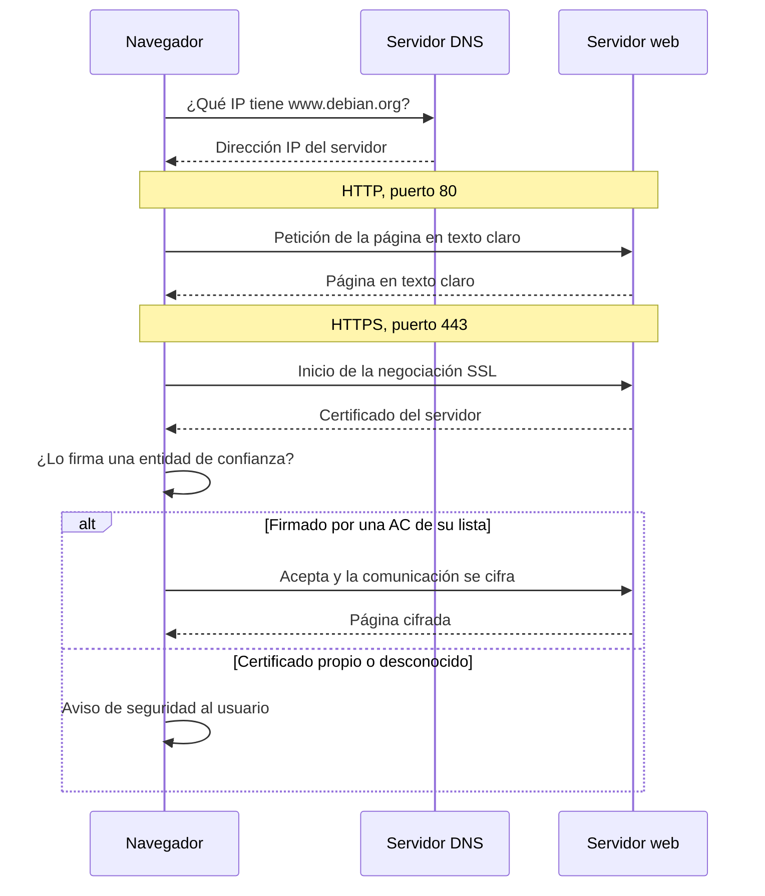
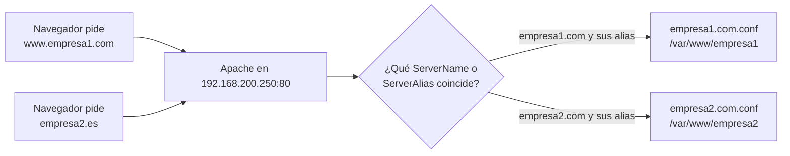
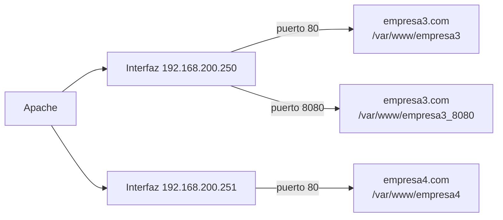
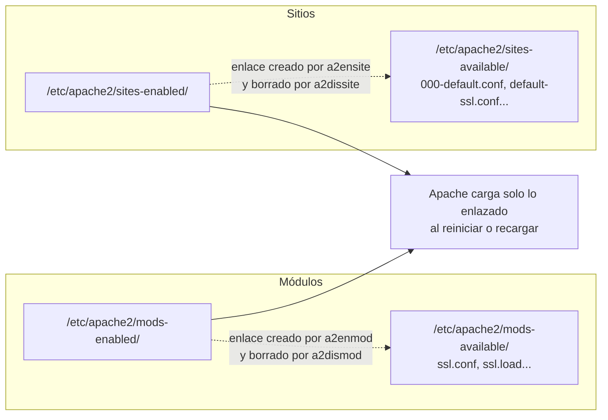
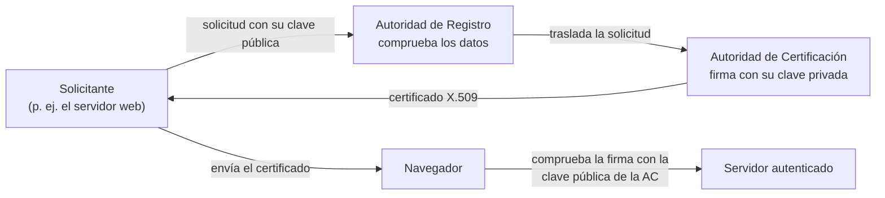
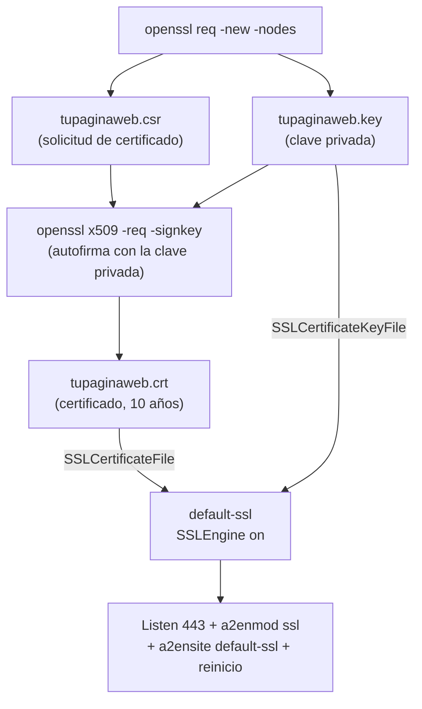
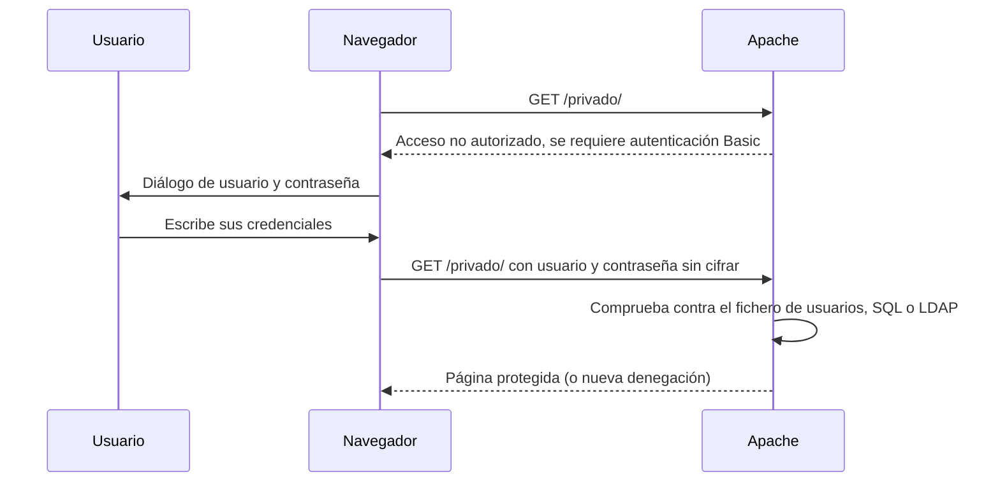
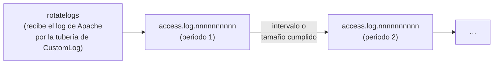
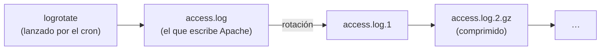

# Unidad 2. Configuración y administración de servidores web

Esta unidad estudia el servidor web Apache (paquete `apache2`) en un sistema GNU/Linux de la familia Debian: cómo sirve contenido estático y dinámico, qué papel tienen los protocolos HTTP y HTTPS y los tipos MIME, cómo se alojan varios sitios en un mismo servidor mediante hosts virtuales, cómo se amplían sus funciones con módulos, cómo se cifra la comunicación con certificados, cómo se restringe el acceso a partes de un sitio y cómo se registra y mantiene la actividad del servidor en los archivos de registro. Termina con el procedimiento general para desplegar una aplicación web sobre el servidor.

La unidad se divide en siete partes:

1. **Funcionamiento de un servidor web**: contenido estático y dinámico, HTTP y HTTPS, tipos MIME.
2. **Hosts virtuales**: basados en nombre, basados en IP y basados en varios servidores principales.
3. **Módulos**: instalar, desinstalar, habilitar y deshabilitar.
4. **Acceso a carpetas seguras**: cifrado asimétrico, certificados, AC, PKI y el módulo `ssl`.
5. **Autenticación y control de acceso**: HTTP Basic, `.htaccess` y LDAP.
6. **Archivos de registro (logs)**: formato CLF, directivas y rotación.
7. **Despliegue de aplicaciones**: el caso de OpenCart.

El escenario de todos los ejemplos es un servidor Ubuntu con Apache en la IP **192.168.200.250** y un cliente de pruebas, desde el que se abre el navegador, en la **192.168.200.100**. Son IP privadas, sin existencia en Internet: para usar nombres de dominio con ellas tiene que haber un servidor DNS que los resuelva en local o, en su defecto, las entradas correspondientes en el fichero **`/etc/hosts`** de cada equipo cliente.

> **Sobre la vigencia del temario.** El temario mezcla rutas y comandos de Debian 6 con Ubuntu 20.04 y cita versiones antiguas (Apache 2.2, `mod_php5`, SSL v2/v3, Firefox 3, el script `/etc/init.d/apache2`). Se expone tal como lo recoge; lo que ha cambiado se indica en recuadros **Contexto actual**.

---

## 1. Funcionamiento de un servidor web

Un servidor web recibe peticiones de los navegadores y les devuelve recursos: páginas, imágenes, vídeos. Detrás de cada página que se ve hay preguntas que esta unidad responde: por qué al escribir un nombre se obtiene una página (DNS y HTTP), por qué hay páginas a las que no se tiene acceso (control de acceso), cómo se impide el acceso por directorio o por usuario (autenticación) y cómo se establece una comunicación segura, por ejemplo en una transacción bancaria (HTTPS).

### 1.1 Servicio de ficheros estáticos

Que el contenido de una página no cambie con el tiempo no la convierte en estática, y que se actualice no la convierte en dinámica: un manual que se corrige de vez en cuando sigue siendo una página estática. Lo que decide el tipo de página es si interviene código al acceder a ella:

| | Página estática | Página dinámica |
|---|---|---|
| Código que interviene al acceder | Ninguno | En el servidor (PHP…) y/o en el cliente (JavaScript…) |
| Qué necesita el servidor | Solo soporte HTML/XHTML/CSS: una instalación base de Apache | Módulos adicionales (PHP, bases de datos…) |
| Configuración y administración | La más simple | Más compleja: más módulos que configurar y actualizar |
| Rendimiento | El mejor: menos CPU y memoria en servidor y cliente, acceso más rápido | Consume más CPU y memoria |

Es decir, en esta unidad una página es **dinámica** si para mostrarla interviene código en el lado del servidor **y/o** en el lado del cliente; si no interviene ninguno de los dos, es **estática**. Una página **totalmente escrita en código HTML y CSS**, como un manual sobre Apache, **no es dinámica**.

> **Error frecuente**: en otros textos solo se llama dinámica a la página que se genera en el servidor. Con la definición de esta unidad, una página con JavaScript que reacciona al usuario ya es **dinámica**, aunque el servidor no ejecute nada.

**El servidor web Apache puede dar servicio de contenido estático y dinámico.** Para servir páginas estáticas basta con copiarlas en la ruta desde la que se quieren publicar. La instalación de Apache en Ubuntu crea esta estructura:

| Ruta | Qué contiene |
|---|---|
| `/etc/apache2/apache2.conf` | Configuración principal del servidor |
| `/etc/apache2/ports.conf` | Puertos de escucha (directiva `Listen`) |
| `/etc/apache2/envvars` | Variables de entorno de Apache |
| `/etc/apache2/mods-available/` y `mods-enabled/` | Módulos disponibles y módulos habilitados |
| `/etc/apache2/sites-available/` y `sites-enabled/` | Sitios (hosts virtuales) disponibles y habilitados |
| `/etc/apache2/conf-available/` y `conf-enabled/` | Fragmentos de configuración disponibles y habilitados |
| `/etc/apache2/sites-available/000-default.conf` | Sitio por defecto creado en la instalación |
| `/etc/apache2/sites-available/default-ssl.conf` | Sitio por defecto con SSL |
| `/etc/apache2/mods-available/mime.conf` | Configuración de los tipos MIME |
| `/var/www/html/index.html` | Página por defecto |

La página por defecto, **`/var/www/html/index.html`**, está referenciada en **`000-default.conf`**. Para servir una única página propia basta con sustituir `index.html` por ella, manteniendo el nombre `index.html`, y recargar el navegador (F5). Si la página conserva su nombre (por ejemplo `empresa.html`), el servidor sirve las dos; así pueden subirse tantas páginas como se quiera, incluso organizadas en carpetas.

### 1.2 Contenido dinámico

Una página es dinámica cuando se modifica mediante una interacción con el usuario o con el navegador: muestra contenido distinto **según la cuenta de usuario** con que se accede (un panel de control que consulta una base de datos y enseña a cada uno su perfil), produce un efecto **al pasar el puntero o pulsar en una imagen**, o cambia **según el navegador** con que se visita. Por eso una URL guardada en Favoritos puede mostrar después otra cosa.

Una página dinámica:

- **Necesita más recursos** del servidor: más tiempo de CPU y más memoria.
- **Complica la configuración y la administración**: cuantos más módulos hay que soportar, más hay que configurar y actualizar.
- **Afecta a la seguridad**: cuantos más módulos, más posibilidades de problemas de seguridad; si la página necesita ejecutar código en el servidor, hay que controlar qué se ejecuta.

Apache soporta las páginas dinámicas mediante **módulos**, que se activan y desactivan sin reinstalar el servidor (apartado 3). Algunos de ellos: `mod_actions`, `mod_cgi`, `mod_cgid`, `mod_ext_filter`, `mod_include`, `mod_ldap`, `mod_perl`, `mod_php5` y `mod_python`. **PHP es una tecnología de programación web en entorno servidor**: el código se ejecuta en el servidor antes de enviar la página.

> **Contexto actual**: `mod_php5` corresponde a PHP 5. En Ubuntu actual el módulo es `libapache2-mod-php` (por ejemplo `php8.3`), y es frecuente sustituirlo por PHP-FPM conectado mediante `mod_proxy_fcgi`.

## 1.3 Protocolo HTTP y HTTPS

| | HTTP | HTTPS |
|---|---|---|
| Qué es | Protocolo usado en cada transacción de la web | Versión segura de HTTP, destinada a la transferencia cifrada de datos |
| Información | Viaja **en texto claro**: quien acceda a ella ve su contenido exacto | Viaja **cifrada** sobre **SSL/TLS**, que proporcionan autenticación y privacidad |
| Requisitos | Ninguno especial | **Certificados** validados |
| Rendimiento | Mejor | Peor: cifrar requiere tiempo de computación |
| Puerto TCP por defecto | **80** | **443** |

**El protocolo HTTP no permite cifrar la información** entre el navegador y el servidor web, sea cual sea el método HTTP usado. Para cifrar hay que emplear HTTPS. Como cifrar penaliza el rendimiento, no siempre se cifra todo: un servidor puede estar configurado para cifrar todo el dominio o solo la autenticación. **HTTPS no excluye ni impide HTTP**: los dos pueden convivir en un mismo dominio.

**Cómo se sirve una página por HTTP** (`http://www.debian.org/index.es.html`):

1. Se traduce el dominio DNS a una IP.
2. Se busca en esa IP un servidor web que aloje la página en el **puerto 80**, el puerto TCP asignado por defecto a HTTP.
3. Si la aloja, se transfiere al navegador.

**Por HTTPS** el procedimiento es el mismo, pero en el **puerto 443**, y antes de transferir la página se inicia una **negociación SSL**: el servidor envía su certificado (el navegador también puede enviar el suyo, aunque es poco habitual). Si el certificado está firmado por una **entidad certificadora de confianza**, se acepta y la comunicación se cifra.

Los dos procedimientos, uno a continuación del otro:



Apache puede emitir sus propios certificados, pero el navegador los marcará como peligrosos si no los firma una entidad de su lista de confianza, igual que no se confiaría en un DNI que no hubiera expedido el Ministerio del Interior. Por eso los certificados propios se usan sobre todo en sitios internos o con acceso restringido al personal de la empresa; en un sitio público, el aviso de seguridad hará que el usuario rechace la conexión y perjudicará la imagen de la empresa.

**Puertos distintos de los de por defecto.** Un servidor puede esperar HTTP y HTTPS en otros puertos, pero entonces la URL tiene que indicarlo: `http://www.tupagina.local:8080` o `https://www.tupagina.local:4333`, y quien quiera acceder tiene que conocer el puerto. Si no se escribe el puerto, se usa el de por defecto: `http://www.tupagina.local:80` equivale a `http://www.tupagina.local`, y `https://www.tupagina.local:443` a `https://www.tupagina.local`.

| Término | Definición |
|---|---|
| **Puerto** | Número entre 1 y 65535 que indica por dónde tiene lugar la conexión con un servidor, en TCP o UDP. Están estandarizados, pero se pueden cambiar en la configuración |
| **TCP** | Protocolo fundamental de Internet que garantiza que los datos llegan sin errores y en el mismo orden en que se transmitieron |
| **DNS** | Sistema de nomenclatura jerárquica para equipos y servicios: en `apache.org`, `org` es el dominio y `apache` identifica la máquina o máquinas |
| **SSL/TLS** | Protocolos criptográficos que proporcionan comunicaciones seguras por una red |

### 1.4 Tipos MIME

**MIME** (*Multipurpose Internet Mail Extensions*, Extensiones Multipropósito de Correo de Internet) es el estándar que especifica cómo un programa debe transferir archivos de texto, imagen, audio, vídeo o cualquier archivo que no esté codificado en US-ASCII. Está especificado en seis RFC (Request for Comments): 2045, 2046, 2047, 4288, 4289 y 2077.

Cuando un navegador abre un archivo, el tipo MIME le dice con qué tipo de archivo trabaja, para que el programa asociado lo abra correctamente. **Si el archivo no tiene un tipo MIME especificado, el programa asociado puede suponer el tipo por su extensión**: un `.txt` se supone de texto.

**Cómo lo comunica el servidor.** El navegador solicita la página; antes de transferirla, el servidor confirma que existe y qué tipo de datos contiene. Este diálogo, oculto al usuario, forma parte de las **cabeceras HTTP** (cabeceras de solicitud del cliente y cabeceras de respuesta del servidor). En la respuesta, el campo **`Content-Type`** indica el tipo MIME: `Content-Type: text/html`.

Un identificador MIME tiene **dos partes**: la categoría general (`text`) y el tipo concreto (`html`). `text/html` indica una página web estándar.

Los tipos MIME pueden indicarse **en tres lugares**: **el servidor web, el código fuente de la página web y el navegador**. No los determina solamente el navegador.

| Dónde | Cómo |
|---|---|
| **Servidor web** | Debe estar capacitado y habilitado para manejar diversos tipos MIME |
| **Código de la página** | En las etiquetas `link`, `script`, `object`, `form` y `meta` |
| **Navegador** | Interpreta el tipo que le envía el servidor y, antes del envío, informa de los tipos que acepta en la cabecera `http_accept` |

```html
<link href="./miarchivo.css" rel="stylesheet" type="text/css">          <!-- hoja de estilo -->
<script type="text/javascript" src="scripts/mijavascript.js"></script>  <!-- código JavaScript -->
<meta http-equiv="Content-Type" content="text/html; charset=iso-8859-1"> <!-- la página participa en el diálogo -->
```

Una cabecera `http_accept` típica: `text/html,application/xhtml+xml,application/xml;q=0.9,*/*;q=0.8`. El valor **`*/*`** significa que el navegador acepta **cualquier tipo MIME**.

**Caso del vídeo .flv.** Si una página con un vídeo `.flv` se reproduce sin problemas aunque el servidor no identifique su tipo MIME, es porque **la extensión la reconoce el navegador**, que asocia el programa correspondiente, o porque **el tipo MIME viene especificado en el código de la página**.

> **Error frecuente**: el servidor que no reconoce un archivo **no envía "otro tipo MIME compatible"** ni **modifica el código de la página** para que el vídeo se reproduzca. El servidor no reescribe las páginas que sirve.

### 1.4.1 Configurar el servidor para enviar los tipos MIME correctos

En el servidor puede fijarse el tipo MIME de los archivos que no puede identificar por su extensión. Apache usa dos directivas:

| Directiva | Qué hace | Ejemplo |
|---|---|---|
| **`DefaultType`** | Asigna la cabecera `Content-Type` a cualquier archivo cuyo tipo MIME no pueda determinarse por la extensión | `DefaultType text/plain` (se muestra como texto), `DefaultType text/html` (como HTML) |
| **`ForceType`** | Hace que todos los ficheros que coincidan con lo especificado se sirvan con el tipo MIME indicado | `ForceType image/gif`, `ForceType video/mp4` |

La lista de tipos MIME que reconoce el servidor está en **`/etc/mime.types`**, referenciado desde **`/etc/apache2/mods-available/mime.conf`**.

> **Ampliación**: la forma habitual de asociar una extensión a un tipo es **`AddType tipo/subtipo .extensión`**, en la configuración principal, en un host virtual o en un `.htaccess`. `ForceType` se suele poner dentro de un bloque `<Directory>` o `<Files>` para afectar solo a ese ámbito:
>
> ```apache
> # los .flv se sirven como vídeo Flash
> AddType video/x-flv .flv
> <Directory "/var/www/sitio/videos">
>     # todo lo de esta carpeta, como vídeo Flash
>     ForceType video/x-flv
> </Directory>
> ```

> **Contexto actual**: desde Apache 2.3 `DefaultType` no tiene efecto (solo admite `none`); para fijar el tipo se usan `AddType` o `ForceType`. El formato Flash Video (`.flv`) está en desuso: los navegadores actuales no lo reproducen sin un reproductor externo.

---

## 2. Hosts virtuales. Creación, configuración y utilización

Las páginas de un servidor pueden pertenecer todas a un mismo dominio (`empresa.com`) o a dominios distintos. Los **hosts virtuales** (virtualhosts) permiten que **un mismo servidor web aloje múltiples dominios** (`empresa1.com`, `empresa2.com`…, `empresaN.com`), cada uno con su virtualhost único e independiente. Es mejor solución que colgar todas las aplicaciones de un directorio raíz común con una carpeta para cada una.

**Herencia.** Todo lo que no esté en la definición de un virtualhost se hereda de la configuración principal, **`/etc/apache2/apache2.conf`**. Una directiva común a todos los virtualhosts no se repite en cada uno: se pone en `apache2.conf`. Ejemplo: `Timeout 300`, segundos antes de cancelar una conexión por falta de respuesta.

**El servidor web Apache permite configurar tres tipos de hosts virtuales**: **basados en nombre**, **basados en IP** y **basados en varios servidores principales**.

Sin servidor DNS, los nombres se resuelven añadiendo entradas al final de `/etc/hosts` (campos separados por espacios o tabuladores). Solo tienen efecto en el equipo donde se modifica el fichero, así que hay que editarlo en cada cliente:

```bash
# IP              nombre-dominio
192.168.200.250   empresa1.com www.empresa1.com
192.168.200.250   empresa2.com www.empresa2.com
```

### 2.1 Virtualhosts basados en nombre

Varios dominios comparten **una misma IP**, la del servidor web (192.168.200.250), y Apache los distingue por el nombre que pide el navegador. Cada virtualhost se define en **un fichero de texto distinto** dentro de **`/etc/apache2/sites-available/`**:

```apache
# /etc/apache2/sites-available/empresa1.com.conf
# inicio: IP del servidor web; puerto 80 por defecto
<VirtualHost 192.168.200.250>
    DocumentRoot "/var/www/empresa1"           # ruta donde está la página en el servidor
    # nombre DNS que se escribe en el navegador
    ServerName empresa1.com
    # otros nombres para la misma página
    ServerAlias www.empresa1.com empresa1.es www.empresa1.es
# fin de la definición
</VirtualHost>
```

```apache
# /etc/apache2/sites-available/empresa2.com.conf
<VirtualHost 192.168.200.250>
    DocumentRoot "/var/www/empresa2"
    ServerName empresa2.com
    ServerAlias www.empresa2.com empresa2.es www.empresa2.es
</VirtualHost>
```

| Directiva | Función |
|---|---|
| `<VirtualHost IP[:puerto]>` … `</VirtualHost>` | Abre y cierra la definición del host virtual |
| **`DocumentRoot`** | Ruta del servidor donde está alojada la página |
| **`ServerName`** | Nombre DNS principal del sitio |
| **`ServerAlias`** | Otros nombres DNS para la misma página (tienen que resolverse por DNS o en `/etc/hosts`) |
| **`Listen`** | En la configuración principal: puertos y direcciones en que escucha el servidor |

Así, los hosts virtuales basados en nombre permiten **configurar en una misma IP varios dominios**, y cada host virtual define **un único dominio, aunque este puede poseer varios alias** (`ServerAlias`).

Con los dos ficheros anteriores, Apache elige el virtualhost según el nombre que pide el navegador:



**Cuántos ficheros.** Un fichero por sitio, no por URL. Si en una misma IP se quieren ofrecer `www.sucursal-zona2.empresa-proyecto.com` y `sucursal-zona2.empresa-proyecto.com` (el mismo sitio) y `www.empresa-proyecto.panel-de-control.com` (otro sitio), hacen falta **dos ficheros**: uno con `ServerName sucursal-zona2.empresa-proyecto.com` y `ServerAlias www.sucursal-zona2.empresa-proyecto.com`, y otro para el panel de control. Los nombres de dominio **sí admiten el carácter guion**, y que los dominios sean distintos es justo el caso para el que existen los virtualhosts.

**La directiva `Listen`.** El puerto 80 está definido por defecto en la configuración principal (`/etc/apache2/ports.conf`) con `Listen`, por eso no hace falta ponerlo en el virtualhost. Pueden usarse varias directivas `Listen`, y el servidor responde por cualquiera de esas direcciones y puertos:

```apache
# puerto 80 en todas las interfaces
Listen 80
# y también el 8080
Listen 8080
# puerto 80 solo en esa IP
Listen 192.168.200.250:80
# puerto 8080 solo en esa otra IP
Listen 192.168.200.251:8080
# solo el 443 y solo en la interfaz 192.168.200.250
Listen 192.168.200.250:443
```

En un servidor con una única interfaz (192.168.200.250), para aceptar conexiones en el puerto 8080 basta con **`Listen 8080`** (o `Listen 192.168.200.250:8080`). Para aceptar **solamente** conexiones en el puerto 443 de la interfaz 192.168.200.250: **`Listen 192.168.200.250:443`**.

**El asterisco en `<VirtualHost>`.** `*` significa cualquier interfaz de red:

| Cabecera | Atiende peticiones |
|---|---|
| **`<VirtualHost *:80>`** | Por **cualquier interfaz de red** y por el **puerto 80** (HTTP) |
| **`<VirtualHost *:443>`** | Por **cualquier interfaz de red** y, a priori, por el **puerto empleado para cifrado SSL** (HTTPS) |
| `<VirtualHost 192.168.200.250:80>` | Solo por la interfaz 192.168.200.250, puerto 80 |

> **Error frecuente**: `192.168.200.0` no es "cualquier interfaz", es una dirección de red; `*:*` y `*:??` no son la forma de indicar el puerto 80.

## 2.2 Virtualhosts basados en IP

Cada virtualhost se asocia a una IP distinta del servidor, y **cada IP corresponde a una interfaz de red**: en el escenario, 192.168.200.250 y 192.168.200.251. El procedimiento es el mismo que en los basados en nombre; solo cambia la IP de la cabecera. Igual que los basados en nombre, **permiten configurar en una misma IP varios dominios** (los alias del virtualhost: `empresa3.com`, `empresa3.es`…) y **configurar un único dominio por host virtual, aunque este puede poseer varios alias**:

```apache
# /etc/apache2/sites-available/empresa3.com.conf
# IP1: primera interfaz
<VirtualHost 192.168.200.250>
    DocumentRoot "/var/www/empresa3"
    ServerName empresa3.com
    ServerAlias www.empresa3.com empresa3.es www.empresa3.es
</VirtualHost>
```

```apache
# /etc/apache2/sites-available/empresa4.com.conf
# IP2: segunda interfaz
<VirtualHost 192.168.200.251>
    DocumentRoot "/var/www/empresa4"
    ServerName empresa4.com
    ServerAlias www.empresa4.com empresa4.es www.empresa4.es
</VirtualHost>
```

La IP puede ir con puerto. El mismo dominio puede servir contenido distinto en dos puertos de la misma IP:

```apache
Listen 8080

<VirtualHost 192.168.200.250:80>
    DocumentRoot "/var/www/empresa3"
    ServerName empresa3.com
</VirtualHost>

<VirtualHost 192.168.200.250:8080>
    DocumentRoot "/var/www/empresa3_8080"     # otro contenido en el puerto 8080
    ServerName empresa3.com
</VirtualHost>
```

Como en los basados en nombre, cada host virtual define **un único dominio, aunque puede poseer varios alias**, y sobre una misma IP pueden definirse varios dominios, cada uno en su host virtual. **Este método no aporta ventajas** sobre el basado en nombre y es **más difícil de mantener** si las IP del servidor cambian con frecuencia.

En los basados en IP, lo que decide el virtualhost es la interfaz (y, si se indica, el puerto) por la que llega la petición:



> **Ampliación**: la directiva **`RewriteRule`** (módulo `rewrite`) reescribe las URL y puede evitar el uso de `ServerAlias`, por ejemplo redirigiendo `empresa3.com` a `www.empresa3.com`.

## 2.3 Virtualhosts basados en varios servidores principales

Es **el método más complejo**. Solo tiene sentido cuando se quieren tener **varios archivos de configuración `apache2.conf` independientes**, cada uno con sus propios hosts virtuales (en la práctica, varias instancias de Apache). En otro caso es mejor emplear uno de los dos anteriores.

| Tipo | Cómo distingue los sitios | Cuándo usarlo |
|---|---|---|
| **Basado en nombre** | Por el nombre que pide el navegador; todos en la misma IP | Opción habitual |
| **Basado en IP** | Por la IP (interfaz) en la que llega la petición | No aporta ventajas; peor si las IP cambian |
| **Varios servidores principales** | Cada `apache2.conf` organiza sus propios virtualhosts | Solo si se necesitan configuraciones principales independientes |

> **Ampliación**: **XAMPP** es un paquete que instala Apache con MySQL, PHP y Perl con solo descargarlo y extraerlo. Hay versiones para Linux, Windows y Mac OS X.

---

## 3. Módulos

La importancia de un servidor web radica en su **estabilidad, disponibilidad y escalabilidad**. Apache es uno de los servidores más manejables y potentes porque es **modular**: se le añaden funciones con módulos y se le quitan del mismo modo. Si se necesita SSL, se usa el módulo SSL; si se necesita PHP, el módulo PHP; si LDAP, el módulo LDAP.

**Instalar, desinstalar, habilitar o deshabilitar un módulo no implica reinstalar Apache** ni perder su configuración: solo cambia si Apache puede trabajar con ese módulo o no. Por eso Apache **no tiene que instalarse de nuevo** cada vez que se le añade o quita una función.

En Debian y derivados hay dos comandos fundamentales para los módulos y dos para los sitios:

| Comando | Qué hace | Ficheros que maneja |
|---|---|---|
| **`a2enmod`** | **Habilita** un módulo | Crea un enlace simbólico en **`mods-enabled/`** que apunta al fichero de **`mods-available/`** |
| **`a2dismod`** | **Deshabilita** un módulo | Elimina ese enlace de `mods-enabled/` |
| **`a2ensite`** | **Habilita** un sitio (normalmente un virtualhost) | Crea un enlace simbólico en **`sites-enabled/`** que apunta al fichero de **`sites-available/`** |
| **`a2dissite`** | **Deshabilita** un sitio | Elimina ese enlace de `sites-enabled/` |

Sin parámetros, `a2enmod` y `a2dismod` muestran la lista de módulos y preguntan cuál habilitar o deshabilitar.

Los cuatro comandos actúan sobre la misma pareja de directorios, uno para módulos y otro para sitios:



> **Error frecuente**: **`a2dismod` y `a2enmod` deshabilitan y habilitan módulos, respectivamente**, en ese orden, y no dependen de ningún paquete "gnome-modular". **`a2dissite` y `a2ensite` deshabilitan y habilitan sitios definidos en virtualhosts**. No son alias unos de otros: los primeros trabajan con módulos y los segundos con sitios.

> **Error frecuente**: al habilitar un **módulo** el enlace simbólico **no** se genera entre `sites-enabled` y `sites-available`, sino en **`mods-enabled`**, apuntando a **`mods-available`**. Los directorios `sites-*` son de los sitios.

## 3.1 Operaciones sobre módulos

Un módulo puede estar **instalado pero no habilitado**: hasta que se habilita, no funciona.

| Operación | Comando | Ejemplo con SSL |
|---|---|---|
| Instalar | `apt-get install nombre-paquete` | `apt-get install libapache2-mod-gnutls` |
| Desinstalar | `apt-get remove nombre-paquete` | `apt-get remove libapache2-mod-gnutls` |
| Habilitar | `a2enmod nombre-modulo` | `a2enmod ssl` |
| Deshabilitar | `a2dismod nombre-modulo` | `a2dismod ssl` |

Apache solo reconoce los cambios cuando se **recarga su configuración**:

```bash
/etc/init.d/apache2 restart     # reinicia el servicio
/etc/init.d/apache2 reload      # recarga la configuración sin reiniciar (si es correcta)
```

**Sin los comandos `a2enmod` y `a2dismod`** se hace a mano lo mismo que ellos: crear o borrar los enlaces simbólicos. Cada módulo tiene dos ficheros en `mods-available`: **`.conf`** (su configuración genérica) y **`.load`** (la librería que se carga).

```bash
ls /etc/apache2/mods-available/ssl.*            # comprueba que está instalado: ssl.conf y ssl.load
cd /etc/apache2/mods-enabled
ln -s ../mods-available/ssl.conf ssl.conf       # enlace en mods-enabled → fichero de mods-available
ln -s ../mods-available/ssl.load ssl.load
/etc/init.d/apache2 restart                     # el módulo ya está habilitado

rm -f /etc/apache2/mods-enabled/ssl.*           # deshabilitarlo: se borran los enlaces
/etc/init.d/apache2 restart
```

> **Contexto actual**: en Ubuntu con systemd se usa `systemctl restart apache2` o `systemctl reload apache2`. Antes de recargar conviene comprobar la sintaxis con `apache2ctl configtest`.

---

## 4. Acceso a carpetas seguras

No todas las páginas de un sitio tienen que ser accesibles a cualquiera, ni toda la información tiene que viajar cifrada. Cifrar la información sensible entre navegador y servidor es posible, pero consume más recursos, porque cifrar es computación algorítmica.

El cifrado que se usa es el **cifrado de clave pública o asimétrico**, con dos claves:

| Clave | Quién la conoce |
|---|---|
| **Clave pública** (kpub) | Interesa publicarla para que la conozca cualquiera |
| **Clave privada** (kpriv) | Solo el propietario |

Las dos son necesarias: lo que se cifra con la clave pública solo se descifra con la privada, y lo que se cifra con la privada solo se descifra con la pública.

**Funcionamiento entre navegador (A) y servidor web (B):**

1. A obtiene la clave pública de B a través del **certificado digital** de B.
2. A cifra la información con la **clave pública de B**.
3. B la descifra con **su clave privada**. Así se garantiza la **confidencialidad**.

El recorrido de la información en el cifrado asimétrico:


Queda por garantizar la **autenticidad**: que B es quien dice ser. Igual que el DNI lo emite una entidad de confianza, en Internet hay **autoridades de certificación (CA o AC)**, como **Verisign** y **Thawte**, que aseguran la autenticidad de los certificados. **El certificado digital que un servidor envía a un navegador asegura, mediante una autoridad de certificación, la autenticación del servidor web.**

Apache también puede actuar como AC y crear sus propios certificados, pero el navegador no confiará en ellos en principio: avisará de que el sitio es un peligro de seguridad, porque esa AC no está en su lista de autoridades de confianza. Aun así, se puede **aceptar la comunicación** (si la empresa es de reconocida importancia, si el sitio es privado o si se conoce el riesgo) y la información viajará cifrada.

> **Error frecuente**: los navegadores **no** necesitan tener instalados de antemano los certificados de cada servidor. Tienen una **lista de autoridades de certificación**: confían en cualquier certificado firmado por ellas, y en los demás pueden aceptar una excepción.

## 4.1 Certificados digitales, AC y PKI

Un **certificado digital** es un documento electrónico que **asocia una clave pública con la identidad de su propietario** (una persona o una máquina, como un servidor web) y que emite una autoridad en la que confían los usuarios. Esa autoridad certifica la asociación **firmando el documento con su clave privada** (firma digital).

Los dos extremos de la comunicación pueden confiar entre sí si ambos confían en una tercera parte. Esa **Tercera Parte Confiable** (TPC o TTP, *Trusted Third Party*) es fundamental en cualquier entorno de clave pública; la que firma los certificados de los usuarios es la **Autoridad de Certificación (AC)**. En la práctica, lo que suele interesar es la fiabilidad del servidor: saber que se conecta con el servidor deseado y no con otro.

El modelo de confianza en terceras partes es la base de las **Infraestructuras de Clave Pública** (ICP o **PKI**, *Public Key Infrastructures*): conjunto de protocolos, servicios y estándares que soportan aplicaciones basadas en criptografía de clave pública.

| Servicio de una PKI | Qué hace |
|---|---|
| Registro de claves | Emite un certificado nuevo para una clave pública |
| Revocación de certificados | Cancela un certificado emitido |
| Selección de claves | Publica la clave pública de los usuarios |
| Evaluación de la confianza | Determina si un certificado es válido y qué operaciones permite |
| Recuperación de claves | Permite recuperar las claves de un usuario |

| Componente de una PKI | Función |
|---|---|
| **Autoridad de Certificación (AC)** | **Firma los certificados** con su clave privada y gestiona la **lista de certificados revocados** |
| **Autoridad de Registro (AR)** | Interfaz con el exterior: **recibe las solicitudes** de certificados y revocaciones, **comprueba los datos** de quien las pide y las traslada a la AC para que las firme |

El recorrido de un certificado, desde la solicitud hasta su uso en una conexión:



El formato más usado es el del estándar **UIT-T X.509**. Sus campos: versión, número de serie, identificador del algoritmo de firmado, nombre del emisor, periodo de validez, nombre del sujeto, información de clave pública del sujeto, identificador único del emisor, identificador único del sujeto y extensiones. La UIT es la organización de las Naciones Unidas para las tecnologías de la información y la comunicación.

### 4.2 Módulo ssl para Apache

**SSL/TLS** usa un método de **cifrado de clave pública (asimétrico) para la autenticación del servidor**.

> **Ampliación**: SSL/TLS emplea **ambos** sistemas de cifrado, **simétrico y asimétrico**. El asimétrico, lento, se usa al principio para autenticar al servidor y acordar una clave de sesión; con esa clave, **simétrica** y mucho más rápida, se cifran después los datos de la comunicación.

El **módulo `ssl`** es el que permite cifrar la información entre navegador y servidor. **En la instalación por defecto no viene activado**; se activa con `a2enmod ssl`. Proporciona SSL v2/v3 y TLS v1 a Apache y **se basa en OpenSSL** para el motor de criptografía. **OpenSSL** es el paquete de herramientas y bibliotecas criptográficas que **proporciona la funcionalidad del nivel SSL en el entorno Linux** (no existen paquetes "LinxSSL" ni "TSL").

```bash
a2enmod ssl                      # habilita el módulo ssl
a2dismod ssl                     # lo deshabilita
/etc/init.d/apache2 reload       # en ambos casos, recargar (o restart)
```

Sin el comando `a2dismod`, se deshabilita borrando los enlaces `ssl.conf` y `ssl.load` de `/etc/apache2/mods-enabled/` y recargando Apache.

> **Contexto actual**: SSL v2, SSL v3 y TLS 1.0/1.1 están obsoletos e inseguros; hoy se usan **TLS 1.2 y TLS 1.3**. Se sigue diciendo "SSL" por costumbre.

## 4.3 Crear un servidor virtual seguro en Apache (I)

Apache trae el sitio **`/etc/apache2/sites-available/default-ssl`**, con la configuración SSL por defecto. Sus líneas clave:

```apache
# activa (on) o desactiva (off) SSL
SSLEngine on
# certificado digital del propio servidor
SSLCertificateFile    /etc/ssl/certs/ssl-cert-snakeoil.pem
# clave privada del servidor
SSLCertificateKeyFile /etc/ssl/private/ssl-cert-snakeoil.key
```

| Directiva | Define |
|---|---|
| **`SSLEngine`** | **Activa o desactiva SSL**. Se usa **dentro de la configuración de un virtualhost**, que es donde se decide qué sitio va cifrado |
| **`SSLCertificateFile`** | El **certificado digital del propio servidor** Apache |
| **`SSLCertificateKeyFile`** | La **clave privada del servidor** Apache |

> **Error frecuente**: `SSLEngine` no cambia de significado según dónde se ponga: `on` activa y `off` desactiva, tanto en la configuración principal como en un virtualhost. Y el orden de las otras dos es **certificado** (`SSLCertificateFile`) y **clave privada** (`SSLCertificateKeyFile`); ninguna se refiere a claves del navegador.

Ese certificado ("snakeoil") está **autofirmado** por el propio Apache, que actúa como AC. Al entrar por HTTPS, Firefox avisa de que no confía en él: *"No se confía en el certificado porque está autofirmado"* (código `sec_error_untrusted_issuer`). Hay dos opciones:

- **Confiar**: *Entiendo los riesgos* → *Añadir excepción…* Antes de *Confirmar excepción de seguridad* se puede ver el contenido del certificado. Aceptado, la información viaja cifrada.
- **No confiar**: *¡Sácame de aquí!*

Como Apache es AC, puede firmar certificados y generar uno autofirmado propio. **La negociación SSL depende totalmente de la IP, no del nombre del sitio**, así que no pueden servirse distintos certificados en una misma IP.

> **Contexto actual**: la limitación de un certificado por IP desapareció con **SNI** (*Server Name Indication*), que todos los navegadores y Apache 2.2.12 o posterior soportan: hoy cada virtualhost de una misma IP puede tener su certificado. Además, el fichero se llama `default-ssl.conf` en Ubuntu, y los certificados reconocidos gratuitos se obtienen de **Let's Encrypt** con `certbot`.

### 4.3.1 Crear un servidor virtual seguro en Apache (II)

Generación de un certificado autofirmado con el comando de Debian **`make-ssl-cert`**, que crea certificados para pruebas usando la librería openssl, con los datos de `/usr/share/ssl-cert/ssleay.cnf`:

```bash
apt-get install openssl                         # en Ubuntu 20.04 ya viene instalado
mkdir /etc/apache2/tus-ssl/
make-ssl-cert /usr/share/ssl-cert/ssleay.cnf /etc/apache2/tus-ssl/apache.pem
# pide el nombre del servidor: el nombre DNS de la IP, p. ej. autofirmado.ssl.empresa-proyecto.com
```

El fichero `apache.pem` contiene **el certificado y la clave privada** a la vez, por eso las dos directivas apuntan a él. El nombre tiene que resolverse por DNS o por `/etc/hosts`.

```apache
# /etc/apache2/sites-available/default-ssl
SSLEngine on
SSLCertificateFile    /etc/apache2/tus-ssl/apache.pem
SSLCertificateKeyFile /etc/apache2/tus-ssl/apache.pem
```

```apache
# /etc/apache2/ports.conf: tiene que incluir
Listen 443
```

```bash
a2enmod ssl                     # habilita el soporte SSL
a2ensite default-ssl            # habilita el sitio SSL por defecto
/etc/init.d/apache2 restart
```

Desde el cliente (192.168.200.100) se abre `https://autofirmado.ssl.empresa-proyecto.com`: el navegador avisa de que la AC no está reconocida; se añade la excepción, se revisa el certificado y se acepta.

#### 4.3.2 Crear un servidor virtual seguro en Apache (III)

Sin `make-ssl-cert`, se usa directamente **`openssl`**:

```bash
mkdir /etc/apache2/tus-ssl/ && cd /etc/apache2/tus-ssl/
openssl req -new -nodes -keyout tupaginaweb.key -out tupaginaweb.csr
#   genera la clave privada (tupaginaweb.key) y la solicitud de certificado (tupaginaweb.csr);
#   pide empresa, país, contraseña (opcional, pero conveniente)
openssl x509 -in tupaginaweb.csr -out tupaginaweb.crt -req -signkey tupaginaweb.key -days 3650
#   autofirma: el primer certificado que firma la AC es el suyo; -days 3650 = caduca en 10 años
```

```apache
# /etc/apache2/sites-available/default-ssl
SSLEngine on
# certificado
SSLCertificateFile    /etc/apache2/tus-ssl/tupaginaweb.crt
# clave privada
SSLCertificateKeyFile /etc/apache2/tus-ssl/tupaginaweb.key
```

Después, igual que antes: `Listen 443` en `ports.conf`, `a2enmod ssl`, `a2ensite default-ssl` y reinicio.

El proceso completo, desde los comandos hasta el sitio seguro en marcha:



> **Ampliación**: un virtualhost propio con HTTPS se escribe como uno normal, en el puerto 443 y con las directivas SSL dentro:
>
> ```apache
> # cualquier interfaz, puerto de SSL
> <VirtualHost *:443>
>     ServerName www.empresa1.com
>     DocumentRoot "/var/www/empresa1"
>     SSLEngine on
>     SSLCertificateFile    /etc/apache2/tus-ssl/tupaginaweb.crt
>     SSLCertificateKeyFile /etc/apache2/tus-ssl/tupaginaweb.key
> </VirtualHost>
> ```

## 4.4 Comprobar el acceso seguro al servidor

- Si el certificado no es admitido, **ver sus campos antes de crear la excepción**.
- **Comprobar que la página a la que se accede es la que dice el certificado.**
- Verificar el **candado** que el navegador muestra cuando **se accede por HTTPS** (cifrado SSL). Si el certificado es de una AC de la lista del navegador, la barra de direcciones puede indicar además el tipo de certificado.
- Revisar la **lista de certificados admitidos** del navegador (Firefox 3.x: Editar → Preferencias → Avanzado → Cifrado → Ver certificados).
- Revisar la **lista de revocaciones** (… → Cifrado → Listas de revocación).

Los certificados pueden **importarse y exportarse** entre navegadores, lo que permite llevar un certificado personal a otras máquinas.

> **Error frecuente**: el candado **no** indica que se haya cargado un certificado personal en el navegador; indica que la conexión con el servidor va **cifrada por HTTPS**.

---

## 5. Autenticación y control de acceso

Hay información que no debe ver cualquiera y servicios web, como el correo, cuyo acceso hay que controlar. Al autenticarse, los datos suelen comprobarse contra una base de datos, en la misma máquina que el servidor web o en otra: **usuarios del sistema, ficheros de usuarios, bases de datos SQL o LDAP**. **OpenLDAP** es una de las alternativas más empleadas.

**AAA** (Autenticación, Autorización y Registro) es el conjunto de herramientas, procedimientos y protocolos que garantizan un tratamiento coherente de la autenticación, la autorización y el registro de actividad de quienes acceden a un sistema.

**Autenticación HTTP Basic.** HTTP proporciona un método básico, **basic**:

1. El cliente solicita una URL protegida.
2. El navegador muestra un diálogo que pide usuario y contraseña.
3. El cliente repite la petición enviando usuario y contraseña **en texto claro** (sin cifrar).

El intercambio completo:



Por eso se recomienda **combinarlo con SSL (HTTPS)**.

**Archivos `.htaccess`.** En la autenticación Basic es típico colocar un archivo **`.htaccess`** en los directorios cuyo acceso se quiere controlar: permite **configurar directorios** y, en particular, **el control de acceso en directorios**. Para que Apache lea sus directivas de autenticación, la configuración del servidor tiene que permitirlo con **`AllowOverride AuthConfig`** (o `AllowOverride All`, que permite todas).

> **Error frecuente**: `ServerName` y `ServerAlias` son directivas del host virtual, no archivos, y no se configuran en `.htaccess`.

> **Ampliación**: para un fichero de usuarios se usa el comando **`htpasswd`**, y la protección puede ir en `.htaccess` o directamente en un bloque `<Directory>` del virtualhost:
>
> ```bash
> htpasswd -c /etc/apache2/usuarios.passwd admin   # -c crea el fichero; pide la contraseña de admin
> ```
>
> ```apache
> <Directory "/var/www/sitio/privado">
>     # autenticación HTTP Basic
>     AuthType Basic
>     # texto del diálogo
>     AuthName "Zona restringida"
>     # fichero de usuarios
>     AuthUserFile /etc/apache2/usuarios.passwd
>     # solo el usuario admin (Require valid-user: cualquiera del fichero)
>     Require user admin
> </Directory>
> ```
>
> Para un rol con varios usuarios se usa un fichero de grupos (`AuthGroupFile`, línea `admin: ana juan`) y `Require group admin`, con el módulo `authz_groupfile`.

**Control por IP.** El acceso también puede limitarse por la IP del cliente.

> **Ampliación**: en Apache 2.4 se escribe `Require ip 192.168.200.0/24` (solo esa red) o `Require all denied` / `Require all granted`. Las directivas `Order`, `Allow` y `Deny` son de Apache 2.2.

## 5.1 Autenticar usuarios en Apache mediante LDAP

Apache autentica usuarios contra LDAP con los módulos **`ldap`** y **`authnz_ldap`**. Suponiendo Apache y OpenLDAP instalados y configurados:

```bash
a2enmod authnz_ldap               # habilita el soporte LDAP
/etc/init.d/apache2 restart
```

```apache
# virtualhost autenticacion-ldap-apache
<VirtualHost *:80>
    DocumentRoot "/var/www/autenticacion-ldap"
    ServerName  www.empresa-proyecto.panel-de-control.com
    ServerAlias www.autenticacion-ldap.empresa-proyecto.com
    <Directory "/var/www/autenticacion-ldap">
        # necesaria para habilitar los .htaccess
        AllowOverride All
    </Directory>
    ErrorLog  /var/log/apache2/error-autenticacion-ldap.log
    LogLevel warn
    CustomLog /var/log/apache2/access-autenticacion-ldap.log combined
</VirtualHost>
```

```apache
# /var/www/autenticacion-ldap/.htaccess
AuthName "Autenticacion por LDAP"
AuthType Basic
# los usuarios se buscan en LDAP
AuthBasicProvider ldap
AuthzLDAPAuthoritative on
AuthLDAPUrl ldap://127.0.0.1/ou=usuarios,dc=proyecto,dc=com?uid
# solo user1LDAP; el resto, acceso denegado
Require ldap-user user1LDAP
```

Al entrar en la URL, el navegador muestra el diálogo de autenticación con el texto de `AuthName`.

> **Contexto actual**: `AuthzLDAPAuthoritative` no existe en Apache 2.4 y da error; se omite.

---

## 6. Monitorización del acceso: archivos de registro (logs)

Tan importante como configurar el servidor es comprobar que funciona, y para eso están los **logs o archivos de registro**. La LSSI-CE obliga a **conservarlos al menos un año** por si hay un requerimiento judicial.

Apache guarda la información de las conexiones, por defecto, en **formato CLF** (*Common Log Format*). **El formato CLF es una especificación que emplean los servidores web para los archivos de registro (logs)**, de modo que el análisis sea el mismo sea cual sea el servidor: por lectura, con scripts o con programas de análisis. No tiene relación con copias de seguridad ni con el cifrado.

Cada línea es una solicitud, con campos separados por espacios; un campo sin valor se marca con un guion (`-`):

```text
192.168.200.100 - - [05/May/2020:17:19:18 +0200] "GET /index.html HTTP/1.1" 200 20
```

| Campo | Especificador | Contenido | Ejemplo |
|---|---|---|---|
| **host** | **`%h`** | Equipo cliente que hace la solicitud | `192.168.200.100` |
| ident | `%l` | Información del cliente si ejecuta `identd` y `IdentityCheck` está activada | `-` |
| **authuser** | **`%u`** | Usuario, si la URL requiere autenticación HTTP | `-` |
| **date** | **`%t`** | Fecha y hora entre corchetes: `[día/mes/año:hora:minuto:segundo zona]` | `[05/May/2020:17:19:18 +0200]` |
| **request** | **`%r`** | Petición del cliente: la página solicitada | `GET /index.html HTTP/1.1` |
| **status** | **`%s`** o **`%>s`** | Código de estado HTTP de tres dígitos | `200` |
| bytes | `%b` | Bytes devueltos, sin contar las cabeceras | `20` |

Los especificadores se usan en las directivas para indicar qué campos se registran.

### 6.1 Directivas para archivos de registro

Todas pueden usarse en la configuración principal y en la de los hosts virtuales.

| Directiva | Definición |
|---|---|
| **`TransferLog`** | Define el archivo de registro (o el programa, mediante tubería) al que se envía la información. Usa el formato de la última `LogFormat` |
| **`LogFormat`** | Define el formato del registro y, opcionalmente, un **alias** para referirse a él |
| **`ErrorLog`** | Registra todos los errores que encuentra Apache, en un archivo o en `syslog` |
| **`CustomLog`** | **Similar a `TransferLog`**, pero **permite personalizar el formato** con los especificadores |
| `CookieLog` | Archivo donde se registra información sobre cookies |

```apache
# archivo o "|programa"
TransferLog logs/acceso_a_empresa1.log
ErrorLog    /var/log/apache2/error_empresa1.log
# archivo + formato (alias o cadena)
CustomLog   /var/log/apache2/access_empresa1.log combined
CustomLog   /var/log/apache2/access_empresa1.log "%h %t \"%r\" %>s"
```

| Directiva | Uso |
|---|---|
| `Listen 80` | Escuchar la conexión en un puerto TCP |
| `SSLEngine On` | Activa SSL |
| `CustomLog` | Guardar información en un archivo de registro **personalizando identificadores** |
| `TransferLog` | Guardar información en un archivo de registro |

Para ver en tiempo real lo que se registra:

```bash
tail -f /var/log/apache2/access.log
```

### 6.2 Rotación de los archivos de registro (I)

Los logs crecen sin parar, así que hace falta una política de mantenimiento. **Rotar** los archivos de registro consiste en **depurarlos, comprimirlos y guardarlos** en el propio servidor; no tiene nada que ver con enviarlos por red entre dos máquinas. Como deben conservarse un año, además de rotarlos se comprimen. Hay dos opciones:

| | **`rotatelogs`** | **`logrotate`** |
|---|---|---|
| Qué es | Programa **proporcionado por Apache** | Utilidad **presente en la mayoría de los sistemas GNU/Linux** |
| Cómo se usa | En una tubería dentro de `CustomLog` o `ErrorLog` | Con ficheros de configuración propios, normalmente lanzado por el **cron** |
| Criterio | Por **tamaño** o por **intervalo de tiempo** | **Diario, semanal, mensual** o por **tamaño** |
| Además | | Comprime y envía los archivos |

Sintaxis de `rotatelogs`: `CustomLog "|ruta_rotatelogs ruta_log segundos|tamañoM" alias_logformat`.

```apache
# cada 24 horas (86400 s)
CustomLog "|/usr/sbin/rotatelogs /var/log/apache2/access.log 86400" common
# cada 5 MB
CustomLog "|/usr/sbin/rotatelogs /var/log/apache2/access.log 5M" common
ErrorLog  "|/usr/sbin/rotatelogs /var/log/apache2/error.%Y-%m-%d-%H_%M_%S 5M"  # 5 MB, sufijo con fecha
```

- Los ficheros rotados por intervalo de tiempo **solo rotan si en ese intervalo hay datos nuevos**.
- Si no se define formato con modificadores `%`, se añade automáticamente un sufijo de 10 cifras (`nnnnnnnnnn`) con un tiempo en segundos.

Con `rotatelogs`, Apache envía el registro por la tubería y el programa abre un archivo nuevo cada vez que se cumple el intervalo o el tamaño indicado:



**El alias logformat** permite **definir un grupo de modificadores en una palabra**: incorporando esa palabra en la directiva de log se activa todo el grupo. Apache trae predefinidos en `/etc/apache2/apache2.conf` los alias `vhost_combined`, `combined`, `common`, `referer` y `agent`:

```apache
LogFormat "%v:%p %h %l %u %t \"%r\" %>s %O \"%{Referer}i\" \"%{User-Agent}i\"" vhost_combined
LogFormat "%h %l %u %t \"%r\" %>s %O \"%{Referer}i\" \"%{User-Agent}i\"" combined
LogFormat "%h %l %u %t \"%r\" %>s %O" common
LogFormat "%{Referer}i -> %U" referer
LogFormat "%{User-agent}i" agent
```

`combined` es `common` más la página de procedencia (`Referer`) y el navegador (`User-Agent`).

> **Contexto actual**: el sufijo de 10 cifras es la marca de tiempo Unix (segundos desde el 1 de enero de 1970) del inicio del periodo. En Ubuntu, `rotatelogs` está en `/usr/bin/rotatelogs`.

### 6.2.1 Rotación de los archivos de registro (II)

**`logrotate`** rota, comprime y envía archivos de registro **a diario, semanalmente, mensualmente o según su tamaño**. Suele ejecutarse en una tarea diaria del **cron** (el programa de GNU/Linux que automatiza tareas a intervalos regulares).

Con `logrotate`, el archivo que escribe Apache conserva siempre el mismo nombre y los anteriores se renombran y se comprimen en cada rotación. En Debian y Ubuntu, la configuración de Apache deja sin comprimir el último archivo rotado (`access.log.1`) y comprime los demás:



| Fichero | Contenido |
|---|---|
| **`/etc/logrotate.conf`** | Parámetros globales, por defecto |
| **`/etc/logrotate.d/apache2`** | Rotación de los logs de Apache; lo que no esté aquí se toma de `logrotate.conf` |

```bash
/usr/sbin/logrotate -d /etc/logrotate.d/apache2    # comprueba la configuración (depuración, no rota)
/usr/sbin/logrotate -f /etc/logrotate.conf         # fuerza la rotación
```

```bash
#!/bin/sh
# /etc/cron.daily/logrotate: ejecución diaria
test -x /usr/sbin/logrotate || exit 0
/usr/sbin/logrotate /etc/logrotate.conf
```

```bash
# crontab del sistema: rotar los logs de Apache a las 3:00
0 03 * * * root /usr/sbin/logrotate /etc/logrotate.conf > /dev/null 2>&1
```

La rotación con `logrotate` sirve para los logs de cualquier otra herramienta del sistema (`man logrotate`).

---

## 7. Despliegue de aplicaciones sobre servidores web

Muchas aplicaciones de software libre (por ejemplo, las tiendas virtuales **OpenCart**, **Magento** y **osCommerce**) abaratan el coste y el tiempo de un proyecto. Normalmente necesitan **soporte PHP** en el servidor web y **soporte SQL**, que lo ofrece otro servidor (en el mismo equipo o en otro) al que pueda acceder el servidor web.

**Procedimiento general:**

1. Se descarga la aplicación.
2. Se configura para que sea visible a través del servidor web.
3. Una página de instalación verifica si el servidor cumple los requisitos.
4. Antes de terminar, hay que autenticarse en el servidor SQL con un usuario con permisos para crear o modificar una base de datos (a veces hay que crearla antes, para que el instalador genere las tablas).
5. Se pide un usuario y una contraseña para acceder a la aplicación.
6. Fin de la instalación.

Requisito previo: una plataforma LAMP (Apache, MySQL y PHP sobre Linux), vista en la unidad 1, o el paquete XAMPP.

### Anexo I. Despliegue de la aplicación OpenCart

Requisitos de OpenCart: servidor web (preferiblemente Apache), PHP, MySQL, Curl y Fsock.

```bash
mkdir /tmp/pruebas && cd /tmp/pruebas
wget -c <URL del paquete estable de OpenCart>
apt-get install unzip
unzip opencart-3.0.3.3.zip                       # leer después install.txt
mv upload /var/www/tienda-virtual                # la carpeta upload es la aplicación
```

```apache
# /etc/apache2/sites-available/tienda-virtual
<VirtualHost 192.168.200.250:80>
    DocumentRoot "/var/www/tienda-virtual"
    ServerName www.tienda-virtual.empresa-proyecto.com
    ErrorLog  /var/log/apache2/error_tienda-virtual.log
    CustomLog /var/log/apache2/access_tienda-virtual.log "%h %l %u %t \"%r\" %>s %b \"%{Referer}i\" %I %O"
</VirtualHost>
```

```bash
a2ensite tienda-virtual
/etc/init.d/apache2 reload
# permisos de escritura (0755 o 0777) en image/, image/cache/, image/data/, system/cache/,
# system/logs/, download/, config.php y admin/config.php
```

Base de datos y usuario propio (distinto de `root`) con permisos sobre ella:

```bash
mysql -h127.0.0.1 -uroot -p -e "CREATE DATABASE db_opencart;"
mysql -h127.0.0.1 -uroot -p -e "GRANT SELECT,UPDATE,INSERT,DELETE,DROP,INDEX,ALTER,CREATE ON db_opencart.* TO 'db_user_opencart'@'localhost' IDENTIFIED BY 'opencart';"
mysql -h127.0.0.1 -uroot -p -e "FLUSH PRIVILEGES;"
```

También puede hacerse con phpMyAdmin. Después se visita `http://www.tienda-virtual.empresa-proyecto.com/`, se siguen las instrucciones, **se borra la carpeta `install`** al acabar, y la tienda queda en esa URL con el panel de administración en `/admin/`.

> **Contexto actual**: en MySQL 8 `GRANT … IDENTIFIED BY` ya no existe: primero `CREATE USER 'db_user_opencart'@'localhost' IDENTIFIED BY 'opencart';` y después el `GRANT` sin contraseña.

---

## Ideas clave

- **Estática o dinámica**: estática si no interviene código ni en el servidor ni en el cliente (una página solo HTML y CSS); dinámica si interviene en alguno. Apache sirve las dos; las dinámicas consumen más y complican la seguridad.
- **HTTP frente a HTTPS**: HTTP viaja en texto claro (puerto 80) y no cifra nunca; HTTPS cifra sobre SSL/TLS con certificados (puerto 443). Pueden convivir. Otros puertos obligan a escribirlos en la URL.
- **MIME**: `Content-Type` en la cabecera de respuesta; tipo en dos partes (`text/html`); se indica en el servidor, en la página y en el navegador; `*/*` = cualquiera. `DefaultType` y `ForceType`; lista en `/etc/mime.types`.
- **Hosts virtuales**: basados en nombre (varios dominios en una IP; un dominio con alias por virtualhost), basados en IP (una IP por interfaz) y varios servidores principales. Un fichero por sitio en `sites-available`. `DocumentRoot`, `ServerName`, `ServerAlias`, `Listen`. `*:80` y `*:443` = cualquier interfaz.
- **Módulos**: `a2enmod`/`a2dismod` (enlaces `mods-enabled` → `mods-available`), `a2ensite`/`a2dissite` (`sites-enabled` → `sites-available`). Instalar no es habilitar. Recargar Apache tras cada cambio; nunca hay que reinstalarlo.
- **Cifrado asimétrico**: A cifra con la clave pública de B; B descifra con su privada. El certificado, firmado por una AC, asegura la autenticación del servidor. PKI = AC (firma, revocaciones) + AR (solicitudes). X.509.
- **SSL en Apache**: módulo `ssl` basado en OpenSSL, no activado por defecto. `SSLEngine on|off`, `SSLCertificateFile` (certificado), `SSLCertificateKeyFile` (clave privada), `Listen 443`, `a2ensite default-ssl`. Certificados propios con `make-ssl-cert` u `openssl`; el navegador avisa y admite una excepción. El candado = conexión HTTPS.
- **Autenticación**: HTTP Basic envía usuario y contraseña en claro (combinar con HTTPS); `.htaccess` configura directorios y su control de acceso, con `AllowOverride AuthConfig`; LDAP con `ldap` y `authnz_ldap`.
- **Logs**: formato CLF; `%h` host, `%l` ident, `%u` authuser, `%t` date, `%r` request, `%>s` status, `%b` bytes. `CustomLog` = `TransferLog` con formato personalizado; `ErrorLog`, `LogFormat` (alias `combined`, `common`…), `CookieLog`. Conservar un año.
- **Rotación**: depurar, comprimir y guardar. `rotatelogs` (de Apache: por tiempo, si hay datos nuevos, o por tamaño) y `logrotate` (de Linux: diario, semanal, mensual o por tamaño, desde el cron).
