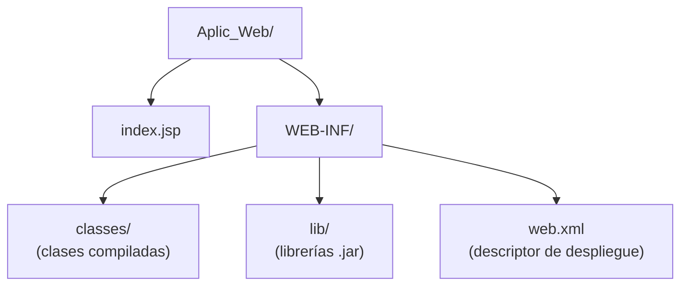
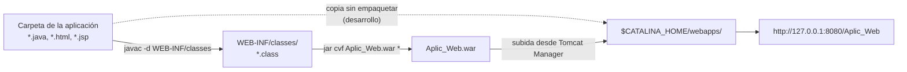
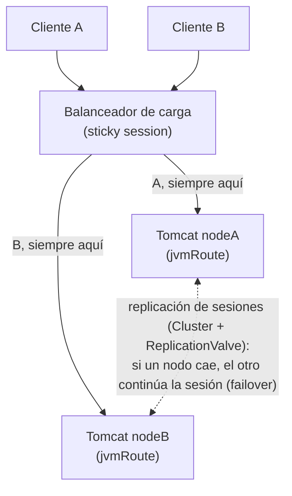
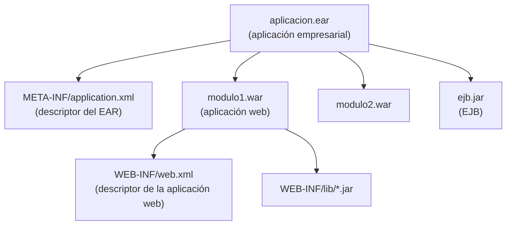
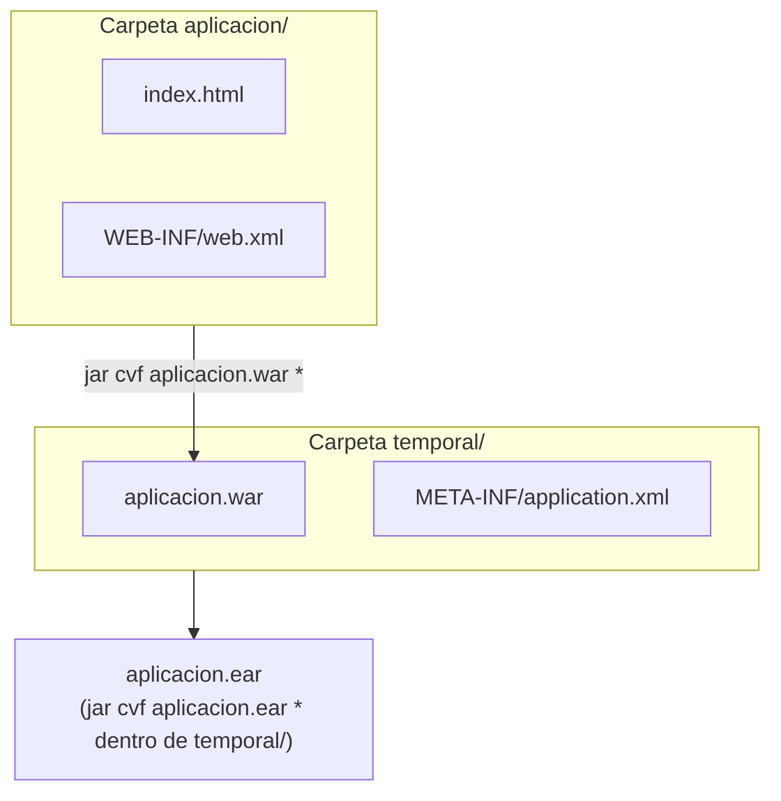
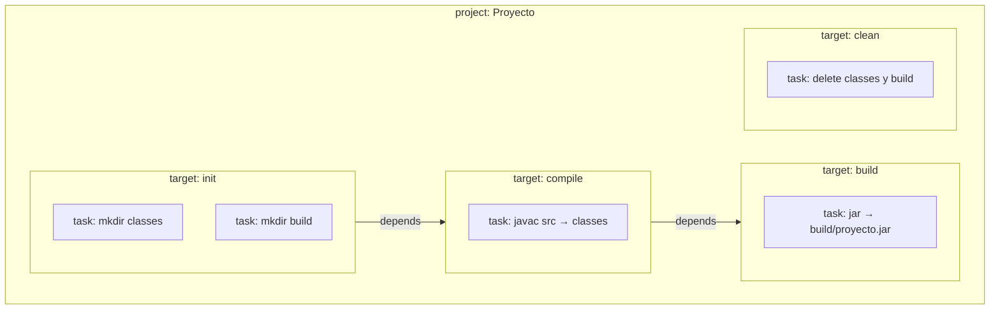
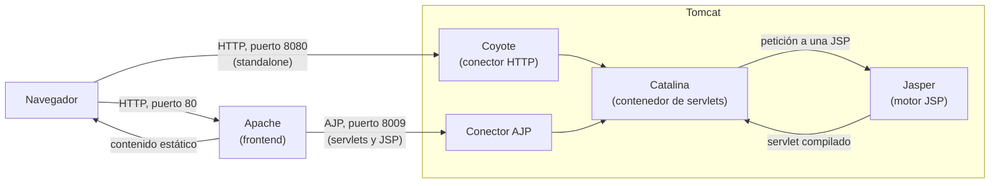
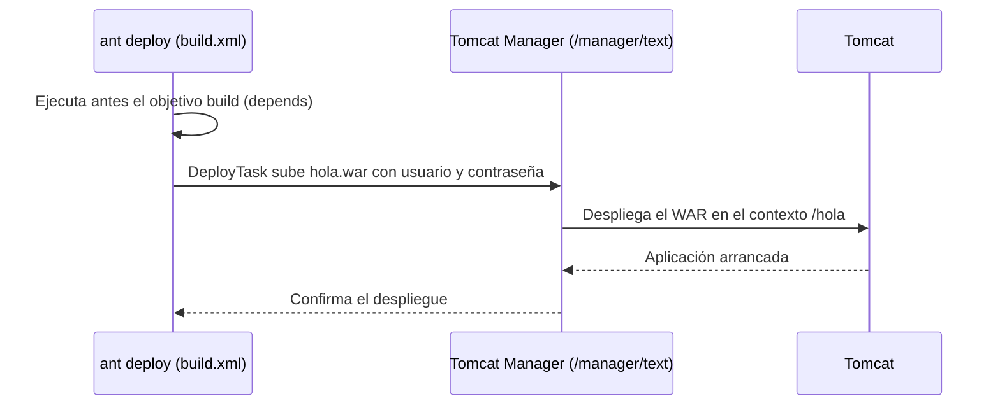

# Unidad 3. Configuración y administración de servidores de aplicaciones

Esta unidad estudia los servidores de aplicaciones Java: qué los diferencia de un servidor web, cómo se protegen, cómo se organiza y se empaqueta una aplicación web Java (WAR) y una aplicación empresarial (EAR), y cómo se despliegan en los dos servidores de referencia, **Tomcat** y **JBoss/Wildfly**. Se completa con la herramienta **Ant**, que automatiza la compilación, el empaquetado y el despliegue, y con el **gestor de aplicaciones web de Tomcat**, la interfaz desde la que se instalan, recargan y retiran aplicaciones.

La unidad se divide en cinco partes:

1. **Protección del servidor de aplicaciones**: niveles de ataque, mecanismos y herramientas de seguridad.
2. **Despliegue de aplicaciones en Tomcat**: estructura de una aplicación web, `web.xml`, archivos WAR, válvulas y registro de acceso, sesiones persistentes y cluster.
3. **El servidor de aplicaciones JBoss/Wildfly**: características, instalación y despliegue; archivos JAR, WAR y EAR.
4. **Construcción y despliegue automático con Ant**: instalación, `build.xml`, objetivos y tareas de despliegue.
5. **El gestor de aplicaciones web de Tomcat**: configuración, roles, componentes (Catalina, Coyote, Jasper), conectores y tareas Ant.

> **Sobre la vigencia del temario.** El temario mezcla Debian 6 con Ubuntu 20.04, Tomcat 6 con el paquete `tomcat9-admin`, JBoss 6 con Wildfly 19, y cita Ant 1.8.2, J2EE 1.4 y la especificación Servlet 2.2. Varios fragmentos de configuración tienen erratas (`<Conector>`, `maxTherads`, comentarios dentro de una etiqueta). Se expone tal como lo recoge, con el código corregido donde la errata impediría que funcionase; lo que ha cambiado se indica en recuadros **Contexto actual**.

---

## 1. Protección del servidor de aplicaciones

Un **servidor de aplicaciones** es un software que proporciona una serie de servicios de aplicación a un número indeterminado de equipos cliente que acceden a ellos vía web. Sus ventajas son la **centralización** y la **disminución de la complejidad** en el desarrollo de aplicaciones; su inconveniente, que las aplicaciones web quedan **más expuestas a ataques**, porque manejan información valiosa (tarjetas de crédito, cuentas bancarias, historiales médicos, datos personales).

Los ataques se clasifican en **tres niveles**, y en cada uno hay que garantizar una seguridad mínima:

| Nivel de ataque | Qué hay que garantizar |
|---|---|
| **Ataques a la computadora del usuario (cliente)** | Navegadores y plataformas seguras, libres de virus |
| **Ataques al servidor** | **Integridad** (los datos no se modifican sin autorización) y **control de acceso** (solo se distribuyen a las personas autorizadas) |
| **Ataques al flujo de información entre cliente y servidor** | **Confidencialidad** (los datos no los leen, modifican ni destruyen terceros) y un canal de comunicación fiable que no se interrumpa con facilidad |

> **Error frecuente**: los "ataques a la alimentación eléctrica" no son ninguno de los tres niveles. Los niveles son cliente, servidor y flujo de información entre ambos.

**Mecanismos que hay que garantizar** para conseguir aplicaciones web seguras:

- **Autenticación**: identifica en todo momento quién es el usuario que accede. Métodos: **autenticación básica** (solicitud de usuario y clave), **autenticación con certificados**, HTTP DIGEST AUTH (autenticación de texto implícita) y HTTP NTLM AUTH (Microsoft NT LAN Manager).
- **Autorización**: una vez autenticado el usuario, determina a qué datos y módulos de la aplicación puede acceder.
- **Validación de entradas**: el código de validación del lado del cliente se puede manipular, así que hay que validar también en el servidor.
- **Inyección de comandos SQL**: técnica para explotar aplicaciones web que no validan la información suministrada por el cliente y generar con ella consultas SQL peligrosas. Es la amenaza contra la que protege la validación de entradas.

> **Error frecuente**: "ataques al servidor" no es un mecanismo de seguridad, sino uno de los niveles de ataque. Los mecanismos son autenticación (básica, con certificados…), autorización y validación de entradas.

**Herramientas y medidas** para conseguir aplicaciones web seguras:

- Deshabilitación de servicios y cuentas no utilizadas.
- Actualización del sistema operativo y de las aplicaciones (**parches**: ficheros adicionales al software original que corrigen una carencia, vulnerabilidad o defecto).
- Fortaleza en las contraseñas.
- Utilización de **firewalls** (cortafuegos): son uno de los mecanismos para establecer seguridad sobre las aplicaciones web.
- Copias de seguridad (*backups*) periódicas.
- Análisis periódico de **logs** (registro de quién, qué, cuándo, dónde y por qué ocurre un evento).
- Verificación periódica de servicios activos.
- Cifrado del tráfico.
- Establecimiento de políticas de seguridad.

---

## 2. Despliegue de aplicaciones en Tomcat

**Tomcat** es un **servidor de aplicaciones**; en concreto, un **contenedor de servlets** (*Servlet Container*): ejecuta servlets y páginas JSP. No es un servlet, sino el programa que los ejecuta.

> **Error frecuente**: Tomcat no es "un servlet". Un **servlet** es una clase Java que se ejecuta en el servidor y genera la respuesta; Tomcat es el servidor de aplicaciones que la contiene y la ejecuta.

**Desplegar** un servlet consiste en situar una serie de archivos en un contenedor web para que los clientes puedan acceder a su funcionalidad. Una **aplicación web** es un conjunto de servlets, páginas HTML, JSP, clases y otros recursos que se pueden empaquetar de una forma determinada.

Gracias a la **especificación Servlet 2.2**, una aplicación web puede desplegarse en diferentes servidores **manteniendo su funcionalidad y sin ningún tipo de modificación en su código**. Para ello, el código necesario para ejecutar correctamente la aplicación se encuentra distribuido en una **estructura de directorios agrupando ficheros según su funcionalidad**:

| Directorio | Qué contiene |
|---|---|
| Raíz de la aplicación | Ficheros estáticos (HTML, imágenes…) y páginas JSP |
| `WEB-INF/` | El fichero **`web.xml`**, el **descriptor de la aplicación**, que configura la aplicación |
| `WEB-INF/classes/` | Ficheros compilados (servlets, beans) |
| `WEB-INF/lib/` | Librerías adicionales (`.jar`) |
| Otras carpetas | Más ficheros estáticos |

> **Error frecuente**: la portabilidad entre servidores la da la especificación **Servlet 2.2**, no la "especificación httpd 2.2". httpd 2.2 es una versión del servidor web Apache, que no tiene nada que ver con el despliegue de aplicaciones Java.

> **Error frecuente**: `web.xml` va dentro de **`WEB-INF`**, no en la raíz ni en `lib` ni en `classes`.

Una aplicación web puede desplegarse de dos formas:

- **Por medio de archivos WAR** (apartado 2.2).
- **Editando los archivos `web.xml` y `server.xml`** y copiando la aplicación en la carpeta `webapps` de Tomcat.

Los directorios que forman una aplicación compilada suelen ser `www`, `bin`, `src`, `tomcat` y `gwt-cache`: `www` contiene una carpeta con el nombre del proyecto y los ficheros de la interfaz (HTML, JS, CSS); `bin`, las clases Java. Para desplegarla en Tomcat a mano:

1. Copiar la carpeta del proyecto contenida en `www` al directorio **`webapps`** de Tomcat.
2. Renombrarla con un nombre más sencillo: será la carpeta de la aplicación.
3. Crear dentro una carpeta **`WEB-INF`** (respetando las mayúsculas).
4. Crear dentro de `WEB-INF` los subdirectorios **`lib`** y **`classes`**.
5. Copiar en `lib` las librerías (`.jar`) que necesite la aplicación.
6. Copiar el contenido de `bin` en `WEB-INF/classes`.
7. Crear en `WEB-INF` el fichero **`web.xml`** con las rutas de los servlets.
8. Acceder desde el navegador a la ruta del fichero HTML de entrada.

El ejemplo del temario parte de un Ubuntu 20.04 con Tomcat en marcha y monta además una **plataforma LAMP**:

| Componente | Software |
|---|---|
| Sistema operativo | **Linux** |
| Servidor web | **Apache** |
| Gestor de base de datos | **MySQL** |
| Lenguaje de programación | **PHP** |

Para instalar cualquier versión de Tomcat es necesario tener instalado el **JDK** (*Java Development Kit*), porque las peticiones a Apache se redirigen a Tomcat mediante un conector proporcionado por Java.

### 2.1 Creación de una aplicación web

Tomcat incluye ejemplos de servlets y JSP que sirven para aprender a crear y desplegar aplicaciones. Conviene definir dos variables de entorno en `/etc/profile`:

- **`JAVA_HOME`**: ubicación de los binarios de Java.
- **`CATALINA_HOME`**: ubicación de los scripts de Tomcat (su directorio de instalación).

```bash
# /etc/profile
CATALINA_HOME=/opt/tomcat
JAVA_HOME=/usr/lib/jvm/java-11-openjdk-amd64     # ← el temario escribe java-1.11.0-openjdk-amd64
PATH=$PATH:$JAVA_HOME/bin:$CATALINA_HOME/bin
export PATH JAVA_HOME CATALINA_HOME
```

```bash
source /etc/profile      # recarga las variables de entorno en la sesión actual
```

Se crea una carpeta con el nombre de la aplicación (en el ejemplo, `Aplic_Web`) con un `index.jsp` sencillo: una página con un botón que, mediante JavaScript, muestra un `alert()`. **JavaScript** se ejecuta en el lado del cliente: es un lenguaje interpretado de *scripting* que no puede acceder a la información local del cliente ni conectarse a otros equipos de la red.

Para desplegarla basta con copiar la carpeta en **`$CATALINA_HOME/webapps`** y abrir en el navegador la URL de la aplicación. El formato general de la URL es **`http://{address}:{port}/{servletName}`**: dirección, después el puerto y después el nombre de la aplicación o del servlet.

| Desde dónde | URL |
|---|---|
| El propio equipo, aplicación `Aplic_Web` | `http://127.0.0.1:8080/Aplic_Web` o `http://localhost:8080/Aplic_Web` |
| El propio equipo, aplicación `web1` | **`http://localhost:8080/web1`** |
| Otro equipo de la red, servidor en 192.168.10.1 | `http://192.168.10.1:8080/Aplic_Web` |

> **Error frecuente**: el puerto por defecto de Tomcat es el **8080**, no el 80 (que es el de Apache). `http://localhost:8080` sin nombre de aplicación abre la página de inicio de Tomcat, no la aplicación.

### 2.2 Despliegue de una aplicación web

Los **WAR** (*Web Application Archive*) son **simplemente archivos Java de una aplicación web** con una extensión diferente (`.war`) para distinguirlos de los JAR. Un archivo `.war` **contiene una aplicación web completa, empaquetada**: servlets, JSP, HTML, CSS, imágenes, clases, librerías y el descriptor.

> **Error frecuente**: un `.war` no "es lo mismo que un `.zip`". Tiene un formato similar (se puede abrir con un compresor), pero es un archivo Java con una estructura y un descriptor obligatorios. Tampoco es solo un conjunto de páginas `.html` o `.css`.

Antes de la especificación **Servlet 2.2** era bastante distinto desplegar servlets en distintos contenedores (llamados antes *motores servlet*); la 2.2 estandarizó el despliegue entre contenedores y llevó la portabilidad del código Java un paso más allá.

El **método más sencillo** para desplegar, que se usa sobre todo **durante la etapa de desarrollo**, es copiar la carpeta de la aplicación en **`$CATALINA_HOME/webapps`**.

El **descriptor de despliegue** `web.xml` **describe las características de despliegue de la aplicación**. Es **un único archivo**, tiene **formato XML** y se sitúa en `WEB-INF`. No es una aplicación web: es un fichero de configuración de la aplicación.

```xml
<?xml version="1.0" encoding="ISO-8859-1"?>
<!-- WEB-INF/web.xml de Aplic_Web -->
<web-app xmlns="http://java.sun.com/xml/ns/javaee"
         xmlns:xsi="http://www.w3.org/2001/XMLSchema-instance"
         xsi:schemaLocation="http://java.sun.com/xml/ns/javaee http://java.sun.com/xml/ns/javaee/web-app_2_5.xsd"
         version="2.5">                                   <!-- ← versión de la especificación Servlet -->
    <display-name>Descriptor Aplicacion Aplic_Web</display-name>   <!-- ← nombre visible -->
    <description>Mi primer descriptor web.xml.</description>
</web-app>
```

Con el descriptor, la carpeta de la aplicación queda así:



Terminada la aplicación, se compila y se empaqueta en un WAR desde su carpeta:

```bash
javac -d WEB-INF/classes *.java     # compila las clases Java y deja los .class en WEB-INF/classes
jar cvf Aplic_Web.war *             # c = crear, v = detallado, f = nombre del archivo; empaqueta todo
```

El WAR se despliega desde `http://127.0.0.1:8080`, en el apartado **Administration → Tomcat Manager**, con la opción de subir un archivo WAR (apartado 5).

El camino completo, desde el código fuente hasta la aplicación accesible:



### 2.3 Implementar el registro de acceso

Tomcat registra los accesos mediante **válvulas** (*valves*). Las válvulas son una tecnología **introducida a partir de Tomcat 4** que permite **asociar una instancia de una clase Java a un contenedor "Catalina"**, de forma que la clase **actúe como un pre-procesador de las peticiones**. Deben implementar la interfaz `org.apache.catalina.Valve` o extender `org.apache.catalina.valves.ValveBase`. **Son propias de Tomcat** y no se pueden usar en otros contenedores de servlets.

| Válvula | Clase | Para qué sirve |
|---|---|---|
| **Access Log Valve** | `org.apache.catalina.valves.AccessLogValve` | Crea ficheros de log con el acceso de los clientes: actividad de la sesión, autenticación… |
| **Remote Address Filter** | `org.apache.catalina.valves.RemoteAddrValve` | Compara la **IP** del cliente con expresiones regulares y permite o deniega la petición |
| **Remote Host Filter** | `org.apache.catalina.valves.RemoteHostValve` | Igual, pero compara el **nombre de equipo** |
| **Request Dumper** | `org.apache.catalina.valves.RequestDumperValve` | Depuración: escribe en el log el detalle de cada petición |
| **Single Sign On** | `org.apache.catalina.authenticator.SingleSignOn` | El usuario se identifica una vez y su identidad la reconocen todas las aplicaciones del host virtual |

```xml
<!-- $CATALINA_HOME/conf/server.xml: afecta a todas las aplicaciones desplegadas -->
<Valve className="org.apache.catalina.valves.AccessLogValve"
       directory="logs"                  
       prefix="localhost_access_log."    
       suffix=".txt"                     
       pattern="common"/>                <!-- ← logs en $CATALINA_HOME/logs/localhost_access_log.<fecha>.txt -->
<Valve className="org.apache.catalina.valves.RemoteAddrValve" deny="127.*"/>   <!-- ← deniega las IP que empiezan por 127 -->
<Valve className="org.apache.catalina.valves.RemoteHostValve" deny="pc_fp.*"/> <!-- ← deniega por nombre de equipo -->
```

> **Contexto actual**: `RequestDumperValve` desapareció en Tomcat 7; su función la cumple hoy el filtro `RequestDumperFilter`. En `RemoteAddrValve` el valor es una expresión regular, así que lo exacto es `127\..*`.

### 2.4 Sesiones persistentes

Por defecto, las sesiones activas en Tomcat están configuradas para **mantenerse** ante pérdidas de conexión o reinicios del servidor, pero se pueden controlar más:

- Las sesiones **inactivas** (aún no caducadas) se pueden guardar en disco para liberar memoria.
- **Al parar Tomcat**, las sesiones activas se vuelcan a disco y se restauran al arrancarlo.
- Las sesiones que superan un tiempo de vida límite se copian a disco por seguridad, para evitar bloqueos.

Se configuran con el elemento **`<Manager>`** como subelemento de **`<Context>`**, a dos niveles:

| Nivel | Fichero |
|---|---|
| **Global** (todas las aplicaciones del servidor) | **`<CATALINA_HOME>/conf/context.xml`** |
| Local (una aplicación concreta) | El `context.xml` propio de esa aplicación (`META-INF/context.xml` de la aplicación) |

> **Error frecuente**: el fichero global está en **`conf`**, no en `bin`, `config` ni `META-INF`. `META-INF/context.xml` es el de una aplicación, no el global.

```xml
<!-- <CATALINA_HOME>/conf/context.xml -->
<Context>
    <Manager className="org.apache.catalina.session.PersistentManager"
             saveOnRestart="true"
             maxActiveSessions="3"
             minIdleSwap="0"
             maxIdleSwap="60"
             maxIdleBackup="5">
        <Store className="org.apache.catalina.session.FileStore"/>
    </Manager>
</Context>
```

| Atributo | Significado |
|---|---|
| `className` | Clase que implementa el gestor; se recomienda `org.apache.catalina.session.PersistentManager` |
| `saveOnRestart="true"` | Guarda todas las sesiones al reiniciar el servidor |
| `maxActiveSessions` | Superado el límite, las nuevas sesiones se envían a disco; `-1` = ilimitadas |
| `minIdleSwap` | Mínimo de segundos antes de que una sesión pueda copiarse a disco |
| `maxIdleSwap` | Máximo de segundos antes de que una sesión pueda copiarse a disco |
| `maxIdleBackup` | Segundos desde la última actividad hasta que la sesión se copia a disco **sin eliminarla de memoria**: permite restaurarla si cae el servidor |
| `<Store>` | Cómo y dónde se guarda: `FileStore` (fichero) o `JDBCStore` (base de datos) |

### 2.5 Configurar Tomcat en cluster

Tomcat **sí se puede configurar en cluster**. El *clustering* es una solución eficaz y relativamente sencilla para la escalabilidad y la disponibilidad, y aporta:

- **Escalabilidad**: si una petición tarda un tiempo T, lo ideal es que muchas peticiones tarden lo más cerca posible de T. Dos soluciones: **escalado horizontal** (más servidores) y **escalado vertical** (más recursos en el mismo servidor).
- **Alta disponibilidad** (*failover*), de dos tipos: **request-level failover** (si un servidor cae, las peticiones siguientes van a otros servidores activos) y **session-level failover** (otro servidor del cluster continúa la sesión del cliente, para lo que la sesión se replica en el cluster).
- **Balanceo de carga**: reparto de las peticiones entre los servidores mediante algoritmos de distribución de carga, para minimizar el tiempo de respuesta.

> **Error frecuente**: no poder configurarse en cluster no es un inconveniente de Tomcat; Tomcat admite cluster y replicación de sesiones.

Pasos para montar un cluster de Tomcat:

1. Todos los atributos de sesión deben implementar `java.io.Serializable`.
2. Descomentar el elemento `<Cluster>` en `server.xml`.
3. Descomentar la válvula `ReplicationValve` en `server.xml`.
4. Si hay varias instancias en la misma máquina, el parámetro `tcpListenPort` debe ser único en cada una.
5. Poner `<distributable/>` en `web.xml` o `<Context distributable="true"/>`.
6. Definir el atributo `jvmRoute` en el `Engine`: `<Engine name="Catalina" jvmRoute="nodeX">`, con el nombre de la instancia.
7. Sincronizar la hora de todos los nodos con NTP.
8. Configurar el balanceador de carga en modo *sticky session* (cada cliente vuelve siempre al mismo nodo).

Con esos pasos, el cluster funciona así:



---

## 3. El servidor de aplicaciones JBoss/Wildfly

**JBoss** es un proyecto de **código abierto** con el que se consigue un servidor de aplicaciones **basado en J2EE** e **implementado al 100 % en Java**. Fue el primer servidor de aplicaciones de código abierto preparado para producción y certificado J2EE 1.4, orientado a aplicaciones de *e-business*.

| | Tomcat | JBoss/Wildfly |
|---|---|---|
| Tipo | *Servlet Container* (contenedor de servlets) | *Application Server* (servidor de aplicaciones Java EE completo) |
| Qué ejecuta | Solo JSP y servlets | JSP y servlets, y además **EJB** y clustering |
| Partes | Catalina, Coyote, Jasper (apartado 5.2) | **Servlet Engine** (JSP y servlets) + **EJB Engine** (EJB Container: Enterprise Java Beans) |

Es decir, **Tomcat, a diferencia de JBoss, implementa solamente la funcionalidad de contenedor de servlets**.

Uno de los rasgos más importantes de JBoss es su apoyo a la implementación **"en caliente"** (*hot deploy*): implementar un nuevo EJB es tan simple como **copiar el archivo en el directorio correspondiente**; si el bean ya estaba cargado, JBoss lo **descarga automáticamente y carga la nueva versión**, sin reiniciar el servidor.

Características destacadas de JBoss:

- Producto de **licencia de código abierto** sin coste adicional.
- Cumple los estándares.
- Confiable a nivel empresa.
- Incrustable, **orientado a arquitectura de servicios**.
- Flexibilidad consistente.
- Servicios de *middleware* para cualquier objeto Java.

> **Error frecuente**: JBoss **no es únicamente un EJB Container** (tiene también el Servlet Engine) y **no funciona únicamente en Microsoft Windows**: al estar escrito en Java, funciona en cualquier sistema con JDK.

Historia: lo creó **Marc Fleury**, que fundó JBoss Inc., adquirida en **2006 por Red Hat**. Las soluciones *JBoss Enterprise Middleware* se distribuyen mediante **JBoss Subscription** (software certificado, actualizaciones, herramientas, mantenimiento y soporte), para producción o desarrollo.

| Plataforma | Qué es |
|---|---|
| **JBoss EAP** (*Enterprise Application Platform*) | Servidor de aplicaciones Java EE que produce y soporta Red Hat; en el temario, versión 7 con Java EE 7. Integra JBoss AS en cluster, persistencia O/R y un framework para aplicaciones Web 2.0. Basado en suscripción |
| **JBoss AS / WildFly** | Versiones comunitarias. JBoss AS (*Application Server*) se renombró **WildFly** para no confundirlo con EAP. Orientados a pruebas y desarrolladores; soporte solo de la comunidad |
| **JBoss Web Server** | Para aplicaciones medianas y grandes basadas en JSP, servlets, PHP y CGI; combina Apache y Tomcat bajo una suscripción |

> **Contexto actual**: J2EE pasó a llamarse Java EE y, desde 2017, **Jakarta EE** (Eclipse Foundation). JBoss EAP va por la versión 8 y WildFly publica varias versiones al año.

### 3.1 Instalación y configuración básica

Requisito previo: el **JDK**, porque JBoss/Wildfly está escrito íntegramente en Java, en versión 1.5 o superior. No exige un sistema operativo concreto. El proceso, sobre Ubuntu 20.04 y Wildfly 19.1.0, tiene seis pasos:

1. **Descargar e instalar el JDK.**
2. **Crear el usuario de Wildfly**: se recomienda ejecutarlo con una cuenta no root y con privilegios mínimos.
3. **Descargar e instalar Wildfly** en `/opt`.
4. **Configurar systemd y el archivo `wildfly.conf`.**
5. **Configurar la autenticación** con `add-user.sh`.
6. **Acceder a la consola de administración.**

```bash
# 1. JDK
apt update
apt install default-jdk

# 2. Grupo y usuario de sistema (-r) sin shell de acceso
sudo groupadd -r wildfly
sudo useradd -r -g wildfly -d /opt/wildfly -s /sbin/nologin wildfly

# 3. Descarga en /tmp, descompresión en /opt, enlace simbólico y propietario
WILDFLY_VERSION=19.1.0.Final
sudo wget https://download.jboss.org/wildfly/$WILDFLY_VERSION/wildfly-$WILDFLY_VERSION.tar.gz -P /tmp
sudo tar xf /tmp/wildfly-$WILDFLY_VERSION.tar.gz -C /opt/
sudo ln -s /opt/wildfly-$WILDFLY_VERSION /opt/wildfly      # ← /opt/wildfly apunta a la versión instalada
sudo chown -RH wildfly: /opt/wildfly

# 4. systemd: configuración, script de arranque y unidad del servicio
sudo mkdir -p /etc/wildfly
sudo cp /opt/wildfly/docs/contrib/scripts/systemd/wildfly.conf /etc/wildfly/
sudo cp /opt/wildfly/docs/contrib/scripts/systemd/launch.sh /opt/wildfly/bin/
sudo sh -c 'chmod +x /opt/wildfly/bin/*.sh'
sudo cp /opt/wildfly/docs/contrib/scripts/systemd/wildfly.service /etc/systemd/system/
sudo systemctl daemon-reload
sudo systemctl start wildfly
sudo systemctl status wildfly

# 5. Usuario de administración
sudo /opt/wildfly/bin/add-user.sh     # ← opción a) Management User (mgmt-users.properties)
```

`add-user.sh` pregunta el tipo de usuario: **a) Management User** (`mgmt-users.properties`, para administrar el servidor) o **b) Application User** (`application-users.properties`, para las aplicaciones). Usa el reino `ManagementRealm` y recomienda que la contraseña sea distinta del usuario, no sea `root`, `admin` ni `administrator`, y tenga al menos 8 caracteres con una letra, un dígito y un símbolo. Añade el usuario a los ficheros `mgmt-users.properties` y `mgmt-groups.properties` de `standalone/configuration` y de `domain/configuration`.

| Puerto | Para qué |
|---|---|
| **8080** | Aplicaciones: `http://<dirección_IP>:8080` o `http://localhost:8080` |
| **9990** | Consola de administración: `http://<dirección_IP>:9990` o `http://localhost:9990`, con el usuario creado |

### 3.2 Despliegue de aplicaciones empresariales

Estructura mínima de una aplicación Java EE:

| Elemento | Qué contiene |
|---|---|
| `META-INF/manifest.mf` | Lista de contenidos de la aplicación; se genera al crearla |
| `WEB-INF/` | Todo lo necesario para ejecutar la aplicación |
| `WEB-INF/classes/` | Clases compiladas |
| `WEB-INF/src/` | Código fuente |
| `WEB-INF/lib/` | Librerías |
| `WEB-INF/web.xml` | Descriptor de despliegue |

Se empaqueta con:

```bash
jar cvf nombre_aplicacion.jar carpetas/ficheros_a_empaquetar
```

Para desplegarla basta con **copiar el archivo a `$JBOSS_HOME/server/default/deploy`**; JBoss muestra un mensaje del tipo `deploy, ctxPath=/nombre_aplicacion`, señal de que se ha desplegado. Es el **despliegue en caliente**.

> **Contexto actual**: `server/default/deploy` es la carpeta de JBoss AS 6 y anteriores. En WildFly se copia a `standalone/deployments/`, o se despliega desde la consola (puerto 9990) o con `jboss-cli.sh`. Una aplicación web se empaqueta como `.war`, no como `.jar`.

### 3.3 Estructura de carpetas de una aplicación empresarial. Archivo EAR

En Java EE hay tres tipos de aplicaciones:

| Tipo | Archivo | Qué es |
|---|---|---|
| Aplicación web | **`.war`** | Una aplicación web completa (servlets, JSP, HTML…) |
| Objetos distribuidos EJB | **`.jar`** | Un conjunto de EJB |
| **Aplicación empresarial** | **`.ear`** (*Enterprise Archive*) | Un conjunto de módulos: **varios `.war` y/o varios `.jar`** |

La relación es de contención en un solo sentido: **un `.ear` puede estar formado por varios `.war`** y **puede contener archivos `.jar`**; un `.war` no contiene archivos `.ear`.

> **Error frecuente**: un `.war` **no** puede estar formado por varios `.ear`: el EAR es el contenedor más grande (EAR ⊃ WAR y JAR).

Estructura de un archivo EAR:

- **`/*.war`**: archivos WAR.
- **`/*.jar`**: archivos (EJB) JAR.
- **`/META-INF/application.xml`**: el **descriptor de despliegue del módulo EAR**, donde se declaran el nombre y la descripción de la aplicación y los módulos web y EJB que la forman.

> **Error frecuente**: dentro de un EAR no hay "`/*.ear`". Un EAR contiene WAR, JAR y su descriptor en `META-INF`.

La relación de contención entre los tres tipos de archivo:



En el ejemplo, la aplicación web se empaqueta primero en un WAR, y ese WAR se empaqueta después, junto con su descriptor, en el EAR:



El comando **`jar cvf`** genera los tres tipos de archivo; solo cambia la extensión:

```bash
# Dentro de la carpeta "aplicacion" (index.html + WEB-INF/web.xml)
jar cvf aplicacion.war *      # ← genera el WAR; formato similar a un .zip

# Dentro de la carpeta "temporal": aplicacion.war + META-INF/application.xml
jar cvf aplicacion.ear *      # ← genera el EAR
```

```xml
<!-- temporal/META-INF/application.xml: descriptor del EAR -->
<application>
    <display-name>aplicacion</display-name>
    <module>
        <web>
            <web-uri>aplicacion.war</web-uri>       <!-- ← el WAR incluido -->
            <context-root>/aplicacion</context-root> <!-- ← ruta de acceso en la URL -->
        </web>
    </module>
</application>
```

---

## 4. Construcción y despliegue automático con Ant

**Ant** (*Another Neat Tool*, "otra herramienta pura"; en inglés, *ant* = hormiga) lo creó **James Duncan Davidson** al pasar a código abierto el motor JSP/Servlet de Sun, que luego sería Jakarta Tomcat.

**Apache Ant** es una herramienta usada en programación para la **realización de tareas mecánicas y repetitivas**, centrada normalmente en la fase de compilación y construcción (*build*). Automatiza el **ensamblado** de aplicaciones web (ensamblado = construcción + despliegue). Es **similar a `make`** de Linux, pero escrito en Java, y tiene la ventaja de **no depender de los comandos shell de cada sistema operativo**, porque se basa en **archivos de configuración XML** y clases Java: es una solución multiplataforma.

Se ocupa de: **compilación**, **generación de documentación**, **empaquetamiento** y **ejecución**. Con un solo comando se puede compilar el proyecto desde cero, ejecutar las pruebas unitarias, generar la documentación y empaquetar el programa. Sin Ant, hay que compilar a mano todos los `.java` (sin saber cuáles han cambiado), ajustar los *classpath* y mezclar los `.class` con el código fuente. Se integra con editores e IDE como jEdit o NetBeans.

Limitaciones:

- Los archivos Ant tienen que escribirse en XML.
- Las tareas antiguas (`<javac>`, `<exec>`, `<java>`) tienen malas configuraciones por defecto, incoherentes con las tareas más recientes.
- Una propiedad no definida no da error: se deja como referencia sin expandir (`${nombre}` literal).

Requisitos:

- **JDK en versión 1.4 o superior**, porque Ant es una aplicación Java.
- Un **parser XML** (cualquiera; la versión binaria de Ant ya incluye uno).

### 4.1 Instalación y configuración de Ant

```bash
java -version                                   # comprueba que hay un JDK 1.4 o superior
wget https://archive.apache.org/dist/ant/binaries/apache-ant-1.8.2-bin.tar.gz   # paquete binario
tar -zxvf apache-ant-1.8.2-bin.tar.gz           # descomprime
mv apache-ant-1.8.2 /usr/local/                 # se mueve a /usr/local
```

Faltan dos variables de entorno, en `/etc/profile`:

- **`ANT_HOME`**: directorio raíz de la instalación de Ant (`/usr/local/apache-ant-1.8.2`).
- **`PATH`**: se le añade `$ANT_HOME/bin` para ejecutar `ant` desde cualquier directorio.

```bash
# /etc/profile
ANT_HOME=/usr/local/apache-ant-1.8.2/
PATH=$PATH:$ANT_HOME/bin
```

```bash
source /etc/profile
ant        # si está bien instalado, responde: "Buildfile: build.xml does not exist!  Build failed"
```

El mensaje de error es la prueba de que funciona: `ant` se ejecuta, pero en ese directorio no hay `build.xml`.

### 4.2 El archivo build.xml

Ant configura el trabajo en un fichero XML llamado **`build.xml`**. Sus etiquetas principales:

| Etiqueta | Qué es |
|---|---|
| **`project`** | Elemento raíz; **solo hay uno** por fichero, el de la aplicación |
| **`target`** | Objetivo: conjunto de tareas que se aplican en un momento dado. Tiene nombre y puede depender de otros (`depends`); Ant resuelve el orden |
| **`task`** | Tarea: código ejecutable (`javac`, `java`, `jar`, `mkdir`, `delete`…). Ant trae muchas y se pueden añadir más |
| **`property`** | Parámetro nombre-valor. Predefinidas: `basedir` (directorio base del proyecto), `ant.file` (ruta absoluta del `build.xml`), `ant.java.version` (versión de la JVM) |

> **Error frecuente**: `apache-tomcat` no es una etiqueta de `build.xml`. Las etiquetas son `project`, `target`, `task` (cada tarea concreta) y `property`.

```xml
<?xml version="1.0"?>
<project name="ProbandoAnt" default="compilar" basedir=".">   <!-- ← objetivo por defecto y directorio base -->
    <!-- propiedades globales del proyecto -->
    <property name="fuente" value="."/>
    <property name="destino" value="classes"/>
    <target name="compilar">
        <javac srcdir="${fuente}" destdir="${destino}"/>    <!-- ← tarea javac; ${...} lee una propiedad -->
    </target>
</project>
```

```bash
ant                    # ejecuta el objetivo por defecto (default="compilar")
ant nombre_objetivo    # ejecuta un objetivo concreto
```

### 4.3 El objetivo .jar

Ant se basa en **objetivos** (*targets*), cuya definición incluye tanto las **dependencias** previas como los **pasos** para conseguirlos. La dependencia se fija con `depends` y se garantiza antes de empezar el objetivo.

```xml
<project name="Proyecto">
    <target name="init">                                   <!-- prepara los directorios de trabajo -->
        <mkdir dir="classes"/>
        <mkdir dir="build"/>
    </target>
    <target name="compile" depends="init">                 <!-- compila src → classes; antes, init -->
        <javac srcdir="src" destdir="classes"/>
    </target>
    <target name="build" depends="compile">                <!-- empaqueta classes en un .jar; antes, compile -->
        <jar destfile="build/proyecto.jar" basedir="classes"/>
    </target>
    <target name="clean">                                  <!-- deja el entorno limpio -->
        <delete dir="classes"/>
        <delete dir="build"/>
    </target>
</project>
```

`ant build` ejecuta en cadena `init` → `compile` → `build`. Cada `<javac>`, `<jar>`, `<mkdir>` o `<delete>` es lo que Ant llama una **tarea**.

En el fichero anterior, el proyecto contiene los objetivos, cada objetivo contiene sus tareas y `depends` fija el orden de ejecución:



La flecha indica el orden: `build` depende de `compile`, que depende de `init`; `clean` es independiente y solo se ejecuta si se pide (`ant clean`).

### 4.4 Despliegue de un archivo WAR

En Java EE, los componentes web y los ficheros con contenido estático, como imágenes, se llaman **recursos web**. Un **módulo web** es la **más pequeña unidad de un recurso web que se puede utilizar y desplegar**; corresponde a una aplicación web según la especificación Java Servlet. Además de componentes y recursos web, puede contener clases utilitarias del lado del servidor (**beans**: componentes reutilizables, como el de un carrito de la compra, a menudo según la arquitectura JavaBeans) y clases del lado del cliente (**applets**: componentes que se ejecutan en el contexto de otro programa, como un navegador).

El directorio más alto del módulo es la **raíz de documentos** de la aplicación (JSP, clases y ficheros del cliente, recursos estáticos). Dentro está `WEB-INF` con:

| Elemento | Contenido |
|---|---|
| `web.xml` | Descriptor de despliegue de la aplicación |
| `classes/` | Clases del servidor: servlets, clases utilitarias y JavaBeans |
| `tags/` | Ficheros de etiquetas (implementaciones de librerías de etiquetas) |
| `lib/` | JAR de las librerías que usan las clases del servidor |

Un módulo web se puede desplegar **sin empaquetar** o **empaquetado en un WAR** (*archivo web*), que se genera con el comando `jar`, con Ant o con un IDE. Es **portátil**: se despliega en cualquier contenedor que cumpla la especificación Java Servlet. Para desplegar un WAR, debe contener un **descriptor de despliegue**: un fichero XML con información como el **contexto raíz** de la aplicación y la relación de los nombres portátiles de los recursos con los recursos del servidor.

Tareas de Ant para gestionar aplicaciones:

| Tarea | Qué hace |
|---|---|
| `<deploy>` | Despliega una aplicación web |
| `<start>` | Inicia una aplicación |
| `<stop>` | Para una aplicación |
| `<undeploy>` | Repliega (desinstala) una aplicación |
| `<trycatch>` | Evita que falle el *build* aunque falle alguna tarea |

Sirven con distintos servidores, como JBoss/Wildfly o Tomcat. Para desplegar un WAR se abre un terminal en el directorio donde se ha construido y empaquetado y se ejecuta **`ant deploy`**.

---

## 5. El gestor de aplicaciones web de Tomcat

Tomcat se arranca con el script **`catalina.sh`** de la carpeta `bin` de su instalación (en el ejemplo, `/opt/tomcat/bin`). Después se accede con:

- `http://localhost:8080` desde la propia máquina.
- `http://ip_servidor:8080` desde cualquier otra máquina de la red.

El enlace **Tomcat Manager** abre el gestor de aplicaciones web, que lista las aplicaciones disponibles y permite desplegar un WAR. La alternativa sigue siendo copiar la carpeta de la aplicación en `webapps`: `Aplic_Web` en `/opt/tomcat/webapps/` aparece en la lista y se abre en `http://ip_servidor:8080/nombre_aplicacion`.

### 5.1 Configuración del gestor

Todos los ficheros de configuración de Tomcat están en **`$CATALINA_HOME/conf`**. En `conf/Catalina/localhost/` se guarda la configuración web de Tomcat en dos archivos XML: **`host-manager.xml`** y **`manager.xml`**.

> **Error frecuente**: `build.xml` es el fichero de Ant, `php.ini` el de PHP y `$CATALINA_HOME` una variable de entorno, no un archivo. La configuración web de Tomcat está en `host-manager.xml` (y `manager.xml`).

Para administrar desde el navegador se instala el paquete de administración y se crea un usuario con los roles adecuados:

```bash
apt-get install tomcat9-admin                     # ← el temario lo llama Tomcat6-admin
nano $CATALINA_HOME/conf/tomcat-users.xml         # usuarios y roles de Tomcat
```

```xml
<!-- $CATALINA_HOME/conf/tomcat-users.xml -->
<tomcat-users>
    <user username="usuario" password="clave" roles="manager-gui,admin-gui"/>
</tomcat-users>
```

| Rol | Acceso |
|---|---|
| `manager-gui` | Interfaz HTML del gestor |
| `manager-status` | Solo la página "Server Status" |
| `manager-script` | Interfaz de texto plano y "Server Status" |
| `manager-jmx` | Proxy JMX y "Server Status" |
| `admin-gui` | Host Manager (gestión de hosts virtuales) |

Tras reiniciar Tomcat:

| URL | Para qué |
|---|---|
| `http://ip_servidor:8080/manager/html` | Gestor de aplicaciones: desinstalar, recargar e instalar aplicaciones |
| `http://ip_servidor:8080/host-manager/html` | Host Manager (rol de administración) |

**JMX** (*Java Management eXtensions*) define la arquitectura, la API, los patrones y los servicios para monitorizar y administrar aplicaciones Java; su versión 1.2 se incorporó a J2SE 5.0.

Para asegurar el gestor se limita su contexto a las IP de los administradores con una válvula `RemoteAddrValve`:

```xml
<!-- context.xml del gestor: el temario lo sitúa en $CATALINA_HOME/work/Catalina/localhost/manager/ -->
<Context path="/manager" privileged="true" antiResourceLocking="false"
         docBase="/opt/tomcat/webapps/manager">
    <Valve className="org.apache.catalina.valves.RemoteAddrValve"
           allow="127.0.0.1,direccion_ip1,direccion_ip2"/>   <!-- ← solo estas IP entran al gestor -->
</Context>
```

> **Contexto actual**: `work/` es la carpeta temporal de Tomcat y se regenera. El sitio estable es `webapps/manager/META-INF/context.xml` o `conf/Catalina/localhost/manager.xml`. Desde Tomcat 7, por defecto el gestor ya solo admite conexiones desde localhost.

### 5.2 Conexión al gestor de aplicaciones web de Tomcat de forma remota

Un servidor Apache-Tomcat consta de **tres componentes principales**:

| Componente | Qué es |
|---|---|
| **Catalina** | El **contenedor de servlets** de Tomcat. Implementa las especificaciones de Sun para servlets y JSP |
| **Coyote** | El **conector HTTP** (HTTP 1.1). Escucha las conexiones entrantes en un **puerto TCP** determinado y redirige las peticiones al motor **Tomcat** para procesarlas y devolver la respuesta al cliente |
| **Jasper** | El **motor JSP** de Tomcat: compila las páginas JSP en código Java, en servlets que pueda manejar **Catalina**. En ejecución, detecta cualquier cambio en un JSP y lo recompila |

> **Error frecuente**: Coyote es el conector HTTP, no el motor JSP; el motor JSP es **Jasper**, y el contenedor de servlets, Catalina.

El recorrido de una petición por los tres componentes, en los dos modos de operación que se describen a continuación:



**Modos de operación** de Tomcat:

| Modo | Funcionamiento |
|---|---|
| **Servidor de aplicaciones** | Un servidor web hace de *frontend* (Apache, IIS…): sirve el contenido estático y redirige a Tomcat las peticiones de servlets y JSP mediante protocolos específicos como **AJP** |
| **Standalone** | No hay servidor web delante: Tomcat sirve todo el contenido y recibe directamente peticiones HTTP |

Los **conectores** son los componentes que dan la interfaz externa del servidor; el conector HTTP/1.1 basado en Coyote es el **conector por defecto**. Se definen en **`$CATALINA_HOME/conf/server.xml`**:

```xml
<!-- $CATALINA_HOME/conf/server.xml -->
<Connector port="8080"                 
           protocol="HTTP/1.1"
           maxThreads="150"             
           connectionTimeout="20000"
           redirectPort="8443"/>        <!-- ← peticiones que exigen SSL se redirigen al 8443 -->

<!-- Conector HTTP/1.1 con SSL -->
<Connector port="8443"
           protocol="HTTP/1.1"
           maxThreads="150"
           scheme="https"               
           secure="true"                
           clientAuth="false"           
           sslProtocol="TLS"/>          <!-- ← scheme = protocolo; secure = conector SSL; clientAuth = no pide certificado al cliente -->
```

`scheme` establece el protocolo (`https`) y `secure="true"` indica que se trata de un conector SSL.

> **Error frecuente**: el temario escribe `<Conector` y `maxTherads`; el elemento es `<Connector>` y el atributo `maxThreads`. Además pone el conector SSL en el 8080; lo habitual es el **8443**, el mismo que figura en `redirectPort`.

### 5.3 Incluir tareas Ant en Tomcat

Tomcat incluye librerías para automatizar con Ant el despliegue y el repliegue de aplicaciones. Para integrarlos:

1. Descargar Ant.
2. Descomprimirlo.
3. Configurar `ANT_HOME` apuntando a la raíz de la distribución.
4. Añadir `<ANT_HOME>/bin` a `PATH`.
5. Copiar **`<TOMCAT_HOME>/lib/catalina-ant.jar`** en **`<ANT_HOME>/lib`**.

| | `ant install` | `ant deploy` |
|---|---|---|
| Qué hace | Indica al Tomcat Manager que hay un nuevo contexto disponible | Despliegue **permanente** |
| Admite | WAR y directorios sin empaquetar | **Solo archivos WAR**; no despliega directorios sin empaquetar |
| Tras reiniciar Tomcat | La aplicación **deja de estar disponible** | Sigue disponible |
| Remoto | No | **Sí**: el WAR se sube a Tomcat y se arranca. Un contenedor remoto no puede acceder al directorio de la máquina local, por eso hace falta el WAR |

`ant deploy` necesita que el **Tomcat Manager esté en ejecución en la URL del atributo `url`**, y despliega la aplicación en el contexto del atributo `path` con los ficheros del WAR indicado en el atributo `war`:

```xml
<!-- build.xml de la aplicación "hola" -->
<project name="hola" default="deploy">
    <property name="example" value="hola"/>                         <!-- ← primero la que usan las demás -->
    <property name="url" value="http://localhost:8080/manager/text"/>
    <property name="path" value="/${example}"/>
    <taskdef name="deploy" classname="org.apache.catalina.ant.DeployTask"/>   <!-- ← tarea de catalina-ant.jar -->

    <target name="deploy" description="Deploy web application" depends="build">
        <deploy url="${url}" username="${username}" password="${password}"
                path="${path}" war="file:${build}/${example}.war"/>
    </target>
</project>
```

> **Contexto actual**: `ant install` es de Tomcat 5 y ya no existe. Desde Tomcat 7, las tareas Ant usan la URL `/manager/text` y un usuario con rol `manager-script`. Las propiedades de Ant no cambian una vez definidas y se expanden al declararse: `example` tiene que ir antes que `path`, al revés que en el ejemplo del temario.

El intercambio entre Ant y Tomcat durante un `ant deploy`:



---

## Ideas clave

- **Seguridad**: tres niveles de ataque (cliente, servidor, flujo de información). Mecanismos: autenticación (básica, con certificados, Digest, NTLM), autorización, validación de entradas frente a inyección SQL. Medidas: parches, contraseñas fuertes, firewalls, backups, logs, cifrado, políticas.
- **Tomcat** es un servidor de aplicaciones que solo hace de contenedor de servlets (JSP y servlets); puerto **8080**. **JBoss/Wildfly** es un servidor de aplicaciones Java EE completo (Servlet Engine + EJB Engine), de código abierto, 100 % Java, con despliegue en caliente; consola en el **9990**.
- **Servlet 2.2** estandarizó el despliegue: la aplicación se despliega en cualquier contenedor sin cambiar el código.
- **Estructura**: raíz (estáticos y JSP) + `WEB-INF/` con `web.xml` (descriptor de despliegue: único, XML), `classes/` y `lib/`.
- **Despliegue en Tomcat**: copiar la carpeta en `$CATALINA_HOME/webapps` (lo más sencillo, en desarrollo) o subir un WAR desde el Tomcat Manager. URL: `http://{address}:{port}/{aplicación}`.
- **JAR, WAR, EAR**: WAR = aplicación web empaquetada; JAR = EJB; EAR = varios WAR y JAR + `META-INF/application.xml`. Los tres se crean con `jar cvf`.
- **Válvulas** (desde Tomcat 4, propias de Tomcat, en `server.xml`): AccessLogValve, RemoteAddrValve, RemoteHostValve, RequestDumper, SingleSignOn.
- **Sesiones persistentes**: `<Manager className="...PersistentManager">` dentro de `<Context>`; global en `<CATALINA_HOME>/conf/context.xml`; `Store` = FileStore o JDBCStore.
- **Cluster**: Tomcat sí lo admite. Escalado horizontal y vertical, failover de petición y de sesión, balanceo de carga; `<Cluster>`, `ReplicationValve`, `<distributable/>`, `jvmRoute`, NTP, *sticky session*.
- **Ant**: automatiza compilar, documentar, empaquetar y ejecutar; como `make`, pero en Java y con XML. Requiere JDK 1.4+. `build.xml` con `project` (uno), `target` (con `depends`), tareas y `property`. `ANT_HOME` y `PATH`.
- **Recursos web**, **módulo web** (la unidad mínima desplegable), **descriptor de despliegue**, `ant deploy`; tareas `deploy`, `start`, `stop`, `undeploy`, `trycatch`.
- **Gestor de Tomcat**: `tomcat-users.xml` con roles `manager-gui`, `manager-status`, `manager-script`, `manager-jmx` y `admin-gui`; `/manager/html` y `/host-manager/html`; configuración web en `host-manager.xml` y `manager.xml`.
- **Componentes de Tomcat**: Catalina (contenedor de servlets), Coyote (conector HTTP, puerto TCP), Jasper (motor JSP). Modos: servidor de aplicaciones (con *frontend* y AJP) y standalone. Conectores en `server.xml`.
- **Ant y Tomcat**: copiar `catalina-ant.jar` en `<ANT_HOME>/lib`. `ant install` no es permanente; `ant deploy` sí, solo con WAR y también en remoto.
