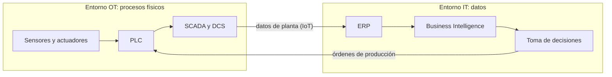
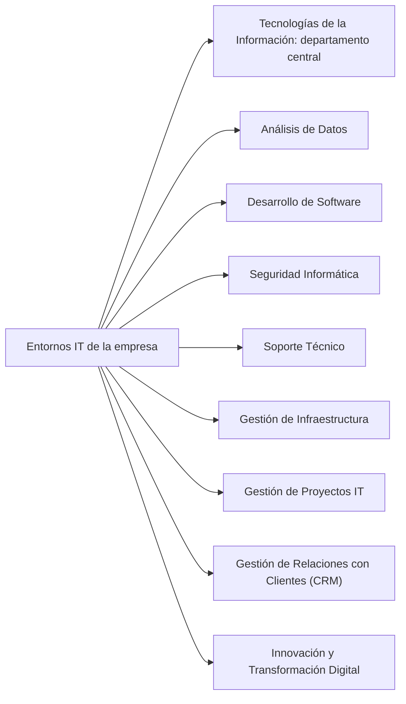
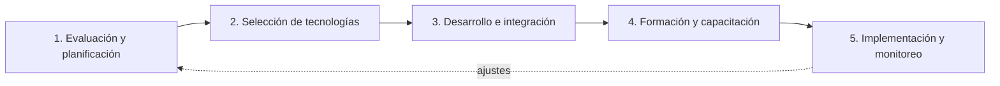

# Tema 1: Digitalización y actividad de la empresa en entornos IT y OT

La unidad presenta qué es la digitalización, distingue las tecnologías virtuales de las digitales y describe los dos grandes entornos tecnológicos de una empresa: el entorno **IT** (tecnología de la información), que gestiona datos, y el entorno **OT** (tecnología de operación), que controla procesos físicos. A continuación compara ambos entornos, enumera los departamentos que forman el entorno IT, recorre las tecnologías típicas de la digitalización en planta y en negocio, y termina con la convergencia IT/OT, las ventajas de digitalizar una empresa de extremo a extremo y el proceso de implantación de la tecnología digital.

---

## 1. Digitalización

La **digitalización** se refiere al proceso de convertir procesos, documentos y funciones empresariales tradicionales en un formato digital. Implica la adopción de tecnologías digitales para transformar y optimizar las operaciones y servicios de una empresa. Por ejemplo, una empresa de manufactura puede digitalizar sus líneas de producción con sensores IoT y sistemas de control automatizado, lo que mejora la eficiencia y reduce el desperdicio.

En su sentido más básico, digitalizar es transformar información que existe en formatos físicos (texto impreso, imágenes, audio) en un formato digital que se puede almacenar y manejar con dispositivos electrónicos. Es decir, en el contexto tecnológico la digitalización es la **conversión de información analógica a información digital**, y el resultado es **la representación de información en formato binario** (bits). Digitalizar un documento, por ejemplo, es convertir el papel impreso en un archivo electrónico.

> **Error frecuente**: confundir digitalizar con imprimir o con organizar papel. La digitalización no es un proceso de impresión en alta resolución, ni un método para organizar documentos físicos, ni el uso exclusivo de impresoras 3D: es pasar la información a bits.

Un **sistema digitalizado** es un conjunto de componentes y procesos que operan mediante tecnologías digitales para recopilar, procesar, almacenar y transmitir información. Estos sistemas reemplazan métodos manuales o analógicos con soluciones automatizadas y electrónicas, lo que aporta más eficiencia, precisión y capacidad de análisis.

En el contexto empresarial, la digitalización no consiste solo en instalar tecnología: **la digitalización implica la transformación de procesos, productos y servicios mediante el uso de tecnologías digitales para mejorar la eficiencia y la calidad**. No se limita a implantar tecnologías nuevas sin cambiar los procesos existentes, ni se aplica únicamente a las empresas del sector tecnológico.

### Digitalización y transformación digital

| Concepto | Qué es |
|---|---|
| Digitalización | Pasar información y procesos concretos a formato digital |
| Transformación digital | **La integración de tecnologías digitales en todos los aspectos de una empresa para mejorar su funcionamiento** |

La transformación digital es el paso siguiente: no se queda en mejorar la infraestructura tecnológica sin cambiar los procesos, ni en crear una página web, sino que afecta a toda la organización.

---

## 2. Tecnologías virtuales y digitales

Ambos términos están relacionados, pero designan conceptos distintos.

| | Tecnologías virtuales | Tecnologías digitales |
|---|---|---|
| Definición | Crean una representación simulada de entornos, objetos o experiencias, a menudo con la intención de simular la realidad | Utilizan información representada en formato digital (bits) para procesar, almacenar, transmitir y manipular datos de manera electrónica |
| Características principales | Inmersión en entornos simulados; interacción con objetos y ambientes virtuales; experiencias que pueden diferir de la realidad física | Representación de la información en formato digital; **manipulación eficiente de datos**; procesamiento y comunicación electrónicos |
| Ejemplos | **Realidad Virtual (RV)**, Realidad Aumentada (RA), Realidad Mixta (RM) | Internet, dispositivos móviles, tecnologías de red, software, computadoras |
| Enfoque | Crear entornos o experiencias simuladas | Cualquier tecnología que use información digital |
| Aplicaciones | Juegos, entrenamiento virtual, visualización de datos | Desde la gestión de datos hasta la conectividad global |

La relación entre ambas es de inclusión: la realidad virtual y la realidad aumentada son tecnologías virtuales que, a su vez, son tecnologías digitales, porque operan con datos en formato digital. Al revés no ocurre: un ordenador, un móvil o una red son digitales, pero no crean entornos simulados.

> **Error frecuente**: elegir "creación de entornos simulados", "interacción inmersiva con ambientes virtuales" o "experiencias que pueden diferir de la realidad física" como característica de las tecnologías digitales. Esas características son de las tecnologías **virtuales**; la de las digitales es la manipulación eficiente de datos.

---

## 3. El entorno IT (Information Technology: Tecnología de la Información)

El acrónimo IT significa **Information Technology** (no Internet, Industrial ni Intelligent Technology). El **entorno IT** es el conjunto de tecnologías, sistemas, recursos y prácticas relacionados con la gestión, el procesamiento, el almacenamiento y la transmisión de la información en el ámbito empresarial. Está centrado en el manejo de datos y en el uso de las tecnologías de la información para mejorar la eficiencia, la comunicación y la toma de decisiones.

Las tecnologías IT favorecen una mayor eficiencia operativa y la reducción de costes. Un ejemplo clave es la **virtualización**, que permite crear entornos virtuales (varias máquinas virtuales sobre un mismo servidor físico), optimizando recursos, simplificando la gestión de servidores y facilitando la escalabilidad. Por eso, la ventaja que proporciona la virtualización en el entorno IT es **mayor eficiencia operativa y reducción de costos**, o dicho de otro modo, la **optimización de recursos y reducción de costos**. No aporta más velocidad de conexión, más capacidad de almacenamiento físico ni más seguridad física.

> **Analogía**: es lo mismo que levantar varias máquinas virtuales de Ubuntu en VirtualBox sobre un único equipo: un solo hardware, varios servidores lógicos.

Ejemplos de tecnologías del entorno IT:

| Tecnología | Ejemplos | Para qué sirve |
|---|---|---|
| Sistemas de gestión de bases de datos (DBMS) | Oracle, MySQL, SQL Server | Almacenar y consultar grandes volúmenes de datos |
| Virtualización y computación en la nube | VMware, Azure, AWS | Entornos virtuales que optimizan recursos y reducen costes |
| Plataformas de colaboración | Teams, Slack, Google Workspace | Comunicación y colaboración en tiempo real |
| Software de gestión empresarial (ERP) | SAP, Oracle ERP, Dynamics 365 | Integrar contabilidad, inventario, ventas y RR. HH. |
| Ciberseguridad y protección de datos | Firewalls, antivirus, IDS, IAM | Proteger sistemas y datos |
| Análisis de datos e inteligencia de negocio (BI) | Tableau, Power BI, Google Data Studio | Analizar datos y generar informes visuales |
| Automatización de procesos (RPA) | UiPath, Blue Prism | Automatizar tareas administrativas repetitivas |
| Redes y comunicaciones | Routers, switches, VPN, wifi corporativo | Conectar dispositivos y sistemas |

Los principales desafíos del entorno IT son la protección contra amenazas cibernéticas, la gestión de accesos y la concienciación de los empleados sobre buenas prácticas de seguridad.

### 3.1. Características clave del entorno IT

Las **características clave del entorno IT** incluyen seguridad, almacenamiento de datos, redes y sistemas de información. En detalle:

1. **Infraestructura tecnológica**: hardware (servidores, redes, ordenadores, almacenamiento) y el software que lo gestiona.
2. **Sistemas de software**: aplicaciones y sistemas operativos.
3. **Comunicación y redes**: LAN, WAN e internet.
4. **Gestión de datos**: DBMS, almacenamiento y análisis de datos.
5. **Ciberseguridad**: proteger la integridad, confidencialidad y disponibilidad de la información.
6. **Servicios de TI**: soporte técnico, gestión de proyectos, consultoría.
7. **Colaboración y productividad**: correo, plataformas colaborativas, software de gestión de proyectos.

En cualquier sector, incluido el sociocultural, una característica clave del entorno IT es la **gestión de la infraestructura informática, como servidores y redes**. El uso de maquinaria física en la producción o el control de procesos industriales en tiempo real pertenecen, en cambio, al entorno OT.

### 3.2. Aplicaciones IT

Las **aplicaciones IT** son programas y sistemas que ayudan en la gestión de la información y los datos en una organización. Las más comunes:

| Aplicación | Ejemplos |
|---|---|
| Sistemas de gestión empresarial (ERP) | SAP, Oracle ERP, Odoo |
| Software de productividad personal | Microsoft Office, Google Workspace |
| Plataformas de colaboración | Slack, Teams, Asana |
| Gestión de relaciones con el cliente (CRM) | Salesforce, HubSpot, Zoho CRM |
| Analítica de datos | Tableau, Power BI, Google Analytics |
| Seguridad informática | Antivirus, cortafuegos, detección de intrusiones |
| Gestión de contenidos (CMS) | WordPress, Drupal, Joomla |
| Comercio electrónico | Shopify, Magento, WooCommerce |
| Recursos humanos | Workday, ADP, BambooHR |
| Almacenamiento en la nube | Dropbox, Google Drive, OneDrive |
| Plataformas de e-learning | Moodle y similares |

Un ejemplo típico de solución de software del entorno IT es el **software de contabilidad**; el software de temperatura o los sistemas de control de procesos son, en cambio, OT.

**ERP y CRM.** El ERP centraliza la gestión de procesos y da una visión integral de operaciones, finanzas y recursos humanos; por eso, la herramienta digital que se utiliza para conectar distintos sistemas de gestión empresarial es el **Software ERP**. La diferencia entre ambos es de objeto: **el ERP gestiona los recursos y el CRM gestiona las relaciones con los clientes**. Ninguno de los dos es exclusivo del departamento de ventas.

**Herramientas de análisis.** La herramienta IT que permite a las empresas analizar datos para mejorar la toma de decisiones es una plataforma de BI, **por ejemplo Power BI**. Las tendencias actuales en la gestión de datos del entorno IT son el aumento del análisis de Big Data, la inteligencia artificial y el almacenamiento en la nube.

Se entiende por **Big Data** **el análisis de grandes volúmenes de datos para encontrar patrones útiles**. No es solo la capacidad de almacenar mucha información ni la recopilación de datos en redes sociales: lo que lo define es el análisis.

Otras tendencias de la gestión de datos, con el sector químico como ejemplo recurrente: Data Lakes (centralizar datos de distintas fuentes), ciberseguridad de datos, gobernanza de datos (cumplir normativas como ISO o REACH y asegurar la trazabilidad), edge computing e IoT (procesar en el punto de origen), RPA, plataformas de datos en tiempo real y análisis predictivo para el mantenimiento.

---

## 4. El entorno OT (Operation Technology: Tecnología de Operación)

El **entorno OT** es el conjunto de tecnologías que se usan para supervisar y controlar procesos industriales. Mientras el entorno IT se centra en el manejo de la información, el OT está orientado a los sistemas que controlan y supervisan las operaciones físicas. Por eso la OT se centra principalmente en la **gestión de operaciones industriales**, y una aplicación típica de la OT es el **control de procesos industriales** (no los procesadores de texto, los navegadores o el software de diseño gráfico).

En el entorno OT se emplean principalmente **equipos de automatización industrial**: controladores, sensores, actuadores, robots. Y la tecnología más asociada a la OT, de entre las habituales, es el **Internet de las Cosas (IoT)**, porque conecta los dispositivos físicos de la planta.

Ejemplos clave del entorno OT:

| Sistema | Qué hace | Ejemplos |
|---|---|---|
| Sistemas de Control Distribuido (DCS) | Supervisar y controlar procesos en tiempo real en petroquímica, energía o química | Siemens, ABB, Emerson |
| Controladores Lógicos Programables (PLC) | Automatizar y controlar máquinas concretas (motores, válvulas) | Allen-Bradley, Siemens, Schneider |
| SCADA | Recopilar datos de sensores y controlar desde una ubicación central | GE Digital, Wonderware |
| Redes de sensores industriales (IIoT) | Medir temperatura, presión o flujo y predecir fallos | |
| Sistemas de gestión de energía (EMS) | Monitorizar y optimizar el consumo energético | |
| Protección de infraestructuras críticas | Mantener la estabilidad de la red eléctrica | ABB, General Electric |
| Control de procesos de manufactura (MPC) | Ajustar variables en tiempo real para mantener la calidad | Farmacia, alimentación |
| Robots industriales | Ensamblaje, soldadura, empaquetado | KUKA, FANUC, ABB |

El uso de sistemas de control de procesos en un entorno OT facilita **la mejora de la eficiencia y reducción de errores en el proceso de producción**; no se trata de conectar las máquinas a la wifi ni de automatizar ventas.

### 4.1. Características clave del entorno OT

1. **Sistemas de Control Industrial (ICS)**: PLC, DCS y sistemas de automatización y control.
2. **Sensores y actuadores**: los sensores recopilan datos del entorno; los actuadores ejecutan acciones en respuesta a las señales de control.
3. **Sistemas SCADA**: plataformas para **supervisar, controlar y adquirir datos de procesos industriales en tiempo real**. Esa es su función principal.
4. **HMI (Human-Machine Interface)**: interfaces que permiten a las personas interactuar con los sistemas de control.
5. **Sistemas de instrumentación**: miden variables físicas como temperatura, presión o caudal.
6. **Sistemas de seguridad industrial**: paradas de emergencia, seguridad intrínseca, detección de fugas. Su función principal es **proteger los procesos físicos y a los trabajadores**.
7. **Redes de campo industrial**: protocolos como MODBUS, PROFIBUS o Ethernet/IP.
8. **Robótica industrial**.
9. **Sistemas de Gestión de Producción (MES)**: planificación y control de la producción.
10. **Control de procesos**: algoritmos para regular y optimizar la producción.

El **software de oficina** no es una característica clave del entorno OT: pertenece al manejo de información, es decir, al IT.

> **Error frecuente**: atribuir a SCADA funciones de otras piezas. Ejecutar acciones en respuesta a señales es propio de los **actuadores**; medir temperatura o presión, de la **instrumentación**; planificar y controlar la producción, del **MES**. SCADA supervisa, controla y adquiere datos en tiempo real.

### 4.2. Aplicaciones OT

Las aplicaciones OT controlan y supervisan procesos industriales en manufactura, energía, infraestructuras y otros sectores críticos.

- **Sistemas de Control Distribuido (SCD o DCS)**: su función principal es **supervisar y controlar procesos industriales complejos**, como una planta química o una central eléctrica. Se usan en refinerías, centrales nucleares, plantas de tratamiento de agua, procesamiento de alimentos, fabricación de automóviles o minería.
- **PLC o autómata programable**: dispositivo electrónico programable que controla máquinas y procesos, como líneas de ensamblaje. Es un componente esencial de la OT y no tiene nada que ver con la contabilidad.
- **SCADA** (Supervisión, Control y Adquisición de Datos): solución de software y hardware para supervisar y controlar procesos industriales, infraestructuras críticas y sistemas de producción en tiempo real. Se utiliza para el **monitoreo y control de procesos industriales**; su área es la **OT (Operation Technology)**, no el IT. Aplicaciones: líneas de producción, redes eléctricas, tratamiento de aguas, control de tráfico, refinerías, automatización de edificios (climatización, iluminación, seguridad).
- **Robótica industrial y monitorización de condiciones**: mantenimiento predictivo y detección temprana de fallos (temperatura, vibración, lubricación, rodamientos).
- **Instrumentación industrial**: sensores de temperatura, vibración, pH, analizadores de gases, transmisores de presión.
- **Redes de comunicación industrial**: MODBUS, PROFIBUS, Ethernet/IP.
- **Seguridad industrial**: paradas de emergencia y detección de fugas.
- **MES**: planificar, rastrear y gestionar la ejecución de la producción (Siemens SIMATIC IT, SAP ME, GE Proficy).
- **HMI**: pantallas desde las que el operario visualiza datos y controla procesos. Están en automatización industrial, SCADA, energía, transporte, edificios inteligentes, maquinaria agrícola, equipos médicos y electrodomésticos.

Las **plataformas de redes sociales** no son una aplicación típica de OT en el ámbito industrial; SCADA, PLC y MES sí lo son.

### 4.3. Robótica industrial

La robótica industrial se utiliza en una amplia variedad de aplicaciones para mejorar la eficiencia, la precisión y la seguridad en la fabricación y la producción:

| Aplicación | Ejemplo |
|---|---|
| Soldadura automática y soldadura por puntos | Carrocerías de automóviles, aeroespacial |
| Ensamblaje de productos | Electrónica, electrodomésticos |
| Paletización y despaletización | Almacenes y centros de distribución |
| Manejo de materiales | Transporte de cargas pesadas en almacenes y plantas |
| Pintura y recubrimiento | Distribución uniforme, menos desperdicio |
| Inspección visual | Detección de defectos con visión artificial |
| Corte y mecanizado | Piezas metálicas y plásticas |
| Manipulación de alimentos | Empaquetado y clasificación con higiene |
| Carga y descarga de máquinas CNC | Fabricación de piezas de precisión |
| Envasado y etiquetado | Alimentación, bebidas, consumo |
| Manipulación de sustancias peligrosas | Materiales tóxicos o radiactivos |

La robótica industrial no se limita únicamente a la fabricación de robots: abarca todas estas aplicaciones. Y sí tiene aplicaciones en la logística y la gestión de almacenes (paletización, manejo de materiales).

La **robótica colaborativa (cobots)** está formada por **robots diseñados para trabajar junto a humanos de manera segura**. Al permitir la colaboración directa, reduce el riesgo de lesiones y mejora la eficiencia en ciertas tareas. No debe confundirse con las plataformas que supervisan procesos en tiempo real (SCADA) ni con los sistemas de análisis de datos.

---

## 5. IT (Information Technology) vs. OT (Operation Technology)

La diferencia clave entre ambas es que **IT se enfoca en la gestión de datos, mientras que OT se enfoca en procesos físicos**.

| Aspecto | IT | OT |
|---|---|---|
| Definición | Tecnologías, sistemas y procesos para gestionar información y datos | Tecnologías y sistemas para controlar y supervisar procesos industriales y operacionales |
| Enfoque | Datos, sistemas de información, software empresarial, redes, ciberseguridad | Procesos físicos, automatización, supervisión industrial, seguridad industrial |
| Objetivos | Eficiencia operativa, decisiones basadas en datos, gestión de la infraestructura | Control preciso de procesos, seguridad y fiabilidad, optimizar la producción |
| Tecnologías | Servidores, redes, sistemas operativos, bases de datos, ERP, software de oficina | SCADA, PLC, sensores industriales, DCS |
| Enfoque temporal | Tiempo real o cercano, pero con operaciones más orientadas a la gestión de datos | Operaciones en tiempo real críticas, con sincronización precisa |
| Seguridad | Ciberseguridad: protección de datos e integridad de los sistemas | Seguridad industrial: procesos físicos, maquinaria y prevención de accidentes |
| Ciclo de vida de los activos | Más corto (la tecnología evoluciona deprisa) | Más largo (sistemas en funcionamiento durante décadas) |

De ahí que el área que se enfoca más en la seguridad de la información y la ciberseguridad sea **IT (Information Technology)**, y que una característica típica de OT en lugar de IT sea el **control de procesos industriales en tiempo real** (administrar bases de datos, desarrollar software empresarial o implantar el correo electrónico son tareas IT).

> **Error frecuente**: invertir los papeles ("OT maneja sistemas de información, IT supervisa procesos físicos") o convertir la diferencia en una regla de lugar ("IT solo en oficinas, OT solo en fábricas"). La diferencia es de objeto: datos frente a procesos físicos. Tampoco es cierto que una sea más eficiente que la otra en cualquier entorno.

Históricamente, IT y OT han existido de manera independiente y con escasa integración. La tendencia actual es la **convergencia IT/OT**, que plantea desafíos por las diferencias de protocolos, de requisitos de tiempo real y de enfoques de seguridad.

La convergencia une los dos entornos mediante el intercambio de datos en ambos sentidos: los datos de planta suben a los sistemas de gestión, y las decisiones bajan a la planta como órdenes.

---

## 6. Diferencias y similitudes entre los entornos IT y OT

| Categoría | IT | OT | Ejemplo |
|---|---|---|---|
| Función principal | Gestionar datos, computación y comunicaciones | Controlar y monitorizar dispositivos y procesos físicos en tiempo real | IT: un ERP gestiona la información financiera. OT: un SCADA controla la producción |
| Entornos típicos | Oficinas, centros de datos, redes, software | Plantas de fabricación, infraestructuras críticas, transporte | IT: centro de datos. OT: planta de automóviles |
| Prioridades de seguridad | Ciberseguridad de los datos | Ciberseguridad y además seguridad física de procesos y equipos | IT: firewalls. OT: monitorización para evitar fallos |
| Tiempos de respuesta | Pueden ser más largos | Tiempo real, para evitar fallos | IT: incidencia de software. OT: avería en la línea |
| Tecnologías | Servidores, bases de datos, software de gestión | PLC, DCS, SCADA, sensores | IT: bases de datos en la nube. OT: PLC en una depuradora |

**Similitudes**: ambos buscan mejorar la eficiencia y la eficacia operativa (IT a través de la información, OT optimizando procesos físicos); ambos usan tecnologías avanzadas; ambos dependen de la recolección y el análisis de datos; ambos necesitan profesionales especializados (administradores de sistemas frente a ingenieros de automatización); y ambos deben proteger sus sistemas. Con la convergencia necesitan una integración fluida: por ejemplo, el IoT conecta dispositivos OT con sistemas IT para mejorar la supervisión y el control.

---

## 7. Departamentos de las empresas que pueden constituir entornos IT

| Departamento | Descripción |
|---|---|
| **Departamento de Tecnologías de la Información (TI)** | Es el **departamento central que gestiona la infraestructura tecnológica de la empresa** (hardware, software, redes, seguridad). Mantiene servidores y redes, da soporte e implanta el software empresarial |
| **Departamento de Análisis de Datos** | Se enfoca en la **recopilación, procesamiento y análisis de datos** para apoyar decisiones estratégicas: Big Data, modelos predictivos, informes y visualizaciones |
| **Departamento de Desarrollo de Software** | Responsable del **desarrollo y mantenimiento de aplicaciones y sistemas de software personalizados** para la empresa, incluidas pruebas y calidad |
| **Departamento de Seguridad Informática (Ciberseguridad)** | Tiene la responsabilidad principal de **proteger los sistemas de información contra amenazas cibernéticas**: firewalls, antivirus, monitorización de incidentes, políticas de seguridad y cumplimiento |
| **Departamento de Soporte Técnico** | **Proporciona asistencia técnica y resolución de problemas a los empleados de la empresa**: incidencias de hardware y software, configuración de equipos, formación de usuarios |
| **Departamento de Gestión de Infraestructura** | Se encarga de la **infraestructura física y lógica que soporta las operaciones de TI**: centros de datos, redes, comunicaciones |
| **Departamento de Gestión de Proyectos IT** | **Coordina y supervisa los proyectos relacionados con la implementación de nuevas tecnologías**: planificación, recursos, presupuestos y plazos |
| **Departamento de Gestión de Relaciones con Clientes (CRM)** | **Utiliza tecnologías de gestión de relaciones con clientes para mejorar la interacción y la satisfacción del cliente**: implanta el CRM, analiza datos de clientes y optimiza ventas |
| **Departamento de Innovación y Transformación Digital** | **Fomenta la adopción de nuevas tecnologías y la innovación dentro de la empresa**: detecta oportunidades, gestiona proyectos de transformación digital y promueve la cultura de innovación |

El conjunto de departamentos que pueden constituir entornos IT se representa así:

> **Error frecuente**: confundir TI con Gestión de Infraestructura. TI es el departamento **central** que gestiona toda la infraestructura tecnológica; Gestión de Infraestructura se ocupa de la parte **física y lógica** que soporta las operaciones de TI (centros de datos, redes). Otro par que se cruza: Gestión de Proyectos IT **coordina** la implantación de tecnologías concretas; Innovación y Transformación Digital **fomenta** su adopción.

---

## 8. Tecnologías típicas de la digitalización en planta y en negocio

### Digitalización en planta (fábrica)

La **digitalización en planta implica la integración de tecnologías digitales en los procesos de manufactura y producción industrial**, para optimizar la eficiencia, la precisión y la flexibilidad. No se refiere a las operaciones administrativas.

| Tecnología | Uso en planta | Ejemplo |
|---|---|---|
| IoT | Sensores y actuadores inteligentes que, junto con otros dispositivos y aplicaciones, monitorizan y controlan temperatura, presión o humedad; equipos conectados que recogen datos en tiempo real | General Electric (turbinas), Siemens |
| Automatización y control | PLC, SCADA, robótica industrial | Rockwell, Honeywell, Fanuc |
| Big Data y análisis | Plataformas de análisis de datos de producción; machine learning para predecir fallos | IBM, Bosch |

El IoT en planta no se limita a los sensores y actuadores: incluye la conexión en red de esos dispositivos, plataformas de análisis y comunicaciones que permiten el mantenimiento predictivo y la optimización.

### Digitalización en negocio

La digitalización en negocio se enfoca en la gestión y optimización de las operaciones empresariales: relación con clientes, decisiones basadas en datos y nuevas oportunidades de mercado. No se enfoca en la eficiencia de las máquinas de una fábrica.

| Tecnología | Uso | Ejemplo |
|---|---|---|
| Realidad aumentada y virtual | Asistencia remota en mantenimiento; formación de operarios con simulaciones | ThyssenKrupp (ascensores), Boeing |
| MES | Seguimiento y control de la producción | Siemens |
| Gemelos digitales | Réplicas digitales de sistemas físicos para simulación y optimización | General Electric |
| ERP | Integración de finanzas, recursos humanos y cadena de suministro | SAP |
| CRM | Interacciones y datos de clientes | Salesforce |
| Business Intelligence | Análisis y visualización para decidir | Power BI |
| E-commerce y marketing digital | Tiendas en línea; automatización del marketing (email, redes, publicidad) | Shopify, HubSpot |
| Cloud computing | Almacenamiento, procesamiento y aplicaciones en la nube | AWS |
| Ciberseguridad | Soluciones y prácticas para proteger la información y los sistemas digitales contra ciberamenazas | Cisco |
| IA y machine learning | Chatbots, análisis predictivo, personalización | Google Cloud AI |
| Blockchain | Seguridad y trazabilidad de las transacciones digitales, especialmente en cadenas de suministro | IBM Blockchain |
| RPA | Robots de software para tareas administrativas | UiPath |

Puntualizaciones que conviene retener:

- El **ERP integra procesos empresariales como finanzas, recursos humanos y cadena de suministro**.
- Los **gemelos digitales** son réplicas digitales de sistemas físicos utilizadas para simulaciones y optimizaciones.
- Los **MES** no gestionan solo eficiencia, calidad y rendimiento: también planifican la producción, gestionan órdenes, controlan el inventario en tiempo real, siguen materiales y analizan la trazabilidad.
- La **RA y la RV** no sirven solo para formar operarios y asistir en el mantenimiento: tienen otras muchas funcionalidades (diseño, visitas virtuales, experiencias de cliente).
- La **automatización del marketing** es una tecnología de negocio que gestiona campañas; no controla la calidad en planta.
- El **cloud computing** no se usa exclusivamente para controlar robots: proporciona infraestructura, almacenamiento y procesamiento.
- Los **PLC** son dispositivos de planta que controlan procesos automatizados, no herramientas de contabilidad.

Ejemplos por sector: BASF (sensores IoT), Dow Chemical (SCADA) y DuPont (Big Data) en química; Philips Healthcare e IBM Watson Health en sanidad; Amazon (robots logísticos) en comercio; Hilton (habitaciones inteligentes) en hostelería; Google (sensores en centros de datos) en informática; John Deere (sensores en maquinaria) en agricultura; Foxconn (robots) y Siemens (gemelos digitales) en electrónica. En servicios socioculturales: el Louvre (realidad aumentada en museos), la Biblioteca Pública de Nueva York (IoT para acceso y seguridad), Blackbaud CRM (gestión de donantes y campañas) y Eventbrite (venta de entradas para eventos culturales).

---

## 9. Importancia de la conexión entre entornos IT y OT

La **convergencia IT/OT** es la integración de las tecnologías de la información y las operacionales para optimizar eficiencia, productividad y toma de decisiones, unificando sistemas y datos de ambos entornos.

| Beneficio | En qué consiste |
|---|---|
| Eficiencia operativa | Sincronización en tiempo real de los datos de planta con los sistemas de gestión; automatización de procesos productivos y administrativos |
| Optimización de la producción | Monitorización en tiempo real y mantenimiento predictivo |
| Flexibilidad | Respuesta rápida a la demanda y personalización de productos |
| Seguridad y cumplimiento | Mejor supervisión de la seguridad en ambos entornos y reporte normativo más eficaz |
| Innovación | Desarrollo y prueba de productos con simulaciones basadas en datos reales |
| Reducción de costes | Menos desperdicio, menos tiempo de inactividad |

Desafíos de la integración: arquitecturas y protocolos distintos; ciberseguridad más compleja (los sistemas OT no se diseñaron para amenazas cibernéticas); resistencia al cambio del personal. Se superan con una estrategia clara, formación y una infraestructura de ciberseguridad robusta.

---

## 10. Ventajas de digitalizar una empresa industrial de extremo a extremo

Digitalizar de extremo a extremo es adoptar tecnologías digitales en cada etapa de la cadena de valor: diseño, producción, distribución y relación con clientes. Cada ventaja general tiene sus componentes específicos:

| Ventaja general | Componentes |
|---|---|
| Mejora de la eficiencia operativa | **Automatización de procesos** y optimización de recursos |
| Aumento de la productividad | Producción en tiempo real y **mantenimiento predictivo** |
| Mejora de la calidad | **Control de calidad automatizado** y trazabilidad completa |
| Flexibilidad y adaptabilidad | Respuesta rápida al mercado y **personalización de productos** |
| Reducción de costes | **Costes de producción** y costes de mantenimiento |
| Mejora en la toma de decisiones | Análisis de datos y **Business Intelligence** |
| Sostenibilidad y responsabilidad ambiental | **Gestión energética** y reducción de desperdicios |
| Mejora de la seguridad | **Seguridad laboral** y seguridad de datos |
| Innovación continua | **Desarrollo de nuevos productos** y adaptación a nuevas tecnologías |

Dos detalles tecnológicos ligados a estas ventajas:

- El mantenimiento predictivo se apoya en el IoT y el machine learning. La tecnología que se utiliza comúnmente para predecir fallos en los equipos y realizar mantenimientos preventivos es el **Machine Learning**.
- Las tecnologías digitales permiten la personalización masiva de productos; la tecnología que lo hace posible en fabricación es la **Impresión 3D**, que produce piezas distintas sin encarecer cada unidad.

Ejemplos: BASF (sensores OT integrados con análisis IT), Mayo Clinic (datos de pacientes con dispositivos conectados), Amazon (almacenes robotizados y comercio electrónico), Hilton (habitaciones inteligentes conectadas a la gestión hotelera), General Electric (turbinas monitorizadas), Foxconn (robots coordinados por sistemas de gestión) y el Louvre (RA y RV con gestión de visitantes).

---

## 11. Impacto de la Digitalización en las Empresas

1. **Eficiencia operativa**: reduce costes y tiempos de proceso.
2. **Flexibilidad y adaptabilidad** ante los cambios del mercado.
3. **Innovación y competitividad**.
4. **Satisfacción del cliente** por la personalización de los servicios.
5. **Sostenibilidad** por el mejor uso de los recursos.

La ventaja de la digitalización en la eficiencia operativa por excelencia es la **automatización de procesos** (por ejemplo, robots que hacen tareas repetitivas o un ERP que integra inventario, producción y recursos humanos). El aumento de la complejidad, de la resistencia al cambio o de los costes son inconvenientes, no ventajas.

---

## 12. Implantación de la tecnología digital en las empresas

Es la adopción e integración de tecnologías digitales en todas las áreas de la organización. Sus características:

| Característica | Ejemplo |
|---|---|
| Automatización de procesos | ERP que automatiza contabilidad, inventario y logística |
| Mejora en la toma de decisiones | Dashboards e informes automáticos |
| Comunicación y colaboración | Teams o Slack |
| Innovación en modelos de negocio | Tienda en línea |
| Personalización y experiencia del cliente | CRM |
| Seguridad y protección de datos | Sistemas de ciberseguridad |
| Capacitación del personal | Formación continua en competencias digitales |
| Integración de sistemas | Conectar ventas, marketing y finanzas para compartir datos |

---

## 13. Proceso de Implantación de la Tecnología Digital

| Fase | Contenido |
|---|---|
| 1. Evaluación y planificación | Identificación de necesidades y establecimiento de objetivos claros; plan estratégico |
| 2. Selección de tecnologías | Elección de las herramientas alineadas con los objetivos (ERP, automatización, análisis, ciberseguridad) |
| 3. Desarrollo e integración | Desarrollo de soluciones personalizadas e integración en los sistemas existentes; migración de datos |
| 4. Formación y capacitación | Entrenamiento del personal para usar las tecnologías y reducir la resistencia al cambio |
| 5. Implementación y monitoreo | Puesta en marcha en las operaciones diarias y monitorización continua para ajustar |

Las fases se suceden en orden, y la monitorización continua de la última permite volver a evaluar y ajustar:

Los desafíos de este proceso son la resistencia al cambio, la inversión inicial significativa y la necesidad de una ciberseguridad robusta; se afrontan con una estrategia clara y el apoyo de la dirección.

---

## Aplicación a los servicios socioculturales y a la comunidad de Castilla y León

Los conceptos de la unidad se aplican igual a un servicio sociocultural (centros cívicos, bibliotecas, residencias, servicios sociales municipales) que a una fábrica:

- **Digitalización**: en este ámbito, la digitalización implica la transformación de procesos, productos y servicios mediante el uso de tecnologías digitales para mejorar la eficiencia y la calidad; por ejemplo, la cita previa en línea o el expediente social electrónico.
- **Tecnología fundamental**: para mejorar los servicios socioculturales de la comunidad, la tecnología virtual y digital fundamental son las **plataformas de videoconferencia y colaboración en línea**, que acercan talleres, atención y formación a una población dispersa por el medio rural.
- **Entorno IT**: su característica clave es la **gestión de la infraestructura informática, como servidores y redes** (los equipos, la red y las bases de datos de usuarios de un ayuntamiento).
- **Entorno OT**: una aplicación común es la **gestión de sistemas automatizados para edificios e infraestructuras comunitarias** (climatización, iluminación, control de accesos de un polideportivo o un centro cultural), el equivalente sociocultural del SCADA de automatización de edificios.
- **Conexión IT/OT**: es importante **porque facilita la integración de sistemas de gestión y control, mejorando la eficiencia operativa y la calidad de los servicios ofrecidos** (por ejemplo, que el sistema de reservas de un centro cívico active la climatización de la sala reservada). No reduce la necesidad de tecnología ni aumenta la dependencia de la mano de obra manual.

---

## Ideas clave

- Digitalizar es convertir información analógica en digital (binaria); la transformación digital integra la tecnología en toda la empresa.
- Tecnologías virtuales: simulan entornos (RV, RA, RM). Tecnologías digitales: manipulan datos de forma eficiente. Toda tecnología virtual es digital, no al revés.
- IT gestiona datos (ERP, CRM, bases de datos, ciberseguridad); OT controla procesos físicos (SCADA, PLC, DCS, sensores, MES, HMI).
- SCADA supervisa, controla y adquiere datos en tiempo real; DCS controla procesos complejos; PLC controla máquinas concretas.
- La ciberseguridad es la prioridad de IT; la seguridad industrial (procesos físicos y trabajadores), la de OT.
- Nueve departamentos IT, cada uno con su frase: TI central, Análisis de Datos, Desarrollo, Ciberseguridad, Soporte, Infraestructura, Proyectos IT, CRM, Innovación.
- La convergencia IT/OT da visión completa y en tiempo real, mantenimiento predictivo y menos costes.
- Implantación digital en cinco fases: evaluación, selección, desarrollo e integración, formación, implementación y monitoreo.
