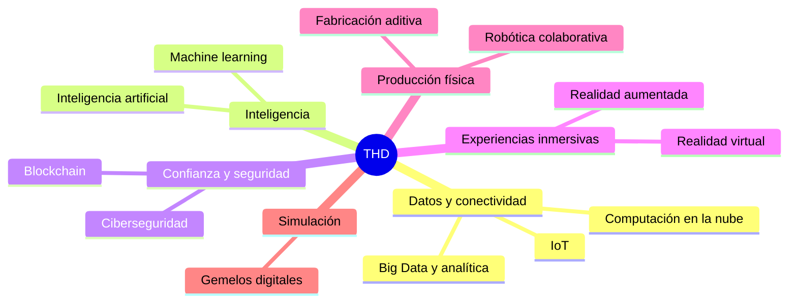
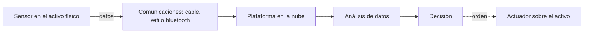
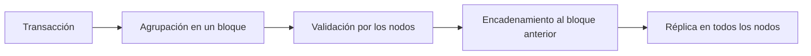
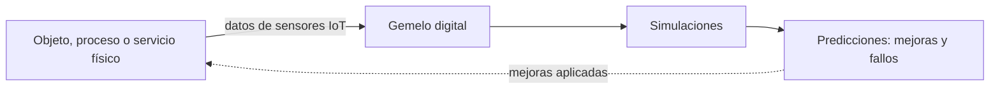

# Tema 2: Tecnologías habilitadoras digitales (THD)

La unidad describe las **tecnologías habilitadoras digitales (THD)**, las herramientas con las que una empresa lleva a cabo su transformación digital: IoT, inteligencia artificial, Big Data, blockchain, realidad aumentada y virtual, robótica colaborativa, gemelos digitales, fabricación aditiva y ciberseguridad. Después estudia sus características comunes, su aplicación por sectores, su relación con el desarrollo de productos, con la economía sostenible y con los nuevos mercados, y su papel en la parte de negocio y en la parte de planta de la empresa, es decir, en los entornos IT y OT del tema anterior.

---

## 1. Tecnologías Habilitadoras Digitales (THD)

Las **THD** son herramientas que permiten a las empresas desarrollar el proceso de transformación digital y adaptarse a la **Industria 4.0** o Cuarta Revolución Industrial y al modelo de fábrica inteligente. Suponen grandes oportunidades de empleo, pero también un reto para los sectores productivos y la ciudadanía.

**La Cuarta Revolución Industrial (Industria 4.0)** es la etapa industrial más importante desde el inicio de la revolución industrial del siglo XVIII y consiste en la **integración de tecnologías avanzadas para crear una fábrica inteligente**. Lo que la define principalmente es la **integración de tecnologías digitales en la fabricación**: no la mera automatización (eso ya lo trajo la Industria 3.0), ni el uso exclusivo de robots, ni solo la inteligencia artificial.

Las THD más frecuentes de la Industria 4.0 son: inteligencia artificial; Big Data y analítica; blockchain; robótica colaborativa; transformación digital inteligente; fabricación aditiva (impresión 3D); realidad virtual; realidad aumentada; ciberseguridad. A ellas se suman el IoT, los gemelos digitales y la computación en la nube.

Agrupadas según su función principal (agrupación orientativa), las THD quedan así:

Un concepto que las engloba es el de **Sistemas Ciber-Físicos (CPS)**: **sistemas que combinan componentes físicos y digitales para mejorar los procesos industriales**. Una máquina con sensores, un controlador y un software que decide sobre ella es un CPS; el IoT y los gemelos digitales son sus piezas habituales.

### La transformación digital como estrategia

La característica principal de la Transformación Digital (TD) en los sectores productivos es la **integración de tecnologías digitales para mejorar la eficiencia**. En la estrategia competitiva, la TD **permite una rápida adaptación a las nuevas demandas del mercado mediante la innovación tecnológica**. Sus objetivos estratégicos y beneficios son:

| Objetivo o beneficio | Descripción |
|---|---|
| **Reducción de Costes** | **Implementa tecnologías que automatizan procesos y optimizan recursos, disminuyendo los gastos operativos** |
| **Mejora de la Competitividad** | **Incorpora tecnologías avanzadas para optimizar procesos, aumentar la producción y diferenciarse en el mercado** |
| **Alineación de Unidades Funcionales** | **Coordina las actividades y metas de diferentes departamentos para lograr un objetivo común mediante la integración digital** |

En la administración y gestión de empresas, el beneficio que se asocia directamente con las THD es la **mejora de la productividad y reducción de costos**.

En el ámbito de los procesos industriales, la digitalización se define como la **implementación de tecnologías digitales para reemplazar los procesos físicos tradicionales**. En la gestión de datos empresariales, su objetivo principal no es solo pasar papel a formato digital, sino **mejorar la eficiencia y accesibilidad de los datos a través de sistemas digitales integrados**.

La digitalización tiene también un coste de gestión: **aumenta la complejidad debido a la integración de múltiples sistemas** (cada sistema nuevo hay que conectarlo con los demás, mantenerlo y protegerlo). Y adoptar THD en industrias tradicionales tiene un desafío importante: la **necesidad de adaptación en procesos y estructuras organizativas para integrar nuevas tecnologías**.

Un **sistema automatizado** es **un sistema que realiza tareas de forma automática sin intervención manual**. Una de las principales ventajas de automatizar procesos con THD es la **reducción de errores y mejora en la precisión y consistencia de los procesos**.

### 1.1. IoT

Se llama **Internet de las cosas** (Internet of Things, IoT) a la posibilidad de interconexión y transmisión de datos entre objetos cotidianos e internet, por cable, wifi o bluetooth: teléfonos, coches, televisores, relojes, electrodomésticos. Es una **red de dispositivos interconectados que recopilan y comparten datos en tiempo real**. Una casa domotizada, en la que se enciende la calefacción desde el móvil antes de llegar, es IoT.

El propósito del IoT en un entorno digitalizado es **conectar dispositivos para recopilar y compartir datos en tiempo real**. En la gestión de operaciones contribuye **permitiendo la conexión de dispositivos para la recopilación y análisis de datos en tiempo real**.

Componentes principales del IoT:

| Componente | Función |
|---|---|
| Sensores | Origen de los datos del activo físico |
| Comunicaciones | Condicionan consumo y conexión según la aplicación |
| Plataforma | Software de análisis de datos y gestión de la información |

Los tres componentes se encadenan en un flujo que va del activo físico a la decisión y, cuando hay actuadores, vuelve a él:

Para desplegar cualquier sistema de gemelo digital se necesitan estos componentes principales del IoT (sensores, plataforma y comunicaciones): el gemelo se alimenta de los datos que el IoT recoge.

Ejemplos de uso: optimizar el riego en cooperativas agrarias, optimizar rutas de transporte y de recogida de residuos, monitorizar pacientes a distancia, monitorizar plantas solares, gestionar la energía de hoteles, edificios públicos y campus universitarios, controlar temperatura y humedad del aceite almacenado, o gestionar iluminación y climatización de un centro cultural.

> **Analogía**: un termostato IoT es un cliente que publica lecturas (sensor), las envía por MQTT o HTTP (comunicaciones) a un servidor que las guarda y decide (plataforma).

### 1.2. Inteligencia Artificial (IA) y Machine Learning (ML)

La **inteligencia artificial** es la simulación de la inteligencia humana en máquinas, dándoles la capacidad de aprender, razonar, deducir y hacer predicciones. El **machine learning** es la rama de la IA en la que el sistema aprende a partir de los datos.

En la digitalización, la IA **permite la automatización y mejora de procesos a través de análisis predictivos**. En el análisis de datos, **automatiza el análisis de datos y proporciona insights para mejorar procesos y decisiones**.

Una tendencia del comercio electrónico son los **chatbots**: los chatbots son robots que atienden a clientes en la web.

| Ventajas de la IA | Desventajas de la IA |
|---|---|
| Automatización de procesos | Falta de profesionales cualificados |
| Reduce el error humano | Su desarrollo es costoso |
| Potencia la creatividad | |
| Aporta precisión | |
| Agiliza la toma de decisiones | |

Una de las ventajas de la IA es, por tanto, la automatización de procesos minimizando la tasa de error.

### 1.3. Big Data y Análisis de Datos

**Big Data** (datos masivos o macrodatos) hace referencia al almacenamiento de grandes cantidades de datos y a los procedimientos usados para encontrar patrones repetitivos en ellos. Contribuye a la digitalización **proporcionando análisis avanzados y tendencias a partir de grandes volúmenes de datos**, y ayuda a decidir **ofreciendo análisis profundos a partir de grandes volúmenes de datos para una toma de decisiones más informada**. No consiste en almacenar sin procesar ni en reducir datos para evitar el análisis.

- **Beneficios**: reducción de coste; nuevos productos y servicios competitivos; tomar decisiones.
- **Desafíos** (las tres V): volumen de datos; velocidad de datos y de transacciones; variedad y tipología de datos.
- **Aplicaciones**: salud pública (modelos predictivos de brotes), deporte (datos de smartbands y smartwatches), ciudades inteligentes, educación (detectar alumnado en riesgo), banca (fidelización y detección de fraude), turismo y mercado inmobiliario.

Un concepto técnico asociado a la transmisión de datos es la **latencia de red**: el retraso en la comunicación de la red, es decir, el tiempo que tardan los datos en transferirse a través de la red. Cuanto menor es, antes llega el dato a donde se analiza.

#### 1.3.1. ¿Qué tipos de datos pueden ser analizados?

| Tipo | Definición | Ejemplos |
|---|---|---|
| Estructurados | **Son datos que cumplen con un modelo de datos y son de fácil acceso para humanos y programas**: formato estandarizado, estructura bien definida, orden persistente | Tabla de Excel por filas y columnas, formulario con campos definidos, registros financieros, inventarios |
| No estructurados | No tienen formato estandarizado ni estructura ni siguen ningún modelo u orden | **Un archivo de texto que contiene correos electrónicos y mensajes de chat sin formato específico**; fotos, audio, vídeo, grabaciones telefónicas |
| Semiestructurados | Están parcialmente organizados y contienen elementos estructurados y no estructurados | XML, JSON, bases de datos NoSQL |

> **Analogía**: una tabla SQL con columnas tipadas es un dato estructurado; un documento JSON de MongoDB, semiestructurado; el cuerpo de un correo, no estructurado.

Los datos estructurados también tienen uso en la web: Google premia las páginas que etiquetan su contenido con datos estructurados (tipo de dato, nombre, imagen, autor, fecha de publicación), porque así entiende qué significa cada elemento.

#### 1.3.2. Big Data, Business Intelligence y Business Analytic

| | Big Data | Business Intelligence (BI) | Business Analytics (BA) |
|---|---|---|---|
| Datos | Estructurados y no estructurados | Estructurados, orientados al **pasado** (descriptivo) | Estructurados, enfocados al **futuro** (predictivo) |
| Finalidad | Capturar y procesar la información; descubrir patrones que no se conocen de antemano | Estudiar estadísticas internas y corregir errores operativos del pasado; responder a preguntas conocidas | Encontrar las mejores estrategias y oportunidades de negocio |
| Usuario final | Cualquiera | Dirección estratégica | Analista de negocio |

> **Error frecuente**: invertir los tiempos. El BI se centra en datos del **pasado** (descriptivo) y el BA busca predecir resultados **futuros** (predictivo). La afirmación contraria es falsa.

Las soluciones de BI se pueden aplicar a cualquier tipo de negocio, independientemente de su sector o tamaño, desde un pequeño comercio hasta una multinacional. Utilidades del BI: optimizar el stock, gestionar proyectos, fidelizar y atraer clientes, corregir desviaciones de presupuesto. El BA permite acceder y analizar datos más rápido que las herramientas tradicionales para reducir el tiempo de lanzamiento de productos (farmacia, automoción, banca, informática).

### 1.4. Blockchain

**Blockchain** es una enorme base de datos compartida que recoge y almacena datos descentralizados y crea un registro único y no modificable, con copias sincronizadas que se encadenan en bloques. Es una **tecnología de registro distribuido que asegura la transparencia y seguridad en transacciones**; o, dicho de otro modo, **una tecnología de registro descentralizado que garantiza la transparencia y la seguridad de las transacciones**. No es un almacenamiento centralizado de una sola entidad ni un sistema temporal sin seguridad.

Su importancia está en aumentar la seguridad de las transacciones online mediante certificados de autenticidad, con datos inmediatos, compartidos, transparentes e inalterables a los que solo acceden los miembros autorizados de la red.

| Ventajas | Desventajas |
|---|---|
| Descentralización | Altos costes de implementación |
| Distribución de la red | Ineficiencia: muchos usuarios validan la misma operación (minería) |
| Bajos costes para las personas usuarias | Claves privadas: la seguridad excesiva es un talón de Aquiles si se pierden |
| Mayor confianza y seguridad (certificados de autenticidad) | Almacenamiento creciente con el número de operaciones |
| | Desempleo al eliminar intermediarios |

Una aplicación propia de blockchain son los **contratos inteligentes**: programas que se ejecutan solos cuando se cumplen sus condiciones. Los **sistemas de autenticación basados en contratos inteligentes** usan la tecnología de blockchain para realizar transacciones seguras y automatizadas a través de contratos inteligentes.

> **Analogía**: cada bloque guarda el hash del anterior, como cada commit de Git guarda el hash de su padre. Cambiar un bloque antiguo rompería todos los hashes posteriores, y por eso el registro es inalterable.

#### 1.4.1. Relación del Blockchain

Blockchain no es un concepto nuevo y no se aplica únicamente en el sector financiero: se usa en automoción, servicios financieros, gobierno, medios de comunicación, comercio minorista, fabricación y cadenas de abastecimiento. Prácticamente cualquier cosa de valor digital puede rastrearse, certificarse y comercializarse en una red blockchain.

El **Bitcoin** es un tipo de criptomoneda: una moneda virtual que funciona con el registro contable compartido (blockchain), lo que impide transferir dos veces el mismo activo o falsificarlo. Las criptomonedas destacan por su transparencia y descentralización; la banca tradicional, por su regulación y seguridad.

Blockchain en la industria no solo aporta seguridad en las transacciones: también mejora la transparencia y la trazabilidad de los productos, porque cada transacción queda en un libro mayor distribuido, inmutable y accesible a las partes autorizadas.

#### 1.4.2. ¿Cómo funciona la tecnología blockchain?

Cada transacción se agrupa con otras en un bloque; los nodos de la red la validan; el bloque validado se encadena al anterior y se replica en todos los nodos. Así se obtiene un registro compartido que nadie puede modificar en solitario.

El proceso, paso a paso:

### 1.5. Realidad aumentada (RA)

La **realidad aumentada (RA)** asigna la interacción entre ambientes virtuales y el mundo físico, posibilitando que ambos se entremezclen a través de un dispositivo tecnológico como webcams, teléfonos móviles o tabletas. En la digitalización se utiliza **para superponer información digital sobre el mundo real para mejorar la interacción**; no crea entornos completamente virtuales. En la productividad, **mejora la eficiencia al proporcionar información adicional en tiempo real sobre el entorno físico**.

La **webcam** es una cámara de vídeo miniaturizada que se puede conectar a un ordenador para grabar imágenes o emitirlas en directo a través de internet; es uno de los dispositivos que sirven para la RA.

Características de la RA: combina el mundo real y el virtual; ofrece interacción en tiempo real; se adapta al entorno; interactúa con las capacidades físicas del entorno en tres dimensiones.

Componentes necesarios:

1. Un objeto real que sirva de referencia.
2. Un dispositivo con cámara (móvil o tableta).
3. Un software que interprete la señal de la cámara; a veces no hace falta instalar nada (probadores de gafas en la web) y a veces sí (Pokémon Go).

#### 1.5.1. Aplicación práctica de la realidad aumentada en diferentes sectores

| Sector | Aplicación de RA o RV |
|---|---|
| Educación | Entornos de aprendizaje inmersivos e interactivos que fomentan el aprendizaje experiencial (*learning by doing*) |
| Comercio | Sesiones de incorporación y formación para empleados |
| Fabricación | Instrucciones paso a paso para la formación y el trabajo práctico |
| Sanidad | Orientación para aprender anatomía y procedimientos quirúrgicos |
| Militar | Entrenamiento de combate en entornos simulados |
| Automovilístico | Exploración de modelos actuales y futuros con sus sistemas internos |
| Logística y almacén | Gestión de inventarios y pedidos escaneando códigos |

La RA favorece las decisiones de compra: IKEA (con IKEA Place, para ver los muebles en el propio hogar), L'Oréal y Maybelline (probadores virtuales de maquillaje) o los probadores virtuales de ropa.

### 1.6. Realidad virtual (RV)

La **realidad virtual (RV)** es un entorno de escenas y objetos de apariencia real, generado por ordenador, que crea en el usuario la sensación de estar inmerso en él. Se contempla con unas gafas o casco de RV.

**RA frente a RV**: la RV construye un entorno totalmente inmersivo, artificial; la RA superpone objetos virtuales en un entorno real, y puede no necesitar gafas.

Tipos de RV:

| Tipo | Características |
|---|---|
| RV inmersiva | Replica el mundo real mediante una experiencia digitalizada; usada en educación, ocio o fabricación |
| RV no inmersiva | Usa un ordenador sin dispositivos interactivos adicionales; se maneja con teclado y ratón; permite interactuar con un mundo virtual sin sentirse dentro; mucho más barata |
| RV pasiva / interactiva | Pasiva: solo se visualiza el mundo virtual. Interactiva: se controlan sus elementos |

Métodos de implementación: simuladores, avatares, proyección de imágenes reales, interfaces cerebro-máquina y modelado 3D por ordenador. Tecnologías necesarias: el *reality engine* (ordenadores y software que crean la ilusión), el sistema de RV que reproduce los movimientos del usuario y los elementos inmersivos (gafas, guantes, cascos, sensores de movimiento). Un **CAVE** (Cave Automatic Virtual Environment) es una sala en forma de cubo con proyectores hacia paredes, suelo y techo.

En la capacitación, el aspecto clave de la RV es **ofrecer simulaciones prácticas en un entorno completamente virtual para mejorar el aprendizaje**. En los servicios sociales permite, por ejemplo, entrenar situaciones de atención difíciles sin riesgo.

#### 1.6.1. Ventajas y desventajas de la realidad virtual

| Ventajas | Desventajas |
|---|---|
| Usada en varios campos (milicia, educación…) | **Alto Costo** (elevado coste) |
| Conecta a las personas | La comunicación virtual no debe reemplazar a la directa |
| Genera experiencias | Aislamiento, soledad y **sentimiento de inutilidad**, peligrosos para la salud mental |
| | **El entrenamiento en ambientes de realidad virtual no es real** |

> **Error frecuente**: "usada en varios campos" es una ventaja, no una desventaja.

#### 1.6.2. Tecnologías virtuales

Las tecnologías que permiten desplegar una vida virtual son: RV, RA y realidad mixta (en conjunto, realidad extendida); monedas virtuales y criptomonedas con blockchain; la identidad digital; los avatares, que proyectan los movimientos y expresiones de los usuarios; los NFT; la inteligencia artificial; y las redes distribuidas y descentralizadas (5G, cloud, edge computing).

Los **NFT** (tokens no fungibles) son representaciones inequívocas de activos, digitales o físicos, en la red blockchain: obras de arte, artículos de juegos, entradas, terrenos virtuales. Usan la misma tecnología que las criptomonedas, pero, al contrario que estas, no se pueden dividir ni intercambiar entre sí, aunque sí comprar y vender.

> **Error frecuente**: describir los NFT como "bienes no fungibles" cuya diferencia con los fungibles radica en si hay que indemnizar por daños al destruirlos. Esa es la distinción jurídica entre bienes fungibles y no fungibles, no la definición de NFT. Un NFT no es el bien, sino un **token** que lo representa de forma inequívoca en blockchain; lo que lo hace no fungible es que no se puede dividir ni sustituir por otro token. La afirmación, tal como se formula, es falsa.

Ejemplos de empresas en el metaverso: Adidas (colecciones de NFT), Warner Music (conciertos en The Sandbox), Mastercard (patentes de NFT), PwC (terrenos virtuales), HSBC (oficinas virtuales), Epic Games y Lego (metaverso infantil) y Barbados (embajada virtual).

#### 1.6.3. Mundos virtuales o metaversos

| | Realidad virtual (RV) | Realidad aumentada (RA) | Realidad mixta (RM) |
|---|---|---|---|
| Qué es | Experiencia inmersiva que aísla del mundo real | Elementos digitales sobre la vista del mundo real, con interacción limitada | Combinación de RA y RV: los objetos digitales interactúan con el mundo real |
| Interacción con la realidad natural | Baja: el usuario se aísla de la realidad | Alta: el mundo real es el entorno con el que se interactúa | Media: el mundo real sirve de escenario |
| Nivel de inmersión | Alta: inmersión completa en una realidad paralela | **Media, depende de la densidad digital que se agrega a la realidad** | Alta: el mundo real se sustituye por una experiencia sensorial inmersiva |
| Dispositivo emblemático | Cascos y gafas sensoriales (Oculus Rift) | Apps en smartphones (Pokémon Go, IKEA Place, probador de gafas) | **Lentes que proyectan información digital sobre un entorno real como Microsoft Hololens** |
| Empresa representativa | Meta (Facebook) | Google | Microsoft, con Google, Apple y Magic Leap |
| Fase de desarrollo | En reajuste tras la burbuja inicial | En expansión | En plena revolución experimental |

La **realidad extendida (RE)** cubre todas las tecnologías que potencian los sentidos, incluidas las tres anteriores.

#### 1.6.4. Privacidad y metaverso

Los movimientos de cada persona en realidad virtual son un identificador biomecánico, con una precisión equivalente a la del reconocimiento facial o dactilar: permiten saber que detrás de varios avatares está la misma persona. Eso no significa que la privacidad esté perdida ni obliga a prohibir la RV: igual que la escritura identifica a quien escribe y no se prohíbe, la identificación por marcadores biomecánicos implica **la necesidad de enmascarar nuestros movimientos para proteger nuestra privacidad**, mediante herramientas que los enmascaren.

### 1.7. Robótica colaborativa

La **robótica colaborativa** está formada por sistemas fáciles de programar, capaces de trabajar junto a operarios sin sistemas de seguridad tradicionales (barreras), con control de fuerza que evita obstáculos. Un **cobot** es un robot, manipulador o no, desarrollado para trabajar de forma colaborativa con humanos y garantizar su seguridad; normalmente, un brazo mecánico ligero. **Los cobots son robots colaborativos.**

En la digitalización, lo que destaca de la robótica colaborativa es que **facilita la colaboración entre robots y humanos en el lugar de trabajo**; en los procesos industriales, **facilita la colaboración entre robots y humanos en el entorno de trabajo**. Lo que la caracteriza son los **robots diseñados para trabajar conjuntamente con humanos en entornos de trabajo compartidos**. No reduce la interacción con las personas ni aísla a los robots. Su objetivo es liberar a los operarios de las tareas tediosas y mecánicas para que aporten valor en otros niveles.

Características de los cobots: intuitivos, seguros, adaptables, flexibles y calibrables. Ventajas: entornos más saludables (eliminan tareas poco ergonómicas o peligrosas), mejor ambiente laboral (son silenciosos), puesta en marcha rápida, precio bajo, conocimiento técnico bajo y optimización de espacios (sin cercado de seguridad).

Tipos de robots:

| Tipo | Descripción |
|---|---|
| **Robots Colaborativos** (cobots) | Brazos robóticos ligeros creados para trabajar junto a los humanos en una cadena de producción |
| Vehículos Guiados Autónomos (AGV) | Inteligencia mínima; siguen rutas prefijadas; detectan obstáculos pero no los sortean |
| **Robots Móviles Autónomos** (AMR) | Más avanzados: se mueven con mapas precargados del espacio |
| **Aeronaves Pilotadas Remotamente** (RPAS) | El sistema completo (aeronave, enlace y estación de tierra) de las aeronaves no tripuladas operadas por control remoto: los drones |

### 1.8. Gemelos digitales o Digital Twin

Un **gemelo digital** es una réplica de una entidad física, existente o todavía no existente, que se usa para la formación, la prevención, el mantenimiento o la simulación. Son **réplicas digitales de procesos físicos para simulación y optimización**: **una representación digital que simula y analiza el comportamiento de un sistema físico para optimizar su rendimiento**. Su contribución a la optimización de procesos es que **permite la simulación y el análisis del comportamiento de sistemas físicos en un entorno digital**.

Su función se parece a la de un prototipo, con una diferencia: no solo analiza el producto en un momento dado, sino que puede hacer predicciones sobre cambios. No es, por tanto, una representación estática, ni un modelo físico, ni un software que solo registra datos históricos. Se aplica en física, química e ingeniería para que el gemelo sea idéntico al real.

#### 1.8.1. Ventajas y desventajas de los gemelos digitales

| Ventajas | Desventajas |
|---|---|
| Actualizar el prototipo y probar mejoras sin tocar el modelo real | No es fácil de crear: no existe una plataforma estandarizada |
| Evaluación informatizada de todo el ciclo de desarrollo | Exige monitorizar y digitalizar los procesos industriales |
| **Es posible hacer predicciones, reaccionar a tiempo a los cambios en las circunstancias y prever tiempos de inactividad** | Exige multiplicar la capacidad de almacenamiento y análisis de datos |
| Analizar y monitorizar productos ya existentes | Requiere inversión, tiempo y profesionales especializados |
| **Aumenta la probabilidad de que el producto, servicio o proceso sea un éxito** | |

> **Error frecuente**: afirmar que los gemelos digitales no requieren una elevada inversión o que no precisan tecnificación ni conocimientos técnicos. Ambas cosas son desventajas reales: sí las requieren.

#### 1.8.2. Ciclo de vida del gemelo digital

Para crear un gemelo digital es necesario, en primer lugar, contar con una ingente cantidad de datos precisos del objeto, proceso o servicio físico que se quiere replicar, y también de lo que se encuentra a su alrededor (para un motor: ciclo de vida, proceso de producción, diseño, materiales, piezas). Un programa recoge esos datos y crea simulaciones; mediante estas simulaciones es posible predecir cómo va a funcionar el producto, servicio o proceso, detectar mejoras y fallos y analizarlo todo en profundidad.

El gemelo y el objeto real forman un bucle: los datos van del objeto al gemelo, y las mejoras que revela la simulación vuelven al objeto.

Entornos donde ya se usan: medicina (planificar operaciones, formación quirúrgica; el primer órgano simulado fue el corazón), logística (DHL gestiona flotas de contenedores) e industria (testear procesos de fabricación, aerogeneradores, coches de carreras).

### 1.9. Fabricación sustractiva y aditiva

| | Fabricación sustractiva | Fabricación aditiva (impresión 3D) |
|---|---|---|
| Proceso | Parte de un bloque sólido y elimina material mediante corte, perforación y esmerilado | Construye objetos 3D añadiendo capas sucesivas de material (plástico, metal, yeso) a partir de un archivo digital |
| Puntos fuertes | Tolerancias estrechas y geometrías difíciles de fundir o modelar | Piezas personalizadas, diseños complejos, tiradas cortas |

> **Error frecuente**: la sustractiva **elimina** material; la que añade capas es la aditiva.

Ventajas de la fabricación aditiva:

- **Producción más rápida y económica**: reduce hasta un 90 % los tiempos.
- **Producción a menor escala y a medida**: permite producir piezas personalizadas a un coste muy inferior al de los procesos convencionales y es rentable en tiradas pequeñas, porque evita plantillas costosas.
- **Reducción de costes logísticos**: con un stock virtual se fabrica la pieza bajo demanda, sin grandes espacios de almacenamiento.
- **Ahorro energético** y **fabricación más sostenible**.

Desventajas: las piezas a menudo carecen de la resistencia al calor o del acabado superficial requeridos para piezas finales, y los procesos aditivos dejan pequeños poros que las debilitan. Por eso **no** es una opción ideal para piezas con alta resistencia al calor y acabados perfectos.

Ambas técnicas no se excluyen: se combinan, por ejemplo, en la creación de prototipos. Permiten la hiperpersonalización y la servitización propias de la Industria 4.0.

### 1.10. Ciberseguridad

La **ciberseguridad** es la práctica de proteger los sistemas más importantes y la información confidencial ante ataques digitales; también se conoce como seguridad de la tecnología de la información. En la digitalización es **la protección de sistemas y datos digitales contra accesos no autorizados y ciberataques**.

| Medida | Definición |
|---|---|
| Seguridad de la infraestructura | Prácticas para proteger los sistemas informáticos, las redes y otros activos que afectan a toda la sociedad |
| Seguridad de la red | Medidas para proteger una red ante intrusos, con cable o inalámbrica (wifi) |
| Seguridad de las aplicaciones | Procesos que protegen las aplicaciones que se ejecutan en local y en cloud |
| Seguridad de la información | Medidas de protección de datos, como el Reglamento General de Protección de Datos |
| Formación del usuario final | Concienciación en toda la organización para reforzar los puntos finales |

El uso de THD tiene un desafío claro en este ámbito: el **incremento en la exposición a vulnerabilidades y ataques cibernéticos**, porque cada dispositivo conectado es una puerta de entrada más.

#### 1.10.1. Tipología de amenazas

| Amenaza | Definición |
|---|---|
| Malware (programas maliciosos) | Software malicioso (gusanos, virus, troyanos, spyware) que da acceso no autorizado o causa daños; cada vez más "sin archivos" para eludir antivirus |
| Ransomware | Bloquea archivos o sistemas y amenaza con destruir o publicar los datos si no se paga un rescate |
| Phishing / ingeniería social | Correos o mensajes que parecen de una empresa legítima y piden datos confidenciales |
| Amenazas internas | Empleados, socios o contratistas, actuales o pasados, que abusan de sus permisos |

Ejemplo: el ransomware WannaCry (2017). Microsoft publicó el parche al día siguiente por Windows Update, lo que muestra la importancia de mantener actualizado el sistema operativo.

---

## 2. Características de las THD

| Característica | Descripción | Ejemplo |
|---|---|---|
| Conectividad | Conexión entre dispositivos, sistemas y plataformas para intercambiar datos en tiempo real | Sensores IoT |
| Automatización | Menos intervención humana, más eficiencia | Robots de ensamblaje |
| Escalabilidad | Crecer sin reconfigurar | Cloud computing |
| Análisis de datos | Extraer información de grandes volúmenes | Big Data |
| Interoperabilidad | Integrarse con otros sistemas | ERP integrado con CRM y SCM |
| Seguridad | Proteger datos y operaciones | Blockchain |
| Flexibilidad y adaptabilidad | Adaptarse a nuevas condiciones | IA que ajusta sus algoritmos |
| Innovación y mejora continua | Introducir mejoras de forma continua | Actualizaciones de software |

En la manufactura avanzada, la característica esencial para que una THD aporte valor es la interoperabilidad: la **capacidad para integrar y colaborar con otros sistemas para optimizar los procesos de manufactura**. Una THD aislada o que dependa de supervisión manual no aporta ese valor. Integrada así, una THD en la manufactura **optimiza los procesos al mejorar la precisión, rapidez y eficiencia**.

La automatización con **datos en tiempo real** produce una **mejora en la precisión y rapidez de las operaciones, reduciendo errores y tiempos de inactividad**: esos datos **permiten realizar ajustes operativos precisos y rápidos, mejorando la productividad**.

**Conectividad digital.** En los proyectos colaborativos, **facilita la colaboración y coordinación efectiva entre los miembros del equipo mediante el intercambio en tiempo real de información**. En las cadenas de suministro globales, **mejora la coordinación y el intercambio de información entre los distintos eslabones de la cadena**. Por eso la digitalización **optimiza la cadena de suministro a través de la integración de tecnologías digitales para mejorar la visibilidad y la eficiencia**.

**Experiencia del cliente.** La adopción de las THD **mejora la experiencia del cliente al proporcionar servicios más personalizados y eficientes** (recomendaciones, chatbots disponibles a cualquier hora). No limita la interacción con los clientes ni reduce la personalización: la aumenta.

Ejemplos que combinan varias THD:

| Ejemplo | Tecnología |
|---|---|
| **Sistemas de autenticación basados en contratos inteligentes** | **Tecnología de Blockchain utilizada para realizar transacciones seguras y automatizadas a través de contratos inteligentes** |
| **Plataformas de análisis de datos en tiempo real** | **Tecnología de Big Data utilizada para extraer y procesar información masiva para una toma de decisiones rápida y precisa** |
| **Sistemas de control de inventarios automatizados** | **Tecnología de IoT y Automatización que permite la gestión eficiente del inventario mediante sensores y sistemas automatizados** |

---

## 3. Aplicación de las THD en las empresas

| Sector | Tecnología y ejemplo |
|---|---|
| Industria y manufactura | IoT para monitorizar equipos y mantenimiento predictivo (Siemens); robótica en ensamblaje (ABB); Big Data para optimizar la fabricación (General Electric) |
| Salud | IA en diagnóstico (IBM Watson Health); VR para simular cirugías (Clínica Cleveland); IoT para monitorizar pacientes (Philips) |
| Agricultura | Sensores IoT de humedad y nutrientes (John Deere); drones (DJI); Big Data climático (Monsanto) |
| Transporte y logística | Blockchain para la trazabilidad (TradeLens, de Maersk e IBM); **IoT para monitorizar flotas en tiempo real (UPS)**; Big Data de rutas (DHL) |
| Finanzas | IA contra el fraude (JP Morgan); contratos inteligentes (Ethereum); Big Data para personalizar ofertas (Capital One) |
| Retail | **RA con IKEA Place**, que permite visualizar muebles en el hogar; Big Data de recomendaciones (Amazon); e-commerce en la nube (**Shopify**) |
| Energía | IoT en redes eléctricas (GE); Big Data en turbinas eólicas (Siemens); blockchain en energía renovable (Power Ledger) |
| Educación | RV (ClassVR); cloud para gestionar aulas (**Google Classroom**); **Big Data para personalizar el contenido educativo (Knewton)** |
| Hostelería y turismo | Habitaciones IoT (Hilton); Big Data de huéspedes (Marriott); tours en RV (Google Earth VR); chatbots (Expedia) |
| Informática y comunicaciones | Cloud (AWS); ML en seguridad (Google); IoT de redes (Cisco); identidades digitales con blockchain (IBM) |
| Electricidad y electrónica | Redes inteligentes IoT (Schneider); Big Data de consumo (Honeywell); robots (Foxconn); certificados renovables con blockchain (WePower) |
| Servicios socioculturales | RA en museos (Louvre); Big Data de servicios comunitarios (Barcelona); IoT en iluminación pública (Singapur) |

> **Error frecuente**: cruzar empresas y tecnologías. La monitorización de **flotas** es IoT del sector **transporte y logística**; en industria el IoT monitoriza equipos. **Google Classroom** usa la nube para gestionar aulas; quien personaliza contenido con Big Data es **Knewton**. Los muebles en el hogar con RA son de **IKEA Place**; **Shopify** ofrece comercio electrónico en la nube. Las tres afirmaciones cruzadas son falsas.

---

## 4. Relación de las THD con el desarrollo de productos y servicios

| Tecnología | Relación con el desarrollo de productos y servicios | Ejemplos |
|---|---|---|
| IoT | Monitorización y feedback continuo; **mejora de productos existentes** con datos en tiempo real sobre su desempeño y uso; nuevos servicios conectados | Coches conectados; **sensores IoT en cultivos para monitorear condiciones y optimizar riego y fertilización**; dispositivos médicos conectados |
| IA y ML | Innovación de productos; **personalización masiva de productos y servicios**; optimización del diseño | Recomendaciones en e-commerce, fraude, marketing segmentado |
| Big Data | Análisis de mercado; **proporciona insights valiosos para la toma de decisiones informadas**; gestión del ciclo de vida | Retail, datos clínicos, energía |
| Cloud computing | Desarrollo ágil; **colaboración entre equipos de desarrollo distribuidos geográficamente**; reducción de costes | Software, e-learning, tiendas en línea |
| Blockchain | Transparencia y trazabilidad; seguridad; nuevos modelos de negocio | **Agricultura**: trazabilidad de alimentos de la granja a la mesa; contratos inteligentes; registros médicos |
| RA y RV | Prototipos virtuales; experiencias de cliente; formación | Ver productos en casa antes de comprarlos; formación médica; tours virtuales |
| Robótica | Automatización de la producción; robots de servicio; productos complejos | Robots quirúrgicos, líneas de ensamblaje, hostelería |

De la tabla se deduce qué tecnología corresponde a cada función: la que mejora productos existentes analizando en tiempo real su desempeño y uso es el **Internet de las Cosas (IoT)**; la que permite la personalización masiva de productos y servicios es la **Inteligencia Artificial (IA)**; la que facilita la colaboración entre equipos de desarrollo distribuidos es el **Cloud Computing**; y el sector que usa blockchain para la trazabilidad de los alimentos es la **Agricultura**.

---

## 5. Importancia de las THD con la economía sostenible y eficiente

Una economía sostenible y eficiente equilibra crecimiento económico, equidad social y protección del medio ambiente: satisface las necesidades presentes sin comprometer las de las generaciones futuras. Sus componentes: crecimiento sostenible, uso eficiente de los recursos, protección ambiental, equidad social, innovación y transparencia.

| Contribución de las THD | Ejemplo |
|---|---|
| Optimización del uso de recursos | IoT para el riego en viñedos y olivares; Big Data en la distribución de aceite |
| Reducción de la huella de carbono | Blockchain para certificar energía renovable; ML para optimizar rutas de camiones |
| Economía circular | IoT para monitorizar el reciclaje; blockchain para la trazabilidad de materiales |
| Innovación y competitividad | RV para prototipar vehículos; cloud sin grandes inversiones en hardware |
| Transparencia y trazabilidad | Blockchain en bodegas; IoT en la cadena de frío |
| Eficiencia operativa | Robots en fabricación electrónica; Big Data para el mantenimiento de plantas solares |
| Desarrollo sostenible | Big Data para medir el impacto ambiental y alinearse con los ODS; IoT en la gestión de residuos |

---

## 6. Nuevos mercados generados por las THD

| THD | Mercado o aplicación |
|---|---|
| IoT | Hogar inteligente, ciudades inteligentes, Industria 4.0 |
| IA y machine learning | Diagnóstico médico, tutoría inteligente, modelos predictivos contra el fraude, recomendaciones |
| Big Data | Segmentación de clientes, salud, optimización de rutas y gestión de flotas |
| Cloud computing | SaaS, IaaS (infraestructura escalable) y PaaS |
| Blockchain | Criptomonedas, contratos inteligentes, trazabilidad, propiedad intelectual |
| RA y RV | Juegos y experiencias inmersivas, aprendizaje virtual, rehabilitación |
| Robótica | Fabricación, almacenes autónomos, asistencia en el hogar |
| 5G | Servicios de alta velocidad y baja latencia, coche conectado |
| Ciberseguridad | Protección de datos financieros, registros médicos, e-commerce |

La IA y la computación en la nube no han creado mercados únicamente en el sector tecnológico: han generado nuevos mercados en múltiples sectores industriales.

---

## 7. Implicación de THD tanto en la Parte de Negocio como en la Parte de Planta

| | Parte de negocio | Parte de planta |
|---|---|---|
| Definición | Actividades de gestión empresarial, planificación estratégica, marketing, ventas, finanzas, atención al cliente y administración | Actividades de producción, fabricación, mantenimiento, control de calidad y operaciones técnicas |
| Componentes | Gestión empresarial; marketing y ventas; finanzas; recursos humanos; atención al cliente (servicio postventa) | Producción y fabricación (transformar materias primas en productos finales); mantenimiento; control de calidad; gestión de operaciones |
| Ejemplos | Gestión de la cadena de suministro; análisis de datos de clientes; marketing digital | Mantenimiento predictivo con sensores IoT; robots en la línea; Big Data y ML para detectar defectos |
| Entorno | IT | OT |

> **Error frecuente**: colocar en planta funciones de negocio. La **cadena de suministro**, el **análisis de datos** y la **atención al cliente y el servicio postventa** son de la parte de **negocio**. La parte de negocio no se refiere a la producción.

---

## 8. Mejoras producidas debido a la implantación de las tecnologías habilitadoras en relación con los entornos IT y OT

La convergencia IT/OT mediante THD produce mejoras en eficiencia operativa (SCADA en tiempo real), reducción de costes (mantenimiento predictivo en instalaciones solares), calidad (visión artificial en la línea), seguridad (ciberseguridad de la infraestructura IT), flexibilidad (MES que ajustan la producción al mercado), toma de decisiones (plataformas de BI), sostenibilidad (IoT de consumo energético) e innovación continua (gemelos digitales para diseñar aeronaves).

El IoT y el Big Data no solo mejoran la eficiencia de la planta: también facilitan la integración de IT y OT, coordinando los sistemas de gestión empresarial con los de control industrial. Del mismo modo, el Big Data y la IA no se usan solo en planta, sino también para optimizar la cadena de suministro (predecir demanda, optimizar rutas); y el cloud computing no es mero almacenamiento adicional: da recursos bajo demanda, colaboración, movilidad, escalabilidad y soporte al IoT y al Big Data.

| Implicación | Mejora |
|---|---|
| Automatización de procesos en la planta | Robots y sistemas automatizados para aumentar la productividad y reducir errores humanos |
| Optimización de la cadena de suministro | IoT y Big Data para mejorar la visibilidad y la gestión de la cadena |
| Mantenimiento predictivo | Sensores y análisis de datos para prever fallos antes de la avería |
| Mejora en la toma de decisiones | Análisis avanzado para decidir con información precisa y en tiempo real |
| Aumento de la eficiencia operativa | Coordinación de IT y OT para reducir el tiempo de inactividad |

---

## 9. Informe de las tecnologías con sus características y áreas de aplicación

| Tecnología | Característica esencial |
|---|---|
| IoT | Interconexión de dispositivos a través de internet para recopilar e intercambiar datos |
| Inteligencia artificial | Algoritmos y modelos que simulan el comportamiento humano y deciden a partir de datos |
| Big Data | Análisis y gestión de grandes volúmenes de datos para decidir con información |
| Computación en la nube | Servicios de computación a través de internet, con recursos bajo demanda |
| Blockchain | Registro distribuido que da transparencia y seguridad a las transacciones |
| RA y RV | Visualización inmersiva o superpuesta para formación, diseño y experiencia de cliente |
| Robótica | Automatización física de tareas |
| 5G | Comunicaciones de alta velocidad y baja latencia |

---

## Aplicación a los servicios socioculturales y a la comunidad de Castilla y León

| THD | Aplicación en servicios socioculturales y a la comunidad |
|---|---|
| IoT | La aplicación más beneficiosa es el **monitoreo y control de dispositivos médicos en tiempo real** (teleasistencia, sensores de caída o de constantes en personas mayores que viven solas) |
| Realidad aumentada | **Proporcionar capacitación interactiva para el personal de servicios sociales** |
| Blockchain | **Mejorando la transparencia y trazabilidad de los registros de servicios comunitarios** (ayudas concedidas, donaciones) |
| Big Data | Se analizan **datos demográficos y de uso de servicios por parte de la comunidad**, por ejemplo para ubicar recursos en una provincia envejecida y dispersa |
| IA y ML | **Analizar patrones de comportamiento en usuarios para mejorar servicios comunitarios** |

En todos los casos se trata de datos y servicios a personas, no de sensores industriales, maquinaria pesada o líneas de ensamblaje.

---

## Ideas clave

- Las THD son las herramientas de la transformación digital y de la Industria 4.0 (integración de tecnologías digitales en la fabricación).
- IoT: dispositivos conectados que recopilan y comparten datos en tiempo real (sensores, comunicaciones, plataforma).
- Big Data analiza datos de todo tipo; BI, datos estructurados del pasado; BA, datos estructurados para predecir el futuro.
- Datos estructurados (modelo de datos, tablas), semiestructurados (XML, JSON) y no estructurados (correos, chats, multimedia).
- Blockchain: registro distribuido, inmutable y transparente; no solo financiero.
- RA superpone lo digital al mundo real (inmersión media); RV sumerge por completo; RM (Hololens) combina ambas.
- Cobots: robots que trabajan junto a las personas de forma segura.
- Gemelo digital: réplica que simula y predice; necesita IoT, muchos datos e inversión.
- Fabricación aditiva añade capas (personalización, bajo demanda); sustractiva elimina material.
- Negocio (gestión, ventas, cadena de suministro, postventa) es IT; planta (producción, mantenimiento, calidad) es OT.
