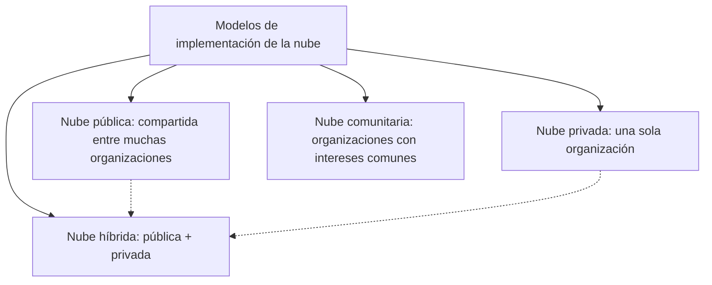
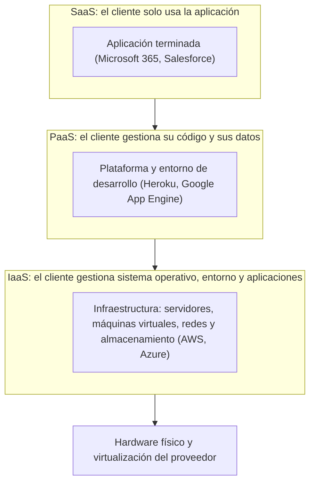
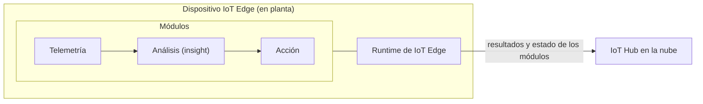
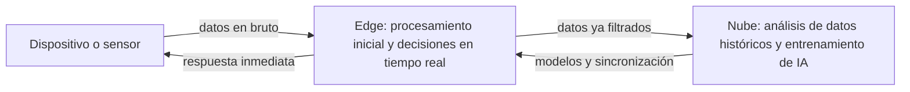
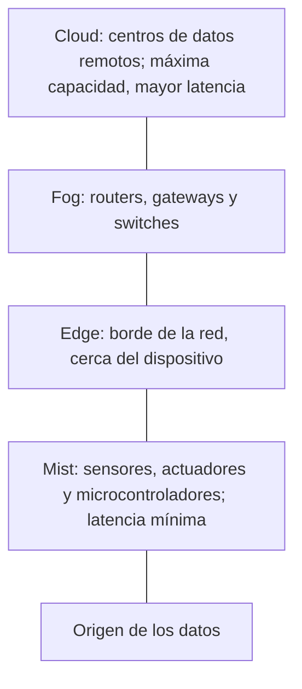
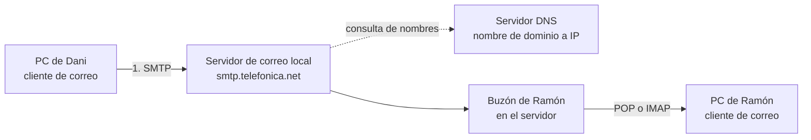

# Tema 3: Sistemas basados en cloud/nube

La unidad estudia los sistemas basados en la nube: qué son, sus tipos (pública, privada, híbrida y comunitaria), sus modelos de servicio (IaaS, PaaS, SaaS y otros), su aplicación por sectores y los criterios para evaluarlos. Después los relaciona con el trabajo colaborativo, con la computación en el borde (edge, fog y mist) y con las utilidades de uso diario: ofimática colaborativa, mensajería, videoconferencia, correo electrónico, agenda y redes sociales.

---

## 1. Sistemas Basados en Cloud/Nube

Los **sistemas basados en cloud/nube** son **modelos de computación donde los recursos y servicios se alojan y gestionan en servidores remotos accesibles a través de internet**, en lugar de depender de infraestructura física local. Un sistema basado en la nube es, por tanto, **un sistema que almacena y gestiona datos en servidores remotos accesibles a través de Internet**; no opera sin conexión ni usa exclusivamente almacenamiento local. Proporcionan flexibilidad, escalabilidad y eficiencia.

Usos principales:

| Categoría | Ejemplos |
|---|---|
| Almacenamiento y recuperación de datos | Google Drive, Dropbox, OneDrive; copias de seguridad con Backblaze o Carbonite |
| Desarrollo y pruebas de software | Heroku y Google App Engine (PaaS); entornos de prueba que replican producción |
| Aplicaciones empresariales | CRM (Salesforce); ERP (SAP, Oracle Cloud ERP) |
| Colaboración y productividad | Microsoft 365, Google Workspace; Slack, Teams |
| Análisis y Big Data | Amazon Redshift, Google BigQuery; IBM Watson, TensorFlow |
| E-commerce y gestión de contenidos | Shopify, Magento; WordPress, Contentful |

Una ventaja principal de los sistemas en la nube es la **flexibilidad para escalar recursos y reducir costos operativos**, en lugar de depender de conexiones físicas y de mantener hardware local. Para las pymes, las ventajas son la reducción de costes, la escalabilidad, la accesibilidad desde cualquier lugar, el mantenimiento a cargo del proveedor y la flexibilidad.

El **modelo de pago por uso** permite pagar solo por los recursos que realmente se utilizan; por eso el coste inicial de implantación es generalmente bajo. En cuanto a seguridad, los proveedores ofrecen medidas avanzadas: cifrado de datos, autenticación multifactor, monitorización continua y cumplimiento de normativas.

La base técnica de la nube es la **virtualización**: **la creación de múltiples instancias virtuales de servidores, redes o almacenamiento en una infraestructura física**. Un mismo servidor físico del proveedor aloja muchas máquinas virtuales de clientes distintos.

---

## 2. Tipología de Sistemas Basados en Cloud/Nube

La **tipología de sistemas basados en cloud/nube** es la **clasificación de los diferentes tipos de servicios y modelos de implementación en la nube, como SaaS, PaaS e IaaS**. Según el modelo de implementación, se distinguen cuatro tipos de nube:

| Tipo | Descripción | Adecuada para | Ventajas | Desventajas |
|---|---|---|---|---|
| Nube pública | Infraestructura de proveedores externos (AWS, Azure, Google Cloud) compartida entre múltiples organizaciones | Aplicaciones web, servicios móviles, proyectos que requieren escalabilidad rápida | Costes de entrada bajos, escalabilidad ilimitada, mantenimiento del proveedor | Menor control; preocupaciones de seguridad y cumplimiento normativo |
| Nube privada | Infraestructura dedicada a una única organización, gestionada internamente o por un proveedor | Sectores con estrictos requisitos de seguridad y cumplimiento: finanzas, salud, gobierno | Mayor control, personalización, mayor seguridad | Costes más altos; capacidad limitada |
| Nube híbrida | Combina pública y privada, con portabilidad de datos y aplicaciones entre ambas | Empresas que gestionan cargas variables y datos sensibles | Flexibilidad, escalabilidad, control de datos sensibles, optimización de costes | Gestión compleja; problemas de compatibilidad y seguridad |
| Nube comunitaria | Infraestructura compartida entre varias organizaciones con intereses comunes | Administraciones, centros educativos, consorcios de investigación | Costes compartidos, colaboración, cumplimiento adaptado a la comunidad | Menos control que la privada; personalización limitada |

Los cuatro modelos de implementación, con la nube híbrida como combinación de las dos primeras:

Para una organización con estrictos requisitos de seguridad y cumplimiento: **la nube privada ofrece mayor control y seguridad, adecuada para organizaciones con altos requisitos de cumplimiento**. La pública tiene menos control sobre la seguridad y el cumplimiento; la híbrida no siempre da el mismo control que la privada; y la comunitaria está pensada para intereses comunes, no necesariamente para requisitos estrictos.

---

## 3. Aplicación de los Sistemas Basados en Cloud/Nube

| Sector | Plataformas y usos |
|---|---|
| Empresas y negocios | CRM (Salesforce), RR. HH. (Workday, BambooHR), productividad (Microsoft 365, Google Workspace) |
| Servicios socioculturales y a la comunidad | Voluntariado (Volgistics, GivePulse), programas educativos (Coursera, Khan Academy), eventos (Eventbrite, Meetup), acceso a servicios sociales (MyGov) |
| Informática y comunicaciones | Desarrollo (Heroku, Google App Engine), ciberseguridad (Splunk, Palo Alto), almacenamiento (Amazon S3), redes (Cisco Meraki) |
| Comercio y marketing | E-commerce (Shopify, Magento), marketing (HubSpot), analítica (Google Analytics), CRM (Zoho) |
| Hostelería y turismo | Reservas y clientes (Cloudbeds, Airbnb), marketing (Salesforce Marketing Cloud), experiencias AR/VR |
| Fabricación mecánica | CAD colaborativo (AutoCAD 360, Onshape), cadena de suministro (SAP IBP), mantenimiento predictivo (IBM Maximo), impresión 3D (Fusion 360) |
| Edificación y obra civil | BIM (Autodesk BIM 360, Revit), gestión de obras (Procore), eficiencia energética (Siemens Navigator) |
| Sanidad | Historias clínicas electrónicas, EMR (Epic, Cerner), telemedicina (Teladoc), gestión hospitalaria |
| Educación | E-learning (Moodle, Blackboard), Google Classroom, Teams for Education |
| Agricultura | Riego inteligente (SmartFarm, CropX), gestión de cultivos (Climate FieldView), trazabilidad (IBM Food Trust) |
| Energía y agua | Redes eléctricas (Siemens EnergyIP), agua (WaterSmart), renovables |
| Imagen y sonido | Edición colaborativa (Adobe Creative Cloud), distribución (Vimeo), directos (Twitch) |
| Transporte | Gestión de flotas (Fleet Complete, Geotab), mantenimiento predictivo de vehículos |

---

## 4. Criterios de Evaluación de los Sistemas Basados en Cloud/Nube

| Criterio | Qué se evalúa |
|---|---|
| Escalabilidad | Crecer y absorber cargas crecientes sin perder rendimiento (una tienda que amplía servidores en el Black Friday) |
| Seguridad | Protección de datos, gestión de accesos y cumplimiento de normativas |
| Costes | Costes iniciales, operativos y a largo plazo, con el pago por uso |
| Fiabilidad | Disponibilidad garantizada por el SLA (acuerdo de nivel de servicio) del proveedor, por ejemplo un 99,99 % |
| Flexibilidad | Adaptarse a cambios del negocio y a tecnologías nuevas |
| Gestión y mantenimiento | Actualizaciones, parches y soporte técnico |
| Interoperabilidad | Compatibilidad e integración con los sistemas existentes |

Para evaluar la efectividad de las aplicaciones en la nube, lo crucial es **la facilidad de integración con sistemas existentes y la capacidad de escalar según la demanda**, no el coste del hardware propio ni el tipo de conexión física. Y en los servicios socioculturales, un criterio clave es **la capacidad de recuperación ante desastres y la continuidad del negocio**.

Afirmaciones correctas sobre estos criterios:

- El coste inicial de implantación es generalmente bajo gracias al pago por uso.
- La escalabilidad permite ajustar recursos de forma rápida y flexible según las necesidades.
- La seguridad sigue siendo una preocupación importante: ningún proveedor puede garantizar la protección absoluta.
- La accesibilidad no está limitada a ciertos dispositivos o ubicaciones: basta una conexión a internet.
- El rendimiento puede verse afectado por la calidad de la conexión a internet del usuario.
- Los sistemas en la nube sí permiten integrarse con otras aplicaciones, mediante APIs y herramientas de integración.
- La recuperación ante desastres es una ventaja clave, por la redundancia y las copias que mantienen los proveedores.
- La personalización no es limitada: los proveedores ofrecen opciones de configuración adaptables a cada organización.
- El cumplimiento normativo y la protección de datos son factores críticos al evaluar a un proveedor.

> **Error frecuente**: dar por buena la "protección absoluta" o la "personalización imposible". Las dos afirmaciones son falsas.

---

## 5. Trabajo colaborativo aplicado a la gestión de dispositivos y datos en el entorno profesional

El **trabajo colaborativo** son las **actividades y procesos que se llevan a cabo de manera conjunta por varios usuarios, aprovechando tecnologías que facilitan la comunicación y cooperación en tiempo real**. En la gestión de dispositivos y datos, el trabajo colaborativo en la nube **facilita la colaboración en tiempo real y el acceso compartido a datos y aplicaciones**. La ofimática colaborativa en la nube, en concreto, **facilita el trabajo colaborativo al permitir la edición y el acceso a documentos desde cualquier lugar, mejorando la gestión de dispositivos y datos**: no obliga a estar en el mismo sitio ni dificulta la sincronización entre dispositivos.

### Los tres niveles de computación en la nube

| Modelo | Definición | Campo de aplicación | Ejemplos |
|---|---|---|---|
| **IaaS (Infrastructure as a Service)** | **Modelo que proporciona la infraestructura de TI, como servidores y almacenamiento, a través de la nube para que las empresas puedan desplegar y gestionar sus aplicaciones**: se alquilan servidores, máquinas virtuales, redes y almacenamiento | Desarrollo y despliegue, almacenamiento | Amazon Web Services (AWS), Microsoft Azure, Google Cloud Platform |
| **PaaS (Platform as a Service)** | **Modelo que ofrece plataformas y entornos de desarrollo para crear, desplegar y gestionar aplicaciones sin tener que preocuparse por la infraestructura subyacente** | Desarrollo de software | Google App Engine, Heroku |
| **SaaS (Software as a Service)** | **Modelo que entrega software y aplicaciones a través de la nube, permitiendo el acceso a través de internet sin necesidad de instalación local** | Aplicaciones empresariales, colaboración | Microsoft 365, Google Workspace, Salesforce |

Los tres niveles se apilan: cada uno se apoya en el inferior, y cuanto más arriba está el modelo, más parte de la gestión asume el proveedor y menos el cliente.

Consecuencias directas:

- El servicio que facilita el desarrollo y las pruebas de software sin preocuparse por la infraestructura subyacente es **PaaS**. IaaS da infraestructura básica pero no la abstrae del todo; SaaS da aplicaciones terminadas; DaaS (Desktop as a Service) ofrece escritorios virtuales.
- Un ejemplo de Plataforma como Servicio es **Google App Engine**. Microsoft Azure se clasifica sobre todo como IaaS (aunque también ofrece PaaS); Dropbox es almacenamiento; AWS Lambda es serverless.
- El tipo de servicio que permite utilizar aplicaciones en línea sin gestionar la infraestructura es **Software as a Service (SaaS)**.

> **Analogía**: IaaS es alquilar una VM vacía y montar uno mismo el Ubuntu, PHP y la base de datos; PaaS es subir el código a Heroku y que la plataforma se encargue del servidor; SaaS es usar Gmail.

### Otros servicios en la nube

| Servicio | Descripción | Ejemplos |
|---|---|---|
| Almacenamiento en la nube | Almacenamiento escalable accesible desde cualquier lugar; copias de seguridad | Dropbox, Google Drive, OneDrive, iCloud |
| Computación sin servidor (serverless) | Ejecución de código sin gestionar servidores | **AWS Lambda**, Azure Functions |
| IoT en la nube | Gestión y análisis de datos de dispositivos conectados | AWS IoT, Azure IoT Hub |
| Big Data y analítica | Procesamiento de grandes conjuntos de datos | Google BigQuery, Amazon Redshift |
| Seguridad en la nube | Protección de datos y gestión de accesos | Cloudflare, Azure Security Center |
| Colaboración y comunicación | Correo, chat y videoconferencia | Microsoft Teams, Slack |
| Automatización empresarial | Orquestar flujos de trabajo | Zapier, Power Automate |

En el IoT en la nube, el procesamiento puede repartirse entre el dispositivo y la nube. En la arquitectura de Azure IoT Edge, el dispositivo ejecuta módulos de telemetría, análisis y acción sobre un entorno de ejecución (*runtime*), que envía a IoT Hub los resultados y el estado de los módulos:

El servicio diseñado específicamente para ejecutar código sin gestionar servidores es **AWS Lambda**; Amazon Redshift es analítica, Google Drive es almacenamiento y Salesforce es SaaS.

### La robótica colaborativa en sistemas productivos conectados

En los sistemas productivos digitalizados, la nube se combina con los robots colaborativos: el robot ejecuta en planta y la nube almacena sus programas, sus datos y su mantenimiento. La característica destacada de la robótica colaborativa en estos sistemas es la **interacción y colaboración con humanos en entornos de trabajo compartidos**, no la operación aislada ni los procesos manuales sin automatizar.

---

## 6. Aplicaciones en la nube. Ventajas y Tipos

Las **aplicaciones en la nube** son **aplicaciones que se ejecutan en servidores remotos y son accesibles a través de internet, ofreciendo diversas funcionalidades sin necesidad de instalación local**.

Ventajas:

1. **Accesibilidad**: desde cualquier lugar con conexión, lo que facilita el trabajo remoto.
2. **Coste**: no hay que invertir en servidores propios ni mantenerlos.
3. **Escalabilidad**: se aumentan o reducen recursos según la demanda.
4. **Actualizaciones automáticas** a cargo del proveedor.
5. **Seguridad**: muchos proveedores aplican medidas robustas, aunque varía según el proveedor.

Tipos: SaaS (Google Workspace, Microsoft 365, Salesforce), PaaS (Google App Engine, Azure, Heroku) e IaaS (AWS, Azure, Google Cloud Platform). Ejemplos por funcionalidad: gestión de proyectos (Asana, Trello, Jira), comercio electrónico (Shopify), educación (Google Classroom, Moodle), telemedicina (Doxy.me), RR. HH. (Workday), CRM (Salesforce, HubSpot), finanzas (QuickBooks Online), diseño (Canva, Figma) y streaming (Netflix, Spotify).

Conceptos asociados:

| Concepto | Significado correcto |
|---|---|
| Acceso remoto | Los recursos están disponibles desde cualquier lugar con internet, no solo desde la oficina central; facilita el teletrabajo y la colaboración global |
| Escalabilidad | Ajustar rápidamente los recursos de TI según la demanda |
| Pago por uso | Se paga solo por los recursos utilizados, no una tarifa fija sin importar el consumo |
| Gestión centralizada | La infraestructura y las aplicaciones las gestiona de forma centralizada el proveedor, no cada departamento por separado; facilita la administración, el mantenimiento y las actualizaciones |
| Seguridad | Los proveedores implementan medidas de seguridad avanzadas |

---

## 7. Edge computing y su relación con la cloud/nube

| | Cloud computing | Edge computing |
|---|---|---|
| Dónde procesa | Centralizado, en centros de datos remotos | Cerca del origen de los datos, en el "borde" de la red |
| Punto fuerte | Gran capacidad de proceso, almacenamiento a largo plazo, análisis intensivos | Baja latencia y respuesta rápida |
| Uso típico | Análisis de grandes volúmenes de datos históricos, entrenamiento de IA | Decisiones en tiempo real |

El **edge computing** es un **paradigma de computación que acerca el procesamiento de datos a la ubicación física del dispositivo o fuente de datos, reduciendo la latencia**.

Edge y cloud no compiten: son **complementarios**.

- **Procesamiento distribuido**: el edge procesa cerca del origen y la nube aporta escala.
- **Latencia reducida**: el edge responde rápido, pero la nube sigue siendo esencial para el proceso pesado.
- **Análisis y almacenamiento**: los datos procesados en el borde se envían a la nube para analizarlos a fondo.
- **Respaldo y sincronización**: los dispositivos edge se sincronizan con la nube.

El reparto de trabajo entre ambos niveles sigue este flujo:

De ahí que:

- Edge y cloud pueden usarse juntos: el procesamiento inicial se hace en el borde y el análisis avanzado en la nube.
- Para decisiones en tiempo real es más adecuado el **edge**, no la nube.
- Combinarlos reduce la cantidad de datos que hay que enviar a la nube (menos ancho de banda y menos coste).
- El edge no elimina la necesidad de la nube en ningún escenario.
- El análisis de grandes volúmenes de datos históricos se hace mejor en la **nube**.

Casos de uso combinados: IoT, vehículos autónomos (navegación en el edge, entrenamiento de la IA en la nube), RA y RV (la latencia es crítica) y ciudades inteligentes. Una refinería, por ejemplo, monitoriza sus equipos en el edge y envía los datos a la nube para el mantenimiento predictivo con machine learning; un parque temático procesa en el borde las experiencias interactivas y analiza en la nube el flujo de visitantes.

---

## 8. Fog y Mist y sus zonas de aplicación en el conjunto

Entre la nube y el dispositivo hay niveles intermedios. De lo más lejano a lo más cercano al dato: **cloud → fog → edge/mist** (el mist es el nivel ultralocal, dentro del propio sensor).

Ordenados por distancia al origen de los datos, los niveles forman una pila: hacia arriba crece la capacidad de proceso; hacia abajo disminuye la latencia.

**Fog computing** (computación en la niebla) extiende los servicios de computación, almacenamiento y red **desde** los centros de datos centralizados **hacia** los nodos de red más cercanos al usuario final (routers, gateways, switches). Se ubica entre la nube y los dispositivos del borde. Es una **extensión del edge computing que proporciona recursos de computación y almacenamiento más cerca de los dispositivos finales, pero no tan cerca como el edge**.

Funcionalidades del fog: procesamiento localizado en routers y gateways; **reducción de latencia**; optimización del ancho de banda; mejora de la seguridad y la privacidad al mantener los datos cerca de su origen; escalabilidad; resiliencia (sigue funcionando si se corta la nube).

**Mist computing** (niebla ligera o fina) es una extensión del fog que lleva el procesamiento aún más cerca, a los dispositivos más pequeños: sensores, actuadores y microcontroladores. Funcionalidades: procesamiento ultralocal, latencia mínima, eficiencia energética (dispositivos con batería), filtrado de datos en origen, autonomía con conectividad intermitente y seguridad local.

| Aspecto | Fog computing | Mist computing |
|---|---|---|
| Nivel | Intermedio, en la infraestructura de red | El más cercano al origen de los datos |
| Dónde se implanta | Routers, gateways, switches | Sensores, actuadores, microcontroladores |
| Capacidad de proceso | Mayor | Muy limitada |
| Eficiencia energética | Menor | Muy alta |
| Ancho de banda | Reduce el tráfico a la nube | Lo reduce aún más |
| Ámbito | **Fog Computing se enfoca en grandes redes de datos mientras que Mist Computing en redes más pequeñas y distribuidas** | |
| Aplicaciones | IoT en gateways, vehículos autónomos, ciudades inteligentes, **monitoreo y control de procesos industriales en tiempo real**, **telemedicina** (procesar datos de salud en centros médicos locales), redes de energía | Filtrado en sensores IoT, dispositivos médicos portátiles, domótica, agricultura de precisión, wearables, mantenimiento predictivo en el borde |

Similitudes: ambos acercan el proceso al dato, reducen la latencia, **mejoran la seguridad y la privacidad de los datos al mantenerlos más cerca de su origen** y aumentan la resiliencia.

> **Error frecuente**: decir que el fog extiende los servicios **hacia** los centros de datos centralizados (es al revés: desde ellos hacia los nodos cercanos), o atribuir al mist el monitoreo y control de procesos industriales en tiempo real (es una aplicación del **fog**). Tampoco es cierto que el fog sea una tecnología obsoleta frente al mist: son complementarios.

---

## 9. Utilidades en la nube

La nube permite acceder a los mismos archivos y aplicaciones casi desde cualquier dispositivo, porque el proceso y el almacenamiento tienen lugar en servidores de un centro de datos y no en el dispositivo del usuario. Utilidades principales: crear copias de seguridad; ahorrar espacio en disco; enviar correos de mayor capacidad (con enlaces a archivos alojados); tener todo disponible en cualquier lugar; intercambiar datos entre dispositivos y trabajar en equipo; y almacenar más barato y de forma más duradera que en pendrives o discos externos. También sirve para la seguridad: un archivo sospechoso puede abrirse en la nube desde otro equipo sin pasarlo por un pendrive.

Para la privacidad en los entornos digitales basados en la nube, la característica esencial es **la configuración de permisos de acceso para proteger datos sensibles y garantizar la privacidad**: decidir quién puede ver, editar o compartir cada carpeta. Entre las utilidades de uso común para la comunicación y la colaboración empresarial están los **sistemas de mensajería y chats**, junto con la videoconferencia y el correo.

### 9.1. Ofimática colaborativa en la nube

La **ofimática colaborativa en la nube** son las **tecnologías que permiten realizar tareas de ofimática (como edición de documentos y hojas de cálculo) de manera compartida y en línea**: Google Workspace, Microsoft 365, Zoho Office Suite, Dropbox Paper.

| Google Workspace | Microsoft 365 |
|---|---|
| Docs, Sheets, Slides | Word, Excel, PowerPoint |
| Drive | OneDrive |
| Meet | Teams |
| Gmail, Calendar | Outlook |
| Forms (encuestas con resultados en tiempo real) | |

Google Docs permite que varias personas trabajen a la vez, con comentarios y control de versiones; Meet ofrece un número de acceso telefónico para quien no tenga datos; Gmail permite usar el dominio propio en la versión de pago.

| Ventajas | Desventajas |
|---|---|
| Acceso universal desde cualquier dispositivo | Dependencia de internet |
| Colaboración en tiempo real | Riesgo de violaciones de datos y accesos no autorizados |
| Seguridad y copias automáticas | Complejidad para cumplir RGPD (GDPR) o HIPAA |
| Reducción de costes | Costes recurrentes de suscripción |
| Integración con otras herramientas | Menos funciones que las versiones de escritorio |
| Compartición y sincronización de documentos; actualización permanente; multiplataforma | Problemas de compatibilidad de formatos; **velocidad de ejecución limitada si se trabaja conectado** |

> **Error frecuente**: la velocidad de ejecución limitada al trabajar conectado es una **desventaja**, no una ventaja.

#### 9.1.1. Aplicación al trabajo colaborativo

Las herramientas de trabajo colaborativo permiten que cualquier persona de la empresa con permisos acceda a la información que necesite esté donde esté, en teletrabajo o en la oficina. Las herramientas adecuadas son Google Docs, Google Drive, Microsoft 365, **OneDrive**, **Dropbox**, **Amazon Drive**, Confluence, Notion o Evernote. Una red social como Facebook no es una herramienta de trabajo colaborativo.

### 9.2. Sistemas de mensajería y Chats

La **mensajería instantánea** es un servicio online de comunicación que permite a dos o más personas enviar y recibir mensajes de texto en tiempo real, sin retraso aparente significativo. Características: sincronía (se entra y se sale de la conversación cuando se desea), interoperabilidad y multiplataforma, envío de archivos (doc, xls, pdf), seguridad frente a malware y ciberdelincuentes, y privacidad del perfil.

Servicios más populares: WhatsApp, Telegram, Signal, Facebook Messenger, WeChat y Line. Telegram ofrece cifrado de extremo a extremo en el modo secreto, uso multidispositivo, mensajes que se autodestruyen, canales y código abierto bajo licencia GPL.

| Ventajas | Desventajas |
|---|---|
| Comunicación en cualquier momento y lugar | Dependencia y adicción; aislamiento |
| Ahorro frente a la telefonía | Distorsión de la gramática y la ortografía por abreviar |
| Canal comercial inmediato para las empresas | |

#### 9.2.1. Videoconferencias

Las **videoconferencias** son **herramientas y servicios que permiten la comunicación visual y auditiva en tiempo real entre dos o más ubicaciones**, con dispositivos con cámara y micrófono: Microsoft Teams, Zoom, Webex, Google Meet, WhatsApp, FaceTime.

Características principales:

1. Transmisión en tiempo real de vídeo y audio.
2. Ahorro de tiempo y recursos (sin viáticos ni desplazamientos).
3. **Interfaz amigable**: configuración sencilla y manejo intuitivo.
4. **Múltiple compatibilidad**: se entra desde móvil, tableta, portátil u ordenador.
5. **Fácil acceso**: basta pulsar el enlace de la invitación.
6. Requiere acceso a internet.

> **Error frecuente**: "buena resolución" no figura entre las características de una videoconferencia; depende de la conexión y la cámara de cada participante.

Funciones: comunicación, compartir pantalla, grabar sesiones, chat integrado, adjuntar archivos y control de usuarios. Teams combina chat persistente, reuniones, archivos e integración de aplicaciones; Meet se integra con Google Calendar; Zoom genera una URL por reunión.

### 9.3. El correo electrónico

La nube ha mejorado el correo en accesibilidad, seguridad, escalabilidad e integración. El beneficio clave del correo en la nube es el **acceso remoto a mensajes desde cualquier dispositivo conectado**.

Un **cliente de correo electrónico** es un programa que se instala en el ordenador o el móvil para enviar y recibir correo (Outlook, Mail de Apple, Thunderbird, Gmail, Correo de Android). Muestra la lista de mensajes con su cabecera, permite leerlos, redactarlos, adjuntar ficheros y consultar los enviados. Los mensajes se almacenan en la misma máquina donde se ejecuta, lo que permite leerlos e incluso redactarlos fuera de línea.

La cabecera de un correo contiene: remitente (From), destinatario (To), asunto (Subject), fecha (Date), identificador único (Message-ID), con copia (CC), copia oculta (CCO) y la referencia al mensaje al que se responde.

**Protocolos**:

| Protocolo | Función |
|---|---|
| SMTP | Protocolo de la familia TCP/IP para enviar correo |
| POP (Post Office Protocol) | Descarga los correos del servidor y los almacena en el equipo |
| IMAP | Deja los correos en el servidor, accesibles desde cualquier dispositivo |

El recorrido de un correo entre dos usuarios del mismo proveedor ilustra el papel de cada protocolo: el cliente del remitente entrega el mensaje por SMTP a su servidor local, que es la primera máquina a la que accede; el servidor lo deposita en el buzón del destinatario, y el cliente de este lo recoge por POP o IMAP.

Es decir, POP descarga los correos y los almacena en **tu ordenador o teléfono móvil**, mientras que IMAP los deja en **el servidor**. Por eso a un comercial que trabaja parte de la semana fuera de la oficina le conviene IMAP.

> **Error frecuente**: describir POP como una forma de almacenamiento en la nube anterior a la palabra *cloud*. Es falso: POP descarga y saca el correo del servidor. Lo que se parece a la nube es IMAP.

#### 9.3.1. Aplicaciones de correo electrónico

Hay clientes de escritorio, móviles y basados en web. Los más populares: Outlook (Microsoft), Mail (Apple), Thunderbird (Mozilla), Gmail (Google) y Correo para Android.

#### 9.3.2. Uso del correo electrónico

La libreta de direcciones guarda los contactos y permite escribir a uno o a varios a la vez. Los campos de destinatarios:

| Campo | Visibilidad |
|---|---|
| CC (con copia) | Las direcciones se muestran a todos los receptores |
| CCO (con copia oculta) | Las direcciones permanecen invisibles para el resto de destinatarios |

La diferencia, por tanto: **las direcciones en CC se muestran a todos los destinatarios, mientras que las direcciones en CCO permanecen ocultas**. Ambos campos admiten varios destinatarios. CCO protege las direcciones cuando se escribe a mucha gente que no se conoce entre sí.

#### 9.3.3. Seguridad en el correo electrónico

La **seguridad en el correo electrónico** es el **proceso de asegurar que el correo electrónico se transmita y almacene de manera segura, protegiéndolo contra accesos no autorizados**.

El **SPAM** es el envío masivo e indiscriminado de correos no solicitados. Se estima que alrededor del **85 %** de los correos enviados son correo basura, lo que sobrecarga el ancho de banda de los servidores. No solo es molesto: puede ser peligroso. Puede bloquearse con filtros (por remitente o por palabras) y otras técnicas. En las empresas, **los administradores de los servidores de correo electrónico son responsables de bloquear el SPAM en las empresas**: vigilan los envíos masivos y los impiden.

### 9.4. Integración y uso de agenda en otros sistemas

Una **agenda electrónica o digital** es la planificación de las tareas para gestionarlas con el máximo aprovechamiento del tiempo. La nube aporta accesibilidad, sincronización y colaboración.

| Aplicación | Rasgos |
|---|---|
| Google Calendar | Multiplataforma; se integra con Gmail, Meet y Docs; notifica en todos los dispositivos; calendarios compartidos |
| **Awesome Calendar** | Exclusiva para iOS; se sincroniza con los calendarios del iPhone; permite escribir listas de tareas, crear diarios con imágenes y verificar el clima |
| aCalendar | Clásica de Android: vistas, recordatorios, temas, fases lunares |
| TimeTree | Pensada para compartir actividades y tareas |

#### 9.4.1. Funcionamiento de la agenda electrónica

El calendario da una visión global de tareas, citas y eventos. Para añadir un evento se procede **haciendo clic derecho o doble clic en el día elegido**, o con el botón correspondiente de la barra; se abre una ventana para detallarlo (reunión, tarea, recordatorio, cita), con colores y prioridades.

### 9.5. Redes sociales

Las redes sociales son plataformas para interactuar, compartir contenido y comunicarse por internet, alojadas en la nube. Sirven para comunicar y compartir, mantener contactos, informarse y entretenerse.

| Tipo | Definición | Ejemplos |
|---|---|---|
| Horizontales o genéricas | No tienen temática determinada: se dirigen a todo tipo de usuarios | Facebook, Twitter |
| Verticales | Relacionan personas con intereses específicos en común (música, hobbies, deportes) | Redes temáticas o profesionales |

> **Error frecuente**: atribuir a las redes horizontales la definición de las verticales. Las que reúnen intereses específicos son las **verticales**.

Ventajas: son inmediatas, masivas, acortan distancias, aumentan la visibilidad de las marcas y funcionan como canal de aprendizaje.

#### 9.5.1. Configuración, publicación y uso responsable

Peligros de las redes sociales:

| Riesgo | Descripción |
|---|---|
| Ciberacoso | Acoso u hostigamiento a través de las redes |
| **Grooming** | Acoso de adultos a menores ("engaño pederasta"); es un delito que debe denunciarse |
| Fake news | Información falsa o sin contrastar |
| Contenidos sensibles | Material sexual o violento inadecuado para menores |
| Adicción | Distracción, alteración del sueño, exposición a rumores |
| Viralización | Difusión masiva de información, dañina si es confidencial |

Por eso, un aspecto negativo de las redes sociales es **el grooming** (informarse y entretenerse son usos positivos). Para configurarlas y usarlas de forma responsable, lo crucial es **configurar la privacidad de la cuenta para limitar el acceso a la información compartida**, en lugar de compartir datos personales sin restricción.

---

## Aplicación a los servicios socioculturales y a la comunidad de Castilla y León

- **Característica principal**: los sistemas en la nube ofrecen **flexibilidad y escalabilidad para acceder a servicios y recursos desde cualquier lugar con conexión a Internet**, algo decisivo en una comunidad extensa y con mucha población rural.
- **Ventaja en la gestión de datos**: la **reducción de costos operativos y mayor accesibilidad a la información** (expedientes, inscripciones y registros de usuarios disponibles para todo el equipo sin servidores propios).
- **Aplicación práctica**: **utilizar plataformas de videoconferencia para proporcionar formación y talleres a distancia** (talleres de memoria, alfabetización digital o formación de voluntariado en municipios pequeños), no fabricar hardware ni montar máquinas virtuales locales.
- **Criterio de evaluación**: la capacidad de recuperación ante desastres y la continuidad del negocio, para que la atención no se interrumpa si falla un equipo local.

---

## Ideas clave

- Un sistema en la nube almacena y gestiona datos en servidores remotos accesibles por internet; su base es la virtualización.
- Nube pública (compartida, barata), privada (control y seguridad), híbrida (combinación) y comunitaria (intereses comunes).
- IaaS da infraestructura (AWS, Azure); PaaS, plataforma de desarrollo (Google App Engine, Heroku); SaaS, aplicaciones terminadas (Microsoft 365, Salesforce); serverless ejecuta código sin servidores (AWS Lambda).
- Criterios de evaluación: escalabilidad, seguridad, costes, fiabilidad (SLA), flexibilidad, mantenimiento e interoperabilidad.
- Edge procesa junto al dato (tiempo real); cloud analiza a gran escala (históricos). Son complementarios.
- Fog: nivel intermedio en routers y gateways, grandes redes (industria, telemedicina). Mist: dentro de sensores y microcontroladores, redes pequeñas y distribuidas.
- POP descarga al equipo; IMAP deja el correo en el servidor. CC visible; CCO oculto. El SPAM lo bloquean los administradores del servidor de correo.
- Videoconferencia: fácil acceso, múltiple compatibilidad, interfaz amigable.
- Redes horizontales (generalistas) frente a verticales (temáticas); el grooming es un riesgo grave.
