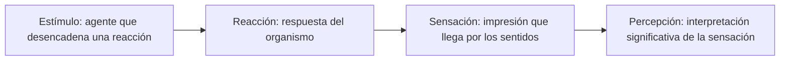
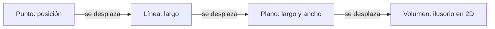
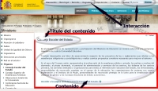
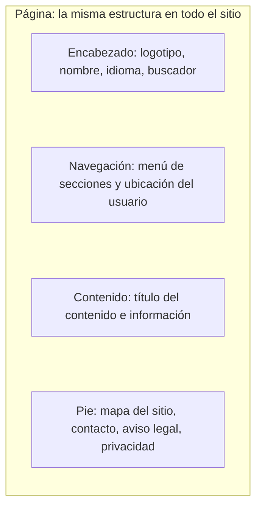
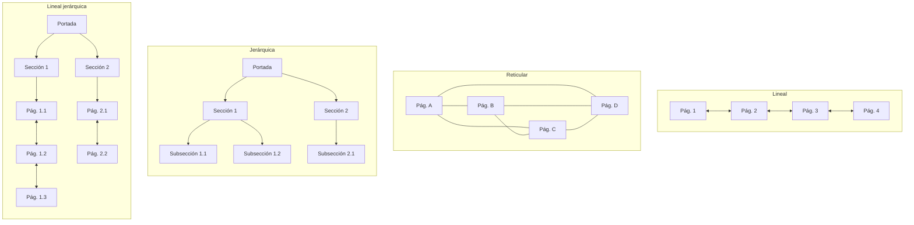
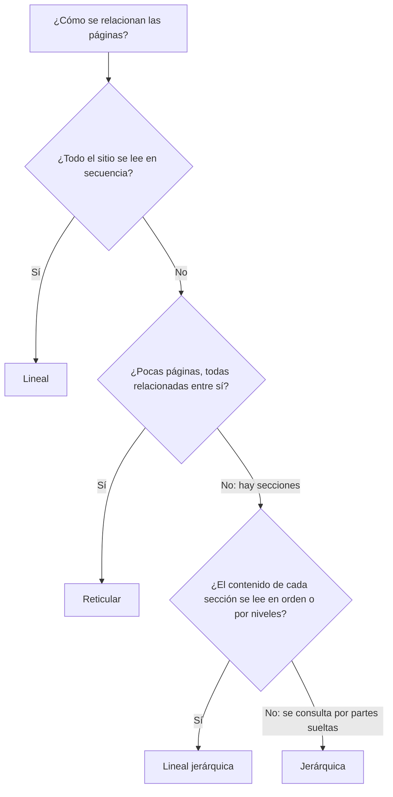
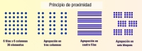
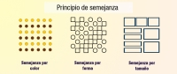
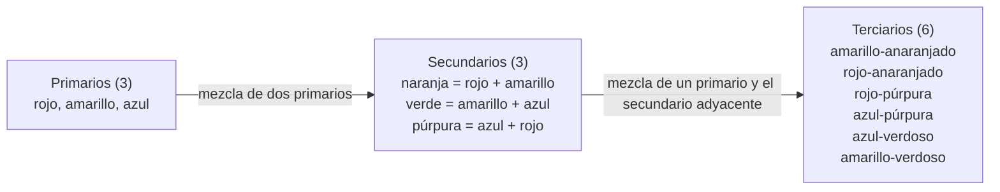
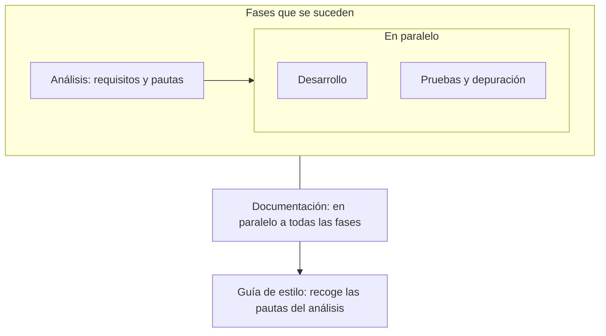

# Unidad 1. Planificación de interfaces gráficas

La planificación de interfaces gráficas es una tarea fundamental en el diseño de interfaces web: exige conocer el problema antes de resolverlo y organizar y documentar las tareas que se van a desarrollar. El resultado es un sitio más consistente y más fácil de mantener.

La unidad se divide en tres partes:

1. **Elementos del diseño**: cómo se percibe una imagen y con qué elementos se construye.
2. **Interfaces web**: qué es una interfaz, qué componentes tiene, cómo se distribuyen en la página, cómo se organiza la navegación y qué principios de la percepción y del color se aplican.
3. **Generación de documentos y sitios web**: las fases de un proyecto, la guía de estilo, las herramientas, los lenguajes de marcas y las técnicas de maquetación.

> **Sobre la vigencia del temario.** Parte de lo que se describe (colores seguros, monitores de 1024 × 768, maquetación con tablas y marcos, Internet Explorer) corresponde a la web de hace más de una década. Se expone tal como lo recoge el temario; lo que ha cambiado desde entonces se indica aparte, en recuadros **Contexto actual**.

---

## 1. Elementos del diseño

**Diseñar** es el proceso previo de configuración mental, la *prefiguración*, en la búsqueda de una solución en cualquier campo. El término se usa en las artes, la ingeniería, la arquitectura y otras disciplinas creativas.

- El diseño requiere sobre todo **consideraciones funcionales y estéticas**.
- Antes de la producción definitiva pasa por **fases de investigación, análisis, modelado, ajustes y adaptaciones**.

Las personas dedicadas al diseño deben **comunicar** las ideas y conceptos de una forma **clara** y directa, por medio de los elementos **gráficos**. La eficacia del mensaje visual depende de qué elementos se eligen y de cuánto se conocen.

### 1.1 Percepción visual

**Percepción** es el proceso de recogida y tratamiento de la información sensorial: se reciben por los sentidos imágenes, sonidos o sensaciones y se interpreta esa información. La percepción es una **interpretación significativa de las sensaciones**. Un mensaje visual tiene éxito cuando el receptor lo interpreta como pretendía el emisor; por eso quien diseña tiene que conocer a su público.

Desde que un estímulo llega a los sentidos hasta que se toma conciencia de él se recorren cuatro pasos:



La **psicología de la Gestalt** estudia cómo el cerebro decodifica la información mediante las asociaciones que se producen al percibir. Sus principios se aplican al diseño de interfaces en el apartado 2.7.

### 1.2 Elementos conceptuales: punto, línea, plano, volumen

Son la base del diseño y **no son visibles**: no existen de hecho, solo parecen estar presentes. Cada uno se genera a partir del anterior en movimiento: punto → línea → plano → volumen.

- **Punto**: indica posición; no tiene largo ni ancho.
- **Línea**: recorrido de un punto; tiene largo pero no ancho. **No es visible por sí sola en la naturaleza**: lo que se percibe como línea es el borde de una superficie.
- **Plano**: recorrido de una línea; tiene largo y ancho, pero no grosor.
- **Volumen**: recorrido de un plano; en un diseño bidimensional es ilusorio.

La cadena de generación se resume así:



### 1.3 Elementos visuales: forma, medida, color, textura

Son **lo que realmente se ve**: al hacerse visibles, los elementos conceptuales adquieren forma, medida, color y textura.

- **Forma**: área que se destaca del espacio que la rodea.
- **Medida**: el tamaño, siempre medible.
- **Color**: diferencia las cosas entre sí; el contraste de color llama la atención sobre una parte de la imagen.
- **Textura**: característica visual o táctil de una superficie (rugosidad, suavidad, aspereza).

### 1.4 Elementos de relación: dirección, posición, espacio, gravedad

Gobiernan la **ubicación y la interrelación de las formas**. La dirección y la posición **se perciben**; el espacio y la gravedad **se sienten**. La gravedad **no es visual, sino psicológica**: se atribuyen a las formas pesadez o ligereza, estabilidad o inestabilidad.

### 1.5 Elementos prácticos: representación, significado, función

Permanecen ocultos en el contenido del diseño:

- **Representación**: la forma deriva de algo real, de la naturaleza o hecho por el ser humano.
- **Significado**: la imagen conceptual que el mensaje genera en la mente de cada receptor.
- **Función**: el propósito al que sirve el diseño.

Se aplican directamente en la iconografía (apartado 3.1.4).

**Cuadro resumen de los cuatro grupos**

| Grupo | Elementos | Rasgo distintivo |
|---|---|---|
| Conceptuales | Punto, línea, plano, volumen | No son visibles |
| Visuales | Forma, medida, color, textura | Son lo que se ve |
| De relación | Dirección, posición, espacio, gravedad | Ubican y relacionan las formas |
| Prácticos | Representación, significado, función | Están en el contenido del diseño |

---

## 2. Interfaces web

Las páginas web se crean para comunicar algo a través de Internet: páginas personales para informar y entretener, páginas comerciales para obtener un beneficio. Cada una tiene una finalidad, y conseguirla depende en gran medida de su diseño. El número de usuarios y de páginas crece cada día, y los usuarios son muy distintos entre sí.

### 2.1 Interacción persona-ordenador

La **Interacción Persona-Ordenador (IPO)** es la disciplina relacionada con el **diseño, evaluación e implementación** de sistemas informáticos interactivos para ser usados por personas. Estudia el intercambio de información entre las personas y los ordenadores: cuando la comunicación es buena, el intercambio es más eficiente, se reducen los errores y aumenta la satisfacción del usuario.

La mayoría de los sistemas informáticos actuales son interactivos, y su **éxito o fracaso** depende en gran medida del diseño de la interfaz. Por eso la interfaz se diseña pensando en las **necesidades del usuario**, que llega con distintos **grados de preparación** y distintas **expectativas**.

**Estándares y tecnologías web.** Conviene distinguir los **estándares** (URI, HTTP, HTML), que son especificaciones comunes, de las **herramientas** que los usan. Internet Explorer es una herramienta (un navegador), no un estándar.

- **URI** (Identificador Uniforme de Recursos): **sistema universal para referenciar recursos en la web**. Es una cadena corta de caracteres que identifica de forma inequívoca un recurso (servicio, página, documento, dirección de correo).
- **HTTP** (Protocolo de Transferencia de Hipertexto): **define la sintaxis y la semántica que utilizan los elementos de software de la arquitectura web** (clientes, servidores, proxies) **para comunicarse**.
- **HTML** (Lenguaje de Marcado de Hipertexto): **el lenguaje de marcado predominante para la elaboración de páginas web**.

### 2.2 Diseño de una interfaz web. Objetivos

Una **interfaz web** es un sistema gráfico que permite a los usuarios acceder a los contenidos de la web mediante **elementos gráficos** conocidos por la mayor parte de los usuarios que acceden a la página.

El **objetivo principal** en el diseño de una interfaz web es que sus potenciales usuarios puedan acceder a todos sus contenidos de la forma más rápida y sencilla posible.

Para ser efectivo, el diseño debe lograr que los usuarios **puedan acceder con facilidad a sus contenidos**, **puedan interactuar con eficacia con todos sus componentes** y se sientan cómodos haciéndolo.

No se introducen elementos gráficos de creación propia para sorprender al usuario: se emplean los que ya conoce, para que no tenga que pensar cómo se usan antes de llegar a los contenidos que le interesan.

### 2.3 Características: usable, visual, educativa y actualizada

Al diseñar un sitio hay que tener en cuenta cómo sienten y perciben las personas (un sitio de cursos para personas mayores atiende a posibles problemas de visión o audición; uno infantil puede recurrir a colores llamativos) y cómo funcionan los procesos mentales: cómo se aprende, se recuerda y se procesa la información. Unas características son **imprescindibles** y otras **deseables**; cuáles son unas y otras depende del público.

| Característica | Definición | Ejemplo |
|---|---|---|
| **Usable** | Es **fácil de usar**: no basta con haber entrado y pulsado algún enlace. La facilidad de uso está relacionada directamente con la **eficiencia**: el usuario no duda sobre lo que tiene que hacer y efectúa más operaciones en menos tiempo. | El usuario encuentra la sección que busca a la primera |
| **Visual** | Las percepciones, opiniones, sentimientos y actitudes que genera en el usuario son positivos. Es atractivo, pero coherente: **los elementos gráficos empleados están orientados a conseguir los objetivos del sitio y no se han empleado como elemento decorativo**. | Una web sobre la madera, con colores tostados, no usa el fucsia en el formulario de pedidos |
| **Educativa** | Es **fácil de aprender** por el usuario. Se mide por el tiempo que el usuario necesita para conocerla usándola y por el tiempo que retiene ese conocimiento sin usarla. | El usuario vuelve al cabo de un mes y sigue sabiendo dónde está cada cosa |
| **Actualizada** | **Ofrece nuevos contenidos de forma periódica** (a diario, cada semana, cada mes, según el sitio) y también revisa la interfaz para hacerla más usable, visual y educativa. | Una sección de novedades que se renueva cada semana |

### 2.4 Componentes de una interfaz web

La interfaz es el medio de comunicación entre los usuarios y las páginas del sitio. Cada uno de sus elementos tiene que dejar clara su función, de modo que el usuario acceda a todos los contenidos sin razonamientos complicados. El número de elementos depende del objetivo del sitio: un portal de noticias o de un organismo público usa más que la web de un restaurante o una página personal.

Los componentes se agrupan en cuatro categorías:

| Categoría | Función | Ejemplos |
|---|---|---|
| **Identificación** | Permite saber **en qué página se está y quién es su propietario** | Título de la barra de título, logotipo, nombre de la empresa |
| **Navegación** | Permite **acceder a todos los contenidos** del sitio | Menú de secciones, enlace a otra página, logotipo enlazado a la portada, información de ubicación |
| **Contenido** | Muestra la **información relevante** de la página | Párrafo de texto, título del contenido, fotografías, descripciones |
| **Interacción** | Permite al usuario **interactuar con la página aportando datos** | Formulario de visitas a la página, selector de idioma, buscador, formulario de opinión |

> **Error frecuente**: la información de contacto (dirección, teléfono, un plano de situación) es **contenido**: se lee o se mira. Un **formulario** de contacto sí es interacción, porque el usuario introduce datos.

#### 2.4.1 Zona de navegación

Para que la página sea usable, el usuario tiene que navegar **sin perderse y sin tener la sensación de perderse**. Para ello, el sistema de navegación consta de tres elementos:

1. **Elemento de regreso a la portada.** Permite volver al principio sin usar el botón "atrás" del navegador. Suele resolverse con un **enlace en el logotipo**, situado normalmente en la parte **superior izquierda** de cada página.
2. **Menú de secciones o áreas de interés.** Detalla las secciones en que se divide la información. Tiene que ser fácil de localizar: suele ir en la parte superior, **debajo del logotipo**. Cada sección se identifica con un texto descriptivo o una imagen representativa, y el menú **mantiene la misma posición en todas las páginas**.
3. **Información sobre la ubicación del usuario.** En sitios grandes, con muchas secciones y subsecciones, el usuario tiene que saber en todo momento dónde está. Se indica con una línea de texto **por debajo del menú y por encima del contenido** que muestra el camino recorrido desde la portada; puede incluir enlaces para volver a cualquier punto de ese camino.

> **Contexto actual**: esta línea de ubicación se conoce hoy como *breadcrumb* o "migas de pan".

#### 2.4.2 Zona de contenido e interacción



**El contenido es la parte esencial de una página web.**

- Se expresa en un lenguaje claro y conciso, con un formato agradable y fácil de leer.
- En un sitio de muchas páginas, el contenido se sitúa **siempre en la misma ubicación**.
- Se evitan los grandes desplazamientos durante la lectura: es preferible **dividir el contenido en varias páginas** enlazadas entre sí.
- Una portada espectacular no sirve de nada si los contenidos decepcionan al usuario.

La **zona de interacción** no comprende los enlaces (que también suponen interactuar con la interfaz, pero son navegación), sino las zonas en que **el usuario participa**: elegir el idioma, buscar información con un formulario, enviar una opinión, firmar un libro de visitas.

| Elemento | Aspecto | Funcionamiento |
|---|---|---|
| **Botón** | Rectángulo con efecto de relieve y un texto | Realiza una acción; el texto orienta sobre ella. Su diseño se mantiene en todo el sitio |
| **Área de texto** | Rectángulo en el que se escribe | Va acompañada de una **etiqueta** que describe el dato que se pide |
| **Botones de opción** | Circunferencia con texto; la seleccionada contiene un círculo negro | **Excluyentes** entre sí dentro de un grupo |
| **Casillas de verificación** | Cuadrado que se marca con una "V" o un aspa "X" | **No excluyentes**: se puede marcar ninguna, una, varias o todas |

Un buscador, por ejemplo, consta de un **área de texto**, donde se escribe lo que se busca, y un **botón**, que lanza la búsqueda; no lleva casillas de verificación ni botones de opción.

### 2.5 Maquetación web

Igual que un proyecto de vivienda empieza con un boceto del reparto de espacios antes de pensar en el terreno o los materiales, un proyecto web empieza con una **maqueta**. Según la RAE, una maqueta es un "boceto previo de la composición de un texto que se va a publicar, usado para determinar sus características definitivas".

Antes de maquetar se decide:

- **Qué elementos** va a contener cada página.
- **Cómo se colocan**, teniendo en cuenta el espacio disponible: la ventana del navegador.

Con los datos obtenidos del cliente se hacen bocetos preliminares, que tienen que reflejar **la interactividad y la funcionalidad** del sitio. El diseño comienza por la distribución de los **grandes bloques** de información. No todos los sitios los colocan igual, pero hay una regla general: el diseño es **consistente**, es decir, todas las páginas mantienen la misma estructura.

#### 2.5.1 Elementos de ordenación

| Bloque | Ubicación | Contenido | Pautas |
|---|---|---|---|
| **Encabezado** | Siempre en la parte superior | Elementos identificativos (logotipo, nombre de la empresa) y a menudo elementos de acción: cambio de idioma, buscador y, en sitios muy grandes, elementos de navegación | Se repite en todas las páginas y, si la complejidad del sitio lo permite, permanece siempre visible |
| **Navegación** | Habitualmente bajo el encabezado | El sistema de navegación descrito en el apartado 2.4.1 | Misma posición en todas las páginas |
| **Contenido** | La zona central | Los contenidos, que son la meta del usuario y la razón de su visita | Espacio suficiente para leer con comodidad, sin grandes desplazamientos. **Nunca se obliga a desplazarse en horizontal** para leer el final de una línea |
| **Pie de página** | Al final | Navegación complementaria: se repiten enlaces del encabezado (mapa del sitio, contacto) y se añaden otros (derechos de autor, privacidad, información legal) | Se repite en todas las páginas. Su diseño es **más sencillo** que el del resto, para que el usuario reconozca que ha llegado al final aunque haya perdido de vista el encabezado |

> **Error frecuente**: el **título del contenido** pertenece al bloque de contenido, no al encabezado, y el enlace al **aviso legal** va en el pie. En el encabezado van el **logotipo** y el **cambio de idioma**.

El esquema siguiente muestra la disposición habitual de los cuatro bloques, de arriba abajo, con el contenido típico de cada uno:



### 2.6 Mapa de navegación

En un sitio grande y complejo conviene un **mapa del sitio**: una página que permite al visitante buscar de forma sencilla los contenidos que no ha encontrado en la portada. Suele enlazarse desde el encabezado y desde el pie.

**La necesidad de un mapa del sitio es proporcional a la complejidad y la extensión del sitio.** Una página única con enlaces a sitios ajenos no lo necesita; una portada con secciones divididas en subsecciones, sí, y con un enlace a él en la portada.

#### 2.6.1 Prototipos

La estructura del mapa de un sitio depende de **la relación que tienen las páginas entre sí**, no de su número.

| Estructura | Relación entre páginas | Uso adecuado |
|---|---|---|
| **Lineal** | Secuencia: se avanza de página en página y se puede volver a la anterior, como en un libro | Sitios cuyas páginas se leen **de forma secuencial** |
| **Reticular** | Todas las páginas están relacionadas entre sí | Sitios pequeños, como una web personal. **No es adecuada con muchas páginas**, porque el usuario puede perderse |
| **Jerárquica** | Árbol: portada, secciones y subsecciones | **La más común.** Sitios con varias secciones bien diferenciadas pero **de poca complejidad**, en los que el usuario no necesita pasar de una sección a otra |
| **Lineal jerárquica** | Árbol cuyas secciones se leen en secuencia | También muy empleada. Secciones con **un volumen de información elevado** y **lectura secuencial del contenido de la sección**, o secciones que representan **grados de dificultad**; permite navegar entre secciones |

Las cuatro estructuras, dibujadas con unas pocas páginas cada una:



> **Error frecuente**: pensar que un sitio con muchas páginas no puede ser lineal. Lo que determina la estructura es la relación entre las páginas, no su número: si se leen en secuencia, la estructura es lineal, sean diez o cien. La reticular, en cambio, sirve para una **web personal**, que suele tener pocas secciones y poco complejas. Y la lectura secuencial de las páginas de una sección corresponde a la **lineal jerárquica**, no a la jerárquica.

**Cómo se elige la estructura de un sitio**

1. Se identifican las **secciones** y se comprueba si son **independientes** (si el usuario necesita o no pasar de una a otra).
2. Se analiza si el contenido de cada sección se lee **en orden** o se consulta **por partes sueltas**.
3. Se aplica la tabla anterior:
   - secciones independientes con contenido suelto → **jerárquica**;
   - secciones con mucho contenido de lectura secuencial, o niveles de dificultad → **lineal jerárquica**;
   - todo el sitio es una secuencia → **lineal**;
   - pocas páginas, todas relacionadas → **reticular**.
4. La elección se **justifica con datos del encargo**: número de secciones, volumen de cada una y su previsión de crecimiento, existencia de lectura secuencial.

El mismo procedimiento, como árbol de decisión:



**Ejemplo.** Una librería de barrio quiere una web con tres secciones (novedades, infantil, segunda mano), con una ficha por libro. Las secciones no dependen unas de otras y cada ficha se consulta por separado. La estructura adecuada es la **jerárquica**: portada → tres secciones → fichas. Si el catálogo crece, se añaden fichas a una rama sin alterar las demás. No es lineal, porque nadie lee las fichas en secuencia; tampoco reticular, porque con decenas de fichas enlazadas entre sí el usuario se perdería.

### 2.7 Detección de patrones

Un **patrón de diseño** es una solución a un problema concreto que puede reutilizarse en problemas similares. Los de software se orientan a la **funcionalidad**; los de interacción, a la **usabilidad**. El diseño de interfaces persigue la **usabilidad, la eficiencia, la eficacia y la satisfacción** del usuario, y para ello aplica los principios de la Gestalt.

#### 2.7.1 Principios de proximidad y de semejanza

- **Proximidad**: la mente **agrupa lo que está cerca**. Dos bloques de enlaces separados por un espacio se leen como dos grupos.
- **Semejanza**: la mente **agrupa lo que se parece** (forma, color, tamaño). Los enlaces de un menú con el mismo aspecto se perciben como un conjunto.

En la primera figura, los mismos 36 puntos se leen como 6 × 6, como tres columnas, como cuatro filas o como seis bloques según cómo se separen. En la segunda, los elementos se agrupan por color, por forma o por tamaño.





> **Error frecuente**: la proximidad no es el principio que distingue el encabezado del pie. La proximidad **agrupa**, no separa: se usa para agrupar los enlaces a las secciones o a las áreas de interés.

#### 2.7.2 Principios de simetría y de continuidad

- **Simetría**: lo dispuesto simétricamente se percibe **como un único elemento**.
- **Continuidad**: lo interrumpido se percibe **como continuo**.

#### 2.7.3 Principios de cierre y de área o tamaño relativo

- **Cierre**: los contornos incompletos se perciben **como figuras cerradas**.
- **Área o tamaño relativo**: de dos objetos superpuestos, **el más pequeño se percibe como figura** y el mayor como fondo.

#### 2.7.4 Principio de figura-fondo

Ciertos elementos se perciben **como figuras**, con forma y borde, destacadas sobre lo que las rodea, que se percibe como **fondo**.

**Todos los principios son aplicables en cualquier zona de la interfaz**, también en la de navegación, aunque unos se emplean más que otros.

#### 2.7.5 Ley de simplicidad, pregnancia o buena forma

La mente percibe **las formas más simples**, lo que facilita su recuerdo. **Esta ley recoge todos los principios anteriores.** El diseño de patrones aplicando la psicología de la Gestalt no solo incrementa la **eficiencia, la eficacia y la satisfacción del usuario**: también aumenta la usabilidad.

### 2.8 El color

Una elección inadecuada de los colores puede hacer perder visitantes. Además, una misma página se ve de forma distinta según la plataforma, el sistema operativo, el navegador y el monitor.

La **rueda de color** clasifica los colores en primarios (rojo, amarillo y azul), secundarios (mezcla de dos primarios) y terciarios (mezcla de un primario y un secundario), y en fríos y cálidos. Los **complementarios** están en lados opuestos de la rueda y crean **contraste**; los **análogos** están juntos y crean **armonía**.

Los tres primarios forman un triángulo equilátero en la rueda; frente a cada uno se sitúa un secundario, que resulta de mezclar los dos primarios adyacentes, y entre cada primario y su secundario vecino aparece un terciario:



#### 2.8.1 Sistema RGB

El ojo humano percibe el **rojo, el verde y el azul**; el resto de los colores se obtiene **sumando** estos tres en distintas proporciones, por lo que se llaman **colores aditivos**. La mezcla de los tres puros da el **blanco**, y el **negro** se considera ausencia de color. El ordenador se basa en este sistema, el **modo de color RGB** (*Red, Green, Blue*).

> **Nota: dos juegos de colores primarios.** La rueda de color (primarios rojo, amarillo y azul) describe la mezcla de pigmentos. La pantalla emite luz y sigue el modelo RGB (rojo, verde y azul). Ambos aparecen en el temario y no se contradicen: cada uno corresponde a un medio distinto.

- El ordenador usa **8 bits** para cada color, lo que da 2⁸ = **256 niveles** por canal, del 0 al 255.
- El total de colores es 256 × 256 × 256 = **16 777 216**.
- Un color se escribe en **decimal**, `rgb(204, 153, 51)`, o en **hexadecimal**, `#CC9933`: dos cifras hexadecimales por canal, en el orden rojo, verde, azul.

**Conversión de hexadecimal a decimal.** Cada par se calcula como *primera cifra × 16 + segunda cifra*, con A = 10, B = 11, C = 12, D = 13, E = 14 y F = 15.

| Hexadecimal | Cálculo | Decimal |
|---|---|---|
| `00` | 0 × 16 + 0 | 0 |
| `33` | 3 × 16 + 3 | 51 |
| `66` | 6 × 16 + 6 | 102 |
| `99` | 9 × 16 + 9 | 153 |
| `CC` | 12 × 16 + 12 | 204 |
| `FF` | 15 × 16 + 15 | 255 |
| `8B` | 8 × 16 + 11 | 139 |

Ejemplo: `#663300` → rojo 102, verde 51, azul 0 → `rgb(102, 51, 0)`, un marrón.

En sentido inverso, de decimal a hexadecimal, se divide entre 16: el cociente es la primera cifra y el resto, la segunda. Por ejemplo, 204 ÷ 16 = 12, resto 12 → `CC`.

**Daltonismo.** Es un **fallo de la percepción de los colores**; en su forma más común, la persona **no distingue el verde del rojo**. Conocerlo ayuda a elegir los colores de un sitio.

> **Contexto actual**: la consecuencia práctica que se extrae hoy es no transmitir nunca una información solo mediante el color, sino acompañarla de texto, iconos o formas. Se desarrolla en la unidad de accesibilidad.

#### 2.8.2 Colores seguros

Algunos monitores antiguos solo mostraban **256 colores**, y algunos navegadores tenían una paleta de **216 colores**, llamados en diseño web **colores seguros**. Emplearlos garantiza que el sitio se vea igual en todos los navegadores.

- Los colores seguros se forman con las combinaciones de los tres colores rojo, verde y azul, pero solo con los valores hexadecimales **`00`, `33`, `66`, `99`, `CC` y `FF`**. Son seis grados distintos de cada color, y por eso hay **216** colores en total (6 × 6 × 6).
- Un color es seguro si **sus tres pares** están en esa lista: `#CC9933` lo es; `#CC9934` no (por el `34`); `#F0F0F0` tampoco.

> **Contexto actual**: los colores seguros están obsoletos desde hace más de veinte años; cualquier pantalla actual muestra millones de colores. Lo que se controla hoy es el **contraste** entre el texto y el fondo, que se estudia en la unidad de accesibilidad.

---

## 3. Generación de documentos y sitios web

En un proyecto web es tan importante el resultado final, el que ve el usuario, como el trabajo previo de diseño y la documentación que se genera durante el proceso. Como cualquier proyecto de software, la generación de un sitio pasa por varias fases, más o menos complejas según su envergadura:

| Fase | Contenido |
|---|---|
| **Análisis** | Tras recabar la información necesaria, se establecen los **requisitos** del sitio, su sistema de navegación y su funcionalidad, y se eligen las herramientas y los lenguajes. También se fijan las **pautas** que seguirá todo el equipo durante la generación y el mantenimiento: tipografía, colores, iconografía, distribución de los elementos |
| **Desarrollo** | Se implementa el sitio con las herramientas y los lenguajes elegidos, siguiendo las pautas establecidas |
| **Pruebas y depuración** | Se realiza **en paralelo al desarrollo**: se comprueba que todos los enlaces funcionan y que los usuarios pueden interactuar con todas las páginas. En sitios grandes es importante ir probando lo ya desarrollado |
| **Documentación** | Se realiza **en paralelo a todas las demás**. Se documentan los requisitos y el código necesario para el mantenimiento. Un código bien comentado y tabulado se puede modificar sin herramientas especiales y permite a otros aprender de él. Lo más importante es documentar las **pautas** de diseño en una **guía de estilo** |

El esquema muestra qué fases se suceden y cuáles discurren en paralelo:



> **Error frecuente**: la guía se redacta como parte de la documentación, que es paralela a todas las fases; pero las pautas que recoge **se establecen en la fase de análisis**. Por eso se afirma que **la guía de estilo se elabora durante la fase de análisis**.

### 3.1 Guías de estilo. Elementos

Un **manual de estilo** es un conjunto de normas para el diseño y la redacción de documentos. Los de sitios web atienden sobre todo a **la estética**, y su aplicación estricta da **uniformidad** al aspecto visual.

La **guía de estilo** de un sitio web:

- Está dirigida a **las personas encargadas del diseño y la programación de la interfaz**, no al usuario final.
- Recoge **todos los aspectos del diseño de la interfaz propia de ese sitio**. No es un repertorio de combinaciones de colores aceptadas por la comunidad de diseñadores.
- Sirve de ayuda en la toma de decisiones durante el diseño y durante el **mantenimiento** posterior. Por eso es útil incluso en un sitio de dos páginas: si el cliente pide después una ampliación, la guía garantiza la coherencia.
- Es **imprescindible cuando el sitio lo desarrollan varias personas**.

Comprende cinco apartados: **fotos y logos, tipografía, colores, iconografía y estructura**. De las fotografías recoge el formato y el tamaño (apartado 3.1.1), no las fotografías concretas que se emplean en los contenidos.

> **Ojo con el término**: la guía de estilo no es una **hoja de estilo**. La guía es un documento de normas para el equipo; la hoja de estilo (CSS) es código que da formato a las páginas.

#### 3.1.1 Fotos y logos

Los recursos gráficos bien empleados mejoran el aprendizaje del usuario y añaden valor al sitio; mal empleados, producen el efecto contrario. Las imágenes son archivos que hay que descargar antes de verlos, así que solo se usan las que **complementan** el sitio y se evitan las meramente decorativas.

La guía indica al equipo:

- **Formato**: el formato en que se almacenan las imágenes y los logotipos.
- **Tamaño**: ancho y alto en **píxeles**.
- **Todos los tamaños posibles** según la función o la ubicación de cada imagen: no mide lo mismo una imagen de la zona de contenido que el logotipo de la cabecera, ni una imagen del sistema de navegación que una del pie.

> **Ampliación**: los formatos se estudian en la unidad de imágenes. Como orientación general, JPG se usa para fotografías, y PNG o GIF para logotipos e iconos con pocos colores o con transparencia.

#### 3.1.2 Tipografías

El uso de una fuente familiar para el usuario facilita la lectura. La guía especifica cuatro aspectos:

| Aspecto | Pautas |
|---|---|
| **La fuente** | No todas se leen con la misma facilidad ni se ven igual en todas las plataformas. **Arial**, muy extendida, asegura una visibilidad correcta en todos los tamaños, plataformas y navegadores |
| **El estilo** | Cuándo se usa negrita, subrayado, cursiva o sus combinaciones. El **subrayado** se reserva para los enlaces: usado con otro fin, induce a error. La **negrita** solo sirve para fijar la atención sobre un elemento. No se enfatiza con distintos estilos más de una o dos palabras o una frase corta |
| **El tamaño** | Según la ubicación del texto y su finalidad: un titular no tiene el mismo tamaño que el texto, y puede haber varios tamaños según la importancia del titular |
| **El color respecto al fondo** | Según la ubicación y la finalidad. Un texto **oscuro sobre fondo claro** se lee mejor que al revés, y un texto sobre **fondo liso** se lee mejor que sobre una textura o una imagen |

> **Error frecuente**: que el texto oscuro sobre fondo claro se lea *mejor* no significa que lo contrario sea ilegible. **Un texto crema sobre fondo marrón oscuro se lee correctamente**, porque es un color claro sobre un fondo oscuro.

#### 3.1.3 Colores

La guía recoge los colores de **todos los textos, fondos e imágenes** del sitio según su ubicación y finalidad, con sus valores RGB **en hexadecimal y en decimal**.

Pautas: si los colores sirven de **código** para distinguir la finalidad de los elementos, tiene que ser fácil de entender; un color se usa siempre para lo mismo (**consistencia**); no se emplean demasiados colores; se buscan combinaciones **armónicas** y un **contraste** que destaque lo relevante. Es habitual asignar un color a cada sección y repetirlo en su enlace, su menú y sus títulos.

#### 3.1.4 Iconografía

La iconografía es la **aplicación práctica de los elementos prácticos del diseño** (apartado 1.5). Según la RAE, un **icono** es un signo que mantiene una relación de semejanza con el objeto representado; en informática, es un pequeño gráfico que identifica y representa un objeto mediante un simbolismo que establece una asociación.

Un icono reúne los tres elementos prácticos:

- **Representación**: es una forma que representa algo del mundo real.
- **Significado**: el mensaje que transmite genera una imagen conceptual en la mente.
- **Función**: atrae la atención y transmite el mensaje más rápido, sin necesidad de leer el texto al que acompaña.

Pautas:

- Los iconos suelen **complementar el texto de los enlaces** de la portada. Su uso está más extendido en la **zona de navegación**, para que el usuario llegue a la sección que le interesa sin leer el texto del enlace.
- Un icono lleva **el menor detalle posible sin perder significado**. Si el usuario no lo entiende a simple vista, no le ahorra tiempo.
- Se usan iconos **a los que el usuario ya está acostumbrado**: en las tiendas en línea, el carro de la compra, la tarjeta de crédito o las monedas.
- La guía especifica **qué iconos se emplean, dónde y con qué finalidad**.
- Es arriesgado usar iconos solo como adorno, sin un significado propio.

#### 3.1.5 Estructura

Este apartado reúne la maquetación (apartado 2.5: disposición de los bloques en la ventana) y el mapa de navegación (apartado 2.6: relación entre las páginas). La guía recoge tanto **la disposición de los bloques en cada página** como **el esquema de navegación** entre páginas.

En los sitios grandes es habitual que la portada tenga un diseño distinto del resto. Tanto si todas las páginas son iguales como si hay varios grupos de páginas, la guía describe **todos los diseños**, indicando en cada uno:

- El **tamaño en píxeles que ocupará el encabezado** y, dentro de él, lo que ocupará y dónde se ubicará cada uno de sus elementos.
- El tamaño (en píxeles o en porcentaje) y la ubicación de la **zona de navegación**; si es horizontal o vertical; si está dividida en secciones y dónde va cada una.
- Cómo se disponen los **enlaces** en cada zona de navegación y su tamaño.
- El tamaño, el lugar y el formato de la **zona de posicionamiento** dentro de la página (la información de ubicación del apartado 2.4.1).
- El tamaño y la ubicación de la **zona de contenido**, y dónde se coloca y cuánto ocupa el **título** dentro de ella.
- Los **cuadros de contenido secundario**, si los hay: tamaño, posición y funcionamiento (siempre visibles o al pasar el ratón por una zona).
- El tamaño y la distribución de los elementos del **pie**.
- **Los huecos** que se dejan a propósito.
- Cómo se muestran los **submenús** de navegación, si los hay.

Los huecos son en una página web lo que los silencios en una partitura: un refuerzo comunicativo. Se colocan intencionadamente para llamar la atención, para evitar un agrupamiento no deseado por proximidad o por semejanza, o para facilitar la lectura. Una página que amontona contenidos confunde al usuario, que ya no sabe adónde mirar.

#### 3.1.6 Ejemplo completo de guía de estilo

Una guía de estilo sin valores concretos ("colores agradables, letra legible") no orienta a nadie. Para cada uno de los cinco apartados se dan **cifras y códigos** para cada elemento del sitio. Se toma como ejemplo la web de una librería de barrio, *Punto y Seguido*, con tres secciones (novedades, infantil y segunda mano), una ficha por libro, un buscador de títulos, un formulario de reserva y una página de contacto con dirección, horario y plano. El diseño se prevé para una pantalla de 1024 × 768.

**1. Fotos y logos**

| Recurso | Formato | Tamaño (px) | Ubicación |
|---|---|---|---|
| Logotipo | PNG | 200 × 100 | Encabezado, a la izquierda; enlaza a la portada |
| Logotipo reducido | PNG | 100 × 50 | Pie |
| Portada de libro (ficha) | JPG | 300 × 450 | Contenido de la ficha |
| Portada de libro (listado) | JPG | 120 × 180 | Listados de cada sección |
| Plano de situación | PNG | 600 × 400 | Página de contacto |

**2. Tipografía**

| Uso | Fuente | Tamaño | Estilo | Color |
|---|---|---|---|---|
| Nombre del sitio | Arial | 28 px | Negrita | `#663300` |
| Título del contenido | Arial | 20 px | Negrita | `#663300` |
| Texto | Arial | 14 px | Normal | `#333333` |
| Enlaces del menú | Arial | 14 px | Negrita, sin subrayado | `#FFFFFF` |
| Enlaces dentro del texto | Arial | 14 px | Subrayado | `#996633` |
| Pie | Arial | 11 px | Normal | `#666666` |

La negrita se reserva para los precios y la indicación "Reservado". El subrayado solo se usa en los enlaces.

**3. Colores** (todos ellos seguros)

| Uso | Hexadecimal | Decimal |
|---|---|---|
| Fondo de la página | `#FFFFFF` | 255, 255, 255 |
| Texto | `#333333` | 51, 51, 51 |
| Fondo del menú y títulos | `#663300` | 102, 51, 0 |
| Texto del menú | `#FFFFFF` | 255, 255, 255 |
| Enlaces en el texto y detalles | `#996633` | 153, 102, 51 |
| Fondo del pie | `#CCCCCC` | 204, 204, 204 |

Se emplea una gama análoga de marrones, que evoca el papel y la madera; el texto blanco del menú contrasta con el fondo marrón oscuro.

**4. Iconografía**

| Icono | Ubicación | Finalidad |
|---|---|---|
| Lupa | Junto al buscador | Indicar la búsqueda de títulos |
| Libro abierto, osito, etiqueta de precio | Delante de Novedades, Infantil y Segunda mano, en el menú | Reconocer cada sección sin leer el enlace |
| Sobre | Pie | Contacto |

Todos miden 16 × 16 px y son monocromos, en `#FFFFFF` sobre el fondo del menú. No se usan iconos decorativos.

**5. Estructura**

- Ancho fijo de **980 px**, centrado (véase el apartado 3.4.3).
- **Encabezado** de 980 × 100 px: logotipo de 200 px a la izquierda, nombre del sitio centrado en 530 px y buscador a la derecha en 250 px.
- **Navegación** de 980 × 40 px, horizontal, bajo el encabezado: cuatro enlaces centrados y separados por "|". Sin submenús.
- **Zona de posicionamiento** de 980 × 20 px, bajo el menú: "Estás en: …", en 12 px.
- **Contenido** de 980 px de ancho y al menos 420 px de alto; título arriba a la izquierda; listados de cuatro libros por fila.
- **Pie** de 980 × 50 px, centrado: mapa del sitio, aviso legal y privacidad.
- Hueco de 20 px entre el contenido y el pie, para que el pie se perciba como bloque independiente (proximidad).
- Navegación jerárquica: portada → tres secciones → fichas. Todas las páginas comparten encabezado, menú y pie; solo cambia el contenido.

### 3.2 Aplicaciones para desarrollo web

Para diseñar un sitio web se necesita, como mínimo, un **editor de código HTML** y un **editor de imágenes**. A ellos se suman los generadores de botones, menús y plantillas, y los **navegadores** (Internet Explorer, Firefox, Safari, Chrome, Opera) para comprobar el resultado.

### 3.3 Lenguajes de marcas

Algunas herramientas permiten diseñar sin conocer más que la propia herramienta, pero el trabajo profesional exige conocer y utilizar los lenguajes de marcas.

**HTML** (*HyperText Markup Language*, Lenguaje de Marcado de Hipertexto) es el lenguaje de marcado predominante para elaborar páginas web. Un documento HTML describe **la estructura y el contenido** de una página.

- HTML usa **etiquetas** para indicar al navegador qué es cada parte del documento. Normalmente delimitan un texto entre una **etiqueta de apertura** y una **de cierre**, aunque algunas no tienen etiqueta de cierre.
- Una etiqueta va encerrada entre **corchetes angulares** (`<` y `>`) y sigue unas normas sintácticas. La mayoría constan del **nombre** de la etiqueta y de sus **atributos**, aunque algunas no tienen atributos.

```html
<p align="center">Texto del párrafo</p>   <!-- p: nombre; align: atributo; </p>: cierre -->
<br>                                        <!-- etiqueta sin cierre en HTML -->
```

**XML** (*eXtensible Markup Language*, Lenguaje de Marcas Extensible) se propone como estándar para el **intercambio de información estructurada** entre plataformas. No es un lenguaje concreto, sino un **metalenguaje** extensible de etiquetas, desarrollado por el **W3C**.

**XHTML** (*eXtensible HyperText Markup Language*) es un lenguaje que utiliza **las mismas etiquetas y atributos que el HTML, pero aplicando las reglas de sintaxis del XML**.

| | HTML | XML | XHTML |
|---|---|---|---|
| Naturaleza | Lenguaje de marcado de páginas web | Metalenguaje para el intercambio de información | Las etiquetas de HTML con la sintaxis de XML |
| Etiquetas | Fijas | Las define quien lo usa | Las de HTML |
| Errores de sintaxis | El navegador no muestra error; como mucho, cambia la presentación | Muy estricto con sus normas de sintaxis | Estricto, como XML |

#### 3.3.1 Reglas de sintaxis del XHTML

> **Ampliación.** Reglas que debe cumplir un documento XHTML válido.

| Regla | Correcto | Incorrecto |
|---|---|---|
| Declaración del tipo de documento al principio | `<!DOCTYPE html PUBLIC "-//W3C//DTD XHTML 1.0 Transitional//EN" "http://www.w3.org/TR/xhtml1/DTD/xhtml1-transitional.dtd">` | Sin DOCTYPE |
| Elemento raíz `html` con su espacio de nombres | `<html xmlns="http://www.w3.org/1999/xhtml" xml:lang="es" lang="es">` | `<html>` |
| `head` con `title` obligatorio | `<head><title>…</title></head>` | `head` sin `title` |
| Etiquetas y atributos en minúsculas | `<td width="200">` | `<TD WIDTH="200">` |
| Toda etiqueta se cierra | `<p>texto</p>` | `<p>texto` |
| Las etiquetas vacías se cierran con `/>`, precedido de un espacio por compatibilidad | `<br />`, ``, `<input … />`, `<meta … />` | `<br>` |
| Anidamiento correcto: se cierra en orden inverso a la apertura | `<p><b>hola</b></p>` | `<p><b>hola</p></b>` |
| No se emplean los elementos desaprobados de HTML; la presentación se da con atributos admitidos u hojas de estilo | `<p style="color: red">` | `<font color="red" size="2">` |
| Valores de atributo siempre entre comillas | `border="0"` | `border=0` |
| Sin atributos minimizados | `checked="checked"`, `selected="selected"` | `checked` |
| `img` con atributo `alt` obligatorio | `` | `` |
| El carácter `&` en el texto o en una URL se escribe `&amp;` | `?a=1&amp;b=2`, `Pan &amp; dulces` | `Pan & dulces` |
| `id` en lugar de `name` para identificar elementos | `<a id="arriba">` | `<a name="arriba">` (desaconsejado) |

**Variantes de XHTML 1.0.** Hay tres definiciones de tipo de documento (DTD):

- **Strict**: no admite atributos de presentación; todo el aspecto se define con hojas de estilo.
- **Transitional**: admite atributos de presentación como `width`, `height`, `bgcolor`, `align` o `valign`. Es la que se usa para maquetar con tablas y atributos.
- **Frameset**: para páginas con marcos.

> **Contexto actual**: XHTML 1.0 quedó en desuso con HTML5 (2014), que se declara con `<!DOCTYPE html>`. Escribir HTML5 con la disciplina de XHTML (todo cerrado, en minúsculas, atributos entre comillas) sigue siendo una buena práctica.

### 3.4 Tablas, capas, marcos

Una vez decididos los bloques de la página (apartado 2.5) y el lenguaje, falta conseguir que el navegador muestre cada bloque en su sitio. Para ello se usan los elementos del lenguaje que permiten definir **tablas, capas o marcos**.

| Técnica | Funcionamiento | Ventaja | Inconveniente |
|---|---|---|---|
| **Tablas** | En los comienzos de HTML, la única forma de estructurar una página. Los bloques (encabezado, navegación, contenido, pie) son celdas de tablas, anidadas si hace falta, con altura y anchura en valores absolutos o relativos | Fácil, aunque laborioso; cada elemento queda exactamente en su sitio | El código se llena de etiquetas `tr` y `td` y exige una tabulación muy cuidada |
| **Marcos** (*frames*) | Incorporados por navegadores posteriores. Dividen la ventana en partes independientes, cada una con una página HTML distinta | Zonas de la ventana **visibles permanentemente**; al separar las zonas por funciones, el mantenimiento es más fácil | Cada vista se compone de varias páginas |
| **Capas** | Cada bloque se define con la etiqueta `div` y su aspecto se configura con **hojas de estilo** | Separa el contenido de la presentación | Requiere conocer las hojas de estilo |

Con la aparición de las hojas de estilo (que no se deben confundir con las guías de estilo) se tiende a abandonar tablas y marcos en favor de los `div` configurados con hojas de estilo, que se estudian en la unidad dedicada a ellas.

> **Contexto actual**: los marcos no existen en HTML5, y maquetar con tablas se considera hoy una mala práctica, entre otras razones porque los lectores de pantalla interpretan las tablas como datos. La maquetación actual se hace con CSS (Flexbox y Grid), y las tablas se reservan para datos tabulares.

#### 3.4.1 Etiquetas y atributos de una tabla

> **Ampliación.** Elementos necesarios para maquetar con tablas.

| Etiqueta o atributo | Función |
|---|---|
| `<table>` | La tabla. Atributos: `width` (ancho en píxeles o porcentaje), `border` (grosor del borde; `0` = sin borde), `cellpadding` (relleno interior de cada celda), `cellspacing` (separación entre celdas), `align="center"` (centrar la tabla), `summary` (descripción para lectores de pantalla) |
| `<tr>` | Una fila |
| `<td>` | Una celda. Atributos: `width`, `height`, `align` (`left`, `center`, `right`), `valign` (`top`, `middle`, `bottom`), `bgcolor` (color de fondo en hexadecimal) |
| `colspan="n"` | La celda ocupa **n columnas** (se extiende a lo ancho) |
| `rowspan="n"` | La celda ocupa **n filas** (se extiende a lo alto) |
| `<th>` | Celda de encabezado, propia de las tablas de datos; no se usa al maquetar |

**Regla de consistencia**: todas las filas suman **el mismo número de columnas**, contando lo que ocupa cada `colspan`. Una celda con `rowspan="2"` ocupa además una posición de la fila siguiente, que tendrá una celda menos.

#### 3.4.2 Procedimiento de maquetación con tablas

1. Se dibuja el **boceto** con los bloques (apartado 2.5.1) y sus medidas en píxeles, tomadas de la guía de estilo (apartado 3.1.5).
2. Se cuenta cuántas **columnas** necesita la franja más dividida; ese es el número de columnas de la tabla.
3. Se escribe **una fila `tr` por franja horizontal**. Las franjas que ocupan todo el ancho llevan una sola celda con `colspan` igual al número de columnas.
4. Si un bloque abarca varias franjas en vertical (un menú lateral, por ejemplo), su celda lleva **`rowspan`** y las filas siguientes tienen una celda menos.
5. Se fijan anchos y altos con `width` y `height`, y la alineación con `align` y `valign`. En la celda de contenido se usa `valign="top"`; si no, el texto aparece centrado en vertical.
6. Se escribe un **comentario** antes de cada bloque (`<!-- ENCABEZADO -->`) y se tabula el código, como exige la fase de documentación (apartado 3).
7. Se comprueba que todas las filas suman las mismas columnas y que el documento cumple las reglas de XHTML (apartado 3.3.1).

#### 3.4.3 Ancho de diseño para una pantalla de 1024 × 768

- El ancho útil de una ventana a 1024 px no es 1024 px: la **barra de desplazamiento vertical** y los bordes de la ventana ocupan unos 20-30 px.
- Por eso se usa un ancho fijo de **entre 960 y 1000 px** (en el ejemplo, 980 px). Así no aparece nunca la barra de desplazamiento horizontal, que el apartado 2.5.1 excluye.
- En altura, las barras del navegador dejan visibles unos 600 px de los 768; en ese espacio deben caber el encabezado, el menú y el comienzo del contenido. El desplazamiento vertical sí es admisible.
- Los anchos de las celdas de una fila suman el ancho total de la tabla: 200 + 530 + 250 = 980.

#### 3.4.4 Ejemplo: portada maquetada con tablas

Portada de la librería del apartado 3.1.6, en XHTML 1.0 Transitional:

```html
<!DOCTYPE html PUBLIC "-//W3C//DTD XHTML 1.0 Transitional//EN" "http://www.w3.org/TR/xhtml1/DTD/xhtml1-transitional.dtd">
<html xmlns="http://www.w3.org/1999/xhtml" xml:lang="es" lang="es">
<head>
  <meta http-equiv="Content-Type" content="text/html; charset=UTF-8" />
  <title>Punto y Seguido: librería de barrio</title>
</head>
<body>
  <!-- Contenedor: 980 px de ancho, centrado -->
  <table width="980" border="0" cellpadding="0" cellspacing="0" align="center"
         summary="Estructura de la página principal">

    <!-- ENCABEZADO: logotipo (vuelve a la portada), nombre y buscador -->
    <tr>
      <td width="200" height="100">
        <a href="index.html"></a>
      </td>
      <td width="530" align="center"><h1>Punto y Seguido</h1></td>
      <td width="250" align="right">
        <form action="buscar.html" method="get">
          <p><input type="text" name="q" size="15" /> <input type="submit" value="Buscar" /></p>
        </form>
      </td>
    </tr>

    <!-- NAVEGACIÓN: menú de secciones -->
    <tr>
      <td colspan="3" height="40" align="center" bgcolor="#663300">
        <a href="novedades.html">Novedades</a> |
        <a href="infantil.html">Infantil</a> |
        <a href="segunda-mano.html">Segunda mano</a> |
        <a href="contacto.html">Contacto</a>
      </td>
    </tr>

    <!-- POSICIONAMIENTO: dónde está el usuario -->
    <tr>
      <td colspan="3" height="20">Estás en: Portada</td>
    </tr>

    <!-- CONTENIDO -->
    <tr>
      <td colspan="3" height="420" valign="top">
        <h2>Novedades de la semana</h2>
        <p>Texto de bienvenida y portadas de los libros recién llegados.</p>
      </td>
    </tr>

    <!-- PIE: navegación complementaria e información legal -->
    <tr>
      <td colspan="3" height="50" align="center">
        <a href="mapa.html">Mapa del sitio</a> |
        <a href="aviso-legal.html">Aviso legal</a> |
        <a href="privacidad.html">Privacidad</a>
      </td>
    </tr>
  </table>
</body>
</html>
```

- La tabla tiene tres columnas porque el encabezado se divide en tres partes; el resto de las filas son una sola celda con `colspan="3"`.
- Con `cellpadding="0"` y `cellspacing="0"` no quedan huecos entre bloques: los huecos se añaden a propósito donde la guía los prevé.
- El buscador va dentro de un `form` con un `p`, porque en XHTML los `input` tienen que estar contenidos en un elemento de bloque.

**Variante con menú lateral (`rowspan`):**

```html
<table width="980" border="1" cellpadding="5" cellspacing="0" align="center">
  <tr>
    <td colspan="2" height="100">ENCABEZADO</td>                 <!-- 2 columnas -->
  </tr>
  <tr>
    <td width="200" rowspan="2" valign="top">NAVEGACIÓN</td>      <!-- ocupa dos filas -->
    <td width="780" height="20">Estás en: Portada &gt; Novedades</td>
  </tr>
  <tr>
    <td height="400" valign="top">CONTENIDO</td>                 <!-- una sola celda: la otra posición la ocupa el rowspan -->
  </tr>
  <tr>
    <td colspan="2" height="50">PIE</td>
  </tr>
</table>
```

Durante la maquetación, `border="1"` permite ver los límites de las celdas; en la versión final se pone a `0`.

### 3.5 Plantilla de diseño

Las mismas distribuciones de bloques se repiten una y otra vez en la web por **reutilización**: no tiene sentido diseñar de nuevo lo que ya funciona. Las **plantillas de diseño web** son sitios prediseñados que se adaptan con rapidez a las necesidades de quien diseña, con un gran ahorro de tiempo y dinero.

---

## Ideas clave

- **Elementos del diseño**: conceptuales (punto, línea, plano, volumen; no son visibles), visuales (forma, medida, color, textura; lo que se ve), de relación (dirección y posición se perciben; espacio y gravedad se sienten; la gravedad es psicológica) y prácticos (representación, significado, función).
- **Características de una interfaz**: usable (fácil de usar), visual (sensaciones positivas, coherencia), educativa (fácil de aprender y de recordar) y actualizada (contenidos e interfaz).
- **Componentes**: identificación (dónde se está y de quién es la página), navegación (acceso a los contenidos), contenido (la información relevante) e interacción (el usuario aporta datos).
- **Sistema de navegación**: regreso a la portada (logotipo enlazado, arriba a la izquierda), menú de secciones (bajo el logotipo, siempre en el mismo sitio) e información de ubicación (bajo el menú y sobre el contenido).
- **Bloques**: encabezado (arriba, se repite), navegación, contenido (sin desplazamiento horizontal) y pie (diseño más sencillo; información legal, mapa, contacto).
- **Estructuras de navegación**: lineal (lectura secuencial), reticular (todas con todas; sitios pequeños), jerárquica (la más común; secciones independientes) y lineal jerárquica (secciones extensas de lectura secuencial o por niveles). Cuenta la relación entre páginas, no su número.
- **Gestalt**: proximidad y semejanza agrupan; simetría, continuidad, cierre, área (el objeto menor es la figura) y figura-fondo; la ley de la buena forma o pregnancia los recoge todos.
- **Color**: primarios de la rueda, rojo, amarillo y azul; RGB, rojo, verde y azul (aditivo; los tres dan blanco). 8 bits por canal, 256 niveles, 16 777 216 colores. Colores seguros: 216, con `00 33 66 99 CC FF`. Complementarios para el contraste; análogos para la armonía.
- **Fases de un proyecto**: análisis (requisitos y pautas), desarrollo, pruebas en paralelo al desarrollo y documentación en paralelo a todas.
- **Guía de estilo**: dirigida al equipo, imprescindible si trabajan varias personas, con cinco apartados y valores concretos: fotos y logos, tipografía, colores (hexadecimal y decimal), iconografía y estructura.
- **XHTML**: etiquetas de HTML con la sintaxis de XML (minúsculas, todo cerrado, comillas, `alt`, DOCTYPE).
- **Maquetación**: tablas, marcos o capas (`div` con hojas de estilo). Con tablas: ancho fijo de unos 980 px para 1024 × 768, una fila por franja, `colspan` a lo ancho, `rowspan` a lo alto.
