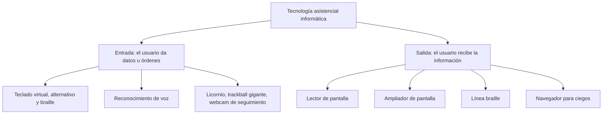
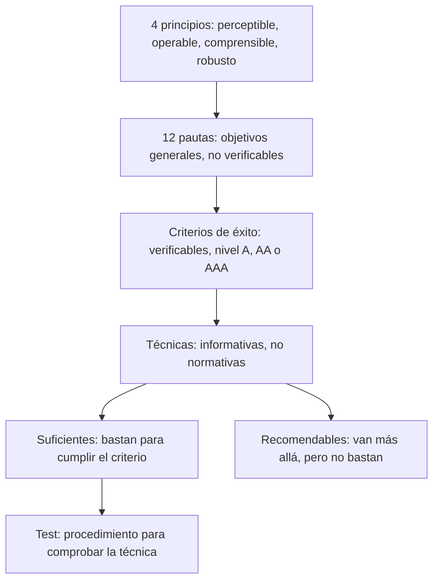
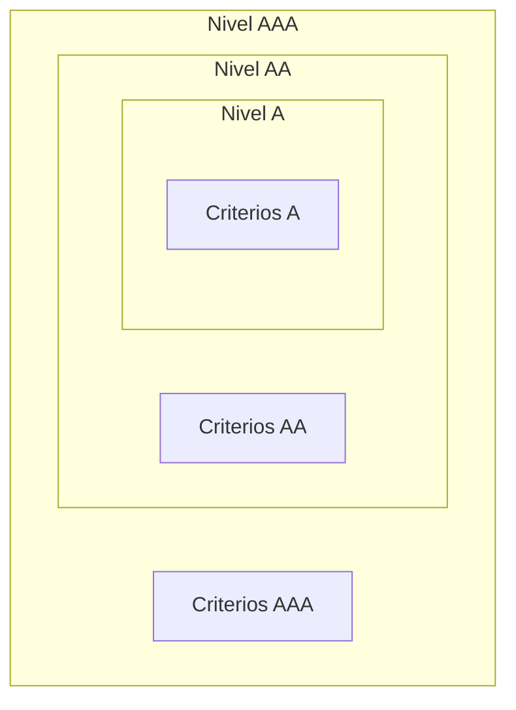
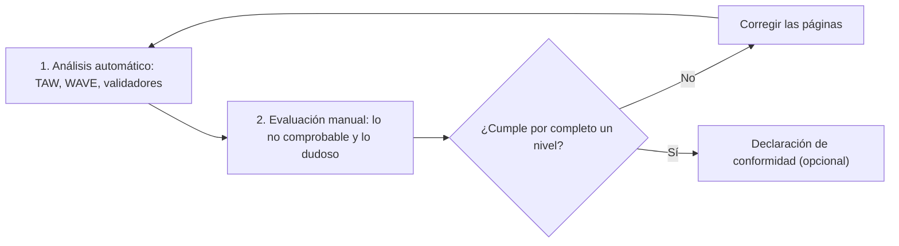
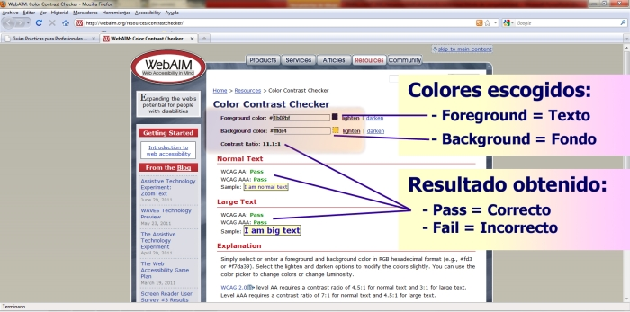

# Unidad 2. Accesibilidad en la web

Una interfaz no solo tiene que ser usable, visual, educativa y actualizada: también tiene que poder usarla cualquier persona, tenga o no alguna discapacidad. Esta unidad trata de qué es la accesibilidad web y a quién afecta, y de las pautas del W3C que permiten diseñar sitios accesibles y comprobar que lo son.

La unidad se divide en dos partes:

1. **Accesibilidad en la web**: el concepto, la legislación, los tipos de discapacidad y la tecnología asistencial.
2. **El Consorcio World Wide Web (W3C)**: los cuatro principios de accesibilidad, las pautas WCAG 2.0, los criterios de éxito y los niveles de conformidad, las técnicas, la declaración de conformidad y las herramientas de evaluación.

> **Sobre la vigencia del temario.** El temario se basa en las WCAG 2.0 (2008) y en la legislación española de 2003-2007. Se expone tal como lo recoge; lo que ha cambiado desde entonces se indica en recuadros **Contexto actual**.

---

## 1. Accesibilidad en la web

La **accesibilidad web** es la capacidad que tienen las personas para acceder a la web y a sus contenidos **independientemente de sus propias limitaciones o de las limitaciones tecnológicas** o ambientales.

**En el mundo de la web todos somos responsables de la accesibilidad**:

- las personas que se dedican al **diseño web**;
- las empresas que fabrican **navegadores** y lectores de pantalla;
- las empresas que **distribuyen software** y crean las herramientas que usan quienes diseñan;
- e incluso **los propios usuarios con discapacidad**, responsables del uso de la tecnología asistencial.

> **Error frecuente**: las empresas que fabrican microprocesadores no figuran entre los responsables. El sexo o la raza tampoco aparecen en la definición: la accesibilidad trata de limitaciones personales, tecnológicas o ambientales.

### 1.1 Conceptos generales

No todos los usuarios disponen de los mismos recursos económicos, la misma tecnología o el mismo ancho de banda. La accesibilidad pretende que **todos puedan acceder a los contenidos de la web en condiciones de igualdad**.

Según el Parlamento Europeo (informe *eEurope 2002*, abril de 2002), los grupos que corren el riesgo de quedar excluidos de los sitios web por obstáculos técnicos son **las personas con discapacidad y los ancianos**, un colectivo en constante crecimiento. La mayoría de esos obstáculos se pueden eliminar con técnicas de diseño específicas.

**Legislación española que recoge el temario:**

| Norma | Qué establece |
|---|---|
| **Ley 51/2003**, de 2 de diciembre, de igualdad de oportunidades, no discriminación y accesibilidad universal de las personas con discapacidad | Art. 1.2: tienen la consideración de personas con discapacidad aquellas con un **grado de minusvalía igual o superior al 33 %**. Art. 2: se inspira en los principios de vida independiente, normalización, **accesibilidad universal**, **diseño para todos**, diálogo civil y **transversalidad** de las políticas en materia de discapacidad. Art. 2.c: define la accesibilidad universal. Art. 3: de acuerdo con el **principio de transversalidad**, se aplica, entre otros ámbitos, a las **telecomunicaciones y la sociedad de la información** |
| **Real Decreto 1494/2007**, de 12 de noviembre | Reglamento sobre las condiciones básicas para el acceso de las personas con discapacidad a las tecnologías, productos y servicios relacionados con la sociedad de la información y los medios de comunicación social. Su capítulo III recoge los criterios de accesibilidad en la sociedad de la información |

**Accesibilidad universal** (Ley 51/2003, art. 2.c): la condición que deben cumplir los entornos, procesos, bienes, productos y servicios, así como los objetos, instrumentos, herramientas y dispositivos, para ser **comprensibles, utilizables y practicables por todas las personas** en condiciones de seguridad y comodidad, y de la forma más autónoma y natural posible. Presupone la estrategia de **diseño para todos**.

> **Error frecuente**: el artículo 3 habla del principio de **transversalidad**, no de "universalidad", y del ámbito de las **telecomunicaciones y la sociedad de la información**, no de "telecomunicaciones y prensa". Cambiar cualquiera de las dos cosas hace falsa la cita.

> **Ampliación: otras normas españolas sobre accesibilidad web.**
>
> | Norma | Relación con la accesibilidad web |
> |---|---|
> | Ley 34/2002, de servicios de la sociedad de la información y de comercio electrónico (LSSI) | Disposición adicional quinta: obliga a las Administraciones Públicas a que sus páginas web sean accesibles |
> | Ley 56/2007, de medidas de impulso de la sociedad de la información | Extiende la obligación a las empresas que prestan servicios de especial trascendencia económica (banca, seguros, suministros, transporte…) |
> | Real Decreto Legislativo 1/2013, Ley General de derechos de las personas con discapacidad | Texto refundido que **sustituye a la Ley 51/2003** e integra sus principios |
> | Real Decreto 1112/2018, sobre accesibilidad de los sitios web y aplicaciones para dispositivos móviles del sector público | Transpone la Directiva (UE) 2016/2102. Exige cumplir la norma UNE-EN 301 549, equivalente a las **WCAG 2.1 nivel AA**, y publicar una declaración de accesibilidad |
> | Ley 11/2023, que transpone la Directiva (UE) 2019/882 (Acta Europea de Accesibilidad) | Extiende los requisitos de accesibilidad a productos y servicios del sector privado, como el comercio electrónico y la banca, desde el 28 de junio de 2025 |

### 1.2 Tipos de discapacidad

Los tipos de discapacidad que más se tienen en cuenta para hacer un diseño web accesible son **visual, auditiva, cognitiva y motriz**.

#### 1.2.1 Visual

Una persona tiene **discapacidad visual** cuando tiene disminuida la función visual o cuando tiene ceguera. La **baja visión** puede deberse a una reducción de la agudeza visual o del campo visual. Los problemas pueden aparecer de forma repentina (un accidente), de forma gradual (una enfermedad, la edad) o existir desde el nacimiento.

Hay muchos **problemas oculares y perturbaciones visuales**: **visión borrosa, halos, puntos ciegos, moscas volantes**, etc.

| Tipo | Definición |
|---|---|
| **Ceguera total** | La persona **no distingue la luz de la oscuridad**. Puede ser de nacimiento o adquirida por enfermedad o accidente |
| **Ceguera legal** | Agudeza visual por debajo de 1/10 incluso con corrección. Se considera ciega aunque perciba formas y sombras |
| **Visión parcial** | 3/10 de agudeza visual en el ojo con mayor visión, con corrección, y/o 20 grados de campo visual total |

> **Error frecuente**: la ceguera total no es solo la de nacimiento; también la adquirida. Y quien conserva parte de la visión en un ojo o parte del campo visual no tiene ceguera total.

#### 1.2.2 Motriz

Una persona tiene **discapacidad motriz** cuando padece alguna disfunción en el aparato locomotor (huesos, articulaciones y músculos). Puede llevar asociados movimientos limitados o incontrolados, falta de coordinación y falta de fuerza en las extremidades. El principal problema ante el ordenador es **señalar algo concreto con el ratón o pulsar una sola tecla**.

- Puede ir acompañada de problemas de percepción visual por trastornos de la movilidad ocular: **nistagmus** (movimiento involuntario de los ojos) y **estrabismo**.
- La causan, entre otras, la **lesión medular**, la **parálisis cerebral**, la distrofia muscular, la esclerosis múltiple y la esclerosis lateral amiotrófica.

> **Error frecuente**: el **nistagmus** aparece en las preguntas de discapacidad **motriz** (es un trastorno de la movilidad ocular asociado a ella), no entre las perturbaciones visuales. Los **halos**, en cambio, son una perturbación visual.

#### 1.2.3 Auditiva

Las personas con discapacidad auditiva tienen una **audición deficiente en ambos oídos**. Se distinguen dos grupos:

- **Hipoacusia**: con prótesis adecuadas pueden adquirir el lenguaje oral por vía auditiva.
- **Sordera**: la **visión** es su principal canal de comunicación.

Un trastorno auditivo a edad temprana dificulta el desarrollo del lenguaje. Por eso, el principal problema de una persona con **discapacidad auditiva desde su nacimiento** ante la web es que **presenta dificultades para la comprensión lectora y la comprensión de determinadas construcciones sintácticas**.

> **Error frecuente**: una persona sorda de nacimiento **no** tiene por qué presentar dificultades en el desarrollo de la inteligencia verbal y matemática: puede desarrollarla con la lengua de signos. Lo que sí tiene es menor rendimiento en la lectura y la comprensión, por falta de vocabulario y porque las frases en lengua de signos se construyen de otra forma.

#### 1.2.4 Cognitiva

Las **habilidades cognitivas** son las operaciones mentales que permiten adquirir, retener y recuperar el conocimiento. Son ocho:

| Habilidad | Comprende todo lo relacionado con… |
|---|---|
| **Observación** | la atención, la concentración, la búsqueda y la identificación de datos, elementos u objetos |
| **Análisis** | las comparaciones y distinciones para destacar los elementos básicos de la información |
| **Ordenación** | la agrupación, reunión y serialización de datos a partir de un atributo |
| **Clasificación** | la categorización, esquematización y jerarquización de datos |
| **Representación** | la modelización, reproducción o simulación para recrear hechos o situaciones nuevas |
| **Memorización** | la retención, conservación, evocación, almacenamiento y recuperación de datos |
| **Interpretación** | la argumentación, la deducción y el razonamiento que permiten aportar un significado personal a la información |
| **Evaluación** | la estimación, la crítica y el juicio sobre los datos obtenidos |

La **discapacidad cognitiva** es una disminución de estas habilidades. Sus causas más conocidas son el autismo, el síndrome de Down y el retraso mental. Produce dificultades en la inteligencia verbal y matemática y menor rendimiento en la lectura.

> **Error frecuente**: la argumentación, la deducción y el razonamiento son la **interpretación**, no la representación. "Experimentación" no es una habilidad cognitiva.

### 1.3 Tecnología asistencial

La **tecnología asistencial** es el conjunto de **equipos, dispositivos, instrumentos o programas** empleados para mejorar la calidad de vida de las personas con discapacidad, incrementando su autonomía. En el ámbito informático incluye todos los **dispositivos y equipos de asistencia**, adaptación y rehabilitación basados en un sistema informático.

Fuera de la informática también es tecnología asistencial el perro guía, la rampa, la puerta automática o el **soporte para libros** (que permite leer con una sola mano).

| Discapacidad | Tecnología asistencial que usa |
|---|---|
| Visual | **Lector de pantalla**, **dispositivo braille**, ampliador de pantalla |
| Motriz | Teclados y **ratones modificados**, reconocimiento de voz, **soporte para libros** |

Los dispositivos informáticos se dividen en dos grupos según el sentido de la información: los de **entrada** sustituyen al teclado o al ratón; los de **salida**, a la pantalla.

#### 1.3.1 Dispositivos de entrada

Permiten realizar las mismas funciones que un teclado o un ratón convencionales.

| Dispositivo | Qué es |
|---|---|
| **Teclado virtual** | Teclado que **se muestra en pantalla** y permite escribir eligiendo los caracteres con el ratón. Lo usan quienes no pueden usar un teclado con normalidad; algunos predicen palabras |
| **Teclado alternativo** | Teclado adaptado: teclas más grandes o más separadas (motriz), letras más grandes (visual), colores o imágenes (cognitiva) |
| **Teclado braille** | Para personas ciegas: 6 u 8 teclas principales que se pulsan a la vez para formar cada carácter |
| **Software de reconocimiento de voz** | Introduce datos o ejecuta órdenes por voz, para quien no puede usar teclado ni ratón |
| **Apuntador o licornio** | Casco con una varilla en la frente o la barbilla para pulsar teclas, para quien solo mueve la cabeza. Se complementa con las **sticky keys** |
| **Trackball gigante** | Ratón que no se desplaza, con una bola grande y botones grandes |
| **Webcam de seguimiento de ojos o cara** | **Transforma el movimiento de los ojos o la cara en movimientos del puntero**; el clic se simula con un parpadeo o un gesto |

> **Error frecuente**: las **sticky keys** no son teclas grandes, sino una función que **simula la pulsación simultánea de varias teclas pulsándolas de una en una**. Y el teclado virtual no está pensado para problemas de aprendizaje: es el teclado en pantalla.

#### 1.3.2 Dispositivos de salida

| Dispositivo | Qué es |
|---|---|
| **Lector de pantalla** | Lee lo que aparece en pantalla con un sintetizador de voz. Para ceguera o discapacidad visual grave |
| **Ampliador de pantalla** | Amplía texto e imágenes, como la **lupa** del sistema operativo. Para baja visión |
| **Línea braille** | Celdas de 6 u 8 puntos que muestran de forma táctil lo que leería un lector de pantalla. Útil sobre todo para personas **sordociegas** |
| **Navegador para ciegos** | Lee las páginas en voz alta y se maneja con órdenes de voz |

> **Error frecuente**: el lector de pantalla y la lupa son de **salida**; el teclado virtual y el licornio, de **entrada**. El reconocimiento de voz y el teclado alternativo también son de entrada.

**Cómo contribuye a la accesibilidad quien diseña:**

- con un código **XHTML semánticamente correcto**;
- con un **texto alternativo descriptivo** en las imágenes;
- dando **nombres significativos a los enlaces**, que los lectores de pantalla leen;
- **subtitulando los vídeos** (discapacidad auditiva);
- con un **lenguaje claro y sencillo** (discapacidad cognitiva y auditiva severa temprana);
- con **letra grande**, buen contraste y una combinación de colores adecuada (baja visión);
- con **elementos de interacción grandes** (discapacidad motriz).

> **Error frecuente**: emplear una fuente de **tamaño fijo no superior a 10 puntos** no contribuye a la accesibilidad; es lo contrario.

---

## 2. El Consorcio World Wide Web (W3C)

El **W3C** es una comunidad internacional, fundada en 1994, que desarrolla estándares para asegurar el crecimiento de la web a largo plazo. Su misión es **desarrollar tecnologías interoperables (especificaciones, líneas maestras, software y herramientas)** para guiar la web hacia su máximo potencial. Uno de sus directores es **Tim Berners-Lee**, creador de la web en 1989.

> **Error frecuente**: el W3C no controla que las páginas publicadas cumplan los estándares ni desarrolla hardware adaptado.

Estándares del W3C relacionados con este módulo:

| Estándar | Qué es | Publicación |
|---|---|---|
| HTML5 | Semántica y estructura de los documentos HTML | Octubre de 2014 |
| XHTML 1.0 | Reformulación de HTML como lenguaje XML | 2002 |
| XHTML 1.1 | Versión modular de XHTML, no compatible con versiones anteriores de HTML | 2002 |
| CSS 2.1 | Hojas de estilo en cascada, nivel 2 | Junio de 2011 |
| CSS3 | Nivel 3, publicado por módulos | Desde 2011 |

### 2.1 Principios fundamentales de acceso al contenido web

Dentro del W3C, la **Iniciativa para la Accesibilidad Web (WAI)** desarrolla estrategias, directrices y recursos para hacer la web accesible. Sus pautas se consideran estándares internacionales. Las **WCAG 2.0** suceden a las WCAG 1.0 (mayo de 1999), y el W3C recomienda seguir las 2.0. Están pensadas para verificarse con una combinación de **pruebas automatizadas y evaluación humana**.

En el nivel más alto están los **cuatro principios** que fundamentan la accesibilidad web: el contenido tiene que ser **perceptible, operable, comprensible y robusto**. Si alguno no se cumple, los usuarios con discapacidad no pueden usar la web.

| Principio | Significa que… |
|---|---|
| **Perceptible** | Los usuarios pueden percibir la información: **la información no puede ser invisible para todos los sentidos del usuario** |
| **Operable** | Los usuarios pueden manejar la interfaz: **la interfaz no puede exigir una interacción que a un usuario le sea imposible de realizar** |
| **Comprensible** | Los usuarios pueden comprender la información y el funcionamiento de la interfaz |
| **Robusto** | El contenido puede interpretarlo de forma fiable una amplia variedad de aplicaciones de usuario, incluidas las ayudas técnicas, y **sigue siendo accesible aunque avance la tecnología** |

> **Error frecuente**: "la interfaz no puede exigir una interacción imposible" es la definición de **operable**, no de robusto. "Visible", "interpretable" y "mantenible" no son principios.

### 2.2 Pautas de Accesibilidad al Contenido en la Web (WCAG)

Las **WCAG 2.0** definen cómo crear contenidos web más accesibles. Cubren un amplio rango de discapacidades, pero no bastan para todas las combinaciones posibles; además mejoran la usabilidad para las personas mayores y para todos los usuarios.

Tienen **12 pautas** organizadas en los cuatro principios. **Las pautas no son verificables**, pero **proporcionan el marco y los objetivos generales que ayudan a los autores a comprender los criterios de éxito y a implementar mejor las técnicas**.

Las WCAG 2.0 forman una jerarquía de cuatro capas, de lo general a lo concreto; cada capa se desarrolla en los apartados siguientes:

| Principio | Pautas |
|---|---|
| **1. Perceptible** | 1.1 **Alternativas textuales** para todo el contenido no textual · 1.2 Alternativas para el **contenido dependiente del tiempo** (multimedia) · 1.3 Contenido **adaptable**, presentable de diferentes maneras sin perder información · 1.4 Contenido **distinguible**: facilitar la visión y la audición |
| **2. Operable** | 2.1 Toda la funcionalidad **disponible desde el teclado** · 2.2 **Tiempo suficiente** para leer y usar el contenido · 2.3 No diseñar contenido que pueda causar **convulsiones** · 2.4 Ayudar a **navegar, localizar contenido y saber dónde se está** |
| **3. Comprensible** | 3.1 Contenido textual **legible** y comprensible · 3.2 Apariencia y funcionamiento **predecibles** · 3.3 Ayudar a **evitar y corregir los errores** |
| **4. Robusto** | 4.1 Maximizar la **compatibilidad** con los agentes de usuario actuales y futuros, incluidas las tecnologías asistivas |

> **Error frecuente**: "ayudar a navegar, localizar contenido y determinar dónde se encuentran" es una pauta de **operable** (2.4), no de comprensible.

### 2.3 Criterios de éxito y niveles de conformidad

Cada pauta tiene **criterios de éxito verificables**. **Un criterio de éxito es una afirmación comprobable que puede ser verdadera o falsa cuando se aplica a un contenido web específico.** Cada uno incluye su intención, sus términos clave y a quién beneficia.

Hay **tres niveles de conformidad**: **A** (el más bajo), **AA** y **AAA** (el más alto). Cada nivel exige los anteriores:

| Nivel | La página satisface… |
|---|---|
| **A** | Todos los criterios de nivel A, o proporciona una versión alternativa conforme |
| **AA** | Todos los criterios de nivel A **y** AA |
| **AAA** | Todos los criterios de nivel A, AA **y** AAA |

Los niveles son acumulativos: cada uno contiene al anterior.

> **Error frecuente**: para el nivel AAA no basta con los criterios AAA: hay que cumplir también todos los de A y AA.

**Criterios de éxito de las pautas 1.1 y 1.2:**

| Criterio | Nivel | Intención |
|---|---|---|
| 1.1.1 Contenido no textual | A | Todo contenido no textual tiene una alternativa textual |
| 1.2.1 Solo audio y solo vídeo (pregrabados) | A | La información de un vídeo sin sonido o de un audio sin imagen está disponible para todos |
| 1.2.2 Subtítulos (pregrabados) | A | Las personas sordas pueden seguir las presentaciones multimedia |
| 1.2.3 Audiodescripción o medio alternativo (pregrabados) | A | Las personas ciegas acceden a la información visual por una descripción sonora o una alternativa textual completa |
| 1.2.4 Subtítulos (directo) | AA | Subtítulos en las presentaciones en tiempo real |
| 1.2.5 Audiodescripción (pregrabada) | AA | Descripción sonora para todos los vídeos pregrabados |
| 1.2.6 **Lenguaje de signos (pregrabado)** | AAA | Interpretación en lengua de signos de la pista de audio |
| 1.2.7 Audiodescripción extendida (pregrabada) | AAA | Pausas en el vídeo para añadir más descripción |
| 1.2.8 Medio alternativo (pregrabado) | AAA | Alternativa textual completa para todo el multimedia |
| 1.2.9 Solo audio (directo) | AAA | Alternativa para el audio en directo |

**Otros criterios de conformidad:**

| Criterio | Principio | Nivel |
|---|---|---|
| 1.4.4 **Tamaño del texto** | Perceptible | AA |
| 1.4.7 **Sonido de fondo bajo o sin él** | Perceptible | AAA |
| 2.3.2 **Tres destellos** | Operable | AAA |
| 2.4.1 Saltar bloques | Operable | A |
| 2.4.3 **Orden del foco** | Operable | A |
| 3.1.6 **Pronunciación** | Comprensible | AAA |
| 3.3.1 Identificación de errores | Comprensible | A |

> **Error frecuente**: "Saltar bloques" y "Orden del foco" son de **operable** (pauta 2.4, ayuda a la navegación); "Identificación de errores", de **comprensible**. Al principio **perceptible** pertenecen "Tamaño del texto" y "Lenguaje de signos".

> **Contexto actual**: hoy rigen las **WCAG 2.2** (W3C, octubre de 2023). Mantienen los cuatro principios y los tres niveles, añaden criterios nuevos (tamaño mínimo de los objetivos táctiles, foco no tapado, autenticación accesible…) y retiran el 4.1.1 Interpretación. La normativa europea y española exige hoy el nivel AA.

### 2.4 Técnicas de accesibilidad web

Para cada pauta y criterio de éxito, el grupo de trabajo de las WCAG ha documentado **técnicas**: más de 375, en continua revisión. **Las técnicas son informativas, no normativas**, y se agrupan en dos categorías:

- **Técnicas suficientes**: bastan para satisfacer un criterio de éxito. La mayoría de los criterios tienen una lista de ellas.
- **Técnicas recomendables** (o de asesoramiento): van más allá de los requisitos de cada criterio y ayudan a afrontar mejor las pautas, pero **no son suficientes** para cumplir todos los requisitos de un criterio.

Las técnicas se clasifican por tecnología: **generales** (G, independientes de la tecnología), **HTML**, **CSS**, **scripts de cliente**, SMIL, PDF, etc. Cada técnica incluye un **test**: el procedimiento para comprobar si se aplica correctamente.

> **Error frecuente**: las técnicas recomendables **no** son "las que mejor satisfacen los criterios": precisamente no bastan para cumplirlos. Y sí hay técnicas suficientes para la mayoría de los criterios.

**Cómo se relacionan pauta, criterio, técnica y test**, con un ejemplo del principio perceptible:

| Pauta | Criterio de éxito | Técnica suficiente | Test |
|---|---|---|---|
| 1.4 Distinguible | 1.4.1 Uso del color (A): el color no es el único medio para transmitir información | G14: la información que se transmite con diferencias de color también está disponible como texto | 1. Localizar todo elemento en que el color indique algo (por ejemplo, campos obligatorios en rojo). 2. Comprobar que esa información también está en texto (un asterisco y la palabra "obligatorio"). Si en todos los casos está, la técnica se cumple |

### 2.5 Declaración de conformidad de documentos web

Para declarar que una página es conforme con las WCAG 2.0 hay que cumplir estos **requisitos**:

- **Nivel de conformidad**: se satisface **por completo uno de los tres niveles**.
- **Páginas completas**: el nivel se aplica a páginas enteras, no a partes.
- **Procesos completos**: si una página forma parte de un proceso (por ejemplo, una compra hasta el pago), todas las páginas del proceso deben ser conformes.
- **Solo tecnologías compatibles con la accesibilidad**: lo que se haga con tecnologías no compatibles tiene que estar disponible también por otra vía compatible.
- **No interferencia**: las tecnologías no compatibles no bloquean el acceso al resto de la página.

La declaración de conformidad es **opcional** y solo se define para páginas web, aunque puede abarcar una o varias. Si se hace, **debe incluir**:

1. La **fecha de la declaración**.
2. El título, la versión y la URI de las pautas.
3. El **nivel de conformidad** satisfecho.
4. Una descripción de las páginas y la lista de sus URI.
5. La lista de las **tecnologías de contenido web en las que se confía**.

Como **información adicional** se recomienda incluir, por ejemplo, **una lista de los criterios de éxito alcanzados más allá del nivel declarado** o la lista de las **tecnologías empleadas en las que no se confía**.

| Frase | Tipo de información |
|---|---|
| Satisfacer por completo uno de los tres niveles | Requisito de la declaración |
| Lista de tecnologías en las que se confía | Información a incluir |
| Lista de tecnologías empleadas en las que no se confía | Información adicional |

> **Error frecuente**: el nombre del autor, el título de la página o la lista de imágenes no son datos obligatorios de la declaración. Lo imprescindible de esa lista es la **fecha**.

### 2.6 Herramientas de evaluación de la accesibilidad

Antes de declarar la conformidad hay que validar las páginas. El INTECO propone un proceso en **dos fases**:

1. **Primero, un análisis automático**, que detecta problemas. Las herramientas automáticas son una ayuda, no un análisis completo ni infalible.
2. **Después, una evaluación manual**, para los problemas que no se pueden comprobar automáticamente y para revisar los dudosos.

**Las herramientas de validación automática no son suficientes para asegurar que un sitio web es 100 % accesible.**

El proceso completo, hasta la declaración de conformidad:

> **Error frecuente**: el orden es **automática primero y manual después**, no al revés.

| Herramienta | Función | Fase |
|---|---|---|
| Validador (X)HTML del W3C | Validación de la gramática del (X)HTML | Automática |
| Validador de CSS del W3C | Validación de las hojas de estilo | Automática |
| **TAW** (Test de Accesibilidad Web, fundación CTIC) | Evaluación de accesibilidad: analizadores, monitorización y observatorios | Automática |
| eXaminator | Evaluación según las WCAG 2.0, con nota de 1 a 10 por prueba | Automática |
| **WAVE** (WebAIM) | Muestra la página con iconos sobre los problemas detectados | Automática |
| Web Developer Toolbar | Barra de herramientas para desarrollo, útil también para accesibilidad | Manual |
| Web Accessibility Toolbar | Complemento de Internet Explorer para la evaluación manual | Manual |
| **Color Contrast Checker** (WebAIM) | Comprueba el contraste entre el color del texto y el del fondo | Manual |

En el Color Contrast Checker se introducen el color del texto (*foreground*) y el del fondo (*background*) en hexadecimal; la herramienta calcula la razón de contraste e indica, para texto normal y texto grande, si se cumplen los niveles AA y AAA (*Pass*) o no (*Fail*).

> **Contexto actual**: eXaminator y la Web Accessibility Toolbar ya no están disponibles. Hoy se usan sobre todo WAVE, axe DevTools y Lighthouse (integrado en Chrome) para la fase automática, y el lector de pantalla NVDA y la navegación con teclado para la manual.

---

## Ideas clave

- **Accesibilidad web**: acceso a la web independientemente de las limitaciones propias, tecnológicas o ambientales. Responsables: diseñadores, fabricantes de navegadores y lectores de pantalla, distribuidores de software y los propios usuarios.
- **Ley 51/2003**: discapacidad desde el 33 %; principios de accesibilidad universal, diseño para todos y transversalidad; se aplica a la sociedad de la información. **RD 1494/2007**: acceso a las tecnologías de la sociedad de la información.
- **Discapacidades**: visual (ceguera total = no distingue luz de oscuridad), motriz (aparato locomotor; nistagmus, lesión medular, parálisis cerebral), auditiva (de nacimiento: dificultad de comprensión lectora) y cognitiva (ocho habilidades).
- **Tecnología asistencial**: entrada (teclado virtual, alternativo y braille, reconocimiento de voz, licornio, trackball, webcam) y salida (lector y ampliador de pantalla, línea braille, navegador para ciegos).
- **W3C**: especificaciones y líneas maestras. **WAI**: pautas de accesibilidad.
- **Cuatro principios**: perceptible, operable, comprensible y robusto.
- **WCAG 2.0**: 12 pautas (no verificables) → criterios de éxito (verificables) → técnicas (informativas; suficientes o recomendables).
- **Niveles**: A, AA, AAA; cada uno exige los anteriores.
- **Declaración de conformidad**: opcional; si se hace, con fecha, pautas, nivel, páginas y tecnologías en las que se confía.
- **Evaluación**: primero automática, después manual. Las herramientas automáticas no bastan.
