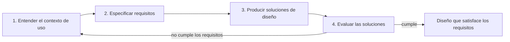
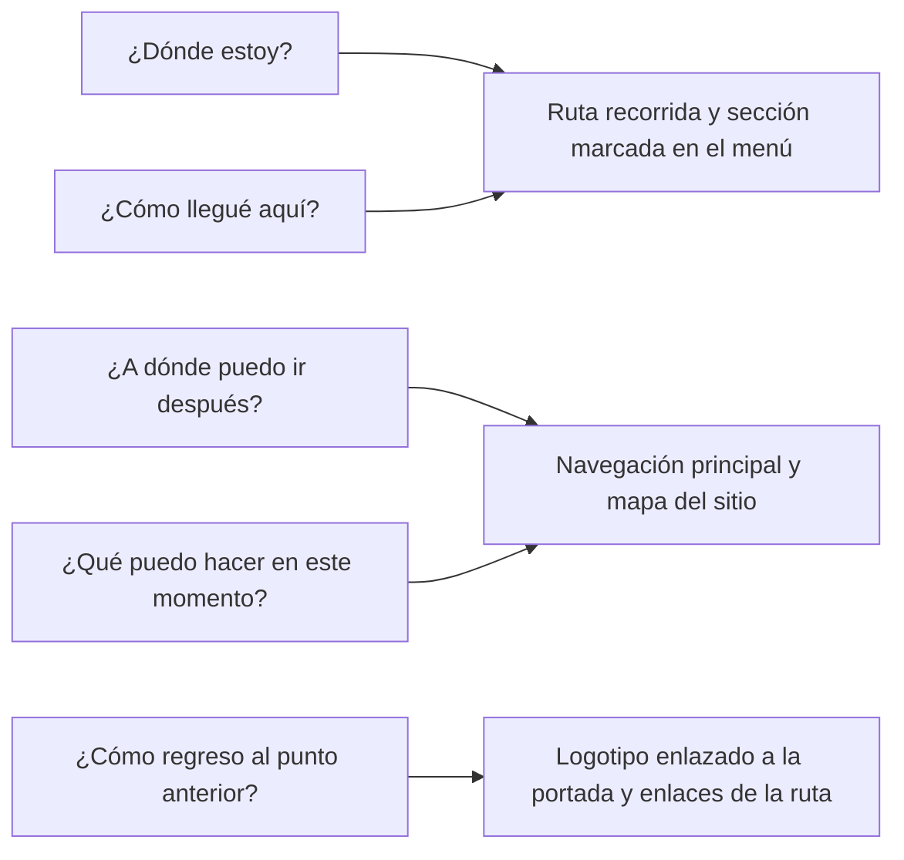
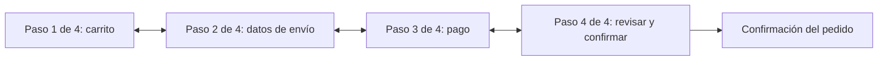
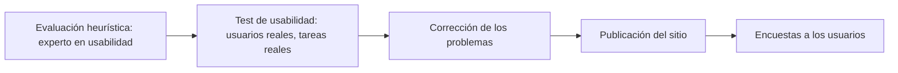
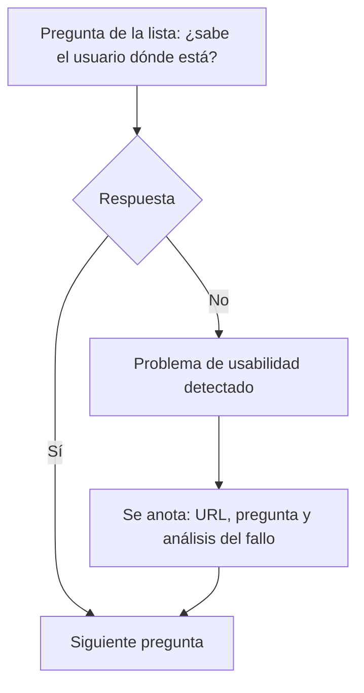

# Unidad 3. Usabilidad en la web

La usabilidad es la cualidad que hace que un sitio se use con facilidad y rapidez; se nota sobre todo cuando falta. Esta unidad define la usabilidad y sus normas, describe a los usuarios y cómo hay que escribir para ellos, estudia las características de un buen sistema de navegación y presenta los métodos para evaluar si un sitio es usable.

La unidad se divide en tres partes:

1. **Usabilidad en la web**: conceptos, normas ISO, usuarios, lenguaje y principios.
2. **Navegación en la web**: información accesible, consistencia, persistencia, sencillez y uso del teclado.
3. **Análisis y verificación de la usabilidad**: métodos, evaluación heurística y test de usabilidad.

> **Sobre la vigencia del temario.** Varias referencias son antiguas (Flash, Windows 7, la etiqueta `ACRONYM`, normas ISO sustituidas). Se exponen tal como las recoge el temario; lo que ha cambiado se indica en recuadros **Contexto actual**.

---

## 1. Usabilidad en la web

La usabilidad recoge ideas de las unidades anteriores: la interfaz tiene que ser usable, visual, educativa y actualizada, y el objetivo del diseño es que los usuarios accedan a los contenidos de la forma más rápida y sencilla posible. Los dos grandes referentes son **Jakob Nielsen**, considerado el padre de la usabilidad web, y **Steve Krug**, autor de *No me hagas pensar*.

> "Usabilidad es una cualidad de un sitio web de la que solo se percibe su falta. Cuando está presente, el usuario interactúa con facilidad y rapidez."

### 1.1 Conceptos generales

Una interfaz usable es **fácil de usar la primera vez, fácil de recordar** para las siguientes y **agradable** de usar, como una carretera bien señalizada por la que se sabe volver sin ayuda.

**El diseño de interfaces web es un caso concreto de diseño de interfaz gráfica de usuario**, y por eso se basa en sus mismos tres principios:

1. **Dar el control al usuario.**
2. **Reducir la carga de memoria.**
3. **Mantener una interfaz consistente.**

> **Error frecuente**: es al revés de como lo plantea la pregunta: las interfaces web son un caso de las gráficas, no las gráficas un caso de las web. "Hacer un diseño visual atractivo" no es uno de los tres principios.

A diferencia de una aplicación para una empresa, cuyos usuarios se conocen, los usuarios potenciales de una web son **todos los que tienen conexión a Internet**.

- **Definición de la ISO**: "el grado en que un producto puede ser utilizado, en un contexto de uso específico, por determinados usuarios, para conseguir objetivos específicos, con **efectividad, eficiencia y satisfacción**".
- **La usabilidad es un atributo cualitativo** que evalúa cuán fáciles son de usar las interfaces de usuario.
- La palabra designa también los **métodos** empleados para aumentar la facilidad de uso durante el diseño.

> **Error frecuente**: que una interfaz sea **visual** no significa que su objetivo sea llamar la atención, sino que es coherente en el uso de colores, tipografía, etc.

### 1.2 La Web: objetivos y uso de estándares

La web es un medio global de comunicación, y una forma ventajosa de dar a conocer una empresa: rapidez en la información y libertad de elección (prensa digital, series a demanda, viajes, compra por Internet).

**Objetivos de la web relacionados con la usabilidad:**

- **Permitir una búsqueda rápida, cómoda y eficiente** de la información.
- **Facilitar la navegación** de los usuarios por el sitio.
- **Facilitar la interactividad** de los usuarios con el sitio.
- **Tener en cuenta las necesidades** de los usuarios.

**Uso de estándares.** Emplear los lenguajes estándar **HTML, XML y XHTML** garantiza la **continuidad** del sitio: se adaptará mejor a cambios en la tecnología, nuevas versiones de navegadores o dispositivos móviles. Separar el aspecto visual del contenido con hojas de estilo facilita además el mantenimiento.

> **Error frecuente**: un sitio hecho con lenguajes estándar no es por eso usable, accesible ni bien navegable: lo que garantizan los estándares es la **continuidad**. UML no es un lenguaje de marcas web.

**Normas ISO relacionadas con la usabilidad:**

| Norma | Qué establece |
|---|---|
| **ISO/IEC 9126** | Define la usabilidad como **un atributo de la calidad del software**, asociado al diseño y la evaluación de la interfaz y a la interacción. La analiza en términos de **comprensibilidad, aprendizaje, operabilidad, atractividad y conformidad** (adhesión a estándares y guías de estilo) |
| **ISO/DIS 9241-11** | Define la usabilidad por la calidad del trabajo de un sistema en uso: "el grado de **eficacia, eficiencia y satisfacción** con la que usuarios específicos pueden lograr objetivos específicos, en contextos de uso específicos". Eficacia: exactitud y completitud; eficiencia: recursos empleados (tiempo, dinero, personas); satisfacción: comodidad y aceptabilidad |
| **ISO 13407** | Guía para el **diseño centrado en el usuario** en todo el ciclo de vida. Cuatro actividades: entender el contexto de uso, especificar requisitos, producir soluciones de diseño y evaluarlas |
| **ISO TR 18529** | Versión ampliada de la anterior, para evaluar los procesos de software centrados en el usuario |
| **ISO TR 16982** | Lista de **métodos ergonómicos** aplicables a cada etapa del diseño, con sus ventajas e inconvenientes |
| **ISO 9241-151** | Publicada en julio de 2008: **principios para el diseño de sitios web usables**. Cinco áreas: estrategia de diseño, diseño del contenido, navegación y búsqueda, presentación del contenido y aspectos generales |

Las cuatro actividades de la ISO 13407 forman un ciclo: si la evaluación muestra que el diseño no cumple los requisitos, se vuelve a iterar.

> **Contexto actual**: la ISO/IEC 9126 fue sustituida por la **ISO/IEC 25010** (2011), y la ISO 13407, por la **ISO 9241-210**.

### 1.3 Los usuarios: tipos, necesidades y barreras

Cada usuario es distinto, y conviene trazar perfiles. Por su comportamiento, hay usuarios que abandonan una página:

- si la portada tiene una animación (Flash) que tarda más de tres segundos y no se puede saltar;
- si tiene demasiados elementos decorativos que tardan en descargarse;
- si se abren ventanas que interrumpen la lectura;
- si está llena de párrafos de más de cinco líneas que ocupan toda la ventana.

**Para diseñar pensando en el usuario** se tienen en cuenta **sus características, sus expectativas, sus capacidades y aptitudes**, la información que necesita, cómo accede a la web, **su experiencia previa** en el uso de la web, sus conocimientos, si tiene alguna discapacidad y **sus limitaciones técnicas**.

Según su experiencia, los usuarios se clasifican en tres niveles: **principiante, intermedio y avanzado**.

Un sitio puede tener **varios perfiles de usuario** (visitante o invitado, usuario registrado o colaborador, usuario experto o administrador), y a cada uno se le presupone una experiencia. Aun así, **la usabilidad hay que garantizarla en todos los perfiles**.

> **Error frecuente**: la titulación y las habilidades manuales del usuario no figuran entre lo que se tiene en cuenta.

### 1.4 Lenguaje y vocabulario

Se emplea **un lenguaje cercano al usuario, sencillo y comprensible**, adaptado al tipo de sitio. Escribir con claridad exige elegir bien las palabras, ordenar el tema con lógica y revisar para eliminar lo superfluo.

**Cómo se redactan los contenidos:**

- **Lenguaje sencillo y directo**, sin estructuras complejas ni conceptos abstractos; si hacen falta, con ejemplos concretos.
- **No dar por hecho** que el usuario tiene conocimientos previos sobre el tema.
- **Palabras cortas**, fáciles de pronunciar.
- **Dirigirse al usuario de forma directa y personal**, en segunda persona ("Si tienes alguna pregunta…").
- Lenguaje **positivo**, sin negaciones.
- Evitar el **subjuntivo**, impreciso y confuso.
- **Cuidado con el lenguaje figurativo o metafórico**: puede confundir.
- **Voz activa** en lugar de pasiva.
- **Usar siempre la misma palabra para la misma cosa**, aunque se repita.
- Signos de puntuación sencillos.
- **Evitar jergas, abreviaturas e iniciales**; si se usan, se marcan en el código con la etiqueta `ABBR`.
- **Dividir el texto en secciones** si es extenso.

> **Error frecuente**: "evitar poner contenidos que se presupone que los usuarios ya conocen" es justo lo contrario de la regla: no se da por hecho lo que sabe el usuario.

> **Contexto actual**: la etiqueta `ACRONYM` no existe en HTML5; para abreviaturas y siglas se usa solo `<abbr title="…">`.

Para llegar a todo el mundo hay que **simplificar las frases y suprimir las palabras inútiles**, sin adornos literarios ni estructuras complejas.

### 1.5 Principios de la usabilidad

Quien diseña trata de **reducir la carga de trabajo** del usuario. **Preferencias de los usuarios**: **no quieren sobrecarga de información** ni tener que recordar nada más de unos segundos, **prefieren una terminología sencilla** y **les gustan las analogías visuales que les recuerdan cosas reales** (el icono de la carpeta, el de la calculadora). Las buenas metáforas crean imágenes mentales fáciles de recordar.

**Directrices para desarrollar una interfaz usable:**

- Ponerse en el lugar de los usuarios.
- **Dar respuesta inmediata a las acciones de los usuarios**: que sepan que algo ha ocurrido.
- **Que el usuario sienta que tiene el control del sistema.**
- Ser consistente en el uso de los elementos gráficos, aprovechando el conocimiento previo del usuario.
- **Tratar los errores, pero evitando que se produzcan.**

> **Error frecuente**: "comprender el estado de ánimo de los usuarios" no es una directriz. Tampoco lo es formar al usuario con un tutorial (se aprovecha lo que ya sabe) ni limitarse a informarle de sus errores (se trata de evitarlos).

Una interfaz es usable si el usuario puede contestar a cinco preguntas: **¿dónde estoy?, ¿cómo llegué aquí?, ¿a dónde puedo ir después?, ¿qué puedo hacer en este momento? y ¿cómo puedo regresar al punto anterior?**

---

## 2. Navegación en la web

Es importante que la interfaz sea atractiva, pero más aún que **el formato del sitio cumpla con las expectativas de los usuarios, en especial las relacionadas con la navegación, el contenido y la organización**.

> **Error frecuente**: el atractivo visual no figura entre esas expectativas.

### 2.1 Información accesible

Para que todos los usuarios accedan a la información de forma eficiente y sencilla es importante **una buena organización de los contenidos**, **un buen diseño del sistema de navegación** y **un sistema de búsqueda eficiente**. Si la navegación es engorrosa o la búsqueda no encuentra lo que existe, el usuario abandona.

Hay que comprobar que:

- **todos los contenidos son accesibles** desde el menú principal o desde algún enlace;
- **no hay enlaces que no lleven a ninguna parte**;
- **todos los enlaces muestran el contenido esperado**.

> **Error frecuente**: nunca se enlaza a páginas "En construcción"; el enlace se pone cuando la página está terminada. El número de páginas del sitio no influye.

### 2.2 Consistencia

**Consistencia**: los elementos del sistema de navegación son **coherentes en todas las páginas** del sitio: mismo diseño y mismo tema visual, mismo comportamiento al pasar el ratón. **La navegación tiene que ser predecible.** El sistema de búsqueda también tiene que ser consistente; el diseño más claro combina la palabra "Buscar", una caja de texto con una lupa y un botón.

### 2.3 Persistencia

**Persistencia**: los elementos del sistema de navegación **se colocan siempre en el mismo sitio** en todas las páginas. Las barras de navegación suelen ir a lo ancho, en la parte superior, bajo el encabezado o dentro de él. El buscador también permanece en el mismo lugar, normalmente en el encabezado, a la derecha.

| Término | Significa | No confundir con |
|---|---|---|
| **Consistencia** | Mismo **aspecto** en todas las páginas | Coherencia (palabra que aparece en su definición, pero no es el término) |
| **Persistencia** | Misma **posición** en todas las páginas | Permanencia (tiempo que se está en un lugar) |

> **Error frecuente**: las características deseables del sistema de navegación y del de búsqueda son **persistencia y consistencia**, no permanencia ni constancia.

### 2.4 Sencillez de navegación

El sistema de navegación sirve para que los usuarios sepan **dónde pueden ir** y, sobre todo, **dónde están y cómo volver**. Siempre debe dar acceso a la página principal. Elementos que responden a las cinco preguntas:

- El **logotipo**, en el encabezado de todas las páginas, que enlaza a la página principal.
- El enlace al **mapa del sitio**, en el encabezado y/o el pie de todas las páginas.
- La **ruta recorrida** desde la portada, bajo el encabezado y sobre el contenido, con enlaces para volver.
- El **sistema de navegación principal**, en el encabezado de todas las páginas, con las secciones del sitio.

> **Error frecuente**: el enlace a la página de contacto no figura en esa lista.

Cada elemento responde a alguna de las cinco preguntas del apartado 1.5:

**Reconocer es mejor que recordar**: con una navegación consistente, persistente y con enlaces de lenguaje claro, el usuario reconoce el camino en cuanto lo ve. En un proceso de varios pasos (una encuesta, una compra), conviene una **navegación guiada**: informar de los pasos, confirmar cada uno, permitir volver atrás y mostrar cuántos quedan. **El usuario debe tener el control.**

Una compra en línea con navegación guiada, en la que cada paso indica cuántos quedan y permite volver al anterior:

### 2.5 Herramientas: ¿ratón o teclado?

La web es el mundo del clic, pero los navegadores también se manejan con el teclado: **métodos abreviados** (Ctrl + "+" para ampliar) y **teclas aceleradoras** del menú (Alt + la letra subrayada). Los atajos ahorran tiempo pero hay que recordarlos; los usan los usuarios avanzados, las personas con discapacidad visual que no pueden manejar el ratón y quienes usan teclados virtuales.

**Firefox** permite moverse por una página con el teclado como en un procesador de textos (navegación con cursor) pulsando **F7**.

| Combinación | Efecto |
|---|---|
| **ALT + D** | Ir a la barra de direcciones |
| ALT + flecha izquierda | Ir a la página anterior |
| **CTRL + TAB** | Avanzar entre marcos |
| INTRO | Activar el vínculo seleccionado |
| **ESC** | Detener la descarga de una página |
| F5 | Actualizar la página |
| MAYÚSCULAS + F10 | Menú contextual de un vínculo |
| **MAYÚSCULAS + TAB** | Retroceder entre los elementos de la página |
| **TAB** | Avanzar entre los enlaces de la página |

> **Error frecuente**: para retroceder entre los elementos se usa **MAYÚSCULAS + TAB**; CTRL + TAB avanza entre marcos.

> **Contexto actual**: hoy CTRL + TAB cambia de pestaña en todos los navegadores, y ALT + D (o CTRL + L) lleva a la barra de direcciones.

---

## 3. Análisis y verificación de la usabilidad

Antes de publicar un sitio conviene **una prueba de usabilidad con un grupo heterogéneo de usuarios**, incluidas personas con distintos tipos de discapacidad: así salen problemas que afectan a todos.

> **Error frecuente**: **una página usable no es siempre accesible**. Lo que sí ocurre es lo contrario: tener en cuenta la accesibilidad hace la interfaz más usable para más personas.

### 3.1 Tecnologías

El éxito de un sitio depende de su contenido, sus servicios y su posicionamiento, pero **su usabilidad garantiza que lo elijan** entre sitios parecidos. Evaluarla a tiempo permite corregir errores antes de que perjudiquen a la audiencia.

**Métodos para analizar la usabilidad de una interfaz:**

| Método | Rasgos |
|---|---|
| **Evaluación heurística** | La realiza una empresa o persona experta. Más eficiente para **proponer soluciones** |
| **Prueba o test de usabilidad** antes de divulgar la página | Con usuarios reales. Muestra **dónde están los problemas** |
| **Encuestas una vez divulgada** la página | Poco recomendable: obliga a publicar la página con sus fallos |
| **Técnica Eye tracking** | **Evalúa cómo usan los usuarios la web**: registra dónde fija la mirada |

**La evaluación heurística y el test de usabilidad se complementan entre sí.**

Ordenados en el tiempo, los métodos se sitúan así respecto a la publicación del sitio:

> **Error frecuente**: una encuesta **antes** de divulgar la página no es uno de los métodos; las encuestas son después de publicarla.

Según Nielsen, el usuario **no lee las páginas con detalle**: las hojea, con un barrido visual rápido en busca de lo que le llama la atención. El *eye tracking* lo muestra, y es la misma técnica que usa el marketing para colocar productos en los lineales de los supermercados.

### 3.2 Análisis heurístico

La **evaluación heurística** la realiza **una persona con experiencia en usabilidad o en diseño de interfaces de usuario**, normalmente con las directrices de Nielsen. Responde **sí o no** a un conjunto de preguntas, y **las contestadas de forma negativa son las que detectan los problemas de usabilidad**.

> **Error frecuente**: no la hace un experto en **accesibilidad**, sino en **usabilidad**.

El procedimiento con cada pregunta es siempre el mismo:

**Parámetros que se observan**, con ejemplos de preguntas:

| Parámetro | Preguntas |
|---|---|
| **El lenguaje** | ¿Es cercano al usuario? ¿Está en un orden lógico? |
| **La consistencia** | ¿Conceptos similares tienen la misma representación gráfica? ¿Se usan los mismos términos para los mismos elementos? |
| **La memoria del usuario** | ¿Hay enlaces directos a la información relevante? ¿Tiene que recordar demasiadas cosas? |
| **Eficiencia y flexibilidad** | ¿Encuentra siempre lo que busca? ¿El usuario novato tiene ayuda adicional? |
| **Diseño** | ¿Es ergonómico y visual, o está todo junto sin espacios? |
| **Información** | ¿Está ordenada y agrupada? ¿El detalle se da bajo demanda o todo de golpe? |
| **Ubicación y navegación** | ¿Sabe dónde está y a dónde puede ir? ¿Puede volver a la principal? ¿Los enlaces son intuitivos? ¿Hay enlaces rotos o con contenido distinto del que anuncian? |

Un fallo típico: mensajes de error que no informan bien, como un aviso con un único botón "Aceptar" que solo confirma la lectura, cuando el usuario espera elegir entre aceptar y cancelar.

**Cómo se anota un fallo encontrado**, con un caso que no es el de la tarea (una web de una autoescuela):

| URL | Pregunta | Análisis |
|---|---|---|
| `www.autoescuela-ejemplo.es` | ¿Sabe el usuario dónde está en todo momento? | No. Las páginas de "Permisos" y "Precios" tienen el mismo título y no hay ruta de navegación ni sección marcada en el menú, así que el usuario no sabe en cuál de las dos está |
| | ¿Funcionan todos los enlaces? | No. El enlace "Horarios" del pie devuelve un error 404 |

### 3.3 Test de usabilidad

Un **test de usabilidad** es una medida concreta y objetiva de la usabilidad, tomada a partir de **usuarios reales que realizan tareas reales**. Detecta problemas y ayuda a encontrar soluciones.

**Elementos que hay que tener en cuenta:**

| Elemento | Pauta |
|---|---|
| **El momento** | Cuanto antes, mejor; antes de publicar el sitio y después de un análisis heurístico |
| **Las personas** | Cuántas y con qué características; pueden incluirse personas con discapacidad y con distinta experiencia |
| **La duración** | Relacionada con el número de participantes |
| **El lugar** | Que los participantes estén a gusto y no puedan interactuar entre sí |
| **El material** | Toda la tecnología necesaria, incluida la asistiva; también conexiones lentas y dispositivos portátiles |
| **El test** | Bien planificado: qué tareas, en qué orden y en cuánto tiempo |

Durante el test se observa la interacción de cada usuario, sus reacciones y el tiempo que tarda en cada tarea. Para una página sencilla basta un grupo de familiares o amigos; los grandes proyectos comerciales seleccionan a los participantes con un formulario.

> **Error frecuente**: "que las preguntas del test estén bien redactadas" no es uno de los elementos: lo que se planifica son **las tareas**.

---

## Ideas clave

- **Usabilidad**: atributo **cualitativo**; ISO: efectividad, eficiencia y satisfacción. El diseño web es un caso del diseño de interfaces gráficas: **control al usuario, menos carga de memoria, consistencia**.
- **Objetivos**: búsqueda rápida, navegación fácil, interactividad y necesidades del usuario. Los **estándares** (HTML, XML, XHTML) garantizan la **continuidad**.
- **Normas**: ISO/IEC 9126 (atributo de calidad del software), ISO/DIS 9241-11 (eficacia, eficiencia, satisfacción), ISO 13407 (diseño centrado en el usuario), ISO 9241-151 (sitios web usables).
- **Usuarios**: características, expectativas, capacidades, experiencia y limitaciones; tres niveles (principiante, intermedio, avanzado); usabilidad en **todos los perfiles**.
- **Lenguaje**: sencillo, directo, palabras cortas, segunda persona, siempre la misma palabra, sin jerga; textos largos divididos.
- **Directrices**: respuesta inmediata, control del usuario, consistencia, evitar errores. Cinco preguntas: dónde estoy, cómo llegué, a dónde puedo ir, qué puedo hacer, cómo vuelvo.
- **Navegación**: expectativas de navegación, contenido y organización; **consistencia** (mismo aspecto) y **persistencia** (misma posición); navegación **predecible**; reconocer mejor que recordar.
- **Teclado**: ALT + D, ESC, TAB (avanza), MAYÚSCULAS + TAB (retrocede); F7 en Firefox.
- **Evaluación**: heurística (experto en usabilidad; las respuestas **negativas** detectan problemas) y test de usabilidad, que se complementan; encuestas tras publicar; **eye tracking** para ver cómo se usa la web. Usable no implica accesible.
