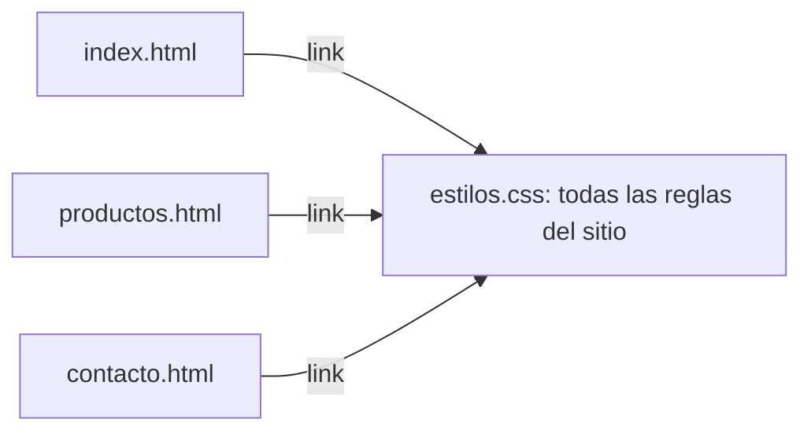
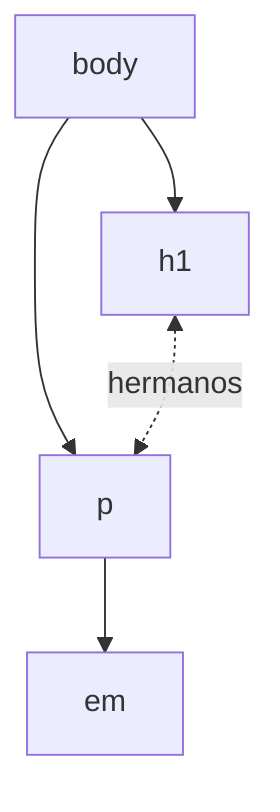
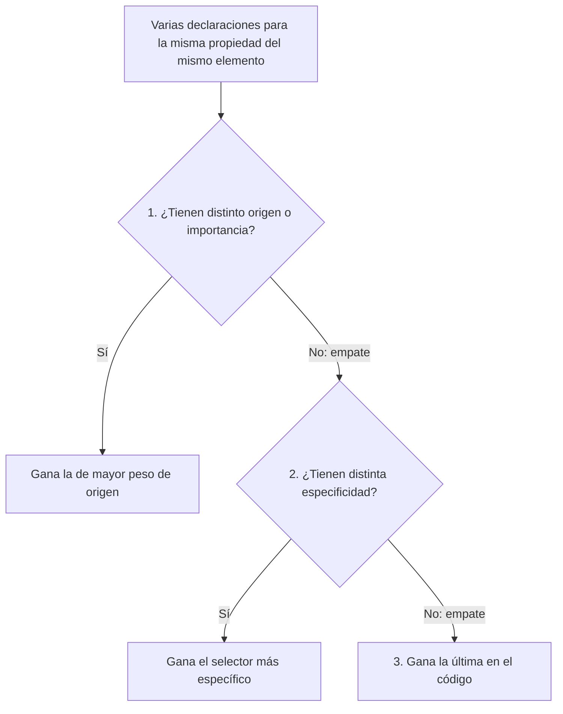
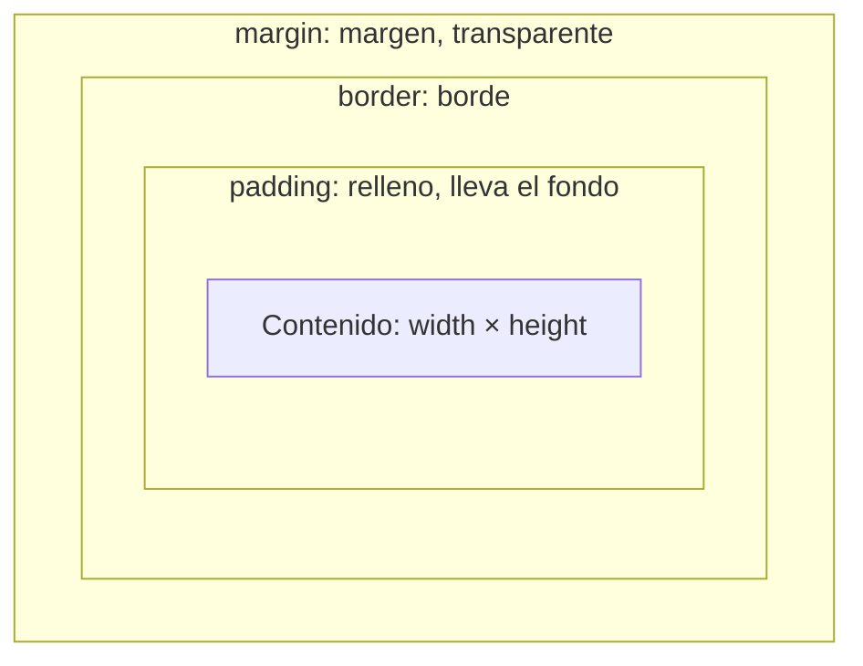
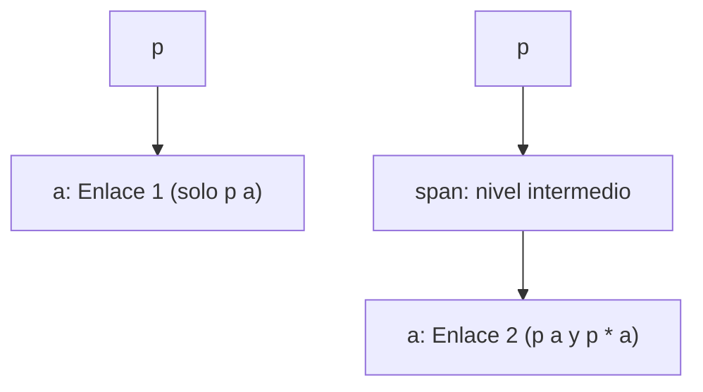
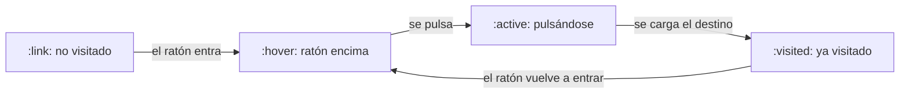
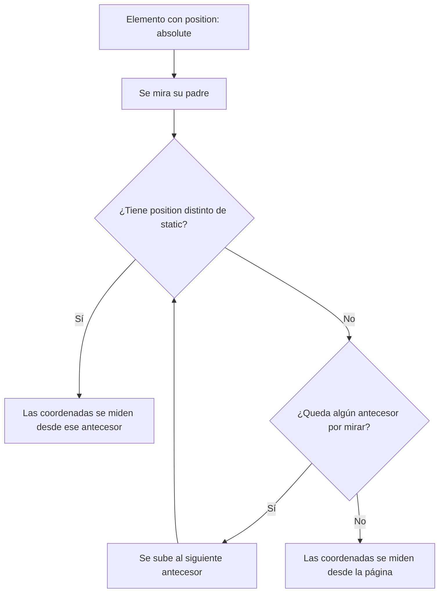

# Unidad 4. Hojas de estilos

Las hojas de estilo en cascada (CSS) separan la **presentación** de una página web de su **contenido**: el HTML dice qué es cada cosa (un título, un párrafo, una lista) y el CSS dice cómo se ve (color, tamaño, posición). Esta unidad explica cómo se escriben y se vinculan las reglas de estilo, cómo se eligen los elementos a los que se aplican, cómo se da formato al texto, a los colores y a los fondos, y cómo se colocan las cajas en la página para maquetarla.

La unidad se divide en siete partes:

1. **Introducción a CSS**: formas de añadir estilos, hojas externas, conceptos clave (herencia, cascada, bloque y en línea) y modelo de cajas.
2. **Selectores**: de elemento, contextuales, de clase e id, pseudoselectores y `!important`.
3. **Propiedades de fuente y texto.**
4. **Colores y fondos**: color, imágenes de fondo y opacidad.
5. **Flotar y posicionar**: `float`, `clear`, `position` y `z-index`.
6. **Otros elementos**: tablas, listas (menús de navegación) y formularios.
7. **Introducción a CSS3.**

> **Sobre la vigencia del temario.** El temario describe CSS 2.1 tal como se usaba hacia 2011: ejemplos en XHTML 1.0, compatibilidad con Internet Explorer 6 y maquetación con `float` y `position`. Todo eso sigue siendo CSS válido y se explica tal como lo recoge el temario. Hoy las páginas se maquetan con **Flexbox** y **Grid**, que se tratan en un tema aparte (4.5); aquí solo se mencionan en el apartado 7, lo justo para situarlas. Lo que ha cambiado se indica en recuadros **Contexto actual**; lo que no está en el temario pero hace falta para maquetar, en recuadros **Ampliación**.

---

## 1. Introducción a CSS

Las **hojas de estilo en cascada** (*Cascading Style Sheets*, CSS) son un **estándar del W3C** que define la presentación de los documentos web: cómo se muestran en un monitor, en la pantalla de un móvil, impresos o leídos por un lector de pantalla. Lo esencial es que las instrucciones de presentación se mantienen **separadas del contenido** del documento HTML.

Cada lenguaje tiene su papel:

| Lenguaje | Para qué sirve |
|---|---|
| (X)HTML | La **estructura** de la página |
| **CSS** | La **presentación** de la página |
| JavaScript | Lenguaje de script **de cliente**: páginas más interactivas |
| PHP | Lenguaje de script **de servidor**: páginas dinámicas |

> **Error frecuente**: si se quiere definir la presentación de una página web, se utiliza **CSS**, no XHTML (estructura), JavaScript ni PHP.

**Historia y versiones:**

- CSS nace del primer borrador de **Håkon Lie**, al que se une **Bert Bos**, gran impulsor del estándar.
- **CSS1** (1996): los navegadores la implementan bien desde 1999. Internet Explorer 5.0 fue el primero con soporte completo; hasta entonces, Opera era el que mejor la soportaba.
- **CSS2.1** (CSS nivel 2, revisión 1): ajustes menores a CSS2 basados en la experiencia de 1998 a 2004.
- **CSS3**: dividida en **módulos**; añade texto vertical, mejor manejo de tablas, idiomas internacionales e integración con SVG, MathML y SMIL.
- El grupo de trabajo de CSS (CSS WG) prepara también perfiles para medios concretos: CSS Mobile, CSS Print y CSS TV.

> **Contexto actual**: desde CSS3 ya no hay "CSS4" como versión única; cada módulo (selectores, colores, Flexbox, Grid…) avanza por separado con su propio nivel.

### 1.1 Añadir estilos a un documento con CSS

**Ventajas de CSS:**

- **Mayor control del diseño**: diseños fuera del alcance de HTML.
- **Menos trabajo**: se cambia el estilo de todo un sitio modificando un único archivo.
- **Documentos más pequeños**: desaparecen las etiquetas `<font>` y las tablas usadas para maquetar.
- **Documentos más estructurados**, y por tanto accesibles a más dispositivos y usuarios.
- **El HTML de presentación desaparece**: el W3C declaró obsoletos sus elementos y atributos.
- **Buen soporte** en los navegadores.

**Cómo funciona CSS**, en tres pasos:

1. Se parte de un documento HTML con una estructura lógica y semántica.
2. Se escriben las **reglas de estilo**: cada una selecciona elementos y les asigna propiedades y valores.
3. Se **vinculan** los estilos al documento.

#### Las tres formas de aplicar estilos

| Forma | Dónde se escribe | Alcance | Cuándo se usa |
|---|---|---|---|
| **Estilos en línea** | Atributo `style` de la etiqueta | Ese elemento | Ocasionalmente, para anular una regla general |
| **Hoja incrustada** | Elemento `<style>` dentro de `<head>` | Ese documento | Un único documento con su propio estilo |
| **Hoja externa** | Archivo `.css` aparte, **vinculado** con `<link>` o **importado** con `@import` | Todas las páginas que lo enlacen | Siempre que haya más de una página: es el modo más potente |

**1. Estilos en línea.** Se escriben las declaraciones en el atributo `style`:

```html
<h1 style="color: red">Esta cabecera es de color rojo</h1>
<p style="font-size: 12px; font-family: 'Trebuchet MS', sans-serif">Texto de 12 px en Trebuchet MS</p>
```

Es válido, pero **contamina el documento con presentación**; se emplea con moderación. El atributo `style` se declaró obsoleto en XHTML 1.1.

**2. Hoja de estilo incrustada.** Un bloque `<style>` en la cabecera:

```html
<!DOCTYPE html>
<html lang="es">
<head>
  <meta charset="utf-8">
  <title>Mi primera página con estilo</title>
  <style media="screen">
    p { font-size: 12px; font-weight: bold; color: #CC0066; }
  </style>
</head>
<body>
  <p>Párrafo con estilo.</p>
</body>
</html>
```

- `<style>` va siempre **dentro de `<head>`**.
- El atributo `media` indica el medio al que se aplica (pantalla, impresión…): apartado 1.2.
- En (X)HTML el atributo `type="text/css"` era obligatorio. Los navegadores muy antiguos que no entendían `<style>` mostraban su contenido como texto; para evitarlo se metían las reglas en un comentario HTML (`<!--` … `-->`).

> **Contexto actual**: en HTML5 el atributo `type` de `<style>` y de `<link>` es opcional (el valor por defecto es `text/css`) y el truco del comentario ya no hace falta. La declaración de documento es simplemente `<!DOCTYPE html>`.

**3. Hoja de estilo externa.** Todas las reglas van en un archivo de texto `.css` y cada página lo enlaza. Un cambio en ese archivo se ve en todo el sitio. El esquema muestra varias páginas de un mismo sitio vinculadas a una única hoja:



Hay dos formas de traerla:

- **Vinculada o enlazada**, con `<link>` en la cabecera:

```html
<head>
  <meta charset="utf-8">
  <title>Mi primera página con estilo</title>
  <link rel="stylesheet" href="../estilos/miestilo.css">  <!-- rel: relación; href: URL de la hoja -->
</head>
```

- **Importada**, con la regla `@import` dentro de `<style>` o de otro archivo CSS:

```html
<style>
  @import url("../estilos/miestilo.css");   /* siempre antes que cualquier otra regla */
  p { color: navy; }
</style>
```

Reglas de `@import`: las sentencias van **al principio** de la hoja, antes de cualquier otra regla, y si hay conflicto **prevalece el último archivo importado**. Con varias hojas vinculadas pasa lo mismo: se aplican **de arriba abajo**, y la última enlazada sobrescribe lo que coincida con las anteriores.

#### Sintaxis de una regla

Una **regla** es un **selector** seguido de un **bloque de declaraciones** entre llaves. Cada **declaración** es un par **propiedad: valor**, y las declaraciones se separan con punto y coma.

```css
h1 { color: #EEEEEE; }                              /* 1 selector, 1 declaración */
p  { font-size: 12px; font-family: Verdana, sans-serif; }   /* 1 selector, 2 declaraciones */
```

Anatomía de la segunda regla:

- **Selector**: `p` → a qué elementos se aplica.
- **Declaración**: `font-size: 12px;` → **propiedad** `font-size`, **valor** `12px`.
- **Bloque de declaraciones**: todo lo que va entre `{` y `}`.

Cuando una propiedad admite varios valores alternativos (como `font-family`), se separan con comas y el navegador los prueba **de izquierda a derecha**: usa Verdana y, si no está instalada, cualquier fuente sans-serif.

CSS ignora los espacios y los saltos de línea, así que la misma regla puede escribirse en una línea o en varias. En hojas largas conviene un formato consistente, una declaración por línea:

```css
p {
  font-size: 11px;
  font-weight: bold;
  color: #CC0066;
}
```

> **Analogía con Java**: el selector hace de "a quién", el bloque `{ }` agrupa como en Java y cada declaración termina en `;`. El último `;` de un bloque es opcional en CSS, pero se pone siempre: así añadir una línea nueva no rompe la anterior.

### 1.2 Hojas de estilo externas

Una hoja externa es un archivo de texto con al menos una regla y **sin ninguna etiqueta HTML**. Los comentarios se escriben así: `/* Esto es un comentario */` (en CSS no existe el comentario de línea `//` de Java).

CSS2 permite orientar una hoja a un **medio de presentación** con el atributo `media` de `<link>` o de `<style>`:

| Valor de `media` | Medio |
|---|---|
| `all` | Todos los medios |
| `braille` | Dispositivos táctiles braille |
| `embossed` | Impresoras braille |
| `handheld` | Dispositivos de mano: móviles, PDA |
| `print` | Impresoras y vista previa de impresión |
| `projection` | Proyectores |
| `screen` | Pantallas de ordenador |
| `speech` | Sintetizadores de voz |
| `tty` | Terminales de texto y teletipos |
| `tv` | Televisores y dispositivos de baja resolución |

```html
<link rel="stylesheet" href="pantalla.css" media="screen">
<link rel="stylesheet" href="impresion.css" media="print">
```

Dentro de una misma hoja, la regla **`@media`** agrupa las reglas de cada medio:

```css
@media print {
  body { font-size: 10pt; }     /* tamaño para imprimir */
}
@media screen {
  body { font-size: 13px; }     /* tamaño para pantalla */
}
p { font-family: Verdana, sans-serif; }   /* fuera de @media: para todos los medios */
```

> **Contexto actual**: hoy solo se usan `all`, `screen` y `print`; el resto de tipos están obsoletos. Para adaptar la página al tamaño de la pantalla se usan **consultas de medios** (*media queries*) con condiciones: `@media screen and (max-width: 600px) { … }` aplica esas reglas solo en pantallas de 600 px o menos. Es la base del diseño adaptable (*responsive*).

### 1.3 Conceptos clave de CSS

#### Estructura y herencia

Un documento HTML es un **árbol** de elementos, con relaciones de parentesco:

- Un elemento es **hijo** de otro si está contenido **directamente** en él; el contenedor es su **padre**.
- Los elementos con el mismo padre son **hermanos**.
- Un elemento contenido a cualquier profundidad es **descendiente**; el contenedor es su **antecesor**.

```html
<body>                       <!-- padre de h1 y de p -->
  <h1>Título</h1>            <!-- hijo de body; hermano de p -->
  <p>Texto con <em>énfasis</em>.</p>   <!-- em: hijo de p, descendiente de body -->
</body>
```

El mismo fragmento, dibujado como árbol:



`h1` y `p` son hijos de `body` y hermanos entre sí; `em` es hijo de `p` y descendiente de `body`, que es su antecesor.

Un hijo **hereda** valores de propiedades de su padre. Si se pone `body { color: navy; }`, todos los párrafos, títulos y enlaces aparecen en azul marino sin escribir una regla para cada uno.

> **Ampliación: qué se hereda y qué no.** Se heredan sobre todo las propiedades de texto: `color`, `font-*`, `line-height`, `text-align`, `text-indent`, `letter-spacing`, `list-style-*`, `visibility`. **No** se heredan las de caja y fondo: `width`, `height`, `margin`, `padding`, `border`, `background-*`, `float`, `position`, `display`. Cualquier propiedad puede forzarse a heredar con el valor `inherit`. Es lógico: si un `div` con borde heredara el borde, cada párrafo de dentro tendría otro borde.

#### Reglas en conflicto: la cascada

La **cascada** decide qué declaración gana cuando varias quieren dar formato al mismo elemento. El navegador las ordena por tres criterios, en este orden: **origen** de la hoja, **especificidad** del selector y **orden** de las reglas.

Cada criterio solo se consulta si el anterior ha empatado:



**1. Origen de la hoja**, de menor a mayor peso:

1. Hojas de estilo del navegador (los estilos por defecto: márgenes de los párrafos, `h1` grande…).
2. Hojas de estilo del lector (el usuario puede configurar las suyas).
3. Hojas de estilo del autor (quien diseña la página).
4. Declaraciones `!important` del lector.

Dentro de las hojas del autor, la jerarquía habitual es esta, de menor a mayor peso:

1. Hojas externas **vinculadas** (`<link>`).
2. Hojas externas **importadas** (`@import` dentro de `<style>`).
3. Hojas **incrustadas** (`<style>`).
4. **Estilos en línea** (atributo `style`).
5. Declaraciones marcadas con **`!important`**.

> **Contexto actual**: lo que es fijo es que los estilos en línea ganan a cualquier selector y que `!important` gana a todo. Entre una hoja vinculada y una incrustada no hay un orden fijo: tienen el mismo origen, así que decide la especificidad y, a igualdad, **la que aparece después en el documento**. Si el `<link>` se escribe después del `<style>`, gana la hoja vinculada. La lista anterior describe el caso habitual, con el `<link>` antes del `<style>`.

**2. Especificidad del selector.** Cuanto **más específico** es un selector, más peso tiene:

```css
strong    { color: red; }    /* todo strong en rojo... */
h1 strong { color: blue; }   /* ...salvo el que está dentro de un h1: azul */
```

Un `strong` dentro de un `h1` es azul: un elemento en un contexto concreto es más específico que el mismo elemento en general.

> **Ampliación: cómo se calcula la especificidad.** Se cuentan tres cifras (a, b, c) y se comparan de izquierda a derecha, como un número de tres dígitos:
>
> - **a**: número de **id** (`#menu`).
> - **b**: número de **clases**, **pseudoclases** (`:hover`) y selectores de **atributo** (`[type="text"]`).
> - **c**: número de **elementos** (`p`, `div`) y **pseudoelementos** (`::first-line`).
>
> El selector universal `*` y los combinadores (espacio, `>`, `+`) no cuentan.
>
> | Selector | a (id) | b (clase) | c (elemento) | Especificidad |
> |---|---|---|---|---|
> | `p` | 0 | 0 | 1 | 0,0,1 |
> | `div p a` | 0 | 0 | 3 | 0,0,3 |
> | `.nota` | 0 | 1 | 0 | 0,1,0 |
> | `p.nota` | 0 | 1 | 1 | 0,1,1 |
> | `#menu a` | 1 | 0 | 1 | 1,0,1 |
> | `#menu a:hover` | 1 | 1 | 1 | 1,1,1 |
>
> Un solo id gana a cualquier cantidad de clases: `#menu a` (1,0,1) gana a `.barra .lista .enlace a` (0,3,1). Por encima de todo selector están los estilos en línea y, por encima de ellos, `!important`.

**3. Orden de las reglas.** Con igual peso, **gana la última**:

```css
h1 { color: green; }
h1 { color: blue; }
h1 { color: red; }    /* los h1 salen rojos */
```

**Ejemplo resuelto de cascada.** ¿De qué color sale el enlace?

```html
<div id="menu"><a href="#" class="activo">Inicio</a></div>
```

```css
a          { color: black; }   /* 0,0,1 */
.activo    { color: green; }   /* 0,1,0 */
#menu a    { color: blue; }    /* 1,0,1  ← gana: tiene un id */
a.activo   { color: orange; }  /* 0,1,1 */
```

Sale azul. Aunque `a.activo` está escrita después, `#menu a` es más específica y el orden solo desempata entre reglas de igual especificidad.

#### Elementos de bloque y en línea

La distinción es de **presentación**:

| | Elemento de **bloque** | Elemento **en línea** |
|---|---|---|
| Saltos de línea | Genera un salto **antes y después**: empieza en una línea nueva | **No** genera saltos: va en el flujo de la línea y solo pasa a la siguiente si no cabe |
| Ancho por defecto | Todo el ancho disponible del padre | Solo el que ocupa su contenido |
| `width` y `height` | Se aplican | **No** se aplican |
| Márgenes verticales | Se aplican | No empujan a las líneas de arriba y abajo |
| Ejemplos | **`p`**, **`div`**, `h1`…`h6`, `ul`, `ol`, `dl`, `li`, `form`, `table` | **`strong`**, **`em`**, `a`, `span`, `img`, `input`, `label` |

Con la propiedad **`display`** se cambia el comportamiento de cualquier elemento: `display: block` hace que un elemento en línea se comporte como de bloque, y `display: inline`, al revés.

```css
a.boton { display: block; width: 150px; }   /* el enlace pasa a admitir ancho */
li      { display: inline; }                /* los elementos de una lista, en fila */
```

> **Error frecuente**: **inline** no es una propiedad de CSS, sino un **valor de la propiedad `display`**. Tampoco tiene nada que ver con dibujar una línea interior que bordee el elemento: lo que rodea al elemento es el **borde** (`border`, apartado 1.4.2). Por eso es falso que **la propiedad inline** haga que todos los elementos tengan una línea en la zona interior bordeando el elemento.

> **Ampliación: `inline-block`.** El valor `display: inline-block` combina las dos cosas: el elemento se coloca en la línea como uno en línea, pero admite `width`, `height`, `padding` y márgenes como uno de bloque. Es útil para botones y menús.

### 1.4 El modelo de cajas de CSS

Todo elemento de una página genera una **caja rectangular**, la **caja del elemento**. Se compone de cuatro capas, de dentro afuera:

| Capa | Propiedad | Qué es |
|---|---|---|
| **Contenido** | `width`, `height` | El núcleo: texto, imagen… |
| **Relleno** | **`padding`** | Espacio entre el contenido y el borde. **Es interior**: lleva el fondo del elemento |
| **Borde** | **`border`** | Línea que perfila el relleno |
| **Margen** | **`margin`** | Espacio alrededor del borde: **la parte más externa** del elemento. Siempre transparente |

Las cuatro capas, unas dentro de otras:



Se puede comparar con un huevo Kinder: la sorpresa es el contenido; la cápsula de plástico amarilla, el relleno; el chocolate, el borde; y el papel de aluminio, el margen.

> **Error frecuente**: **el margin es el margen exterior del objeto** (verdadero). **El padding no es el margen exterior del objeto** (falso): es el relleno, el espacio **interior** entre el contenido y el borde.

Características fundamentales:

- Relleno, borde y margen son **opcionales**: con valor 0 desaparecen.
- El color o la imagen de **fondo se extiende por el contenido y el relleno** (y bajo el borde: se ve a través de los huecos de un borde punteado).
- Los **márgenes siempre son transparentes**: a través de ellos se ve el fondo del padre.
- **`width` es el ancho del área de contenido.** El relleno, el borde y el margen **se suman** a esa cantidad.
- Cada lado (superior, derecho, inferior, izquierdo) se puede configurar por separado.

#### Cálculo del tamaño total de una caja

Es el cálculo que hay que dominar para maquetar: si las cajas no suman lo que mide su contenedor, no caben.

```css
.ficha {
  width: 300px;              /* contenido */
  padding: 20px;             /* 20 a cada lado */
  border: 2px solid #333;    /* 2 a cada lado */
  margin: 10px;              /* 10 a cada lado */
}
```

| Concepto | Cálculo | Resultado |
|---|---|---|
| Ancho del contenido | `width` | 300 px |
| Ancho visible (hasta el borde) | 300 + 20 + 20 + 2 + 2 | **344 px** |
| Espacio horizontal que ocupa | 344 + 10 + 10 | **364 px** |

La fórmula: **ancho ocupado = margin-left + border-left + padding-left + width + padding-right + border-right + margin-right**. Con el alto es igual.

> **Error frecuente**: pensar que `width: 300px` hace que la caja mida 300 px en pantalla. Con relleno y borde mide más. Si se quiere que una caja ocupe 300 px en total con 20 px de relleno y 2 px de borde, el `width` tiene que ser 300 − 40 − 4 = 256 px.

> **Contexto actual**: con `box-sizing: border-box` (CSS3, apartado 7) el `width` pasa a incluir relleno y borde, y la caja mide exactamente lo que dice `width`. Hoy muchas hojas empiezan con `* { box-sizing: border-box; }`. El comportamiento por defecto, el que describe el temario, es `box-sizing: content-box`.

#### Valores abreviados: el orden de las agujas del reloj

`padding`, `margin`, `border-width`, `border-style` y `border-color` admiten de uno a cuatro valores. Con cuatro, el orden es **top right bottom left** (arriba, derecha, abajo, izquierda): el sentido de las **agujas del reloj empezando en las 12**. Si faltan valores, se copian del lado opuesto:

| Valores | Ejemplo | Significado |
|---|---|---|
| 4 | `padding: 3px 20px 5px 10px;` | arriba 3, derecha 20, abajo 5, izquierda 10 |
| 3 | `padding: 3px 20px 5px;` | arriba 3, derecha **e izquierda** 20, abajo 5 (la izquierda copia a la derecha) |
| 2 | `padding: 3px 20px;` | arriba **y abajo** 3, derecha **e izquierda** 20 |
| 1 | `padding: 3px;` | 3 en los cuatro lados |

> **Error frecuente**: el orden es **top right bottom left**, no "top bottom right left" ni "left right top bottom". Con dos valores, el primero es el **vertical** (arriba y abajo) y el segundo el **horizontal**, al revés de las coordenadas (x, y) habituales.

Cada lado tiene también su propiedad individual: `padding-top`, `padding-right`, `padding-bottom`, `padding-left`, y lo mismo con `margin-*` y `border-*`.

#### 1.4.1 Área de contenido y relleno

**Área de contenido.** Su tamaño se fija con `width` (ancho) y `height` (alto), y se puede acotar con `min-width`, `max-width`, `min-height` y `max-height`:

```css
div.aviso { width: 100px; height: 200px; }
img       { max-width: 100%; }   /* la imagen nunca supera el ancho de su contenedor */
```

**Relleno (`padding`).** Espacio opcional entre el contenido y el borde. Conviene ponerlo siempre que hay borde, para que el texto no quede pegado a él.

- Su valor **se suma** al `width`.
- Tiene **el mismo fondo** que el área de contenido.
- **Nunca se colapsa** (los márgenes sí: 1.4.3).

```css
h1 { padding: 4px 10px; background: #ccc; }   /* el gris cubre texto y relleno */
```

#### 1.4.2 Bordes

El borde es una línea alrededor del contenido y del relleno. Tres propiedades lo definen:

| Propiedad | Qué fija | Valores | Valor por defecto |
|---|---|---|---|
| **`border-style`** | El estilo | `none`, `hidden`, `dotted`, `dashed`, `solid`, `double`, `groove`, `ridge`, `inset`, `outset`, `inherit` | **`none`** |
| `border-width` | El grosor | `thin`, `medium`, `thick` o una longitud (`2px`) | `medium` |
| `border-color` | El color | Cualquier color | El valor de `color` del elemento (el color del texto) |

**`border-style` es la más importante: sin ella el borde no existe**, porque su valor por defecto es `none`.

```css
div.a { border-width: 1px; }                      /* NO se ve nada: el estilo es none */
div.b { border-width: 1px; border-style: solid; } /* borde sólido de 1 px, del color del texto */
```

> **Error frecuente**: si **a un contenedor le configuramos un borde de 1 píxel de ancho**, **no adquiere por defecto el estilo solid**. El estilo por defecto es `none` y el borde no aparece hasta que se le da un estilo.

Las tres admiten de uno a cuatro valores con el orden de las agujas del reloj:

```css
div { border-style: solid dashed dotted double; }  /* arriba sólido, derecha discontinuo, abajo punteado, izquierda doble */
div { border-style: solid; border-width: thin medium thick 12px; }
div { border-style: solid; border-width: 4px; border-color: #333 red rgb(0,0,255) #0044AC; }
```

**La propiedad abreviada `border`** reúne estilo, grosor y color, **en cualquier orden**, y configura los **cuatro lados por igual**. Para un solo lado: `border-top`, `border-right`, `border-bottom`, `border-left`.

```css
h1 { border: .5em solid blue; }
h2 { border-left: solid blue .5em; }   /* solo a la izquierda */
h3 { border-right: solid .5em; }       /* sin color: toma el del texto */
#pie { border-top: 1px solid #C5C5C5; border-bottom: 1px solid #C5C5C5; }
```

> **Error frecuente**: `border: 1px #000;` no dibuja nada, por la misma razón: falta el estilo. La forma segura es escribir siempre los tres valores: `border: 1px solid #000;`.

#### 1.4.3 Márgenes

El margen (`margin`) es el espacio alrededor del borde. Sigue la misma lógica que `padding` (uno a cuatro valores, agujas del reloj, `margin-top`…). A diferencia del relleno, admite **valores negativos** y el valor **`auto`**.

**Colapso de márgenes.** Los márgenes **verticales** (top y bottom) de dos elementos de bloque seguidos **se colapsan**: entre ellos queda solo **el mayor** de los dos, no la suma.

```css
h1 { margin: 10px 20px 10px 20px; }   /* margen inferior: 10 */
h2 { margin: 20px; }                  /* margen superior: 20 */
/* espacio entre un h1 y el h2 que le sigue: 20 px, no 30 */
```

Los márgenes **horizontales** (left y right) de dos elementos colocados uno al lado del otro (dos `span`, dos cajas flotantes) **no se colapsan: se suman**.

**Centrar una caja con `margin: auto`.** Una caja de bloque con `width` fijo se centra horizontalmente en su contenedor con márgenes laterales automáticos:

```css
#pagina { width: 800px; margin: 0 auto; }   /* 0 arriba y abajo; auto a los lados → centrada */
```

> **Error frecuente**: `margin: auto` no centra una caja sin `width` (ya ocupa todo el ancho) ni un elemento en línea. Para centrar el **texto** dentro de una caja se usa `text-align: center`, no márgenes.

---

## 2. Selectores

El **selector** es la parte de la regla que identifica a qué elementos se aplica. Elegir bien el selector permite escribir menos reglas y no tocar el HTML.

Resumen de todos los selectores de la unidad:

| Selector | Ejemplo | Selecciona |
|---|---|---|
| Elemento | `p` | Todos los párrafos |
| Universal | `*` | Todos los elementos |
| Grupo | `h1, h2, p` | Los h1, los h2 y los p |
| Descendiente (espacio) | `li em` | Los `em` contenidos a cualquier profundidad en un `li` |
| Hijo (`>`) | `p > em` | Los `em` hijos **directos** de un `p` |
| Adyacente (`+`) | `h1 + p` | El `p` que va **justo después** de un `h1`, con el mismo padre |
| Clase | `.nota` | Los elementos con `class="nota"` |
| Elemento con clase | `p.nota` | Los **párrafos** con `class="nota"` |
| Id | `#pie` | El elemento con `id="pie"` |
| Elemento con id | `div#pie` | El **div** con `id="pie"` |
| Pseudoclase | `a:hover` | Los enlaces con el ratón encima |
| Pseudoelemento | `p::first-line` | La primera línea de cada párrafo |

### 2.1 Selectores de elemento

Se aplican a todas las apariciones de una etiqueta HTML. Se escribe el nombre de la etiqueta:

```css
h4   { color: navy; }    /* todos los encabezados de tamaño 4 */
form { border: 1px solid #ccc; }   /* todos los formularios del documento */
```

Así, el selector que selecciona **todos los encabezados de tamaño 4** es **`h4`**, y el que selecciona **todos los formularios** de un documento es **`form`**.

**Grupos de selectores.** Si varias reglas tienen las mismas declaraciones, se agrupan separando los selectores **con comas**:

```css
h1 { color: blue; }
h2 { color: blue; }
p  { color: blue; }
/* equivale a: */
h1, h2, p { color: blue; }
```

El selector que selecciona **todos los enlaces y todos los párrafos**, escrito **sin espacios**, es **`a,p`**. El espacio tras la coma es opcional (`a, p` es igual), pero un espacio **sin coma** cambia por completo el significado (`a p` es un descendiente: 2.2).

**Selector universal (`*`)**: selecciona todos los elementos.

```css
* { color: grey; }   /* todo en gris, salvo lo que tenga otro color más específico */
```

### 2.2 Selectores contextuales

Seleccionan elementos según su **posición en el árbol** respecto a otros. Hay tres tipos: **descendente**, **hijo** y **hermano adyacente**.

#### Selector descendente (espacio)

Se escriben los selectores separados por **un espacio**: el último es el que recibe el estilo y los anteriores son sus antecesores, **a cualquier profundidad**.

```css
li em   { color: blue; }     /* em dentro de un li, a cualquier nivel */
ol a em { color: yellow; }   /* em dentro de un a que está dentro de una ol */
```

Ejemplos de construcción:

| Se quiere seleccionar | Selector |
|---|---|
| **Todos los párrafos contenidos en una tabla** | **`table p`** |
| **Todas las imágenes y todos los enlaces que estén dentro de una tabla** | **`table img,table a`** |
| **Todos los enlaces contenidos dentro de un párrafo que se encuentre además dentro de un contenedor** (`div`) | **`div p a`** |
| **Todos los elementos de una lista ordenada con id nueva** | **`ol#nueva li`** |

> **Error frecuente**: `table img, a` no es lo mismo que `table img, table a`. La coma separa selectores **completos**: `table img, a` son las imágenes de las tablas **y todos los enlaces de la página**. El contexto `table` hay que repetirlo en cada parte del grupo.

**Combinado con el universal.** El asterisco en medio exige **al menos un nivel intermedio**:

```html
<p><a href="#">Enlace 1</a></p>                <!-- a hijo directo de p -->
<p><span><a href="#">Enlace 2</a></span></p>   <!-- a dentro de un span dentro de p -->
```

```css
p a   { color: red; }   /* los dos enlaces */
p * a { color: red; }   /* solo el Enlace 2: entre p y a tiene que haber algún elemento */
```

En el árbol se ve la diferencia: el Enlace 1 cuelga directamente del `p`; el Enlace 2 tiene el `span` en medio, que es el nivel que exige el `*`.



**Todos los objetos contenidos dentro de un formulario**: el universal como descendiente.

```css
form     { border: 1px solid #999; }   /* el propio formulario */
form > * { margin: 5px; }            /* solo los hijos directos del formulario */
form *   { color: #333; }                /* todos los elementos que hay dentro, a cualquier profundidad */
```

> **Error frecuente**: `form` selecciona **el formulario**, no lo que contiene; `form > *` solo sus **hijos directos** (si un `input` está dentro de un `fieldset` o de un `p`, se queda fuera). Para **todos los objetos contenidos** se usa **`form *`**.

#### Selector hijo (`>`)

Es un caso concreto de descendiente: el elemento tiene que estar contenido **directamente**, sin niveles intermedios.

```css
p > em { background-color: gray; }   /* em hijo directo de p */
div > p { margin: 0; }               /* párrafos hijos directos de un contenedor */
```

Los **párrafos que sean hijos directos de un contenedor** se seleccionan con **`div > p`**.

Se puede combinar con descendientes y clases. **Los hiperenlaces hijos directos de un párrafo y contenidos en un contenedor que emplee la clase nueva**:

```css
div.nueva p > a { font-weight: bold; }
```

Se lee de derecha a izquierda: un `a` → hijo directo (`>`) de un `p` → que está (espacio) dentro de un `div` de clase `nueva`. El selector completo es **`div.nueva p > a`**.

#### Selector hermano adyacente (`+`)

Selecciona un elemento que va **inmediatamente después** de otro en el código **y comparte con él el mismo padre**. Recibe el estilo el segundo.

```css
h1 + p { color: blue; }   /* el primer párrafo que sigue a cada h1 */
```

Para seleccionar los elementos **h1 y párrafos que sean hermanos** (el párrafo que sigue a un h1) se escribe **`h1 + p`**.

**Ejemplo resuelto.** Con la regla `h2+p { color: green; }` y este cuerpo:

```html
<body>
  <h1>Título 1</h1>
  <h2>Subtítulo 1</h2>
  <p>Párrafo 1</p>
  <h2>Subtítulo 2</h2>
  <p>Párrafo 2</p>
</body>
```

Salen en verde **Párrafo 1 y Párrafo 2**: los dos `p` comparten padre (`body`) con los `h2`, y cada uno va justo detrás de un `h2`. Los `h2` no cambian: el estilo se aplica al **segundo** elemento del selector, no al primero.

> **Ampliación: hermano general (`~`).** `h2 ~ p` selecciona **todos** los párrafos que van después de un `h2` con el mismo padre, no solo el inmediato.

### 2.3 Selectores de clase e id

#### Identificadores (`id`)

El atributo `id` identifica a un elemento **de forma única**: **un id no puede repetirse en el documento**. Se usa para las secciones principales: cabecera, menú, contenido, pie. En CSS se escribe **almohadilla (`#`) + nombre**:

```html
<p id="textocabecera">Bienvenidos</p>
```

```css
p#textocabecera { font-size: 14px; }   /* el párrafo con ese id */
#textocabecera  { font-size: 14px; }   /* lo mismo: el id ya es único */
```

#### Clases (`class`)

El atributo **`class`** es el que se usa en una marca HTML para que **emplee una determinada clase CSS**. Agrupa elementos que comparten estilo; una clase **sí puede repetirse** y un elemento puede tener **varias clases separadas por espacios**. En CSS se escribe **punto (`.`) + nombre**:

```html
<h1 class="especial">¡Atención!</h1>
<p class="especial">Hoy hay rebajas.</p>
<p class="textocabecera especial">Este párrafo tiene dos clases.</p>
```

```css
.especial   { color: green; }   /* todo lo que tenga la clase especial... */
h1.especial { color: red; }     /* ...salvo los h1, que van en rojo (más específico) */
```

| | `id` | `class` |
|---|---|---|
| Símbolo en CSS | `#` | `.` |
| ¿Se repite en la página? | **No**: único | Sí |
| ¿Varios por elemento? | No | Sí, separados por espacios |
| Especificidad | Alta (1,0,0) | Media (0,1,0) |
| Uso típico | Zonas únicas: `#cabecera`, `#pie` | Estilos reutilizables: `.destacado`, `.boton` |

Los nombres de clases e identificadores **no pueden contener espacios**.

> **Analogía con Java**: un `id` es como el identificador único de un objeto concreto; una `class` es como una etiqueta que se pega a varios objetos para tratarlos igual. No tiene nada que ver con las clases de Java.

#### Pegado o separado: la diferencia que lo cambia todo

Un **espacio** entre un elemento y una clase o id significa "**dentro de**"; **sin espacio** significa "**que es a la vez**".

| Selector | Significado |
|---|---|
| **`.nuevo`** | **Todos los objetos que empleen la clase nuevo** |
| **`p.tronic`** | **Los párrafos que empleen la clase tronic** |
| **`#nuevo`** | **Todos los objetos con id=nuevo** |
| **`table#nuevo`** (sin espacio) | **Una tabla que tenga como id=nuevo** |
| **`table #nuevo`** (con espacio) | **Todos los objetos con id=nuevo y que estén contenidos en una tabla** |
| **`div table#nuevo`** | **Una tabla con id=nuevo que esté dentro de un contenedor** |
| **`table .nuevo`** (con espacio) | **Todos los objetos con class="nuevo" que están contenidos en una tabla** |
| `table.nuevo` (sin espacio) | Las tablas que pertenecen a la clase nuevo |
| **`p#viejo p.nuevo`** | **Un párrafo que emplee la clase nuevo y que esté contenido en otro párrafo con id=viejo** |

> **Error frecuente**: `table#nuevo` y `table #nuevo` se distinguen solo por un espacio. Sin espacio es **la propia tabla** cuyo id es nuevo; con espacio, **un elemento cualquiera** con id nuevo **que está dentro** de una tabla (una celda, un párrafo, una imagen). Igual con las clases: `table.nuevo` son tablas de clase nuevo, y `table .nuevo`, lo que hay dentro de una tabla con esa clase. Y `table#nuevo` usa la almohadilla, que es de id, no de clase.

> **Error frecuente**: el selector `p#viejo p.nuevo` es sintácticamente correcto, pero en HTML un párrafo **no puede contener** otro párrafo: el navegador cierra el primero al encontrar el segundo `<p>`, así que en una página real esa regla no se cumple nunca. Es un ejercicio de construcción de selectores, no un patrón de uso.

### 2.4 Pseudoselectores

Sirven para dar estilo a **estados** o **partes** de un elemento que no tienen etiqueta propia: un enlace visitado, la primera letra de un párrafo. Hay dos tipos:

| | **Pseudoclase** | **Pseudoelemento** |
|---|---|---|
| Qué selecciona | Un elemento **en un estado** o situación | **Una parte** de un elemento, o contenido generado |
| Sintaxis | **Un** signo de dos puntos: `a:hover` | **Dos** signos de dos puntos en CSS3: `p::first-line` (CSS2 usaba uno) |
| Ejemplos | `:link`, `:visited`, `:hover`, `:active`, `:focus`, `:first-child`, `:lang()`, `:nth-child()` | `::first-line`, `::first-letter`, `::before`, `::after`, `::marker` |

#### Pseudoclases

**Estados de un enlace.** Las cuatro pseudoclases de los enlaces:

| Pseudoclase | Estado del enlace |
|---|---|
| `:link` | No visitado todavía |
| `:visited` | Ya visitado |
| `:hover` | Con el ratón encima |
| `:active` | En el momento de pulsarlo |

```css
a:link    { color: red; text-decoration: none; }        /* sin subrayado... */
a:visited { color: blue; text-decoration: none; }
a:hover   { color: red; text-decoration: underline; }   /* ...que aparece al pasar el ratón */
a:active  { color: maroon; }
```

Un enlace pasa por estos estados al usarlo:



Se escriben **siempre en este orden: `:link`, `:visited`, `:hover`, `:active`** (LVHA). Las cuatro tienen la misma especificidad, así que gana la última: si `:hover` fuera antes de `:visited`, un enlace visitado no cambiaría al pasar el ratón.

Ejemplos de construcción:

- **Todos los enlaces visitados de un documento**: **`a:visited`**.
- **Todos los enlaces contenidos en un párrafo con id=nuevo cuando pasemos el ratón por encima**: **`p#nuevo a:hover`**.

**Otras pseudoclases:**

```css
input:focus { background-color: yellow; }   /* el campo que tiene el foco (el cursor) */
ul li:first-child { font-weight: bold; }    /* el primer elemento de cada lista */
p:lang(en) { color: red; }                  /* párrafos en inglés (atributo lang="en") */
```

Los **campos de tipo input cuando se pone el foco en ese campo** se seleccionan con **`input:focus`**. `:hover` y `:focus` no son exclusivas de los enlaces: valen para cualquier elemento (`tr:hover`, `li:hover`, `textarea:focus`).

> **Ampliación: `:nth-child()`** (CSS3). Selecciona elementos según su **posición entre sus hermanos**, empezando a contar en 1. Admite un número (`:nth-child(3)`), las palabras `odd` (impares) y `even` (pares), o una fórmula **an+b**, donde n toma los valores 0, 1, 2, 3…
>
> | Selector | n = 0 | n = 1 | n = 2 | n = 3 | Selecciona |
> |---|---|---|---|---|---|
> | `p:nth-child(2n)` | 0 | 2 | 4 | 6 | Los pares (igual que `even`) |
> | `p:nth-child(2n+1)` | 1 | 3 | 5 | 7 | Los impares (igual que `odd`) |
> | `p:nth-child(3n+3)` | 3 | 6 | 9 | 12 | El 3, 6, 9, 12, 15 |
> | `p:nth-child(3n+4)` | 4 | 7 | 10 | 13 | El 4, 7, 10, 13 (el 16 ya no existe si hay 15) |
>
> Así, en un `main` con 15 párrafos, los párrafos **4, 7, 10 y 13** se seleccionan con **`main p:nth-child(3n+4)`**. Las otras formas fallan: `main+p:nth-child(4n+3)` usa el adyacente (`+`, el párrafo **después** de `main`, no dentro) y otra fórmula; `p:nth-child(3n+3)` da 3, 6, 9…; y `main,p:nth-child(3n+4)` es un **grupo** (la coma): selecciona el `main` entero **y** esos párrafos de cualquier parte.
>
> Ojo: `:nth-child` cuenta **todos** los hermanos, sean del tipo que sean. Si dentro del `main` hubiera un `h2` antes de los párrafos, este contaría como hijo 1. Para contar solo los de un tipo se usa `:nth-of-type()`. Otras de la misma familia: `:last-child`, `:first-of-type`, `:not(selector)`.

#### Pseudoelementos

Seleccionan una **parte** de un elemento o crean contenido nuevo:

```css
p::first-line                { letter-spacing: 6pt; }               /* primera línea de cada párrafo */
p.definicion::first-letter   { font-size: 300%; color: red; }       /* letra capital */
p.incompleto::after          { content: " continuará..."; }         /* añade texto al final */
p.nota::before               { content: "Nota: "; font-weight: bold; }
```

`::before` y `::after` necesitan siempre la propiedad `content`, aunque sea vacía (`content: "";`).

> **Ampliación: `::marker`.** **El pseudoelemento `::marker` permite aplicar estilo a los símbolos de una lista** (las viñetas o los números):
>
> ```css
> li::marker { color: #C0392B; font-weight: bold; }   /* viñetas naranjas sin tocar el texto */
> ```
>
> Admite pocas propiedades: color, fuente y `content`, entre otras.

> **Error frecuente**: `::marker` es un **pseudoelemento**, no una pseudoclase. Llamarlo pseudoclase es un error aunque lo demás sea cierto: los dos signos de dos puntos (`::`) marcan siempre un pseudoelemento.

### 2.5 La palabra clave `!important`

`!important` da **prioridad máxima** a una declaración: gana a cualquier otra que afecte al mismo elemento, sea cual sea la especificidad o el orden.

```css
#principal { width: 800px; width: 1200px; }               /* gana la última: 1200 px */
#principal { width: 800px !important; width: 1200px; }    /* gana la marcada: 800 px */
```

Se puede usar como recurso de depuración: si un párrafo sale de un color inesperado y no se encuentra qué regla lo provoca, `p { color: black !important; }` lo fuerza.

> **Contexto actual**: abusar de `!important` se considera mala práctica, porque rompe la cascada y obliga a añadir más `!important` para corregirlo. Para encontrar qué regla aplica un estilo se usa el inspector del navegador (F12 → pestaña Elementos → panel Estilos), que muestra todas las reglas que afectan al elemento y tacha las que pierden.

---

## 3. Propiedades de fuente y texto

### 3.1 Propiedades de fuente

| Propiedad | Qué controla | Valores |
|---|---|---|
| `font-family` | La tipografía | Lista de fuentes separadas por comas, terminada en una **familia genérica** |
| `font-size` | El tamaño | Palabra clave, longitud o porcentaje |
| `font-weight` | El grosor (negrita) | `normal`, `bold`, `bolder`, `lighter`, `100` … `900` |
| `font-style` | La cursiva | `normal`, `italic`, `oblique` |
| `font-variant` | Versalitas | `normal`, `small-caps` (mayúsculas de tamaño menor) |
| `font` | Todo lo anterior en una declaración | Ver más abajo |

**`font-family`.** La fuente tiene que estar **instalada en el equipo del usuario**; si no lo está, se prueba la siguiente de la lista. Por eso se termina siempre con una **familia genérica**: `serif` (con remates), `sans-serif` (sin remates), `monospace` (ancho fijo), `cursive` o `fantasy`. Los nombres con espacios van entre comillas.

```css
h1           { font-family: Arial; }
#cabecera    { font-family: Courier, monospace; }
p.articulo   { font-family: "Trebuchet MS", Verdana, sans-serif; }
```

**`font-size`.** Cuatro formas de indicar el tamaño:

- **Absoluta**, con palabras clave: `xx-small`, `x-small`, `small`, `medium`, `large`, `x-large`, `xx-large`.
- **Relativa** al tamaño del padre: `smaller`, `larger`.
- Con una **longitud**: `15px`, `1.2em`.
- Con un **porcentaje**: `90%`.

**`font-weight`**: `normal` equivale a `400` y `bold` a `700`.

#### Unidades de medida

Una medida se escribe con un signo opcional, un número (con **punto** decimal) y la unidad, **todo junto, sin espacios**: `12px`, `-0.5em`, `1.4em`. Con valor 0 la unidad puede omitirse.

| Unidad | Nombre | Qué es | Uso en pantalla |
|---|---|---|---|
| `mm`, `cm`, `in` | Milímetro, centímetro, pulgada | Medidas físicas | No |
| `pt` | Punto | 1/72 de pulgada | No (sí en hojas de impresión) |
| `pc` | Pica | 12 puntos | No |
| **`px`** | **Píxel** | Punto de la pantalla | **Sí** |
| `em` | Em | Relativa al tamaño de letra (`font-size`) | **Sí** |
| `ex` | Ex | Altura de la letra x minúscula | Poco |
| `%` | Porcentaje | Relativo a un valor de referencia | **Sí** |

Para dar una medida **en píxeles** se emplea como unidad **px**.

**Unidades relativas, con precisión:**

- **`em`** en `font-size` es relativa al tamaño de letra **del padre**; en cualquier otra propiedad (`padding: 1em`), al tamaño de letra **del propio elemento**. Si el navegador usa 16 px por defecto y nada lo cambia, `1em` = 16 px y `0.9em` = 14,4 px.
- **`%`** en `font-size` es relativo al tamaño de letra del padre; en `width`, al **ancho del contenedor**.

```css
body { font-size: 100%; }    /* respeta el tamaño que el usuario tiene configurado */
h1   { font-size: 2.5em; }   /* 2,5 veces el tamaño de su padre */
p    { font-size: 0.9em; }
#lateral { width: 25%; }     /* la cuarta parte del ancho del contenedor */
```

Se recomienda **un tamaño base en porcentaje** y **`em` para cada elemento**: así la página respeta el tamaño de letra que cada usuario ha configurado en su navegador (accesibilidad).

> **Error frecuente**: `em` se acumula. Si `ul { font-size: 0.8em; }` y hay una lista dentro de otra, la interior sale al 0,8 × 0,8 = 0,64 del tamaño original.

> **Contexto actual**: la unidad **`rem`** (*root em*) es relativa al tamaño de letra del elemento raíz (`html`) y no se acumula; hoy es la más usada para tamaños de texto. También existen `vw` y `vh` (1 % del ancho y del alto de la ventana).

#### La propiedad abreviada `font`

Reúne las propiedades de fuente y el interlineado en una sola declaración:

`font: [font-style || font-variant || font-weight] font-size[/line-height] font-family`

- Las tres primeras son **opcionales** y pueden ir en cualquier orden entre sí.
- **`font-size` y `font-family` son obligatorios**, y en ese orden: primero el tamaño, al final la familia.
- `line-height` es opcional y va pegado al tamaño con una barra (`/`).
- Si falta el tamaño o la familia, o se intercambian, **la declaración entera es incorrecta y se ignora**.

```css
p { font: 12px Arial; }
p { font: italic small-caps bold 12px Arial; }
p { font: oblique small-caps 900 12px/14px Arial; }
p { font: 80% sans-serif; }
p { font: bold italic large Palatino, serif; }
p { font: x-large/110% "New Century Schoolbook", serif; }
p { font: bold Arial; }   /* INCORRECTA: falta el tamaño → se ignora entera */
```

**Ejemplo resuelto.** Se quiere una fuente base para toda la página de **color negro**, **Arial**, con un tamaño **0.9 veces** la letra por defecto del navegador y un **espaciado entre líneas de 1,4**. Estas cuatro reglas lo consiguen, y **las cuatro son correctas**:

```css
body { font: 0.9em/1.4 Arial, Helvetica, sans-serif; color: #000; }   /* a */
body { font: 0.9em/1.4 Arial, sans-serif; color: #000; }              /* b */
body { color: #000; font: .9em/1.4 Arial; }                           /* c */
body { font: .9em/1.4 Arial; color: #000; }                           /* d */
```

- Todas llevan tamaño y familia en el orden correcto, y el interlineado con la barra.
- Las fuentes alternativas (Helvetica, sans-serif) son una precaución, no una obligación: Arial está en casi todos los equipos.
- `.9em` es igual que `0.9em`: el cero a la izquierda del punto decimal se puede omitir.
- El orden de las **declaraciones** dentro del bloque (`color` antes o después de `font`) no importa.
- El color va aparte porque `font` no incluye el color.

> **Error frecuente**: `font` restablece a su valor por defecto todo lo que no se escribe. `p { font-weight: bold; font: 12px Arial; }` deja el párrafo **sin negrita**: el `font` posterior vuelve a poner `font-weight: normal`.

> **Ampliación: fuentes web con `@font-face`.** Para usar una tipografía que el usuario no tiene, se descarga junto con la página. La regla **`@font-face`** declara la fuente y dónde está el archivo; después se usa en `font-family` como cualquier otra:
>
> ```css
> @font-face {
>   font-family: "Lobster";                            /* nombre que se le da */
>   src: url("fuentes/lobster.woff2") format("woff2");  /* archivo en el servidor */
> }
> h1 { font-family: "Lobster", cursive; }
> ```
>
> Por eso, para incorporar una nueva fuente a una página **no hace falta que esté instalada en el sistema operativo** del usuario: el navegador la descarga del servidor. Servicios como Google Fonts generan estas reglas. No se confunda con `font-style` ni con `font-variant`, que son propiedades normales, ni con `@fontface` (sin guion), que no existe.

### 3.2 Propiedades de texto

| Propiedad | Qué hace | Valores habituales |
|---|---|---|
| `text-decoration` | Subrayado y otros efectos | `none`, `underline`, `overline` (línea encima), `line-through` (tachado), `blink` (parpadeo, obsoleto) |
| `text-transform` | Mayúsculas y minúsculas | `none`, `capitalize` (inicial de cada palabra), `uppercase`, `lowercase` |
| `text-align` | Alineación horizontal del texto en su caja | `left`, `right`, `center`, `justify` |
| `line-height` | Interlineado: distancia entre líneas | Número (factor), longitud o porcentaje |
| `text-indent` | Sangría de la **primera línea** | Longitud o porcentaje del ancho del padre; admite negativos |
| `letter-spacing` | Espacio entre letras | Longitud; positiva separa, negativa junta |
| `word-spacing` | Espacio entre palabras | Longitud |
| `white-space` | Tratamiento de los espacios | `normal` (se colapsan), `pre` (se respetan, como `<pre>`), `nowrap` (sin salto automático de línea) |

```css
p   { line-height: 1.4; }      /* 1,4 veces el font-size (forma recomendada: sin unidad) */
p   { line-height: 14pt; }     /* distancia fija */
p   { text-indent: 20px; }     /* sangría de primera línea */
p   { text-indent: -12px; }    /* sangría negativa: la primera línea sobresale */
h2  { text-transform: uppercase; letter-spacing: 2px; }
a   { text-decoration: none; } /* quita el subrayado de los enlaces */
.precio { white-space: nowrap; }   /* "12,50 €" nunca se parte en dos líneas */
```

> **Truco de maquetación**: si `line-height` vale lo mismo que la altura de una caja de una sola línea, el texto queda **centrado verticalmente**. Es lo que se hace en los botones de los menús: `height: 40px; line-height: 40px;`.

---

## 4. Los colores y los fondos

**Cinco formas de indicar un color:**

| Forma | Ejemplo (azul puro) |
|---|---|
| Palabra clave | `blue` |
| Color del sistema (obsoleto) | `ButtonFace`, `Window` |
| Hexadecimal | `#0000FF` |
| Hexadecimal simplificado (cada cifra se duplica) | `#00F` (= `#0000FF`) |
| RGB decimal (0 a 255) | `rgb(0, 0, 255)` |
| RGB porcentual (0 % a 100 %) | `rgb(0%, 0%, 100%)` |

El hexadecimal `#RRGGBB` da dos cifras a cada canal (rojo, verde, azul), de `00` a `FF` (0 a 255). `#333333` = `#333` es un gris oscuro; `#666666` = `#666`, un gris medio.

Las **16 palabras clave** de CSS 2: `aqua`, `black`, `blue`, `fuchsia`, `gray`, `green`, `lime`, `maroon`, `navy`, `olive`, `purple`, `red`, `silver`, `teal`, `white` y `yellow`.

> **Contexto actual**: hoy hay 148 nombres de color (`orange`, `tomato`, `steelblue`…) y CSS3 añade `rgba()`, `hsl()` y `hsla()` (apartado 7).

### 4.1 Color del primer plano y del fondo

| Propiedad | Qué colorea |
|---|---|
| `color` | El **primer plano**: el texto y, por defecto, el borde |
| `background-color` | El **fondo** (contenido y relleno) |

```css
body { color: #333; background-color: #fff; }   /* color del texto de todo el documento */
p    { color: #0000FF; }
p    { color: #00F; }
p    { color: rgb(0, 0, 255); }
p    { color: rgb(0%, 0%, 100%); }
p    { color: gray; }
p.aviso { padding: 5px; background-color: #ccc; }
```

- Para dar color al texto de **todo el documento**, se pone `color` en el selector `body` (se hereda).
- Si se da `color` a una imagen, la imagen no cambia; afecta a su borde.
- `border-color` tiene prioridad sobre `color` para el borde.
- Los colores en los controles de formulario no se aplicaban igual en todos los navegadores antiguos.

**El fondo no se hereda**, pero su valor por defecto es **`transparent`**: si un hijo no tiene fondo propio, a través de él se ve el del padre. El efecto parece herencia, pero no lo es.

### 4.2 Imágenes de fondo

| Propiedad | Qué hace | Valores |
|---|---|---|
| `background-image` | Pone una imagen de fondo | `url(ruta)`, `none` |
| `background-repeat` | Cómo se repite (mosaico) | `repeat` (por defecto: en las dos direcciones), `repeat-x` (horizontal), `repeat-y` (vertical), `no-repeat` (una vez) |
| `background-position` | Dónde se coloca la primera imagen | Palabras (`left`, `right`, `top`, `bottom`, `center`), longitudes o porcentajes |
| `background-attachment` | Si se desplaza con la página | `scroll` (por defecto), `fixed` (se queda fija al hacer scroll) |
| **`background`** | **Todo lo anterior y el color**, en una sola declaración | Cualquier combinación, en cualquier orden |

```css
body       { background-image: url(fondo.gif); }
div#cuerpo { background-image: url(fondo.gif); background-repeat: no-repeat; }
div.franja { background-image: url(degradado.png); background-repeat: repeat-x; }  /* tira horizontal */
body {
  background-image: url(logo.gif);
  background-position: top center;   /* arriba en el centro */
  background-repeat: no-repeat;
}
body { background-image: url(logo.gif); background-position: 150px 150px; background-repeat: no-repeat; }
body { background-image: url(logo.gif); background-position: 50% 50%; background-repeat: no-repeat; }  /* centrada */
```

**`background-position`:**

- Con palabras, se dan dos (horizontal y vertical) en cualquier orden; si se da una sola, la otra es `center`.
- Con longitudes, se miden desde la **esquina superior izquierda** del elemento: primero la horizontal, después la vertical.
- Con porcentajes, se alinea el punto de la imagen con el mismo punto del contenedor: `50% 50%` centra la imagen; `100% 0` la pone arriba a la derecha. Si se da un solo valor, el otro es 50 %.

**La propiedad abreviada `background`.** La propiedad CSS que permite poner **un color o una imagen de fondo** (o los dos) en una sola declaración es **`background`**. A diferencia de `font`, **no tiene ningún valor obligatorio** y admite **cualquier orden**; la única condición es que los dos valores de la posición vayan juntos, primero el horizontal.

```css
body          { background: url(fondo.gif) fixed top center no-repeat; }
div.cabecera  { background: repeat-x url(franja.gif) red; }
p             { background: #ccc; }   /* solo color: el uso más corriente */
span.icono    { background: url("img/icono.gif") 0 50% no-repeat; }   /* a la izquierda, centrado en vertical */
```

> **Contexto actual**: el temario dice que `background-image` **prevalece** sobre `background-color` y que, si se declaran las dos, se ignora el color. En realidad se aplican **las dos**: la imagen se pinta **encima** del color, y el color se ve donde la imagen no llega (con `no-repeat`), a través de sus zonas transparentes y si la imagen no carga. Por eso se recomienda declarar siempre un color de fondo parecido al de la imagen: si la imagen falla, el texto sigue siendo legible.

**Ejemplo resuelto.** Un contenedor con `id="pie"` con relleno superior e inferior de 0.5em y derecho e izquierdo de 0; margen superior de 1em; bordes superior e inferior sólidos de 1 px y color #C5C5C5; y fondo #F8F8F8:

```css
#pie {
  padding: .5em 0;                   /* 2 valores: vertical 0.5em, horizontal 0 */
  margin-top: 1em;
  border-top: 1px solid #C5C5C5;
  border-bottom: 1px solid #C5C5C5;
  background: #F8F8F8;
}
```

El orden de las declaraciones podría ser otro.

### 4.3 Opacidades

La **opacidad** decide cuánto deja ver un elemento de lo que hay detrás.

| Propiedad | Navegadores | Valores |
|---|---|---|
| **`opacity`** | Todos los que soportan CSS3 (el estándar) | De **0** (totalmente transparente, invisible) a **1** (totalmente opaco) |
| `-moz-opacity` | Versiones antiguas de Firefox | De 0 a 1 |
| `filter: alpha(opacity=…)` | Internet Explorer 5.5 a 8 | De 0 a 100 |

```css
#caja {
  background: white;
  filter: alpha(opacity=50);   /* IE antiguo */
  -moz-opacity: 0.5;           /* Firefox antiguo */
  opacity: 0.5;                /* estándar */
}
```

> **Error frecuente**: `opacity` afecta **al elemento entero con todo su contenido**. Un `div` con `opacity: 0` hace invisibles todos sus hijos, aunque estos tengan `opacity: 1`, y el hijo no puede ser más opaco que el padre. Además, un elemento con `opacity: 0` **sigue teniendo su fondo** (por ejemplo, blanco); simplemente no se ve, y lo que se ve en su lugar es lo que hay detrás. "No se ve" no significa "tiene el mismo fondo que la página".

> **Contexto actual**: los prefijos `-moz-` y `filter: alpha()` ya no hacen falta. Para que solo el **fondo** sea semitransparente sin afectar al texto se usa un color con canal alfa: `background-color: rgba(255, 255, 255, 0.5);`.

---

## 5. Flotar y posicionar

Por defecto, los elementos siguen el **flujo normal**: se colocan en pantalla en el mismo orden que en el código, de arriba abajo los de bloque y de izquierda a derecha los de línea. **Flotando y posicionando**, un elemento **abandona el flujo normal** y puede verse en otro sitio: a un lado, encima de otro, fijo en la ventana.

Propiedades de CSS 2.1 para esto: `float`, `clear`, `position`, `top`, `right`, `bottom`, `left`, `overflow`, `clip`, `visibility` y `z-index`.

### 5.1 Flotar

**Flotar** mueve una caja a la **izquierda** o a la **derecha** hasta que su borde exterior toca el borde de su contenedor **o el de otra caja flotante**. El contenido que sigue en el flujo normal (el texto) **la rodea**.

| `float` | Efecto |
|---|---|
| `none` | No flota (por defecto) |
| `left` | Flota a la izquierda |
| `right` | Flota a la derecha |

- Una caja flotante debe tener **tamaño definido** (`width`, o el propio de una imagen).
- Las cajas flotantes **salen del flujo normal**: las cajas de bloque que siguen se comportan como si no estuvieran, pero **el texto sí las rodea**.
- Varias cajas flotantes a la izquierda se colocan **en fila**, cada una pegada a la anterior; si no caben, la que sobra **baja** a la línea siguiente.

```css
img.izquierda { float: left; margin: 0 10px 5px 0; }   /* imagen a la izquierda, rodeada de texto */
```

#### `clear`: limpiar la flotación

**Para limpiar el float se emplea la propiedad `clear`**: hace que un elemento empiece **por debajo** de los flotantes anteriores, en vez de colocarse a su lado. Valores: `left`, `right`, **`both`** (los dos lados, el más usado) y `none`.

```css
#pie { clear: both; }   /* el pie empieza por debajo de las columnas flotantes */
```

**El contenedor que se queda sin altura.** Cuando todos los hijos flotan, el padre no tiene nada en el flujo y su altura es 0: su fondo y su borde dejan de verse. Se soluciona con un elemento con `clear: both` al final del contenedor, o con `overflow: hidden` en el propio contenedor.

> **Error frecuente**: en una maqueta con columnas flotantes, la suma de los anchos ocupados (contando `padding`, `border` y `margin`) no puede pasar del ancho del contenedor; si se pasa aunque sea un píxel, la última columna **baja** por debajo de las otras.

> **Contexto actual**: `float` se usó durante años para maquetar columnas; hoy se reserva para su uso original, una imagen rodeada de texto. Las columnas y la estructura de la página se hacen con **Flexbox** y **Grid** (tema 4.5).

### 5.2 Posicionamiento

#### `display` y `visibility`

`display` cambia el tipo de caja: `block`, `inline`, `inline-block` o **`none`**, que hace que el elemento **no genere caja**: no se muestra y **no ocupa espacio**. `visibility: hidden` lo oculta, pero **sigue ocupando su hueco**.

| | `display: none` | `visibility: hidden` |
|---|---|---|
| ¿Se ve? | No | No |
| ¿Ocupa su espacio? | **No**: los demás se recolocan | **Sí**: queda un hueco vacío |

#### `position`

| Valor | ¿Sigue en el flujo? | Respecto a qué se miden `top`, `right`, `bottom`, `left` | ¿Se mueve al hacer scroll? |
|---|---|---|---|
| `static` (por defecto) | Sí | No admite desplazamientos | Sí |
| `relative` | **Sí: conserva su hueco** | Respecto a **su propia posición** normal | Sí |
| `absolute` | **No**: no ocupa espacio | Respecto al **antecesor posicionado** más cercano; si no hay, respecto a la página | Sí, con la página |
| `fixed` | **No** | Respecto a la **ventana del navegador** | **No**: se queda fijo |

**`static`.** El flujo normal. `top`, `left`, etc. no tienen efecto.

**`relative`.** El elemento se desplaza desde **donde estaría normalmente**, pero su hueco original se conserva: los demás elementos no se mueven.

```css
#caja2 {
  position: relative;
  left: 50px;    /* 50 px hacia la derecha (se aleja del lado izquierdo) */
  top: 50px;     /* 50 px hacia abajo (se aleja del lado superior) */
}
```

> **Error frecuente**: `left: 50px` mueve la caja **a la derecha**, no a la izquierda: indica la distancia desde el lado izquierdo. Para moverla a la izquierda se usa `left: -50px` o `right: 50px`.

**`absolute`.** El elemento **sale del flujo** (los demás actúan como si no existiera) y se coloca con `top`, `right`, `bottom` y `left`. **En el posicionamiento absoluto, el origen de coordenadas depende de si el elemento a posicionar está contenido dentro de otro que ya está previamente posicionado absoluta o relativamente**:

- Si tiene un antecesor con `position` distinto de `static` (`relative`, `absolute` o `fixed`), las coordenadas se miden desde **la esquina de ese antecesor posicionado más cercano**.
- Si no lo tiene, se miden desde **la esquina superior izquierda de la página** (el bloque inicial, que en la práctica coincide con el `body`).

La búsqueda de la referencia se hace subiendo por el árbol, de padre en padre:



Esto da el patrón más usado del posicionamiento: **padre `relative` + hijo `absolute`**. El padre no se mueve (`relative` sin desplazamientos), pero se convierte en la referencia del hijo.

```html
<div class="tarjeta">
  
  <span class="etiqueta">Novedad</span>
</div>
```

```css
.tarjeta {
  position: relative;          /* no se mueve; solo hace de referencia */
  width: 200px;
}
.etiqueta {
  position: absolute;
  top: 10px;                   /* a 10 px del borde superior de la tarjeta, */
  right: 10px;                 /* no de la página */
  padding: 2px 6px;
  background-color: #c00;
  color: #fff;
}
```

> **Error frecuente**: si se olvida `position: relative` en `.tarjeta`, la etiqueta se coloca a 10 px de la esquina superior derecha **de la página**, no de la tarjeta. Basta con que el padre esté dentro de otro elemento: si no está **posicionado**, no cuenta como referencia.

**`fixed`.** Como `absolute`, pero respecto a la **ventana**: el elemento se queda en el mismo sitio aunque se desplace la página. Se usa en barras de menú fijas y botones de "volver arriba".

```css
#volver-arriba { position: fixed; bottom: 20px; right: 20px; }
```

> **Contexto actual**: existe un quinto valor, `position: sticky`: el elemento se comporta como `relative` hasta que, al hacer scroll, llega a la posición indicada (`top: 0`) y desde ahí se queda pegado como si fuera `fixed`. Se usa en cabeceras de tabla y menús.

#### `z-index`: el orden de las capas

Cuando dos elementos posicionados se solapan, `z-index` decide **cuál queda encima** (el eje z sale de la pantalla hacia el usuario).

- Sin `z-index`, gana el que aparece **más abajo en el código**.
- Con `z-index`, el de **valor mayor** queda encima; admite negativos.
- **La propiedad z-index se aplica a los elementos que tengan la propiedad position igual a absolute o relative** (también `fixed`). En un elemento `static` no tiene efecto.

```css
.capa-a { position: absolute; top: 0;    left: 0;    z-index: 2; background: red; }
.capa-b { position: absolute; top: 30px; left: 30px; z-index: 1; background: blue; }
/* la roja queda encima aunque la azul esté después en el código */
```

> **Error frecuente**: `float`, `clear` y `display` son **propiedades**, no valores de `position`. Las opciones "position igual a float, clear o display" no tienen sentido.

> **Contexto actual**: hoy `z-index` funciona también en los hijos de un contenedor Flexbox o Grid aunque sean `static`.

#### `overflow` y `clip`

`overflow` decide qué pasa con el contenido que **no cabe** en una caja de tamaño fijo:

| Valor | Efecto |
|---|---|
| `visible` | Se sale de la caja (por defecto) |
| `hidden` | Se recorta |
| `scroll` | Se recorta y aparecen siempre barras de desplazamiento |
| `auto` | Barras solo si hacen falta |

`clip` recorta un elemento con posición absoluta a un rectángulo: `clip: rect(0, 100px, 50px, 0);` (obsoleto: hoy se usa `clip-path`).

---

## 6. Cambiar la apariencia de otros elementos web

Con CSS, las **tablas ya no sirven para maquetar** (cabecera, pie, columnas): eso se hace con cajas. Pero siguen siendo la herramienta correcta para **datos tabulares**: horarios, precios, resultados.

### 6.1 Las tablas con CSS

| Propiedad | Qué hace | Valores |
|---|---|---|
| `border-collapse` | Bordes separados o compartidos | `separate` (cada celda con su borde: efecto de línea doble), `collapse` (las celdas contiguas comparten borde) |
| `border-spacing` | Separación entre celdas (solo con `separate`) | Una longitud (igual en horizontal y vertical) o dos (horizontal y vertical) |
| `empty-cells` | Si se dibujan bordes y fondo de las celdas vacías | `show`, `hide` |
| `caption-side` | Dónde va el título (`<caption>`) | `top`, `bottom` |
| `table-layout` | Cómo calcula el navegador los anchos | `auto` (según el contenido; por defecto), `fixed` (según los anchos del código: más rápido) |

```css
table {
  border: 1px solid #000;
  border-collapse: separate;
  border-spacing: 0.5em 1em;   /* 0.5em en horizontal, 1em en vertical */
  empty-cells: show;
}
table caption { caption-side: bottom; }   /* título debajo de la tabla */
```

**Ejemplo: tabla de horarios con estilo**, con filas alternas y resaltado al pasar el ratón:

```html
<table class="horario">
  <caption>Horario de la biblioteca</caption>
  <tr><th>Día</th><th>Mañana</th><th>Tarde</th></tr>
  <tr><td>Lunes</td><td>9:00-14:00</td><td>16:00-20:00</td></tr>
  <tr><td>Martes</td><td>9:00-14:00</td><td>16:00-20:00</td></tr>
  <tr><td>Sábado</td><td>10:00-13:00</td><td></td></tr>
</table>
```

```css
table.horario {
  border-collapse: collapse;       /* una sola línea entre celdas */
  width: 100%;
}
.horario th, .horario td {
  border: 1px solid #999;
  padding: 6px 10px;
  text-align: left;
}
.horario th { background-color: #7D3C98; color: #fff; }
.horario tr:nth-child(even) td { background-color: #f2f2f2; }   /* filas pares en gris (CSS3) */
.horario tr:hover td { background-color: #ffff99; }             /* fila resaltada con el ratón */
.horario caption { font-weight: bold; padding: 5px; }
```

> **Error frecuente**: el borde de `table` solo rodea la tabla entera; para que haya líneas entre celdas hay que dárselo a `th` y `td`. Y sin `border-collapse: collapse`, cada celda dibuja el suyo y aparecen líneas dobles.

> **Contexto actual**: el temario incluye `left` y `right` como valores de `caption-side`, pero CSS 2.1 solo define `top` y `bottom`. Para mover el texto del título a un lado se usa `text-align` dentro del `caption`.

### 6.2 Las listas con CSS

Las listas sirven para enumerar, pero sobre todo para hacer **menús de navegación**, verticales y horizontales: un menú es, semánticamente, una lista de enlaces.

| Propiedad | Qué hace | Valores |
|---|---|---|
| **`list-style-type`** | **Elige el marcador** | `none` (sin marcador), `disc` (círculo relleno), `circle` (circunferencia), `square` (cuadrado), `decimal`, `lower-roman`, `upper-roman`, `lower-alpha`, `upper-alpha`… |
| `list-style-image` | Una imagen como marcador | `url(ruta)` |
| `list-style-position` | Marcador dentro o fuera del contenido | `outside` (fuera: sangría francesa; por defecto), `inside` (dentro: todas las líneas alineadas a la izquierda) |
| `list-style` | Abreviada: las tres en cualquier orden | |

Un modo directo de elegir el marcador de una lista es la propiedad **`list-style-type`**. `list-type`, `list-point` o `list-boliche` no existen.

```css
ul.cuadrados { list-style-type: square; }
ol.romanos   { list-style-type: upper-roman; }
ul.iconos {
  list-style-image: url(boliche.gif);
  list-style-type: disc;           /* por si la imagen no carga */
  list-style-position: outside;
}
ul.especial { list-style: outside circle url("img/balon.png"); }
```

**Imagen como marcador con `background`**, que permite colocarla con precisión:

```css
ul { margin: 0; padding: 0; list-style-type: none; }   /* 1. quitar el marcador */
li {
  padding-left: 20px;                                  /* 2. hueco a la izquierda */
  background: url(boliche.gif) no-repeat 0 50%;        /* 3. la imagen, centrada en vertical */
}
```

#### Quitar el marcador

Estas cuatro reglas eliminan el marcador:

```css
ul    { list-style-type: none; }   /* a */
ul li { list-style-type: none; }   /* b */
ul    { list-style: none; }        /* c */
ul li { list-style: none; }        /* d */
```

Las cuatro funcionan en el navegador. Las propiedades `list-style-*` **se heredan**, así que ponerlas en `ul` llega a sus `li` (a y c); y da igual usar la abreviada `list-style` que la específica `list-style-type`. Aun así, conviene usar `list-style-type`, la propiedad específica: es la forma más directa.

> **Error frecuente**: quitar el marcador no quita la **sangría**. Las listas traen de serie un `padding-left` (o `margin-left`) que deja el hueco donde iba la viñeta; en un menú hay que poner `margin: 0; padding: 0;` en el `ul`.

#### Menú vertical

Partiendo de una lista de enlaces:

```html
<ul class="menu">
  <li><a href="index.html">Inicio</a></li>
  <li><a href="novedades.html">Novedades</a></li>
  <li><a href="socios.html">Socios</a></li>
  <li><a href="contacto.html">Contacto</a></li>
</ul>
```

1. Se quitan marcadores, márgenes y relleno del `ul`.
2. Los **enlaces** pasan a `display: block` con tamaño, para que toda la caja sea clicable como un botón (no solo el texto).
3. Se centra el texto en vertical con `line-height` igual a `height` y se quita el subrayado.
4. Se cambia el fondo con `:hover`.

```css
ul.menu { margin: 0; padding: 0; list-style-type: none; }
ul.menu a {
  display: block;            /* el enlace ocupa toda la caja */
  width: 200px;
  height: 40px;
  line-height: 40px;         /* texto centrado en vertical */
  text-indent: 30px;         /* separado del borde izquierdo */
  color: black;
  text-decoration: none;
  font-weight: bold;
  background-color: orange;
  border: 1px solid #fff;
}
ul.menu a:hover { color: white; background-color: blue; }
```

> **Error frecuente**: poner el `:hover` en el `li` y el tamaño en el `a`, o al revés. El estilo de botón (tamaño, fondo, `:hover`) va en el **enlace** con `display: block`: así el área que cambia de color es la misma que se puede pulsar.

#### Menú horizontal

Dos métodos para poner los `li` en fila:

| Método | Cómo | Inconveniente |
|---|---|---|
| En línea | `li { display: inline; }` | Los enlaces en línea no admiten `width` ni `height`; quedan espacios entre ellos |
| **Flotando** (el más habitual en CSS 2.1) | `li { float: left; }` | El `ul` se queda con altura 0 y pierde su fondo: hay que hacer que envuelva a los flotantes |

```css
ul.barra {
  margin: 0;
  padding: 0;
  list-style: none;
  float: left;                  /* el ul también flota: así envuelve a sus li flotantes */
  width: 720px;
  background-color: #2E5E8C;
}
ul.barra li { float: left; }    /* cada opción a la izquierda de la siguiente */
ul.barra li a {
  display: block;
  padding: 0 2em;
  line-height: 2.1em;
  color: white;
  font-weight: bold;
  text-decoration: none;
  border-left: 1px solid #ccc;  /* separador entre opciones */
}
ul.barra li:first-child a { border-left: none; }   /* sin separador antes de la primera */
ul.barra li a:hover { background-color: #C0392B; }  /* cambia el fondo al pasar el ratón */
```

Sin el `float: left` del `ul` (o un `overflow: hidden`), el fondo verde desaparece: el `ul` no contiene nada en el flujo y su altura es 0.

> Una forma de quitar el separador de la primera opción es con una clase (`<li class="primerli">` y `ul li.primerli a { border-left: none; }`). La pseudoclase `:first-child` consigue lo mismo sin tocar el HTML.

**Pestañas.** Para que las opciones parezcan pestañas (con un ancho fijo, separadas y con esquinas superiores redondeadas), se da a cada enlace un `width`, un `margin-right` y un `border-radius` (apartado 7):

```css
ul.pestanas li a {
  display: block;
  width: 100px;
  margin-right: 4px;
  text-align: center;
  border-radius: 6px 6px 0 0;   /* redondea solo las esquinas superiores */
  background-color: #F4D03F;
}
ul.pestanas li a.actual { background-color: #C0392B; }   /* la página en la que se está */
```

### 6.3 Formularios con CSS

Un formulario (`form`) contiene cinco tipos de elementos:

| Tipo | Elementos HTML |
|---|---|
| Para escribir | Cajas de texto (`input type="text"`, `password`), áreas de texto (`textarea`) |
| Para seleccionar | Botones de opción (`radio`), casillas (`checkbox`), listas (`select`) |
| Descriptivos | Etiquetas (`label`), textos |
| De agrupación | `fieldset` (con su título `legend`) |
| Botones de comando | Enviar (`submit`), limpiar (`reset`), `button` |

No hay propiedades específicas de formularios: se usan las de siempre (modelo de cajas, flotado, fondo, texto, colores).

**Ejemplo: formulario de suscripción** con las etiquetas encima de cada campo:

```html
<form class="suscripcion" action="#" method="post">
  <fieldset>
    <legend>Boletín del club</legend>
    <label for="nombre">Nombre:</label>
    <input type="text" id="nombre" name="nombre">
    <label for="correo">Correo electrónico:</label>
    <input type="email" id="correo" name="correo">
    <input type="submit" value="Suscribirme">
  </fieldset>
</form>
```

```css
form.suscripcion { width: 220px; }
.suscripcion fieldset { border: 1px solid #7D3C98; padding: 10px; }
.suscripcion legend   { font-weight: bold; color: #7D3C98; }
.suscripcion label {
  display: block;               /* cada etiqueta en su línea, encima del campo */
  margin-top: 8px;
  font-weight: bold;
}
.suscripcion input[type="text"],
.suscripcion input[type="email"] {
  width: 180px;
  padding: 3px;
  border: 1px solid #999;
}
.suscripcion input:focus { background-color: #ffffcc; border-color: #7D3C98; }   /* campo activo */
.suscripcion input[type="submit"] {
  margin-top: 10px;
  padding: 4px 12px;
  background-color: #ddd;
  border: 1px solid #666;
  border-radius: 4px;
  cursor: pointer;              /* manita al pasar por encima */
}
```

**Etiquetas a la izquierda del campo**, alineadas en columna: se flotan las etiquetas con un ancho fijo y se limpia en cada fila.

```css
.alineado label { float: left; width: 120px; clear: left; text-align: right; padding-right: 10px; }
.alineado input { float: left; margin-bottom: 8px; }
```

> **Ampliación: selectores de atributo** (CSS3, citados en el apartado 7). Seleccionan por el valor de un atributo; con ellos se distingue un `input` de texto de un botón sin poner clases:
>
> | Selector | Selecciona |
> |---|---|
> | `input[type="text"]` | Los `input` cuyo `type` es exactamente `text` |
> | `a[target]` | Los enlaces que tienen atributo `target` |
> | `a[href^="https"]` | Los enlaces cuyo `href` **empieza** por https |
> | `img[src$=".png"]` | Las imágenes cuyo `src` **termina** en .png |
>
> Cuentan como una clase en la especificidad (0,1,0).

---

## 7. Introducción a CSS3

CSS3 mantiene el objetivo de separar contenido y presentación, y añade mecanismos para lograr efectos **sin trucos** (*hacks*): imágenes de esquinas para redondear, imágenes de sombra, JavaScript. Novedades principales:

| Ámbito | Propiedades |
|---|---|
| Bordes | `border-radius` (esquinas redondeadas), `border-image`, `box-shadow` (sombra de la caja), colores de borde múltiples |
| Fondos | `background-size`, `background-origin`, `background-clip`, varias imágenes de fondo |
| Color | Formatos **RGBA**, **HSL** y **HSLA** (con transparencia) |
| Texto | `text-shadow` (sombra del texto), `text-overflow` (recorte con puntos suspensivos), `word-wrap` (partir palabras largas) |
| Interfaz | `box-sizing`, `resize`, `outline`, `nav-*` |
| Cajas | `overflow-x`, `overflow-y` |
| Selectores | **Por atributo** (6.3), `:nth-child()` (2.4), `:not()`, `:last-child`… |
| Otros | **Varias columnas de texto** (`column-count`), fuentes web (`@font-face`, 3.1), propiedades para la lectura por voz (accesibilidad) |

**Esquinas redondeadas y sombras:**

```css
.aviso {
  border: 2px solid #2E5E8C;
  border-radius: 10px;                          /* las cuatro esquinas */
  box-shadow: 4px 4px 8px rgba(0, 0, 0, 0.3);   /* desplazamiento x, y, desenfoque, color */
}
.cabecera { border-radius: 0 0 20px 20px; }     /* agujas del reloj desde arriba a la izquierda */
.tarjeta  { box-shadow: inset 0 0 10px #999; }  /* inset: sombra hacia dentro de la caja */
h1        { text-shadow: 2px 2px 3px #666; }    /* sombra abajo a la derecha */
h2        { text-shadow: -2px -2px 0 #ccc; }    /* valores negativos: arriba a la izquierda */
```

Sintaxis de la sombra: `text-shadow: desplazamiento-x desplazamiento-y desenfoque color;`. `box-shadow` añade un cuarto valor opcional de expansión y la palabra **`inset`**.

**Dirección de las sombras.** Las sombras de CSS3 **no tienen una dirección fija**. Los desplazamientos admiten valores positivos y negativos, de modo que una sombra creada con **`text-shadow`** **puede ir desde el interior de la caja hacia el exterior y viceversa** (desde el borde hacia el margen y al revés). Por eso es falso que una sombra de `text-shadow` **solo pueda ir desde el borde hacia el margen**.

> **Error frecuente**: en sentido estricto, la sombra que se dibuja **dentro** de una caja (palabra clave `inset`) es exclusiva de **`box-shadow`**; `text-shadow` no admite `inset` y su sombra rodea las letras, no la caja. Las dos propiedades se confunden con facilidad: `box-shadow` es la sombra de la caja; `text-shadow`, la del texto.

**Colores con transparencia:**

```css
.velo  { background-color: rgba(0, 0, 0, 0.5); }      /* negro al 50 %: el texto encima sigue opaco */
.verde { color: hsl(120, 60%, 35%); }                 /* tono 120° (verde), saturación, luminosidad */
.capa  { background-color: hsla(210, 80%, 50%, 0.3); }
```

**Otras propiedades útiles:**

```css
* { box-sizing: border-box; }                 /* width incluye relleno y borde (1.4) */
.portada { background: url(foto.jpg) no-repeat; background-size: cover; }  /* la imagen cubre toda la caja */
.titulo-corto { white-space: nowrap; overflow: hidden; text-overflow: ellipsis; }  /* "Texto muy lar…" */
input:focus { outline: 2px solid #7D3C98; }   /* contorno que no ocupa espacio ni altera la caja */
.articulo { column-count: 2; column-gap: 20px; }   /* texto en dos columnas, como un periódico */
.cabecera { background: linear-gradient(#F4D03F, #2E5E8C); }   /* degradado sin imagen */
```

> **Ampliación: degradados.** `linear-gradient()` es un valor de `background` o `background-image` (no una propiedad) que dibuja un degradado de un color a otro, de arriba abajo por defecto: `linear-gradient(to right, white, #2E5E8C)` lo hace de izquierda a derecha. Sustituye a las imágenes de degradado repetidas con `repeat-x`.

> **Contexto actual: Flexbox y Grid.** Las técnicas de maquetación actuales, que sustituyen a `float` y `position` para colocar las cajas principales, se estudian en el tema 4.5. Lo esencial para situarlas:
>
> | | **Flexbox** | **Grid** |
> |---|---|---|
> | Dimensiones | **Unidimensional**: coloca los elementos en **una** dirección, en fila o en columna | **Bidimensional**: filas y columnas a la vez |
> | Se activa con | `display: flex` en el contenedor | `display: grid` en el contenedor |
> | Uso típico | Menús, barras, alinear elementos en una línea | La estructura completa de la página |
>
> Por tanto, **Flexbox no es un sistema de maquetación bidimensional**, sino unidimensional; el bidimensional es Grid.
>
> En Flexbox, el contenedor se declara con `display: flex` y sus **hijos** se reparten el espacio. **La propiedad `flex-grow` permite hacer crecer un elemento hijo contenido en un elemento definido como flex**: indica qué proporción del espacio sobrante se lleva.
>
> ```css
> .fila { display: flex; }                /* contenedor flex: los hijos en fila */
> .fila .lateral   { width: 200px; }      /* ancho fijo */
> .fila .principal { flex-grow: 1; }      /* crece hasta ocupar todo lo que sobra */
> ```
>
> Con Flexbox no hacen falta `clear` ni sumas exactas de anchos: el contenedor envuelve siempre a sus hijos.

---

## Ideas clave

- **CSS = presentación**; HTML = estructura. Tres formas de aplicarlo: **en línea** (`style`), **incrustada** (`<style>` en `<head>`) y **externa** (`<link rel="stylesheet">` o `@import`, que va al principio). La externa es la más potente.
- **Regla** = selector + `{ propiedad: valor; }`. Comentarios `/* */`.
- **Cascada**: origen → especificidad (**id > clase/pseudoclase > elemento**) → orden (gana la última). En línea gana a los selectores; `!important` gana a todo.
- **Herencia**: se heredan texto y color; no se heredan caja, borde ni fondo.
- **Bloque** (`p`, `div`, `h1`, `ul`): salto antes y después, admite `width`. **En línea** (`strong`, `em`, `a`, `span`): en la línea, sin `width`. `display` los cambia; `inline` es un **valor**, no una propiedad.
- **Modelo de cajas**: contenido → **padding** (relleno, interior) → **border** → **margin** (exterior, transparente). `width` es solo el contenido: **ancho ocupado = width + padding + border + margin** de los dos lados.
- Orden de los cuatro valores: **top right bottom left**, agujas del reloj. Dos valores: vertical y horizontal.
- **Sin `border-style` no hay borde** (por defecto `none`). Los márgenes verticales **se colapsan** (queda el mayor). `margin: 0 auto` + `width` centra una caja.
- **Selectores**: espacio = descendiente (`table #nuevo`); pegado = el mismo elemento (`table#nuevo`); `>` = hijo directo; `+` = hermano inmediato; coma = grupo (`a,p`); `form *` = todo lo de dentro. Pseudoclases con `:` (`a:hover`, `input:focus`, enlaces en orden **LVHA**); pseudoelementos con `::` (`::first-letter`, `::before`, **`::marker`**).
- **`font`**: tamaño y familia obligatorios, en ese orden; interlineado con `/`. **`background`**: sin obligatorios, cualquier orden. `@font-face` carga fuentes del servidor.
- **`float`** saca la caja del flujo y el texto la rodea; **`clear`** limpia la flotación. El contenedor de flotantes se queda sin altura: `div` con `clear: both`, flotar el contenedor u `overflow: hidden`.
- **`position`**: `relative` (desde su sitio, conserva el hueco), `absolute` (respecto al antecesor **posicionado**; patrón padre `relative` + hijo `absolute`), `fixed` (respecto a la ventana). **`z-index`** solo en posicionados (`absolute`, `relative`, `fixed`); mayor valor, más arriba.
- **`display: none`** no ocupa espacio; **`visibility: hidden`** sí.
- **Tablas**: `border-collapse: collapse` y borde en `th`/`td`. **Listas**: `list-style-type: none` + `margin: 0; padding: 0`; menú = enlaces con `display: block`; horizontal con `li { float: left; }` y el `ul` también flotando.
- **CSS3**: `border-radius`, `box-shadow` (con `inset`), `text-shadow`, `rgba`/`hsla`, `box-sizing`, selectores de atributo. **Flexbox es unidimensional** (`flex-grow` hace crecer a un hijo); **Grid**, bidimensional.
