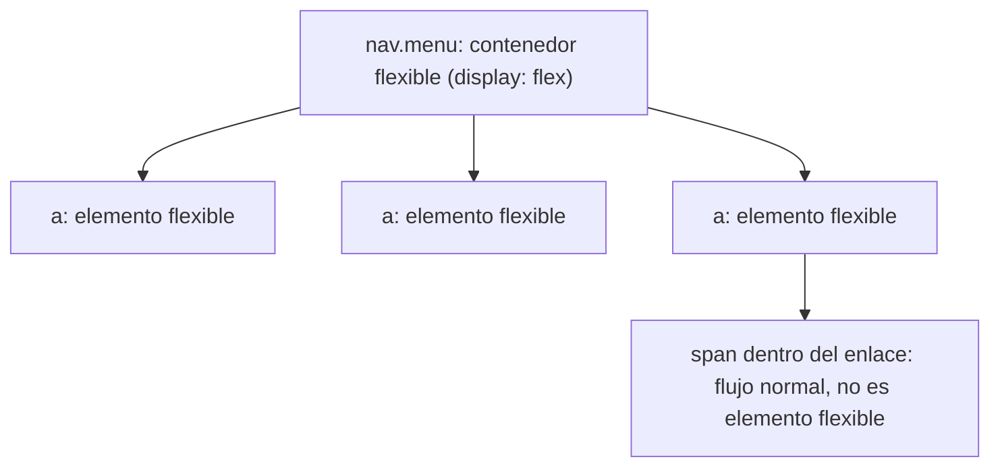
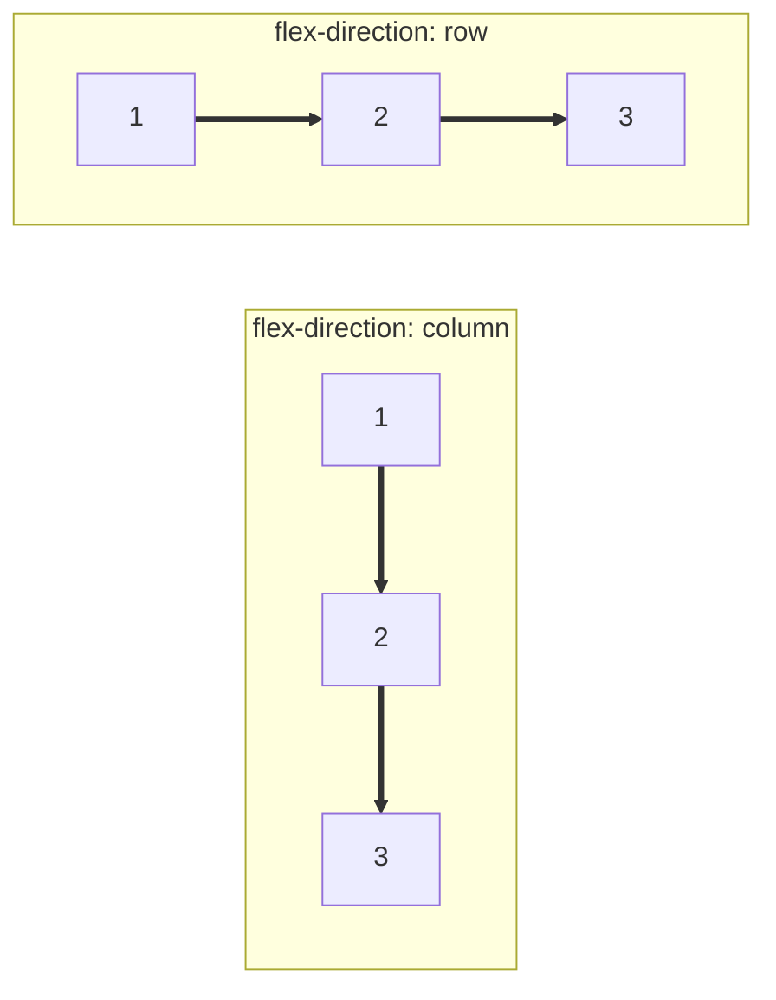
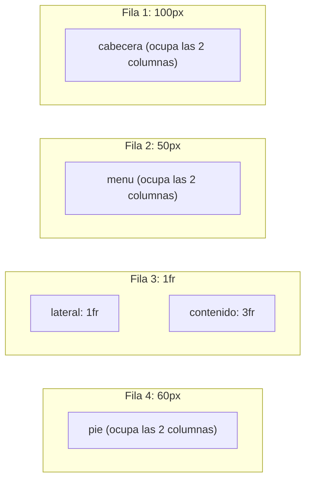
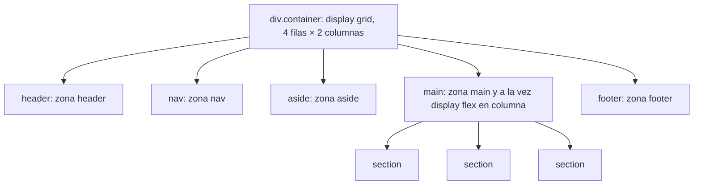
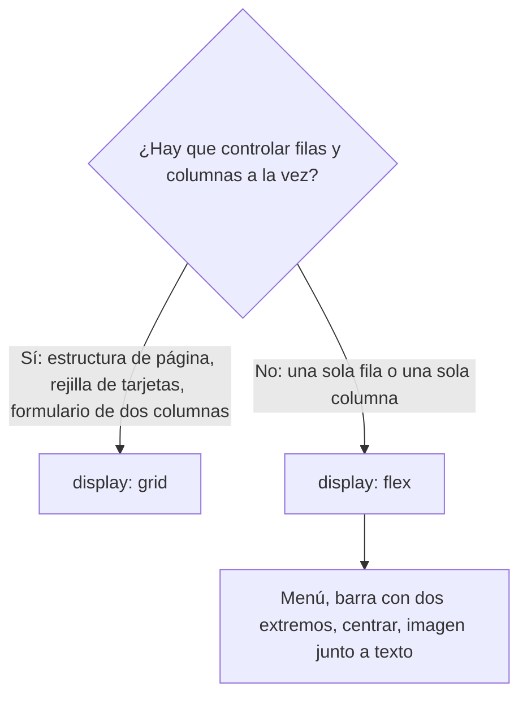
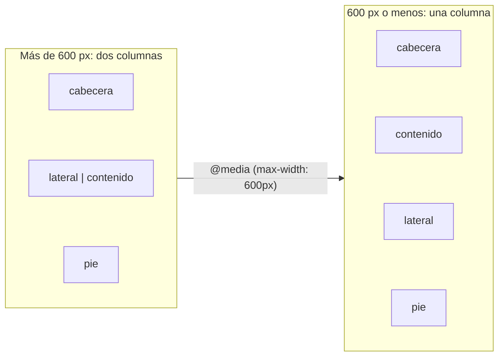
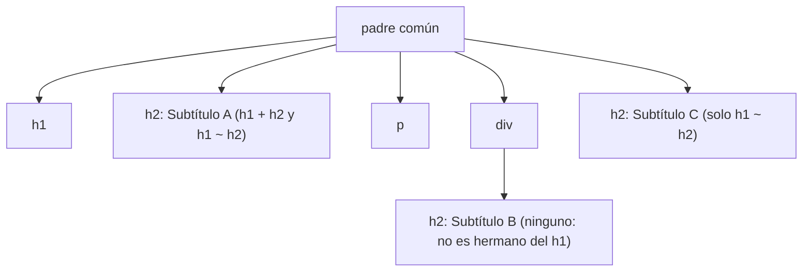

# Unidad 4.5. Maquetación moderna: Flexbox y Grid

La unidad 4 explica CSS tal como se usaba con CSS 2.1: la página se maquetaba con `float` y `position`, sumando anchos a mano. Hoy la estructura de una página se construye con **Grid** y sus piezas se alinean con **Flexbox**, dos sistemas de CSS3 pensados precisamente para maquetar. Esta unidad los explica desde cero y termina con el procedimiento completo para maquetar una página de cabecera, menú, tres columnas y pie.

La unidad se divide en siete partes:

1. **Punto de partida**: estructura HTML5, reinicio de estilos, `box-sizing` y unidades modernas.
2. **Flexbox**: maquetación en una dimensión.
3. **Grid**: maquetación en dos dimensiones.
4. **Grid y Flexbox juntos**: cuándo se usa cada uno.
5. **Diseño adaptable** con consultas de medios.
6. **Selectores CSS3** útiles para maquetar.
7. **Formularios, imágenes y depuración** con el inspector del navegador.

Y al final, un **ejemplo resuelto** de página completa.

> **Ampliación.** Esta unidad no forma parte del temario oficial, que se quedó en CSS 2.1. Recoge lo que se usa hoy para maquetar y lo que se trabajó en la tutoría del módulo con dos ejemplos de Flexbox y Grid, que se explican en los apartados 2.6 y 3.6.

---

## 1. Punto de partida

### 1.1 Estructura HTML5 semántica

HTML5 añade etiquetas que dicen **qué es** cada bloque de la página. Sustituyen a los `div` con id de la unidad 4 (`<div id="cabecera">`) y cualquier lector (un navegador, un lector de pantalla, un buscador) entiende la estructura sin mirar el CSS:

| Etiqueta | Bloque | Equivale en CSS 2.1 a |
|---|---|---|
| `<header>` | Cabecera de la página o de un artículo | `<div id="cabecera">` |
| `<nav>` | Menú de navegación | `<div id="menu">` |
| `<main>` | Contenido principal (uno por página) | `<div id="principal">` |
| `<aside>` | Contenido lateral, complementario | `<div id="lateral">` |
| `<section>` | Sección temática con su propio título | `<div class="seccion">` |
| `<article>` | Contenido independiente: una noticia, una entrada | `<div class="articulo">` |
| `<footer>` | Pie de la página o de un artículo | `<div id="pie">` |

```html
<body>
  <header>…</header>     <!-- cabecera -->
  <nav>…</nav>           <!-- menú -->
  <aside>…</aside>       <!-- columna lateral -->
  <main>…</main>         <!-- contenido -->
  <footer>…</footer>     <!-- pie -->
</body>
```

Todas son **elementos de bloque** y se les da estilo con selectores de elemento (`header { … }`), sin necesidad de clases ni id.

### 1.2 Reinicio de estilos y `box-sizing`

Cada navegador aplica sus propios márgenes y rellenos por defecto (el `body` tiene 8 px de margen, los `h1` y los `p` tienen márgenes…). Para partir de cero, las hojas suelen empezar con un **reinicio** (*reset*):

```css
* {
  margin: 0;                /* sin márgenes por defecto */
  padding: 0;               /* sin rellenos por defecto */
  box-sizing: border-box;   /* width incluye padding y borde */
}
```

**`box-sizing: border-box`** cambia el modelo de cajas de la unidad 4: el `width` pasa a ser el ancho **total** de la caja, con su relleno y su borde dentro.

| | `content-box` (por defecto) | `border-box` |
|---|---|---|
| Qué mide `width` | Solo el contenido | Contenido + relleno + borde |
| Caja con `width: 300px; padding: 20px; border: 2px` | Mide 344 px | **Mide 300 px**; el contenido se queda en 256 |
| Para maquetar | Hay que restar a mano | Lo que se escribe es lo que se ve |

> **Error frecuente**: el margen (`margin`) **no** entra en el `width` ni con `border-box`. Solo el relleno y el borde.

### 1.3 Unidades para maquetar

| Unidad | Relativa a | Uso típico |
|---|---|---|
| `px` | Medida fija | Bordes, anchos fijos |
| `%` | El contenedor | Anchos que se adaptan |
| `rem` | Tamaño de letra del elemento raíz (`html`) | Tamaños de texto y espacios |
| **`vw`** | **1 % del ancho de la ventana** | `width: 100vw` = todo el ancho |
| **`vh`** | **1 % del alto de la ventana** | `height: 100vh` = todo el alto |
| **`fr`** | **Una fracción del espacio libre** (solo en Grid) | Columnas y filas proporcionales |

```css
body  { width: 100vw; height: 100vh; }   /* el body ocupa justo la ventana */
.caja { width: 25vh; height: 25vh; }     /* un cuadrado que mide la cuarta parte del alto de la ventana */
```

> **Error frecuente**: `100vw` incluye la barra de desplazamiento vertical; si la página tiene scroll, un elemento de `100vw` provoca una barra horizontal. Para "todo el ancho del contenedor" es más seguro `width: 100%`.

---

## 2. Flexbox

**Flexbox** (caja flexible) coloca los elementos **en una sola dimensión**: en una **fila** o en una **columna**. Es **unidimensional**. Sirve para menús, barras, grupos de botones, tarjetas en fila y, sobre todo, para **alinear y centrar**.

Hay siempre dos papeles:

- **Contenedor flexible** (*flex container*): el elemento al que se le pone `display: flex`.
- **Elementos flexibles** (*flex items*): sus **hijos directos**, y solo ellos.

```html
<nav class="menu">          <!-- contenedor -->
  <a href="#">Inicio</a>    <!-- elementos flexibles -->
  <a href="#">Cursos</a>
  <a href="#">Ayuda</a>
</nav>
```

```css
.menu { display: flex; }   /* los tres enlaces se ponen en fila */
```

> **Error frecuente**: `display: flex` se pone en el **padre**, no en los elementos que se quieren colocar. Y solo afecta a los hijos directos: los nietos siguen en el flujo normal salvo que su propio padre también sea flex.

En el árbol, el alcance de `display: flex` llega exactamente un nivel por debajo del contenedor:



### 2.1 Los dos ejes

Todo en Flexbox se entiende con **dos ejes**:

- **Eje principal**: la dirección en que se colocan los elementos. Lo fija `flex-direction`.
- **Eje cruzado**: el perpendicular.

| `flex-direction` | Eje principal | Eje cruzado |
|---|---|---|
| `row` (por defecto) | Horizontal, de izquierda a derecha | Vertical |
| `row-reverse` | Horizontal, de derecha a izquierda | Vertical |
| `column` | Vertical, de arriba abajo | Horizontal |
| `column-reverse` | Vertical, de abajo arriba | Horizontal |

**`justify-content` alinea en el eje principal; `align-items`, en el cruzado.** Con `row`, `justify-content` es horizontal y `align-items` vertical; con `column` **se intercambian**.

Las mismas tres cajas con `row` y con `column`; la flecha gruesa marca el eje principal, que es el que gobierna `justify-content`:



> **Error frecuente**: pensar que `justify-content` es siempre horizontal. Lo es solo con `flex-direction: row`. En una columna, `justify-content` reparte en vertical y `align-items` alinea en horizontal.

### 2.2 Propiedades del contenedor

| Propiedad | Qué hace | Valores |
|---|---|---|
| `display` | Convierte el elemento en contenedor flexible | `flex` |
| `flex-direction` | Dirección del eje principal | `row`, `row-reverse`, `column`, `column-reverse` |
| **`justify-content`** | Reparte los elementos **en el eje principal** | `flex-start` (por defecto), `flex-end`, `center`, `space-between`, `space-around`, `space-evenly` |
| **`align-items`** | Alinea los elementos **en el eje cruzado** | `stretch` (por defecto), `flex-start`, `flex-end`, `center`, `baseline` |
| `flex-wrap` | Si los elementos pasan a otra línea cuando no caben | `nowrap` (por defecto), `wrap`, `wrap-reverse` |
| `gap` | Separación entre elementos | Longitud: `gap: 10px` |
| `align-content` | Reparte **las líneas** cuando hay varias (con `wrap`) | Los mismos que `justify-content`, más `stretch` |

**Los valores de reparto de `justify-content`**, con tres cajas en una fila:

| Valor | Resultado |
|---|---|
| `flex-start` | Las tres pegadas al principio |
| `flex-end` | Las tres pegadas al final |
| `center` | Las tres juntas en el centro |
| `space-between` | La primera al principio, la última al final y el espacio sobrante **entre** ellas |
| `space-around` | Cada caja con el mismo espacio a cada lado: en los extremos queda la mitad que entre cajas |
| `space-evenly` | El **mismo espacio** en los extremos y entre cajas |

**`align-items: stretch`**, el valor por defecto, **estira** los elementos para que ocupen todo el alto de la fila (si no tienen `height`). Por eso las columnas de una fila flex salen todas igual de altas, algo que con `float` era muy difícil.

### 2.3 Propiedades de los elementos

| Propiedad | Qué hace | Valores |
|---|---|---|
| **`flex-grow`** | **Cuánto crece** el elemento para ocupar el espacio sobrante | Número: `0` (por defecto, no crece), `1`, `2`… |
| `flex-shrink` | Cuánto encoge si no hay sitio | Número: `1` (por defecto) |
| `flex-basis` | Tamaño de partida antes de crecer o encoger | Longitud o `auto` |
| `flex` | Abreviada de las tres: `flex: grow shrink basis` | `flex: 1` = crece y reparte por igual |
| `order` | Orden visual, sin tocar el HTML | Número entero (por defecto `0`) |
| `align-self` | Alineación en el eje cruzado **solo para ese elemento** | Los de `align-items` |

**`flex-grow` reparte el espacio sobrante en proporción a su valor**:

```css
.fila     { display: flex; }
.lateral  { flex-grow: 1; }   /* recibe 1 parte del espacio libre */
.central  { flex-grow: 3; }   /* recibe 3 partes: el triple que el lateral */
```

```css
.buscador input { flex: 1; }  /* el campo de texto se estira y ocupa todo lo que deja el botón */
```

### 2.4 Patrones habituales con Flexbox

**Centrar un elemento en los dos ejes**, el problema clásico que con CSS 2.1 no tenía solución sencilla:

```css
.contenedor {
  display: flex;
  justify-content: center;   /* centro horizontal */
  align-items: center;       /* centro vertical */
  height: 100vh;             /* hace falta altura para que se note el centrado vertical */
}
```

**Menú horizontal** con una lista, sustituto del menú con `float` de la unidad 4:

```html
<nav>
  <ul class="menu">
    <li><a href="#">Inicio</a></li>
    <li><a href="#">Catálogo</a></li>
    <li><a href="#">Contacto</a></li>
  </ul>
</nav>
```

```css
.menu {
  display: flex;
  gap: 5px;                 /* separación entre pestañas */
  list-style-type: none;    /* sin viñetas */
}
.menu a {
  display: block;           /* el enlace ocupa toda la pestaña: se puede pulsar en cualquier punto */
  padding: 8px 16px;
  background-color: #3C6E8F;
  color: #fff;
  text-decoration: none;
}
.menu a:hover { background-color: #F2A541; }   /* cambia el fondo al pasar el ratón */
```

**Barra con dos extremos** (título a la izquierda y fecha a la derecha), sustituto de `float: left` + `float: right`:

```css
.barra {
  display: flex;
  justify-content: space-between;   /* uno a cada extremo */
  align-items: center;              /* los dos a la misma altura */
}
```

**Cabecera con logotipo a la izquierda y menú a la derecha**: el mismo patrón, con el `nav` como segundo hijo.

**Imagen y texto lado a lado**:

```css
.ficha { display: flex; gap: 15px; align-items: flex-start; }
.ficha img { width: 120px; }        /* tamaño fijo */
.ficha p   { flex: 1; }             /* el texto ocupa el resto */
```

**Elementos que pasan a otra línea si no caben** (galería, tarjetas):

```css
.galeria { display: flex; flex-wrap: wrap; gap: 10px; }
.galeria img { width: 150px; }
```

**El pie siempre abajo**, aunque la página tenga poco contenido:

```css
body { display: flex; flex-direction: column; min-height: 100vh; }   /* el body ocupa al menos toda la ventana */
main { flex: 1; }                                                    /* el contenido crece y empuja el pie al fondo */
```

### 2.5 Columna con Flexbox

Con `flex-direction: column` los elementos se apilan, y `justify-content` reparte **en vertical**:

```css
.columna {
  display: flex;
  flex-direction: column;
  align-items: center;             /* centrados en horizontal (eje cruzado) */
  justify-content: space-around;   /* repartidos en vertical (eje principal) */
}
```

### 2.6 Ejemplo de la tutoría: `Flexbox.html`

```css
* { margin: 0; padding: 0; box-sizing: border-box; }   /* reinicio */
body {
  width: 100vw;
  height: 100vh;                     /* el body ocupa toda la ventana */
  background-color: #000;
  display: flex;                     /* el body es el contenedor */
  justify-content: space-evenly;     /* las cajas, repartidas con el mismo espacio en horizontal */
  align-items: center;               /* y centradas en vertical */
}
div {
  width: 25vh;
  height: 25vh;                      /* cuadrados proporcionales al alto de la ventana */
  background-color: #f00;
}
```

```html
<body>
  <div></div>
  <div></div>
  <div></div>
</body>
```

Resultado: tres cuadrados rojos sobre fondo negro, en fila, centrados en vertical y con el mismo espacio entre ellos y con los bordes de la ventana. Si se cambia `space-evenly` por `space-between`, los cuadrados de los extremos se pegan a los bordes.

---

## 3. Grid

**Grid** (rejilla) coloca los elementos **en dos dimensiones**: filas y columnas a la vez. Es **bidimensional**. Es el sistema para la **estructura de la página**: cabecera, menú, columnas, pie.

Igual que en Flexbox, hay **contenedor** (`display: grid`) y **elementos** (sus hijos directos).

### 3.1 Definir la rejilla

```css
.pagina {
  display: grid;
  grid-template-columns: 200px 1fr 150px;   /* tres columnas */
  grid-template-rows: 80px auto 60px;       /* tres filas */
  gap: 10px;                                /* separación entre celdas */
}
```

- **`grid-template-columns`**: el ancho de cada columna, separados por espacios. Tantos valores como columnas.
- **`grid-template-rows`**: el alto de cada fila.
- **`gap`**: el hueco entre filas y columnas (`row-gap` y `column-gap` por separado).

**La unidad `fr`** reparte **el espacio libre** en fracciones, una vez restadas las medidas fijas y los `gap`:

```css
grid-template-columns: 1fr 3fr;          /* dos columnas: la segunda, el triple de ancha (25 % y 75 %) */
grid-template-columns: 220px 1fr 180px;  /* laterales fijas; la central se queda con todo lo demás */
grid-template-columns: repeat(3, 1fr);   /* tres columnas iguales: equivale a 1fr 1fr 1fr */
```

| Valor | Significado |
|---|---|
| `200px` | Ancho fijo |
| `25%` | Porcentaje del contenedor |
| `1fr`, `3fr` | Fracciones del espacio libre |
| `auto` | Lo que necesite su contenido |
| `repeat(n, valor)` | Repite el valor n veces |
| `minmax(150px, 1fr)` | Como mínimo 150 px y como máximo una fracción |

> **Error frecuente**: `fr` solo existe dentro de Grid (`grid-template-columns`, `grid-template-rows`). `width: 1fr` no es válido.

**Rejilla que se adapta sola**, sin consultas de medios: tantas columnas de al menos 200 px como quepan, repartiéndose el sobrante.

```css
.tarjetas {
  display: grid;
  grid-template-columns: repeat(auto-fit, minmax(200px, 1fr));
  gap: 15px;
}
```

En una pantalla ancha salen cuatro o cinco columnas; en un móvil, una. Las tarjetas de una misma fila tienen siempre la misma altura.

### 3.2 Colocar con `grid-template-areas`

La forma más clara de maquetar una página: se **dibuja la maqueta con nombres** y se asigna cada elemento a su zona.

```css
.pagina {
  display: grid;
  grid-template-columns: 1fr 3fr;
  grid-template-rows: 100px 50px 1fr 60px;
  grid-template-areas:
    "cabecera cabecera"
    "menu     menu"
    "lateral  contenido"
    "pie      pie";
}
header { grid-area: cabecera; }
nav    { grid-area: menu; }
aside  { grid-area: lateral; }
main   { grid-area: contenido; }
footer { grid-area: pie; }
```

La maqueta que dibujan esas cuatro cadenas, con dos columnas en proporción 1 : 3:



Reglas de `grid-template-areas`:

- Cada cadena entre comillas es **una fila**; cada palabra, **una celda**.
- Todas las filas tienen **el mismo número de celdas**, igual al de columnas.
- **Repetir un nombre** hace que esa zona ocupe varias celdas: `"cabecera cabecera"` es una cabecera que ocupa las dos columnas.
- Cada zona tiene que ser un **rectángulo**: no se puede hacer una L.
- Un punto (`.`) deja una celda **vacía**.
- Los nombres son libres; se usan con **`grid-area`** en cada elemento, **sin comillas**.

> **Error frecuente**: escribir `grid-area: "cabecera";` con comillas. En `grid-template-areas` los nombres van entre comillas (forman la cadena de la fila); en `grid-area` van **sin comillas**.

> **Error frecuente**: si una fila tiene un número distinto de celdas que las demás, la declaración entera es **inválida** y el navegador la ignora: todo aparece apilado en una columna.

### 3.3 Colocar por líneas

Las columnas y filas están separadas por **líneas numeradas desde 1**. Con tres columnas hay cuatro líneas verticales (1 a 4). Un elemento se coloca indicando entre qué líneas va:

```css
header { grid-column: 1 / 4; }     /* de la línea 1 a la 4: las tres columnas */
aside  { grid-column: 1 / 2; grid-row: 2 / 4; }   /* primera columna, dos filas de alto */
footer { grid-column: 1 / -1; }    /* -1 es la última línea: todo el ancho, haya las columnas que haya */
.ancha { grid-column: span 2; }    /* ocupa dos columnas desde donde le toque */
```

Las dos formas dan el mismo resultado; `grid-template-areas` se lee mejor para la estructura de una página, y las líneas son útiles para casos sueltos.

### 3.4 Alinear dentro de las celdas

| Propiedad (en el contenedor) | Alinea el contenido de cada celda… |
|---|---|
| `justify-items` | En horizontal |
| `align-items` | En vertical |
| `place-items: center` | Las dos a la vez: todo centrado en su celda |

Por defecto los elementos se **estiran** (`stretch`) para llenar su celda, que es lo que se quiere para una maqueta.

### 3.5 Sin `float` ni `clear`

Con Grid desaparecen los problemas de la unidad 4:

| Con `float` | Con Grid |
|---|---|
| Sumar a mano los anchos y que no pasen del contenedor | `fr` reparte el espacio sobrante automáticamente |
| Columnas de distinta altura | Todas las celdas de una fila tienen la misma altura |
| El pie sube si falta `clear: both` | El pie está en su fila y no se mueve |
| El contenedor se queda con altura 0 | El contenedor mide lo que sus filas |
| Cambiar el orden obliga a tocar el HTML | Se cambia `grid-template-areas` |

### 3.6 Ejemplo de la tutoría: `GridLayout.html`

```html
<div class="container">
  <header></header>
  <nav></nav>
  <aside></aside>
  <main>
    <section></section>
    <section></section>
    <section></section>
  </main>
  <footer></footer>
</div>
```

```css
* { margin: 0; padding: 0; box-sizing: border-box; }
body { width: 100vw; height: 100vh; }

div.container {
  background-color: black;
  width: 100%;
  height: 100%;                              /* ocupa toda la ventana */
  display: grid;
  grid-template-rows: 1fr 1fr 3fr 1fr;       /* 4 filas: la tercera, el triple de alta */
  grid-template-columns: 1fr 3fr;            /* 2 columnas: lateral 25 %, contenido 75 % */
  grid-template-areas:
    "header header"
    "nav    nav"
    "aside  main"
    "footer footer";
}
header { background-color: gray;       grid-area: header; }
nav    { background-color: blueviolet; grid-area: nav; }
aside  { background-color: green;      grid-area: aside; }
main {
  background-color: blue;
  grid-area: main;
  display: flex;                      /* main es a la vez celda del grid y contenedor flex */
  flex-direction: column;             /* sus secciones, en columna */
  align-items: center;                /* centradas en horizontal */
  justify-content: space-around;      /* repartidas en vertical */
}
section { width: 75%; height: 25%; background-color: orangered; }
footer  { background-color: yellow;    grid-area: footer; }
```

Cómo se lee:

1. El contenedor ocupa la ventana entera y se divide en **4 filas** (proporción 1 : 1 : 3 : 1 del alto) y **2 columnas** (1 : 3 del ancho).
2. `grid-template-areas` dibuja la maqueta: cabecera y menú a todo el ancho, lateral y contenido en la tercera fila, pie a todo el ancho.
3. Cada etiqueta HTML5 se asigna a su zona con `grid-area`.
4. **`main` es a la vez una celda del grid y un contenedor flex**: dentro, sus tres `section` se apilan en columna, centradas y repartidas.

Es el patrón completo de la maquetación actual: **Grid para la estructura, Flexbox para lo de dentro**. El esquema muestra los dos niveles de anidamiento:



---

## 4. Grid y Flexbox juntos

| | **Flexbox** | **Grid** |
|---|---|---|
| Dimensiones | **Una**: fila **o** columna | **Dos**: filas **y** columnas |
| Se piensa desde | El contenido: los elementos se reparten el espacio | La rejilla: se dibuja y se colocan los elementos |
| Uso típico | Menús, barras, botones, tarjetas, centrar | La estructura de la página |
| Se activa con | `display: flex` | `display: grid` |

No compiten: se anidan. Una celda del grid puede ser un contenedor flex, y un elemento flex puede ser un grid.

La elección para cada contenedor se reduce a una pregunta:



**Procedimiento para maquetar una página:**

1. **Escribir el HTML** con etiquetas semánticas (`header`, `nav`, `main`, `aside`, `footer`) y el contenido, sin pensar en el aspecto.
2. **Reinicio**: `* { margin: 0; padding: 0; box-sizing: border-box; }`.
3. **Contenedor de la página**: un `div` (o el `body`) con el ancho total y `margin: 0 auto` para centrarlo.
4. **Estructura con Grid**: `display: grid`, columnas (`grid-template-columns`), filas si hace falta, `grid-template-areas` y `grid-area` en cada bloque.
5. **Piezas con Flexbox**: el menú, la cabecera (título y menú), las barras de título y fecha.
6. **Detalle**: colores, fuentes, bordes, `border-radius`, `:hover`.
7. **Comprobar**: que la suma de columnas da el ancho pedido y que la página se ve igual al ampliar o reducir el texto.

**Traducir medidas fijas a Grid.** Si una maqueta da los anchos en píxeles y el relleno aparte, con `border-box` cada columna mide su ancho **más su relleno**:

| Columna | Enunciado | Con `border-box` |
|---|---|---|
| Lateral | `width: 200px` | `200px` |
| Central | `width: 500px` + `padding-left: 20px` | `520px` (el relleno va dentro) |

```css
.columnas { display: grid; grid-template-columns: 200px 520px; }
.central  { padding-left: 20px; }   /* el relleno sigue existiendo, ahora dentro de los 520 */
```

---

## 5. Diseño adaptable (*responsive*)

Una **consulta de medios** (*media query*) aplica reglas solo cuando se cumple una condición sobre la pantalla. Con Grid basta con **redibujar las zonas** para el móvil:

```css
.pagina {
  display: grid;
  grid-template-columns: 1fr 3fr;
  grid-template-areas:
    "cabecera cabecera"
    "lateral  contenido"
    "pie      pie";
}

@media (max-width: 600px) {            /* pantallas de 600 px de ancho o menos */
  .pagina {
    grid-template-columns: 1fr;        /* una sola columna */
    grid-template-areas:
      "cabecera"
      "contenido"
      "lateral"
      "pie";                           /* el lateral pasa debajo del contenido */
  }
}
```

El cambio de zonas entre las dos versiones:



| Condición | Se aplica cuando la ventana… |
|---|---|
| `(max-width: 600px)` | Mide 600 px o **menos** |
| `(min-width: 768px)` | Mide 768 px o **más** |
| `(min-width: 768px) and (max-width: 1024px)` | Mide entre 768 y 1024 px |

Para que el móvil no muestre la página reducida, el `<head>` lleva siempre:

```html
<meta name="viewport" content="width=device-width, initial-scale=1.0">
```

---

## 6. Selectores CSS3

CSS3 incluye todos los selectores de CSS 2.1 (unidad 4) y añade decenas más. Estos son los que se usan en la práctica.

### 6.1 Selectores de atributo

Seleccionan elementos según sus atributos y los valores de estos. Los cuatro primeros ya existían en CSS 2.1; los tres últimos son de CSS3:

| Selector | Selecciona los elementos… | Ejemplo |
|---|---|---|
| `[atr]` | Que tienen el atributo, sea cual sea su valor | `a[class]`, `input[required]` |
| `[atr="v"]` | Con el atributo **igual** a v | `input[type="text"]` |
| `[atr~="v"]` | Cuyo valor es una lista de palabras separadas por espacios y **una de ellas** es v | `a[class~="externo"]`: enlaces con la clase externo entre otras |
| `[atr\|="v"]` | Cuyo valor **es v o empieza por v seguido de guion** | `[lang\|="es"]`: `es`, `es-ES`, `es-AR` |
| `[atr^="v"]` (CSS3) | Cuyo valor **empieza** por v | `a[href^="mailto:"]`: enlaces a correo |
| `[atr$="v"]` (CSS3) | Cuyo valor **termina** en v | `a[href$=".pdf"]`: enlaces a PDF |
| `[atr*="v"]` (CSS3) | Cuyo valor **contiene** v | `h1[title*="capítulo"]` |

```css
a[href^="mailto:"] { background-color: #DFF3E4; }   /* enlaces que abren el correo */
a[href$=".pdf"]::after { content: " (PDF)"; }       /* avisa de que el enlace descarga un PDF */
input[type="text"] { border: 1px solid #999; }      /* solo los campos de texto, no los botones */
```

> **Error frecuente**: `[class~="externo"]` y `[class*="externo"]` no son iguales. `~=` busca la **palabra** completa en una lista (`class="hola externo"`); `*=` busca el **texto** en cualquier parte, así que también acepta `class="externos"` o `class="noexterno"`.

### 6.2 Combinadores: hijo, adyacente y hermanos generales

| Selector | Selecciona |
|---|---|
| `p a` (descendente) | Los `a` dentro de un `p`, a cualquier profundidad |
| `p > a` (hijo) | Los `a` **hijos directos** de un `p` |
| `h1 + h2` (adyacente) | El `h2` hermano de un `h1` que va **justo después** |
| `h1 ~ h2` (hermanos generales, CSS3) | **Todos** los `h2` hermanos de un `h1` que van **después**, aunque no sea justo detrás |

```html
<h1>Título</h1>
<h2>Subtítulo A</h2>      <!-- h1 + h2 y h1 ~ h2 -->
<p>Párrafo</p>
<div>
  <h2>Subtítulo B</h2>    <!-- ninguno: está dentro del div, no es hermano del h1 -->
</div>
<h2>Subtítulo C</h2>      <!-- solo h1 ~ h2: es hermano y va después, pero no justo detrás -->
```

El árbol del fragmento aclara qué es hermano de qué:



**Todos los selectores de hermanos exigen el mismo padre**: el subtítulo B va después del `h1` en el código, pero está dentro de un `div`, así que no es su hermano.

**Un uso clásico del adyacente**: en los libros, la primera línea de cada párrafo va sangrada salvo en el primero. `p + p` selecciona todo párrafo precedido de otro párrafo, es decir, todos menos el primero:

```css
p + p { text-indent: 1.5em; }
```

### 6.3 Pseudoclases estructurales

| Selector | Selecciona el elemento si… |
|---|---|
| `:first-child` / `:last-child` | Es el primer / último hijo de su padre |
| `:nth-child(n)` | Es el hijo número n (admite `odd`, `even` y `an+b`: unidad 4) |
| `:nth-last-child(n)` | Ídem, contando **desde el último** |
| `:nth-of-type(n)` | Es el número n **de los de su tipo** entre sus hermanos |
| `:nth-last-of-type(n)` | Ídem, contando desde el último |
| `:empty` | No tiene ningún hijo, **ni siquiera texto** |
| `:not(selector)` | **No** cumple el selector |

```css
li:nth-child(2n+1) { background-color: #f4f4f4; }   /* elementos impares de una lista */
li:nth-child(2n)   { background-color: #fff; }      /* elementos pares */

img:nth-of-type(2n+1) { float: right; }   /* las imágenes impares, a la derecha... */
img:nth-of-type(2n)   { float: left; }    /* ...y las pares, a la izquierda: van alternando */

.menu li:not(:last-child) { border-right: 1px solid #fff; }   /* separador en todas las opciones menos la última */
:not(p) { margin: 0; }                    /* todos los elementos que no son párrafos */
td:empty { background-color: #eee; }      /* celdas vacías, en gris */
```

> **Error frecuente**: `:nth-child` cuenta **todos** los hijos, sean de la etiqueta que sean; `:nth-of-type` solo los de **su tipo**. En un `div` con un `h2` y tres `p`, el primer párrafo es `p:nth-child(2)` pero `p:nth-of-type(1)`.

### 6.4 Pseudoelementos y pseudoclases de formulario

En CSS3 los **pseudoelementos** se escriben con **dos** signos de dos puntos (`::first-line`, `::first-letter`, `::before`, `::after`), para distinguirlos de las pseudoclases. CSS3 añade **`::selection`**: el texto que el usuario ha seleccionado con el ratón o el teclado.

```css
::selection { background-color: #F2A541; color: #000; }   /* color del texto al seleccionarlo */
```

| Pseudoclase | Selecciona |
|---|---|
| `:focus` | El campo con el cursor (unidad 4) |
| `:checked` | Casillas y botones de opción marcados |
| `:disabled` | Campos desactivados |

## 7. Formularios, imágenes y depuración

### 7.1 Formularios con Grid

Un formulario se maqueta con una rejilla de **dos columnas**: etiquetas a la izquierda y campos a la derecha. Como los elementos se colocan en orden, cada `label` y su `input` caen solos en la misma fila:

```html
<form class="alta">
  <label for="nombre">Nombre</label>
  <input type="text" id="nombre" name="nombre">
  <label for="correo">Correo</label>
  <input type="email" id="correo" name="correo">
  <label for="mensaje">Mensaje</label>
  <textarea id="mensaje" name="mensaje" rows="4"></textarea>
  <button type="submit">Enviar</button>
</form>
```

```css
.alta {
  display: grid;
  grid-template-columns: 100px 1fr;   /* etiquetas | campos */
  gap: 10px;
  align-items: center;                /* cada etiqueta, a la altura de su campo */
  max-width: 450px;
}
.alta label[for="mensaje"] { align-self: start; }   /* junto a un textarea alto, la etiqueta arriba */
.alta button {
  grid-column: 2;          /* en la columna de los campos */
  justify-self: start;     /* sin estirarse a todo el ancho */
}
```

- El `for` de cada `label` coincide con el `id` de su campo: al pulsar la etiqueta se activa el campo, y los lectores de pantalla saben qué campo describe.
- En una columna estrecha (un lateral de 200 px), es más legible **una sola columna**, con la etiqueta encima del campo: `grid-template-columns: 1fr`.
- `grid-column: 1 / -1` estira un elemento (un aviso, un enlace) a todo el ancho del formulario.

### 7.2 Imágenes dentro de la maqueta

Una imagen tiene su propio tamaño en píxeles y, si es mayor que su columna, la desborda. Tres reglas lo evitan:

```css
img {
  max-width: 100%;   /* nunca más ancha que su contenedor */
  height: auto;      /* conserva la proporción al reducirse */
  display: block;    /* sin el hueco que deja debajo una imagen en línea */
}
```

Para miniaturas de **tamaño fijo** (todas las fotos de una galería iguales aunque los originales tengan distinta proporción), **`object-fit: cover`** recorta la imagen para llenar la caja sin deformarla:

```css
.miniatura { width: 150px; height: 100px; object-fit: cover; }
```

Una imagen junto a un texto se coloca hoy con Flexbox, no con `float`:

```css
.noticia { display: flex; gap: 10px; align-items: flex-start; }
.noticia img { width: 120px; flex-shrink: 0; }   /* la imagen no encoge aunque el texto sea largo */
```

`float` sigue siendo la opción cuando se quiere que el texto **rodee** la imagen por abajo, como en un periódico.

### 7.3 `order` y `align-self` en la práctica

**`order`** cambia el orden visual de los elementos flex o grid sin tocar el HTML. Todos tienen `order: 0`; uno con `-1` pasa delante y uno con `1`, detrás:

```css
.cabecera .buscador { order: 1; }   /* el buscador, al final de la cabecera */
```

> **Error frecuente**: `order` solo cambia lo que se ve. La tecla Tab y los lectores de pantalla siguen el orden del HTML, así que no se usa para reordenar contenido con sentido (eso se hace en el HTML).

**`align-self`** alinea **un solo elemento** en el eje cruzado, por encima del `align-items` del contenedor:

```css
.barra { display: flex; align-items: center; }
.barra .logo { align-self: flex-start; }   /* todo centrado en vertical salvo el logotipo, arriba */
```

### 7.4 Dos sustos típicos de Flexbox

- **El elemento que no encoge.** Un elemento flex no se hace más estrecho que su contenido más largo (una palabra o una URL muy larga, una imagen), porque su ancho mínimo es `auto`. Si un texto largo desborda la fila, se le pone `min-width: 0` al elemento.
- **`flex-basis` frente a `width`.** En un elemento flex, `flex-basis` es el tamaño de partida en el eje principal y tiene prioridad sobre `width`. Si se escribe `flex: 1`, el `flex-basis` pasa a ser 0 y el `width` deja de contar: el elemento se reparte el espacio con los demás.

### 7.5 Ver la maqueta en el navegador

El **inspector** del navegador (F12, o clic derecho → Inspeccionar) es la herramienta para entender por qué algo no se coloca donde se espera:

1. En la pestaña **Elementos**, junto a cada contenedor aparece una etiqueta **`grid`** o **`flex`**. Al pulsarla, dibuja sobre la página las líneas de la rejilla (con sus números y los nombres de las zonas) o los ejes de Flexbox.
2. El panel **Estilos** muestra todas las reglas que afectan al elemento seleccionado y **tacha** las que pierden en la cascada; ahí se ve si una regla no se aplica por especificidad o por una errata.
3. El panel **Calculado** (o **Diseño**) muestra el modelo de cajas del elemento con sus medidas reales: contenido, relleno, borde y margen.
4. Las propiedades se pueden **editar en vivo** para probar valores sin tocar el fichero.
5. El **modo de dispositivo** (el icono del móvil) simula pantallas pequeñas para comprobar las consultas de medios.

> **Error frecuente**: si una declaración aparece tachada con un aviso amarillo, el navegador no la entiende (propiedad o valor mal escrito: `align-items: middle`, `width: 1fr`). Es la forma más rápida de encontrar una errata.

---

## 8. Ejemplo resuelto: página completa con Grid y Flexbox

**El supuesto**: la web de una **biblioteca municipal**, de **900 px** de ancho y centrada. Cabecera con el nombre a la izquierda y un menú a la derecha; tres columnas: avisos (lateral izquierdo, 200 px), noticias (central, 480 px + 20 de relleno izquierdo) y horarios (lateral derecho, 180 px + 20 de relleno izquierdo); y un pie a todo el ancho.

**Comprobación de anchos** con `border-box`: 200 + (480 + 20) + (180 + 20) = **900 px**.

```html
<!DOCTYPE html>
<html lang="es">
<head>
  <meta charset="utf-8">
  <meta name="viewport" content="width=device-width, initial-scale=1.0">
  <title>Biblioteca municipal</title>
  <link rel="stylesheet" href="estilos.css">
</head>
<body>
  <div class="pagina">
    <header class="cabecera">
      <h1>Biblioteca municipal</h1>
      <nav>
        <ul class="menu">
          <li><a href="#" class="actual">Inicio</a></li>
          <li><a href="#">Catálogo</a></li>
          <li><a href="#">Actividades</a></li>
          <li><a href="#">Contacto</a></li>
        </ul>
      </nav>
    </header>

    <aside class="avisos">
      <h2>Avisos</h2>
      <ul>
        <li>Cerrado el día 8</li>
        <li>Nuevo horario de verano</li>
      </ul>
    </aside>

    <main class="noticias">
      <article>
        <div class="barra">
          <h2>Club de lectura</h2>
          <span class="fecha">12/11/2026</span>
        </div>
        <p>Este mes se lee una novela corta. Las sesiones son los jueves.</p>
      </article>
    </main>

    <aside class="horarios">
      <h2>Horarios</h2>
      <p>De lunes a viernes, de 9:00 a 20:00.</p>
    </aside>

    <footer class="pie">
      <p>Biblioteca municipal. Todos los derechos reservados.</p>
    </footer>
  </div>
</body>
</html>
```

```css
/* 1. Reinicio */
* { margin: 0; padding: 0; box-sizing: border-box; }

body { font: 0.9rem/1.5 Verdana, sans-serif; color: #333; background-color: #eee; }

/* 2. Contenedor de la página: estructura con Grid */
.pagina {
  width: 900px;
  margin: 0 auto;                                  /* centrada en la ventana */
  background-color: #fff;
  display: grid;
  grid-template-columns: 200px 500px 200px;        /* 200 + (480+20) + (180+20) = 900 */
  grid-template-areas:
    "cabecera cabecera cabecera"
    "avisos   noticias horarios"
    "pie      pie      pie";
}
.cabecera { grid-area: cabecera; }
.avisos   { grid-area: avisos; }
.noticias { grid-area: noticias; padding-left: 20px; }   /* el relleno va dentro de los 500 */
.horarios { grid-area: horarios; padding-left: 20px; }   /* el relleno va dentro de los 200 */
.pie      { grid-area: pie; }

/* 3. Cabecera con Flexbox: título a la izquierda, menú a la derecha */
.cabecera {
  display: flex;
  justify-content: space-between;
  align-items: flex-end;                           /* el menú, pegado abajo, sobre la línea */
  padding: 20px 20px 0;                            /* arriba 20, lados 20, abajo 0 */
  background: linear-gradient(#5B8DB8, #2F5E85);   /* degradado vertical */
  color: #fff;
}

/* 4. Menú de pestañas con Flexbox */
.menu { display: flex; gap: 4px; list-style-type: none; }
.menu a {
  display: block;
  padding: 6px 14px;
  background-color: #2F5E85;
  color: #fff;
  text-decoration: none;
  border-radius: 6px 6px 0 0;                      /* pestaña: solo las esquinas de arriba redondeadas */
}
.menu a:hover,
.menu a.actual { background-color: #F2A541; }     /* la opción actual y la del ratón, en naranja */

/* 5. Barra de título y fecha con Flexbox */
.barra {
  display: flex;
  justify-content: space-between;
  align-items: center;
  padding: 4px 8px;
  background-color: #2F5E85;
  color: #fff;
}
.barra h2 { font-size: 1rem; text-transform: uppercase; }

/* 6. Detalles */
.avisos, .noticias, .horarios { padding-top: 15px; padding-bottom: 15px; }
.avisos { padding-left: 10px; padding-right: 10px; }
article p { text-align: justify; margin-top: 8px; padding-bottom: 8px; border-bottom: 1px dotted #999; }
.pie {
  padding: 10px;
  text-align: center;
  border-top: 2px solid #2F5E85;
}
```

Cómo está construido:

- **Grid** hace la estructura: tres columnas fijas que suman 900 px y tres filas dibujadas con `grid-template-areas`. Cabecera y pie ocupan las tres columnas porque su nombre se repite tres veces.
- **Flexbox** resuelve tres piezas: la cabecera (título y menú en los extremos), el menú (pestañas en fila) y la barra de cada artículo (título y fecha en los extremos).
- Las tres columnas tienen automáticamente **la misma altura**: si los horarios se alargan, las otras dos se estiran con ellos.
- Sin `float`, sin `clear` y sin sumar márgenes a mano: el relleno izquierdo de las columnas va dentro de su ancho gracias a `border-box`.

> **Error frecuente**: poner `grid-template-columns: 200px 480px 180px` y además `padding-left: 20px`. Con `border-box` el relleno entra en el ancho, así que el contenido de la columna central se queda en 460 px y la página mide 860 px, no 900. Hay que sumar el relleno al ancho de la columna: 500 y 200.

---

## Ideas clave

- **Partida**: etiquetas HTML5 semánticas, reinicio `* { margin: 0; padding: 0; box-sizing: border-box; }`; con `border-box`, `width` incluye relleno y borde, no el margen.
- **Unidades**: `vw` y `vh` (1 % de la ventana), `rem` y `fr` (fracción del espacio libre, solo en Grid).
- **Flexbox**: **unidimensional**. `display: flex` en el padre. `flex-direction` fija el eje principal; **`justify-content`** reparte en el principal y **`align-items`** alinea en el cruzado (con `column` se intercambian). `flex-wrap`, `gap`, **`flex-grow`** (cuánto crece un hijo), `order`.
- **Patrones flex**: centrar (`justify-content` + `align-items` `center`), menú en fila, barra con dos extremos (`space-between`).
- **Grid**: **bidimensional**. `display: grid`, `grid-template-columns` y `-rows` (`px`, `%`, `fr`, `repeat`, `minmax`), `gap`. **`grid-template-areas`** dibuja la maqueta con nombres y **`grid-area`** (sin comillas) coloca cada bloque; o por líneas con `grid-column: 1 / -1`.
- **Juntos**: Grid para la estructura de la página, Flexbox para lo de dentro de cada zona.
- **Adaptable**: `@media (max-width: 600px) { … }` y `<meta name="viewport" …>`; con Grid basta con redibujar las zonas.
- **Formularios**: rejilla de dos columnas (`label` | campo), `grid-column: 2` para el botón. **Imágenes**: `max-width: 100%`, `object-fit: cover`. **Inspector** (F12): dibuja la rejilla y los ejes, y tacha lo que no se aplica.
- **Selectores CSS3**: atributo (`^=` empieza, `$=` termina, `*=` contiene; `~=` palabra de una lista, `|=` idioma), hermanos generales (`~`), `:nth-child`, `:nth-of-type`, `:not`, `:empty`, `::selection`.
