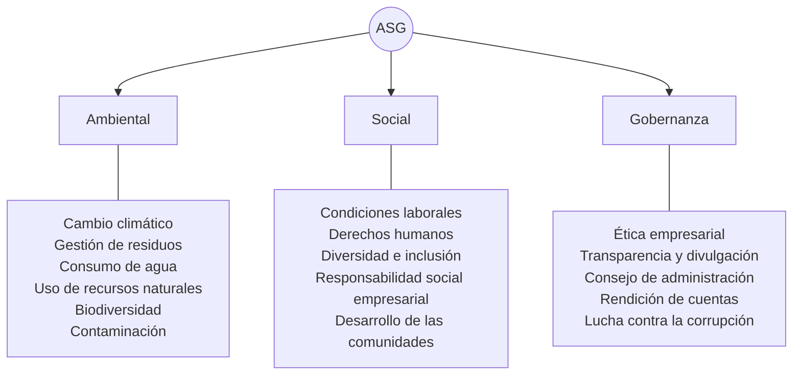
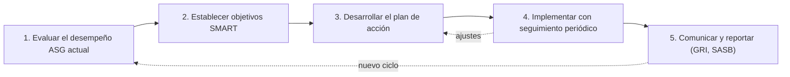
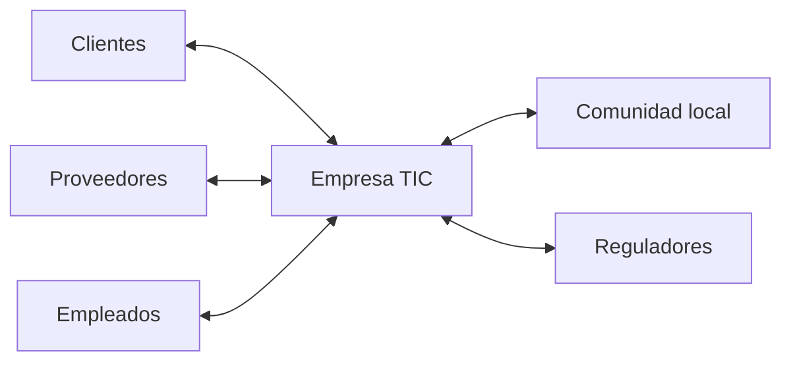
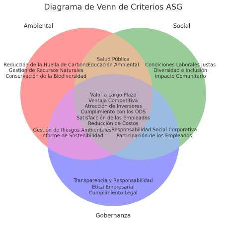
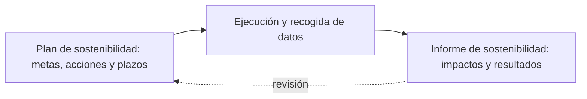

# TEORÍA tema 1: Aspectos ambientales, sociales y de gobernanza (ASG) relativos a la sostenibilidad

La unidad parte del concepto de desarrollo sostenible y de su diferencia con la sostenibilidad; presenta los criterios ASG y su integración en la empresa; repasa los marcos internacionales y la normativa española; describe la Agenda 2030 y los 17 ODS; y termina con la evaluación del desempeño en sostenibilidad y la Inversión Socialmente Responsable (ISR).

---

## 1. ¿Qué es el desarrollo sostenible?

El desarrollo sostenible se formalizó **a nivel global** con la publicación del informe *Nuestro Futuro Común*, también conocido como **Informe Brundtland**, en **1987**, por la Comisión Mundial sobre Medio Ambiente y Desarrollo de las Naciones Unidas. Ese informe define el desarrollo sostenible como **el desarrollo que satisface las necesidades del presente sin comprometer la capacidad de las generaciones futuras de satisfacer las suyas**.

La definición equilibra el progreso económico, la equidad social y la preservación del medio ambiente. Se apoya en tres dimensiones: la económica, la social y la ambiental, que a su vez se fundamentan en los aspectos ASG.

> **Error frecuente**: dos afirmaciones de verdadero/falso alteran la definición. Es **falso** que se formalizara "a nivel local" y "en 1997": fue a nivel global y en 1987. También es **falso** que hable de "satisfacer las necesidades del futuro sin comprometer a las generaciones presentes": el orden correcto es *presente* primero, *futuras* después.

## 2. ¿Es lo mismo sostenibilidad que desarrollo sostenible?

Los dos términos están relacionados y a menudo se usan como sinónimos, pero tienen matices distintos:

| | Sostenibilidad | Desarrollo sostenible |
|---|---|---|
| Qué es | **Un término más general que se refiere a la capacidad de mantener algo** a lo largo del tiempo | **Se centra específicamente en la búsqueda de un desarrollo equilibrado y armonioso que abarque aspectos económicos, sociales y ambientales** |
| Ámbito | Se aplica a contextos diversos: ambiental, social, económico | Enfoque amplio de equilibrio entre los tres; la sostenibilidad es un componente esencial suyo |

El término sostenibilidad **no** está limitado únicamente al medio ambiente. Abarca tres pilares interconectados, conocidos como la *triple línea de fondo* o *triple resultado*:

- **Ambiental**: gestión sostenible de los recursos naturales, reducción de la huella ambiental, conservación de la biodiversidad y mitigación del cambio climático.
- **Social**: derechos humanos, condiciones laborales, equidad de género, salud y seguridad de los empleados, bienestar de las comunidades locales.
- **Económico**: viabilidad económica y financiera a largo plazo de la organización y contribución al desarrollo de las comunidades.

> **Error frecuente**: la afirmación "el término de sostenibilidad está limitado únicamente al medio ambiente" es **falsa**.

## 3. Aspectos Ambientales, Sociales y de Gobernanza (ASG) relativos a la sostenibilidad

Los criterios ASG (en inglés ESG, *Environmental, Social and Governance*) son un marco fundamental para evaluar el desempeño no financiero de las empresas. **ASG se refiere a los Aspectos Ambientales, Sociales y de Gobernanza, que son elementos clave que las empresas y organizaciones consideran al evaluar su impacto y desempeño en áreas relacionadas con la sostenibilidad y la responsabilidad corporativa.** Van más allá de la rentabilidad financiera: abordan el impacto de la organización en el planeta, en las personas y en su estructura interna de toma de decisiones.

En este contexto, **los tres pilares de la sostenibilidad son ambiental, social y gobernanza**. Se representan con un diagrama de Venn: Ambiental arriba, Social abajo a la izquierda y Gobernanza abajo a la derecha; las zonas donde se solapan dos círculos combinan dos criterios, y el centro representa la integración de los tres (§3.4).

En el contexto de la inversión y los negocios, las siglas ASG se glosan también de forma abreviada como **Aspectos Sociales y de Gobierno**, expresión que omite el factor ambiental pero conserva la idea de criterios sociales y de buen gobierno.

> **Error frecuente**: ASG no significa "Actividades Sostenibles Globales" ni "Acuerdos sobre Sostenibilidad Global". Entre esas opciones, la válida es **Aspectos Sociales y de Gobierno**; la forma completa es Ambientales, Sociales y de Gobernanza.

Evaluar la sostenibilidad consiste en medir y analizar el desempeño de una organización en términos de su impacto ambiental, social y económico a lo largo del tiempo.

### 3.1. Criterios Ambientales, Sociales y de Gobernanza (ASG) en el desarrollo sostenible de las organizaciones empresariales

| Factor | Qué evalúa | Elementos |
|---|---|---|
| **A** (Ambiental) | El desempeño con respecto a la naturaleza | Cambio climático (emisiones de GEI, huella de carbono, eficiencia energética); gestión de residuos (reducción, reutilización, reciclaje); consumo de agua; uso de recursos naturales; emisiones; biodiversidad; contaminación del aire, agua y suelo |
| **S** (Social) | Derechos humanos, laborales y condiciones de trabajo | Condiciones laborales (salarios justos, jornadas decentes, seguridad y salud ocupacional); derechos humanos y no discriminación; diversidad e inclusión; responsabilidad social empresarial; desarrollo de las comunidades |
| **G** (Gobernanza) | Transparencia, equilibrio e información | Ética empresarial; transparencia y divulgación; estructura y funcionamiento del consejo; rendición de cuentas; lobby o grupos de presión; lucha contra la corrupción |

El siguiente mapa resume los tres factores y sus componentes principales:

Ejemplos típicos de cada factor:

- En los aspectos ambientales se incluye típicamente el **manejo de residuos y emisiones de carbono** (no las prácticas de contratación ni las estrategias de marketing).
- Un ejemplo de gestión sostenible de recursos naturales en las operaciones es **reducir el uso eficiente de materias primas**, es decir, reducir el consumo de materias primas haciendo un uso eficiente de ellas, frente a no gestionar los residuos o aumentar el consumo de agua.
- Se considera aspecto social la **diversidad e inclusión en el lugar de trabajo** (la eficiencia energética es ambiental y el cumplimiento normativo es de gobernanza).
- Para abordar la salud y seguridad de sus empleados, una empresa debe **implementar políticas de seguridad y proveer equipos de protección personal**, además de evaluar los riesgos laborales y formar en seguridad.
- Dentro del factor social, la relación con el entorno exige **comunicación abierta con las comunidades locales**, cuya importancia reside en que sirve **para entender y abordar las preocupaciones de la comunidad**.
- Para asegurarse de tener un liderazgo ético y transparente, una empresa debe **tener políticas de anticorrupción y prácticas de gobernanza transparentes**, con un código de conducta ética y rendición de cuentas.
- Son ejemplos de gobernanza sostenible la diversidad en el consejo de administración y la transparencia en la toma de decisiones; en cambio, la **remuneración excesiva de los directivos** **no** es un ejemplo de gobernanza empresarial sostenible.

**Aplicación al sector sanitario.** Una empresa de sanidad contribuye a la sostenibilidad ambiental **implementando prácticas de gestión de residuos y reciclaje en sus instalaciones** (lo contrario sería aumentar los desechos médicos sin tratamiento o el uso de productos de un solo uso). En los criterios ASG, el departamento de sanidad de una organización se ocupa de garantizar la seguridad y salud de los empleados (S) y de implementar políticas de reciclaje y gestión de residuos (A); **supervisar la transparencia financiera de la empresa** **no** es una función típica suya, sino de gobernanza.

La evaluación de los ASG suele formar parte de los informes de sostenibilidad y de estándares como ISO 14001 (gestión ambiental), ISO 26000 (responsabilidad social) o SA8000.

### 3.2. ¿Por qué son importantes los criterios ASG?

Los criterios ASG son importantes **porque ayudan a las empresas a gestionar riesgos, mejorar su reputación y contribuir positivamente a la sociedad y al medio ambiente**. No se centran únicamente en la rentabilidad ni únicamente en cumplir la regulación. En concreto:

1. **Reflejan las expectativas de los stakeholders** (inversores, clientes, empleados) y las tendencias del mercado.
2. **Reducen riesgos y mejoran la gestión**: permiten identificar, evaluar y mitigar riesgos ambientales, sociales y de gobernanza.
3. **Facilitan el acceso a capital** y a oportunidades de inversión.
4. **Mejoran el desempeño financiero a largo plazo**: menor coste de capital y mayor valor para el accionista.
5. **Contribuyen a un futuro más sostenible** e inclusivo.

Dentro de la reducción de riesgos, las evaluaciones de riesgos ambientales son importantes **para identificar impactos adversos y planificar medidas de mitigación**.

**Sector de informática y comunicaciones.** La importancia de integrar los criterios ASG en una empresa TIC está en que sirve **para mejorar la reputación corporativa y gestionar riesgos**; el cumplimiento de la legislación ambiental o la reducción de costes son efectos parciales, no la razón principal.

**Marketing y ASG.** El papel del marketing responsable en la promoción de productos y servicios sostenibles es **generar conciencia sobre la importancia de la sostenibilidad y promover opciones responsables**, de forma honesta y transparente con el consumidor. Integrar criterios ASG en las estrategias de marketing sirve para **atraer a consumidores más conscientes y comprometidos con la sostenibilidad**.

La alta dirección es la que impulsa todo esto: demuestra liderazgo, asigna recursos, incorpora los ASG a la estrategia y promueve una cultura ASG.

### 3.3. ¿Cómo integrar los criterios ASG en las organizaciones empresariales?

Los criterios ASG se integran **incorporando políticas y prácticas sostenibles en todas las áreas de la empresa y fomentando una cultura corporativa de responsabilidad**, y no limitándose al cumplimiento legal ni ignorando a los stakeholders. El proceso tiene cinco pasos:

1. **Evaluar** el desempeño ASG actual.
2. **Establecer objetivos ASG** específicos, medibles, alcanzables, relevantes y con plazos (SMART), alineados con la estrategia de la empresa.
3. **Desarrollar un plan de acción ASG** con iniciativas, recursos y responsables.
4. **Implementar** el plan, con seguimiento periódico y ajustes.
5. **Comunicar y reportar** el desempeño ASG de forma transparente, con marcos reconocidos como GRI o SASB.

Los cinco pasos forman un ciclo de mejora continua: el seguimiento de la implantación permite ajustar el plan, y lo comunicado al final sirve de punto de partida para una nueva evaluación.

Para que esta integración funcione hace falta un órgano responsable. Tener un comité de sostenibilidad es esencial **para supervisar e informar sobre las iniciativas ASG y garantizar la integración sostenible**, lo contrario de aumentar la opacidad.

#### Metodología SMART

**La metodología SMART es una herramienta utilizada para definir objetivos de manera clara y efectiva.** Cada letra es un requisito del objetivo:

| Letra | Inglés | Español | Ejemplo ambiental |
|---|---|---|---|
| S | *Specific* | Específico | Reducir las emisiones de CO2 de la empresa |
| M | *Measurable* | Medible | Disminuirlas un 20 % |
| A | *Achievable* | **Alcanzable** | Con eficiencia energética y renovables |
| R | *Relevant* | **Relevante** | Mejora la huella de carbono y cumple la regulación |
| T | *Time-bound* | **Con plazo determinado** | Para finales de 2026 |

Un objetivo solo es SMART si cumple los cinco requisitos a la vez; basta que falle uno para que deje de serlo:

Un objetivo relevante en sostenibilidad **sí** necesita estar alineado con las metas de la organización: eso es precisamente lo que significa "relevante".

> **Error frecuente**: la **T** de SMART **no** significa "Temporal", sino *Time-bound*: **con plazo determinado**. En cambio, sí es verdadero que la **A** se refiere a **Alcanzable** y la **R** a **Relevante**.

#### Ejemplo aplicado: grupos de interés en una empresa TIC

En una empresa de informática y comunicaciones, una estrategia eficaz para gestionar a los grupos de interés en clave de sostenibilidad consiste en **identificar stakeholders clave como clientes, proveedores, comunidad local, empleados y reguladores, e involucrarlos en decisiones sobre impacto ambiental y digitalización ética**. No es eficaz diseñar el plan sin consultar a terceros, atender solo a los inversores ni limitar la comunicación al área comercial.

| Grupo de interés | Ejemplo de implicación en una empresa TIC |
|---|---|
| Clientes | Encuestas sobre eficiencia energética de los servicios en la nube |
| Proveedores | Criterios de compra de hardware reciclable y con certificación ambiental |
| Empleados | Participación en el comité de sostenibilidad y en la política de teletrabajo |
| Comunidad local | Programas contra la brecha digital |
| Reguladores | Cumplimiento de la normativa de residuos electrónicos y de protección de datos |

La empresa ocupa el centro de una red de relaciones en dos sentidos: consulta a cada grupo de interés y le rinde cuentas.

### 3.4. Ejemplo de Diagrama de Venn representando los criterios ASG

Un diagrama de Venn representa conjuntos con círculos; las zonas donde se superponen muestran los elementos comunes (intersección).

Aplicado a los criterios ASG:

| Zona | Contenido |
|---|---|
| Círculo **Ambiental** | **Reducción de la huella de carbono**, gestión de recursos naturales, **conservación de la biodiversidad** |
| Círculo **Social** | **Condiciones laborales justas**, diversidad e inclusión, impacto comunitario |
| Círculo **Gobernanza** | **Transparencia y responsabilidad**, ética empresarial, cumplimiento legal |
| Ambiental ∩ Social | **Salud pública y educación ambiental** |
| Social ∩ Gobernanza | Responsabilidad social corporativa, participación de los empleados |
| Ambiental ∩ Gobernanza | **Gestión de riesgos ambientales**, informe de sostenibilidad |
| Centro (A ∩ S ∩ G) | Valor a largo plazo, ventaja competitiva, atracción de inversores, cumplimiento con los ODS, **satisfacción de los empleados**, reducción de costes |

Por tanto, es verdadero que el círculo Ambiental incluye la reducción de la huella de carbono y la conservación de la biodiversidad; que la transparencia y la responsabilidad son componentes del criterio de Gobernanza; y que la intersección Ambiental-Social incluye la salud pública y la educación ambiental.

> **Error frecuente**: tres afirmaciones típicas son **falsas**:
> - "El círculo Social no incluye condiciones laborales justas": sí las incluye.
> - "La intersección Social-Gobernanza incluye la gestión de riesgos ambientales": esa gestión está en la intersección **Ambiental-Gobernanza**.
> - "La intersección central no incluye la satisfacción de los empleados": sí la incluye.

## 4. Marcos internacionales de sostenibilidad

Un marco internacional de sostenibilidad es **un estándar global que guía a las empresas en prácticas sostenibles y responsables**: un conjunto de principios, pautas y estándares que abarcan los aspectos ASG. No es una regulación para empresas locales ni un informe financiero. La elección del marco depende del sector, las características y los objetivos de cada organización.

| Marco | Qué es |
|---|---|
| **ODS** de Naciones Unidas | 17 objetivos adoptados por 193 países en 2015 |
| **Principios Rectores de la ONU sobre Empresas y Derechos Humanos** | Responsabilidad empresarial de respetar los derechos humanos |
| **Pacto Mundial de la ONU** | La mayor iniciativa de sostenibilidad empresarial; 10 principios sobre derechos humanos, trabajo, medio ambiente y anticorrupción |
| **GRI** (*Global Reporting Initiative*) | Marco líder para elaborar informes de sostenibilidad |
| **SASB** | Estándares de contabilidad por industria para los aspectos ASG con impacto financiero |
| **TCFD** | Recomendaciones para divulgar información financiera relacionada con el clima |
| **SBTi** | Objetivos de reducción de emisiones alineados con la ciencia climática |

### 4.1. Normativa en España relativa a la sostenibilidad

- **Ley 7/2021, de Cambio Climático y Transición Energética**: neutralidad climática en 2050; obliga a las empresas que superen un umbral de emisiones a presentar planes de reducción.
- **Ley 11/2018, de información no financiera y diversidad**: exige a las grandes empresas un Informe de Información No Financiera (INF) con su desempeño ASG. Procede del **Real Decreto-ley 18/2017**, que es la norma española que estableció inicialmente el **marco legal para la información no financiera y la diversidad** en las empresas (no la Ley de Contratos del Sector Público ni la Ley de Sociedades de Capital).
- **Estrategia Española de Economía Circular** (desarrollada en la unidad 3).
- **Ley de Economía Circular**: marco legal de la transición a la economía circular; fomenta la reutilización, la reparación y la refabricación. En el sector TIC, la normativa española que regula la gestión de residuos electrónicos es la **Ley de Economía Circular**, importante porque **garantiza la reutilización y reciclaje de residuos electrónicos**.
- Otras: Estrategia Española de Biodiversidad 2030, Plan Nacional de Adaptación al Cambio Climático, Ley de Montes, Ley de Aguas, Plan Nacional de Derechos Humanos y normas sectoriales.

> **Contexto actual (no entra en examen)**: la ley española de residuos para una economía circular es la **Ley 7/2022, de 8 de abril, de residuos y suelos contaminados para una economía circular**; la referencia "Ley 11/2023" que a veces se le atribuye no corresponde a esa ley. Los aparatos eléctricos y electrónicos tienen además su norma específica, el Real Decreto 110/2015.

### 4.2. ¿Qué beneficios se consiguen al adoptar marcos internacionales de sostenibilidad?

Adoptar marcos internacionales permite **mejorar la transparencia, la confianza de los inversores y la alineación con estándares globales**. Los beneficios se agrupan en seis dimensiones:

1. **Mejora del desempeño ASG**: evaluación sistemática, áreas de mejora, objetivos y seguimiento.
2. **Reducción de riesgos** y mayor resiliencia ante crisis.
3. **Transparencia y rendición de cuentas**: informes de sostenibilidad y diálogo con stakeholders.
4. **Atracción y retención de talento**.
5. **Nuevas oportunidades de negocio**: consumidores e inversores con enfoque ASG; innovación.
6. **Contribución a un futuro sostenible**, alineada con los ODS.

Los marcos ayudan a atraer inversores **proporcionando mayor transparencia y confianza en las prácticas de la empresa**.

### 4.3. Organismos e instituciones implicadas en la lucha contra el cambio climático a nivel nacional

El cambio climático es la variación a largo plazo de la temperatura, la precipitación y otros aspectos del clima; hoy se asocia al calentamiento global causado por el aumento de gases de efecto invernadero (GEI). Sus consecuencias son el calentamiento global, el deshielo, los cambios en los ecosistemas, la subida del nivel del mar y la acidificación de los océanos.

| Organismo | Función principal |
|---|---|
| **Oficina Española de Cambio Climático (OECC)** | Formula la política nacional de cambio climático (RD 500/2020) |
| **Consejo Nacional del Clima** | Facilita la participación de los agentes y formula recomendaciones (RD 415/2014) |
| **Comisión de Coordinación de Políticas de Cambio Climático (CCPCC)** | Seguimiento, reducción de emisiones y absorción de carbono |
| **Comisión Interministerial para el Cambio Climático y la Transición Energética** | Coordina la ley de cambio climático, el PNIEC y la descarbonización a 2050 |

#### 4.3.1. Huella de Carbono (HC)

La huella de carbono es un indicador de la cantidad total de GEI generados directa o indirectamente por una persona, organización, evento, producto o servicio a lo largo de su ciclo de vida. Se expresa en CO2 equivalente.

**Fórmula**: `Huella de carbono = Dato de actividad × Factor de emisión`

- **Dato de actividad**: nivel de la actividad que emite (por ejemplo, kWh de gas natural consumidos).
- **Factor de emisión**: GEI emitidos por unidad de actividad (por ejemplo, 0,183 kg CO2 eq/kWh de gas natural).

#### 4.3.2. Objetivo de la Huella de Carbono (HC)

El objetivo es medir y evaluar las emisiones de GEI de una actividad para identificar dónde reducirlas: conciencia ambiental, identificación de fuentes, metas de reducción, decisiones informadas y transparencia.

Para reducir su huella de carbono, una empresa puede **optimizar rutas de transporte y utilizar fuentes de energía renovable**, además de mejorar la eficiencia energética de sus edificios y gestionar sus residuos.

## 5. ¿Qué es la Agenda 2030?

La Agenda 2030 (*Transformar nuestro mundo: la Agenda 2030 para el Desarrollo Sostenible*) es **un plan de acción global que incluye 17 Objetivos de Desarrollo Sostenible (ODS) para erradicar la pobreza, proteger el planeta y asegurar la prosperidad para todos**. La adoptaron todos los Estados miembros de la ONU en **septiembre de 2015**; contiene 17 ODS y **169 metas**, y su plazo es el año **2030**. Su principio fundamental es **no dejar a nadie atrás**.

### 5.1. ¿Cuáles son los Objetivos de Desarrollo Sostenible (ODS)?

Los ODS son **metas globales diseñadas para abordar los desafíos sociales, económicos y ambientales que enfrenta el mundo**; no se limitan al desarrollo económico ni obligan solo a los países desarrollados.

| ODS | Nombre | Idea central |
|---|---|---|
| 1 | **Fin de la pobreza** | Erradicar la pobreza extrema en todas sus formas |
| 2 | Hambre cero | Seguridad alimentaria y agricultura sostenible |
| 3 | **Salud y bienestar** | Vida sana y bienestar para todos |
| 4 | **Educación de calidad** | Educación inclusiva, equitativa y de calidad |
| 5 | Igualdad de género | Empoderamiento de mujeres y niñas |
| 6 | Agua limpia y saneamiento | Acceso al agua y gestión sostenible |
| 7 | Energía asequible y no contaminante | Energía moderna y renovable |
| 8 | **Trabajo decente y crecimiento económico** | Crecimiento inclusivo y empleo digno |
| 9 | Industria, innovación e infraestructura | Infraestructuras resilientes e innovación |
| 10 | **Reducción de las desigualdades** | Dentro de los países y entre ellos |
| 11 | Ciudades y comunidades sostenibles | Ciudades inclusivas, seguras y resilientes |
| 12 | **Producción y consumo responsables** | Uso eficiente de recursos, menos residuos |
| 13 | **Acción por el clima** | Combatir el cambio climático y sus efectos |
| 14 | Vida submarina | Conservar océanos y recursos marinos |
| 15 | Vida de ecosistemas terrestres | Bosques, suelo y biodiversidad |
| 16 | Paz, justicia e instituciones sólidas | Sociedades pacíficas e instituciones eficaces |
| 17 | Alianzas para lograr los objetivos | Cooperación y movilización de recursos |

Correspondencias que conviene fijar: la erradicación de la pobreza extrema es el ODS **Fin de la Pobreza**; la "Producción y consumo responsables" es el **ODS 12**; el ODS 10 trata sobre la **Reducción de las desigualdades**, y el que promueve esa reducción dentro y entre los países es el **ODS 10: Reducción de las desigualdades**; la salud es el **ODS 3: Salud y bienestar**; la educación inclusiva es el **ODS 4: Educación de calidad**; el trabajo decente es el **ODS 8: Trabajo decente y crecimiento económico**; y la acción climática y protección del medio ambiente es el **ODS 13: Acción por el clima**.

### 5.2. Importancia de los ODS para la Agenda 2030

Los ODS son la herramienta principal para implementar la Agenda 2030: aportan un marco de acción medible, objetivos interconectados, foco en la equidad, sostenibilidad a largo plazo y adaptación a cada país. Son verdaderas estas afirmaciones:

- La erradicación de la pobreza es el mayor desafío global y un requisito indispensable para el desarrollo sostenible.
- **Los ODS son importantes para promover un consumo y una producción sostenibles (ODS 12) y reducir la huella ecológica global.**
- **Los ODS promueven la paz, la justicia y la solidez de las instituciones (ODS 16) como elementos esenciales para el desarrollo sostenible.**

> **Error frecuente**: es **falso** que el ODS 4 (Educación de calidad) no tenga un impacto significativo en la erradicación de la pobreza: la educación contribuye a reducir la pobreza y al desarrollo económico.

### 5.3. Relación de los Objetivos de Desarrollo Sostenible (ODS) con la importancia para la consecución de los objetivos de la Agenda 2030

| Bloque de la Agenda | ODS que lo concretan |
|---|---|
| Pobreza y desigualdad | ODS 1 y 10 |
| Sostenibilidad ambiental | ODS 13, 14 y 15 |
| Desarrollo económico inclusivo | ODS 8 y 9 |
| Bienestar social y educación | ODS 3 y 4 |
| Alianzas globales | ODS 17 |

## 6. Criterios de sostenibilidad en el desempeño profesional y personal

| Ámbito profesional | Ámbito personal |
|---|---|
| Ética y transparencia | Consumo responsable |
| Responsabilidad social corporativa | Gestión del tiempo |
| Gestión ambiental | Desarrollo personal sostenible |
| Diversidad e inclusión | Participación comunitaria |
| Desarrollo profesional sostenible | Gestión de residuos |
| Gobernanza corporativa | Salud, bienestar y conciencia ambiental |

La responsabilidad social corporativa (RSC) implica que la empresa actúe de manera ética y contribuya positivamente a la sociedad: en la práctica, **participar en programas de voluntariado y apoyar a la comunidad** (donaciones, patrocinio de eventos comunitarios), tener en cuenta la diversidad y no ignorar el impacto social de sus operaciones.

### 6.1. Identificar los ODS más relevantes para la actividad personal y profesional

La relevancia de cada ODS depende del sector y del entorno: el ODS 3 para el sector sanitario, el 4 para el educativo, el 7 para el energético, el 8 para empresarios y trabajadores, y el 13 para todos. En el sector TIC destacan el ODS 9 (innovación e infraestructura), el 12 (residuos electrónicos) y el 13 (consumo energético de los centros de datos).

### 6.2. Riesgos y Oportunidades que representan los ODS

El **riesgo** es la posibilidad de que ocurran hechos con impacto negativo en los objetivos de sostenibilidad; la **oportunidad**, la forma en que los enfoques sostenibles generan beneficios a largo plazo.

| Riesgos (para quien no aborda los ODS) | Oportunidades (para quien los cumple) |
|---|---|
| De reputación | Acceso a financiación sostenible |
| **Regulatorios**: multas y sanciones | **Innovación** y competitividad |
| Financieros | Acceso a nuevos mercados |
| Operativos | **Mejora de la eficiencia operativa** |
| De cadena de suministro | Atracción y retención de talento; resiliencia; alianzas |

Así, un riesgo asociado a la implementación de los ODS son las **multas por incumplimiento de regulaciones ambientales**; una oportunidad de la acción por el clima (ODS 13) es el **incremento de la eficiencia operativa**; y una oportunidad de la producción y consumo responsables (ODS 12) es la **innovación en productos y procesos**.

### 6.3. Acciones necesarias para atender algunos de los retos ambientales y sociales desde la actividad profesional y el entorno personal

- **Desde la actividad profesional**: implementar prácticas sostenibles (menos recursos, residuos y emisiones); promover la RSC mediante voluntariado, donaciones y patrocinios; adoptar estándares éticos en toda la cadena de suministro; invertir en innovación sostenible.
- **Desde el entorno personal**: reducir el consumo, fomentar la educación ambiental, apoyar iniciativas locales, adoptar hábitos ecológicos y consumir de forma responsable.

En una empresa de informática, adoptar prácticas de economía circular (reacondicionar equipos, alargar su vida útil, virtualizar servidores) aporta como beneficio una **mejora en la eficiencia energética**, junto con menos residuos electrónicos.

## 7. La evaluación del desempeño en sostenibilidad

Es el proceso mediante el cual una organización mide, gestiona y comunica su impacto ambiental, social y económico.

- **Objetivos**: comprender el impacto en el triple resultado; identificar oportunidades de mejora en el desempeño **ambiental, social y económico** (los tres a la vez: **todas las anteriores**); fijar metas; comunicar el progreso; decidir mejor.
- **Beneficios**: mejorar el desempeño **ambiental, social y económico** (**todos los anteriores**); reducir costes; mejorar la reputación; reforzar la licencia para operar; ganar competitividad.

Los indicadores de sostenibilidad son métricas de esos impactos. Entre los indicadores utilizables están las emisiones de GEI, el consumo de agua y energía, la generación de residuos, las condiciones de trabajo y seguridad laboral, la diversidad e inclusión, la satisfacción del cliente y el impacto en la comunidad: todos ellos (**todos los anteriores**).

| Dimensión | Indicadores |
|---|---|
| Ambiental | Emisiones de GEI (alcance 1, 2 y 3); consumo de energía y proporción renovable; residuos y proporción reciclada; agua; biodiversidad |
| Social | Rotación; accidentes laborales; diversidad; horas de formación; inversión comunitaria; satisfacción de los empleados |
| Económica | Ingresos, beneficios, ROE; inversión en sostenibilidad; I+D; compras a proveedores locales |

### 7.1. Estándar de métricas para la sostenibilidad

En España no existe un único estándar de métricas que sea de obligado cumplimiento. Que la evaluación del desempeño en sostenibilidad sea obligatoria o no **depende del sector en el que opere la empresa**, y también de su tamaño: la Ley 11/2018 la exige a las grandes empresas mediante el INF.

A nivel internacional, el principal estándar de métricas es **GRI (Global Reporting Initiative)**, organización sin ánimo de lucro que ofrece el marco más utilizado para los informes de sostenibilidad.

| Estándar o herramienta | Qué es |
|---|---|
| **ISO 14001** | Sistema de gestión ambiental |
| **EMAS** | Sistema de gestión ambiental europeo; exige auditoría externa y declaración ambiental |
| Huella de carbono | Medición de las emisiones de GEI |
| RSC | Enfoque de gestión voluntario, más allá de la ley |
| Etiqueta Ecológica | Certificación oficial para productos con altos criterios ambientales |
| GRI | Marco internacional para informes de sostenibilidad |
| SGE 21 | Sistema de gestión ética de Forética |
| SASB | Estándares contables ASG por industria |
| FTSE4Good | Índices bursátiles de desempeño ASG |

**Ampliación: ISO 14031.** La norma ISO 14031 orienta la **evaluación del desempeño ambiental** mediante indicadores clave (KPI) medibles. En una empresa de informática, el KPI más útil para la sostenibilidad ambiental según la ISO 14031 es el **consumo energético medio de los servidores por unidad de procesamiento y porcentaje de dispositivos electrónicos reciclados anualmente**. Las licencias vendidas, las visitas a la web o el tiempo de respuesta del soporte técnico son indicadores comerciales o de servicio, no ambientales.

### 7.2. Relación y ejemplos de la evaluación del desempeño de sostenibilidad

Cada dimensión se relaciona con indicadores y con estándares de referencia:

| Dimensión | Indicador | Estándar |
|---|---|---|
| Ambiental | Emisiones de GEI | GRI 305; ISO 14064 |
| Ambiental | Agua | GRI 303; ISO 14046 |
| Ambiental | Energía | GRI 302; Ley 2/2011 de Economía Sostenible |
| Ambiental | Residuos | GRI 306; Ley 7/2022 |
| Social | Condiciones laborales | OIT; RD 486/1997; Estatuto de los Trabajadores |
| Social | Impacto en la comunidad | ISO 26000 |
| Económica | Rentabilidad; riesgos | IFRS; COSO; Ley 31/1995 de Prevención de Riesgos Laborales |

### 7.3. ¿Cuáles son las funciones claves de los estándares de métricas para la evaluación del desempeño en sostenibilidad?

Medir y gestionar el desempeño; transparencia y responsabilidad; gestión de riesgos y oportunidades; comparabilidad y *benchmarking*; cumplimiento normativo; mejora continua; atracción de inversiones y clientes.

### 7.4. ¿Cómo se mide la evaluación del desempeño en sostenibilidad?

La evaluación del desempeño en sostenibilidad se mide **mediante métricas que incluyen indicadores ambientales, sociales y de gobernanza**, no solo económicos ni solo con la satisfacción del cliente. Los pasos son:

1. Identificar los aspectos de sostenibilidad relevantes (análisis de materialidad).
2. Establecer objetivos y metas.
3. Recopilar datos.
4. Analizarlos.
5. Elaborar informes.
6. Aplicar la mejora continua.

**Ampliación: plan de sostenibilidad frente a informe de sostenibilidad.** Los dos documentos no son equivalentes. En una empresa del sector tecnológico, la diferencia principal es que **el plan establece las metas, acciones y líneas estratégicas a futuro; el informe evalúa los impactos generados y comunica los resultados alcanzados**.

| | Plan de sostenibilidad | Informe de sostenibilidad |
|---|---|---|
| Orientación | Hacia el futuro | Hacia el pasado (periodo cerrado) |
| Contenido | Metas, acciones, responsables, plazos | Impactos generados y resultados alcanzados |
| Paso del proceso | Pasos 2 y 3 de §3.3 | Paso 5 de §3.3 |
| Ejemplo TIC | Reducir un 30 % el consumo del centro de datos en 2028 | Consumo real del año, indicadores GRI 302 y 305 |

Los dos documentos se encadenan: el plan fija las metas, la ejecución genera los datos y el informe comunica los resultados, que sirven para revisar el plan siguiente.

## 8. La Inversión Socialmente Responsable (ISR) y el papel de los diferentes actores en el fomento de la sostenibilidad

La **Inversión Socialmente Responsable** (también inversión sostenible o inversión ASG) integra criterios ambientales, sociales y de gobernanza en las decisiones de inversión. Entre los criterios ASG están el ambiental, el social y el de gobernanza; la **rentabilidad** **no** es un criterio ASG.

| Actor | Papel |
|---|---|
| Analistas | Evalúan el desempeño ASG y recomiendan inversiones |
| Inversores | Su demanda empuja a las empresas a ser sostenibles |
| Agencias de calificación ASG | Asignan calificaciones de sostenibilidad |
| Índices de sostenibilidad | Agrupan empresas por desempeño ASG; sirven de referencia |

### 8.1. Beneficios de la Inversión Socialmente Responsable (ISR)

- **Reducción de riesgos** regulatorios, reputacionales y operacionales.
- **Retorno de la inversión a largo plazo** comparable o superior al de las inversiones tradicionales.
- **Impacto positivo en la sociedad**.

Los beneficios de la ISR son **promover prácticas empresariales éticas, mejorar la reputación corporativa y contribuir al bienestar social y ambiental**. Para los inversores, el principal beneficio es la **mitigación de riesgos y retornos competitivos**; para la sociedad en general, que **contribuye al desarrollo sostenible**. Son beneficios la **mayor rentabilidad a largo plazo** y la **mitigación de riesgos**.

> **Error frecuente**: la **garantía de beneficios inmediatos** **no** es un beneficio de la ISR. Su rentabilidad es a largo plazo y no está garantizada.

---

## Ideas clave

- **Desarrollo sostenible** (Informe Brundtland, 1987, nivel global): satisfacer las necesidades del presente sin comprometer las de las generaciones futuras. La sostenibilidad es más general y no se limita al medio ambiente.
- **ASG**: Ambiental (naturaleza), Social (personas, trabajo, comunidad), Gobernanza (ética, transparencia, anticorrupción). La rentabilidad no es un criterio ASG.
- **Diagrama de Venn**: A∩S = salud pública y educación ambiental; S∩G = RSC y participación de empleados; A∩G = gestión de riesgos ambientales e informe de sostenibilidad; centro = valor, inversores, ODS, satisfacción de empleados.
- **SMART**: Específico, Medible, Alcanzable, Relevante, con plazo determinado (la T no es "Temporal").
- **Agenda 2030**: 2015, 17 ODS, 169 metas, "no dejar a nadie atrás".
- **GRI** es el principal estándar internacional de informes; ISO 14001 gestiona, ISO 14031 evalúa el desempeño ambiental con KPI.
- **Plan** = metas a futuro; **informe** = resultados alcanzados.
- **ISR**: mitigación de riesgos y retornos competitivos a largo plazo; nunca beneficios inmediatos garantizados.
