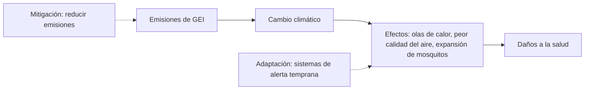
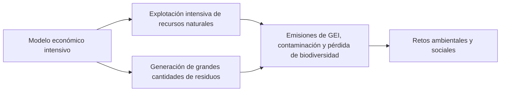
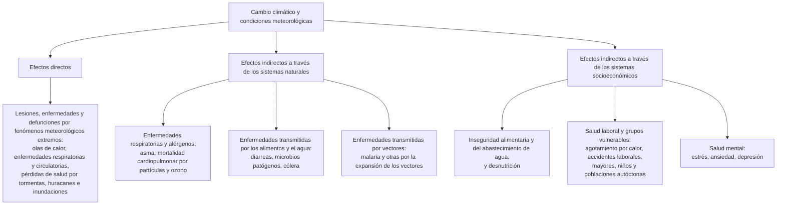
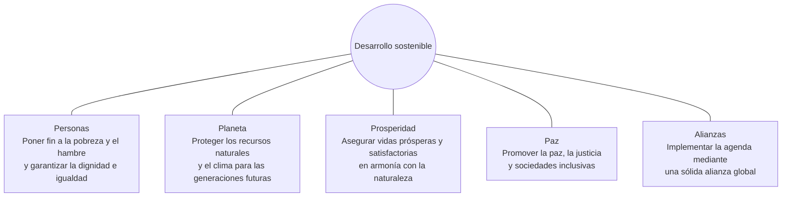
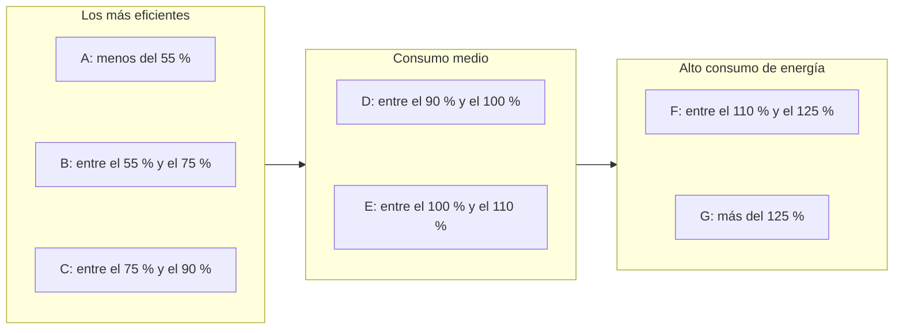
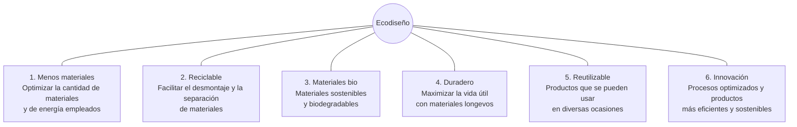
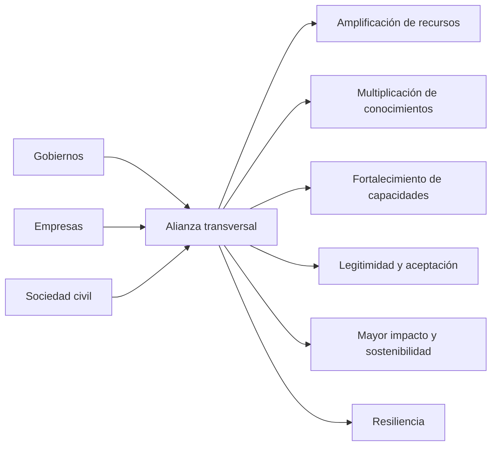
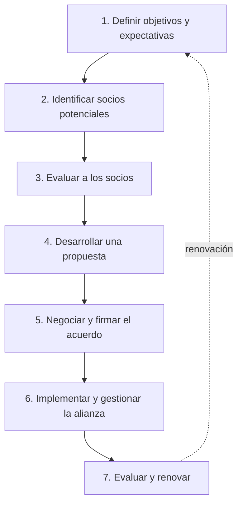

# TEORÍA tema 2: Retos ambientales y sociales a los que se enfrenta la sociedad

La unidad identifica los principales retos ambientales y sociales, los relaciona con el modelo económico actual, describe sus efectos sobre las personas y los sectores productivos, recoge las medidas para minimizarlos y termina con las alianzas y el trabajo transversal como condición para abordarlos. La mayor parte del material original son listas de buenas prácticas por sector; aquí se resumen en tablas y se desarrolla con más detalle el sector de informática y comunicaciones.

---

## 1. Efectos del cambio climático

Los efectos del cambio climático sobre la salud son múltiples y se producen en cascada: olas de calor, deshidratación, peor calidad del aire y expansión de enfermedades. El efecto que se relaciona directamente con el aumento de enfermedades en las personas es **el aumento de temperaturas y la expansión de mosquitos transmisores de enfermedades**, como los del dengue y el paludismo. Por eso hacen falta a la vez dos tipos de respuesta:

| Mitigación | Adaptación |
|---|---|
| Reducir las emisiones de CO2 y otros GEI | Mejorar la respuesta ante los efectos que ya se producen |
| Ejemplo: energías renovables | Ejemplo: sistemas de alerta temprana ante olas de calor |

Las dos respuestas actúan en puntos distintos de la cadena: la mitigación sobre la causa y la adaptación sobre los efectos.

## 2. Principales retos y desafíos ambientales y sociales

**Los retos ambientales y sociales son problemas y desafíos que afectan directamente al medio ambiente y a la sociedad en general. Estos retos pueden variar en magnitud y complejidad, y a menudo están interrelacionados.**

| Desafíos ambientales | Desafíos sociales |
|---|---|
| **Cambio climático**: eventos extremos, subida del nivel del mar, sequías, extinción de especies, enfermedades, acidificación de los océanos | **Desigualdad y pobreza**: dificultad de acceso a servicios básicos, educación, sanidad y empleo |
| **Pérdida de biodiversidad** por destrucción de hábitats y contaminación | **Migración forzada** por conflictos, falta de recursos y desastres naturales |
| **Contaminación del aire, agua y suelo** | **Acceso limitado a la educación y la salud** |
| **Escasez de recursos naturales** | **Desafíos de salud global**: pandemias y obesidad |
| **Gestión de residuos**, en especial plásticos | **Discriminación y derechos humanos** |
| | **Desafíos demográficos**: envejecimiento y crecimiento descontrolado |

Uno de los retos ambientales más urgentes que enfrenta la sociedad es el **cambio climático**. Sobre la escasez de recursos, es verdadero que **la sobreexplotación de recursos naturales, como el agua, los suelos fértiles y los minerales, plantea desafíos importantes para la sostenibilidad a largo plazo y puede dar lugar a conflictos por los recursos**.

> **Error frecuente**: es **falso** que los conflictos, la falta de recursos y los desastres naturales estén llevando a una *reducción* de la migración forzada. Están llevando a un **aumento** de la migración forzada.

### Retos de las empresas españolas y del sector TIC

En las empresas españolas los retos ambientales principales son el cambio climático y la huella de carbono, la gestión del agua (por la escasez en ciertas regiones), la calidad del aire urbano, la gestión de residuos y la pérdida de biodiversidad. Los retos sociales son la desigualdad, el desempleo y la precariedad, la inclusión de grupos vulnerables, la educación, la **brecha digital** (sobre todo en zonas rurales), la salud y la transparencia.

Aplicado a un sector profesional concreto, los principales retos ambientales y sociales son la **pérdida de biodiversidad y escasez de recursos hídricos**, a los que se suman en el sector TIC el consumo energético y los residuos electrónicos. Uno de los principales retos sociales para las empresas de informática y comunicaciones en relación con la brecha digital es **garantizar el acceso equitativo a las tecnologías de la información y comunicación para todas las comunidades**.

## 3. Relación de los retos ambientales y sociales con el desarrollo de la actividad económica

Estos retos están estrechamente relacionados con el modelo económico actual, basado en la explotación intensiva de recursos naturales y en la generación de grandes cantidades de residuos. **El modelo productivo intensivo causa contaminación y pérdida de biodiversidad**: la industria, la agricultura y el transporte son los principales responsables de las emisiones de GEI, la contaminación y la pérdida de biodiversidad.

La relación entre el modelo económico y los retos se resume en una cadena causal:

> **Error frecuente**: no es cierto que el desarrollo económico genere siempre sostenibilidad ni que las actividades económicas carezcan de impacto ambiental relevante.

Un modelo económico más sostenible debe reducir las emisiones y promover las renovables, proteger la biodiversidad, minimizar la contaminación y promover la economía circular, reducir la desigualdad y asegurar el uso sostenible de los recursos. Requiere la participación de gobiernos, empresas, sociedad civil e individuos.

Las empresas deben adoptar prácticas sostenibles **porque las regulaciones y los consumidores exigen responsabilidad ambiental**, no para evitar impuestos ni para aumentar beneficios a corto plazo.

### Contribución de los sectores a un desarrollo más sostenible

| Sector | Medidas representativas |
|---|---|
| Sanitario | Hospitales verdes, gestión de residuos sanitarios, medicina preventiva |
| Actividades sociales y culturales | Eventos sostenibles, voluntariado, menos materiales desechables, compensación de la huella |
| Electricidad y electrónica | Renovables, redes inteligentes, electrodomésticos eficientes, reciclaje de residuos electrónicos |
| **Informática y comunicaciones** | Tecnologías limpias, economía circular, gestión de residuos electrónicos, software sostenible, centros de datos sostenibles |
| Edificación y obra civil | Edificios eficientes, certificaciones LEED o BREEAM, edificios de energía neta cero |
| Transporte | Electrificación, movilidad compartida, logística verde |
| Fabricación mecánica e industria | Ecodiseño, fabricación aditiva, producción circular |
| Educación | Educación ambiental, infraestructura sostenible, voluntariado en las escuelas |
| Turismo | Ecoturismo, turismo responsable, certificaciones |
| Comercio y marketing | Comercio electrónico sostenible, marketing responsable, envases sostenibles |
| Agricultura | Agricultura ecológica y de precisión, comercio justo, menos desperdicio de alimentos |
| Administración y gestión | Inversión en proyectos sostenibles, productos financieros verdes, criterios ASG |

**Sector de informática y comunicaciones.** Las medidas que pueden tomar las empresas TIC para minimizar los impactos ambientales de sus operaciones son **desarrollar centros de datos eficientes en el uso de energía y utilizar energías renovables**, diseñar software eficiente, alargar la vida de los equipos y reciclar los residuos electrónicos para que no acaben en vertederos o en países en vías de desarrollo. Las tecnologías limpias contribuyen a la sostenibilidad **reduciendo las emisiones de gases de efecto invernadero**.

## 4. Efecto de los impactos ambientales y sociales sobre las personas y los sectores productivos

Los impactos pueden ser directos o indirectos, a corto o largo plazo, y de escala local a global.

| Efectos sobre las personas | Efectos sobre los sectores productivos |
|---|---|
| **Problemas de salud**: enfermedades respiratorias, cardiovasculares; dengue, paludismo, deshidratación | **Aumento de los costes de producción** (energía, agua, recursos) |
| Pérdida de medios de vida y aumento de la pobreza | Disrupciones en las cadenas de suministro |
| **Desplazamiento y migración forzada** por inundaciones, sequías y tormentas | Pérdida de mercados ante consumidores conscientes |
| Conflictos sociales y violentos por recursos escasos | Regulaciones ambientales más estrictas |
| **Impactos psicosociales**: **estrés, ansiedad y depresión**, trastorno de estrés postraumático | Pérdida de biodiversidad en agricultura, pesca y turismo |
| Pérdida de identidad cultural | Aumento del coste de los seguros |
| Mayor vulnerabilidad de niños, mujeres, mayores y personas con discapacidad | Daño a la reputación; pérdida de activos físicos; subida del precio de los alimentos |

De la tabla se desprenden varias relaciones:

- Los impactos ambientales y sociales **afectan la salud pública y generan riesgos para la seguridad alimentaria**; no incrementan el empleo ni reducen la presión sobre los recursos.
- Un efecto social de los desastres naturales provocados por el cambio climático es la **migración forzada de comunidades afectadas**. El impacto psicológico que producen es **estrés, ansiedad y depresión**.
- La pérdida de biodiversidad afecta a la economía **porque reduce los servicios ecosistémicos esenciales para la agricultura y la pesca** (polinización, fertilidad del suelo, regulación del agua, poblaciones de peces).
- Los sectores más vulnerables a los efectos del cambio climático son **agricultura, pesca y turismo**, porque dependen directamente del clima y de los ecosistemas.
- En la actividad económica de un sector, los retos ambientales y sociales **incrementan los costos operativos y de cumplimiento** (energía, agua, seguros, adaptación a nuevas normas).
- La escasez de recursos hídricos afecta a los sectores productivos porque **impacta la generación de energía hidroeléctrica**, además de encarecer el agua para la agricultura y la industria.

Los efectos del cambio climático sobre la salud humana se clasifican en tres grupos, según actúen de forma directa o a través de los sistemas naturales o socioeconómicos:

**Infraestructuras TIC.** Aunque el sector TIC no es de los más vulnerables, el cambio climático afecta a su infraestructura con un **aumento del riesgo de fallos en los equipos debido a fenómenos meteorológicos extremos**: olas de calor que sobrecargan la refrigeración de los centros de datos, inundaciones y cortes eléctricos.

> **Error frecuente**: un clima más cálido **no** reduce el mantenimiento de los equipos ni da más estabilidad a la infraestructura; ocurre lo contrario.

## 5. Medidas y acciones encaminadas a minimizar los impactos ambientales y sociales

Cada tipo de impacto necesita medidas específicas, teniendo en cuenta las relaciones entre ellos.

El desarrollo sostenible al que se orientan estas medidas se articula en cinco dimensiones, cada una con su propósito:

**Medidas para minimizar impactos ambientales**

| Ámbito | Medidas |
|---|---|
| Lucha contra el cambio climático | Reducir emisiones: **fomentar el uso de energías renovables y la eficiencia energética**, transporte sostenible, reforestación. Adaptarse: infraestructuras resilientes, alerta temprana |
| Protección de la biodiversidad | Áreas protegidas, **conservación de bosques**, restauración de ecosistemas, control de especies invasoras |
| Energías renovables | Incentivos, redes inteligentes, almacenamiento, eficiencia energética |
| Gestión de residuos | Economía circular, valorización (biogás, compost) |
| Aguas residuales | Ósmosis inversa, ultrafiltración, reutilización para usos no potables |
| Control de emisiones | Monitorización continua; captura y almacenamiento de carbono (CCS) |
| Recursos naturales | Agricultura sostenible, ahorro de agua, responsabilidad ampliada del productor, protección del suelo |
| **Diseño ecológico** | **Análisis del ciclo de vida** de los productos para reducir su impacto ambiental; materiales sostenibles |

Son verdaderas, por tanto, dos afirmaciones de base: **promover el uso de energías renovables ayuda a minimizar el impacto del cambio climático**, y **la conservación de bosques es una acción efectiva para abordar la deforestación**. La medida fundamental para reducir las emisiones de GEI es **fomentar el uso de energías renovables y la eficiencia energética**, no la deforestación controlada ni el transporte privado.

Lo que caracteriza al diseño ecológico es que **analiza el ciclo de vida de los productos para reducir su impacto ambiental**. La economía circular contribuye a la sostenibilidad **promoviendo la reutilización y el reciclaje de materiales**.

Las empresas contribuyen a la responsabilidad ambiental **adoptando prácticas de producción sostenible**. En un sector profesional concreto, una medida directa para minimizar impactos es **implementar programas de reciclaje y reducción de residuos**.

> **Error frecuente**: "participando en todo tipo de iniciativas de conservación" no es la respuesta adecuada a cómo contribuyen las empresas: la contribución se concreta en sus propias prácticas de producción.

**Medidas para minimizar impactos sociales**

| Ámbito | Medidas |
|---|---|
| Igualdad e inclusión | **Implementar políticas públicas que garanticen educación y salud para todos**; igualdad de oportunidades; participación ciudadana |
| RSC | Programas comunitarios; voluntariado de los empleados |
| Condiciones laborales | Salud y seguridad ocupacional, EPP, beneficios laborales |
| Participación comunitaria | Consultas públicas; colaboración con ONG |
| Prácticas justas | Transparencia, ética, cumplimiento legal |
| Desarrollo económico local | Emprendimiento local; compras a proveedores locales |
| Transparencia | Informes de sostenibilidad; canales de retroalimentación |
| Desarrollo sostenible | Educación y formación; apoyo a comunidades rurales; cooperación internacional |

La estrategia social que se propone para enfrentar los retos ambientales es **promover el voluntariado ambiental y la participación comunitaria**. La educación ambiental contribuye a enfrentarlos **fomentando la conciencia y responsabilidad ambiental**.

### 5.1. Estrategias sostenibles, minimizando el impacto de estas en el medio ambiente

Las estrategias sostenibles son planes de acción que satisfacen las necesidades actuales sin comprometer las de las generaciones futuras, apoyadas en los pilares económico, social y ambiental.

| Estrategia | Contenido |
|---|---|
| Eficiencia energética | Iluminación eficiente, optimización de procesos; la **etiqueta energética** informa de la eficiencia de edificios, electrodomésticos y coches |
| Energías renovables | Eólica, solar, biomasa, biogás, biocombustibles, hidroeléctrica, geotermia |
| Diseño sostenible y ecodiseño | Ciclo de vida completo, reutilización y reciclaje |
| Economía circular y gestión de residuos | Regulada por la **Ley 7/2022, de 8 de abril, de residuos y suelos contaminados para una economía circular** |
| Transporte sostenible | Transporte público, movilidad compartida, vehículos eléctricos |
| Consumo responsable | Consumo consciente y crítico, en la compra y en el hogar |
| Gestión del agua | Captación de pluviales, riego eficiente |
| Conservación de la biodiversidad | Protección de áreas naturales, especies autóctonas |

La etiqueta de eficiencia energética clasifica el consumo de un aparato en siete letras, según el porcentaje que representa respecto al consumo medio:

El ecodiseño, por su parte, se concreta en seis principios:

El **consumo responsable** se basa en dos máximas: consumir menos y que lo consumido sea lo más sostenible y solidario posible. Es consciente, crítico, ético, ecológico, saludable, sostenible, solidario, socialmente justo y tiene poder de transformación social.

### 5.2. Actividades sostenibles minimizando los impactos ambientales y sociales

En la vida cotidiana: movilidad sostenible, consumo responsable, ahorro de energía, gestión de residuos, conservación del agua, jardinería y alimentación sostenibles (local y de temporada), turismo sostenible, educación y participación comunitaria.

**Actividades sostenibles en una empresa de electricidad e informática**

| Área | Actividades |
|---|---|
| Energía | Renovables para las operaciones propias; auditorías energéticas a clientes; gestión inteligente de la demanda; vehículos eléctricos |
| Residuos electrónicos | Programas de reciclaje; reparar y reacondicionar equipos; donar equipos en buen estado |
| Productos y servicios | Equipos de bajo consumo; computación en la nube con centros de datos eficientes y renovables |
| Cadena de suministro | Proveedores sostenibles; menos embalaje; logística optimizada |
| Comunicación | Informar a empleados y clientes; talleres; cultura de sostenibilidad |

Las demás actividades (administración, agricultura, educación, hostelería, sanidad, transporte, construcción) siguen el mismo patrón: energía, agua, residuos, compras sostenibles y sensibilización.

## 6. La importancia de establecer alianzas y trabajar de manera transversal y coordinada para abordar con éxito los retos ambientales y sociales

La condición indispensable para afrontar los retos ambientales y sociales de forma efectiva es **establecer alianzas transversales entre gobiernos, empresas y sociedad civil**; no trabajar de forma aislada, centralizar la gestión en el gobierno ni reducir la cooperación internacional. Las alianzas aportan:

1. **Amplificación de recursos** financieros, humanos y técnicos.
2. **Multiplicación de conocimientos** y perspectivas.
3. **Fortalecimiento de capacidades**.
4. **Más legitimidad y aceptación** de las iniciativas.
5. **Mayor impacto y sostenibilidad**, al atacar causas y no solo síntomas.
6. **Resiliencia** ante el cambio climático, la degradación y la pobreza.

La alianza reúne a los tres tipos de actores y produce los seis efectos enumerados:

En el sector TIC, la estrategia crucial para abordar estos retos de manera efectiva es **crear alianzas con otras empresas y organizaciones para promover prácticas sostenibles y responsables**, frente a la obsolescencia programada o el incumplimiento de las normas.

## 7. ¿Cómo podemos establecer alianzas y trabajar de manera transversal?

Las alianzas nacionales e internacionales de sostenibilidad agrupan a gobiernos, empresas, organizaciones civiles y otros actores con el objetivo común de promover el desarrollo sostenible.

Pasos para establecer una alianza estratégica:

1. **Definir los objetivos** y expectativas (el paso más importante).
2. Identificar socios potenciales.
3. Evaluarlos: reputación, experiencia, recursos, valores.
4. Desarrollar una propuesta: beneficios, costes, riesgos, decisiones, medición del éxito.
5. Negociar y firmar un acuerdo claro y vinculante.
6. Implementar y gestionar la alianza.
7. Evaluarla y renovarla.

Los siete pasos se suceden en orden, y la evaluación final puede abrir una renovación que vuelve a empezar por los objetivos:

**Trabajar de manera transversal** significa fomentar la interacción y el intercambio de información entre equipos de distintos departamentos y niveles jerárquicos.

> **Error frecuente**: eliminar la competencia **no** es un beneficio de las alianzas estratégicas; su objetivo es crear valor conjunto. Sí lo son el acceso a nuevos mercados, la reducción de costes y riesgos y el desarrollo de nuevos productos.

## 8. Ejemplos de alianzas y trabajo transversal exitosos

La **sinergia** es el valor adicional que se genera cuando dos o más organizaciones colaboran: un resultado que supera la simple suma de los esfuerzos individuales.

| Ámbito | Alianza | Contenido |
|---|---|---|
| Nacional | Red Española de Ciudades por el Clima | Más de 200 municipios contra el cambio climático |
| Nacional | Pacto por el Agua | Más de 400 entidades por la gestión sostenible del agua |
| Nacional | Estrategia Española de Biodiversidad | Elaborada con gobiernos, empresas, sociedad civil y academia |
| Internacional | **Acuerdo de París** | 196 países; limitar el calentamiento muy por debajo de 2 °C, preferiblemente 1,5 °C; reducir emisiones, presentar planes nacionales y cooperar |
| Internacional | ODS | Agenda de la ONU de 2015, 193 países |
| Internacional | Alianza Global de Residuos Sólidos | Gestión sostenible de residuos a escala mundial |

---

## Ideas clave

- Los retos ambientales y sociales están **interrelacionados**; el más urgente es el **cambio climático**.
- La migración forzada **aumenta**; los desastres naturales generan estrés, ansiedad y depresión.
- El **modelo productivo intensivo** causa contaminación y pérdida de biodiversidad.
- La pérdida de biodiversidad reduce los **servicios ecosistémicos**; los sectores más vulnerables son **agricultura, pesca y turismo**.
- Medidas base: **renovables y eficiencia energética**, conservación de bosques, economía circular, diseño ecológico con **análisis del ciclo de vida**.
- En el sector TIC: centros de datos eficientes con renovables, reciclaje de equipos, acceso equitativo a la tecnología y riesgo de fallos por fenómenos extremos.
- Condición indispensable: **alianzas transversales** entre gobiernos, empresas y sociedad civil; la sinergia supera la suma de las partes.
