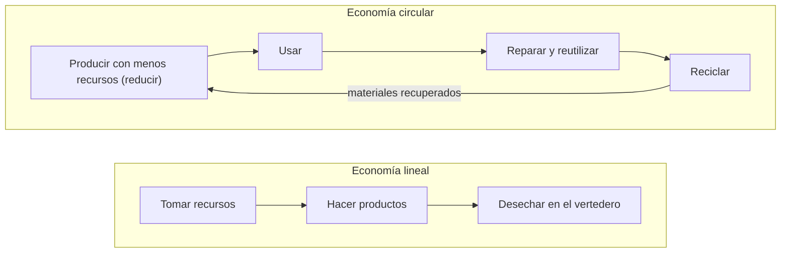
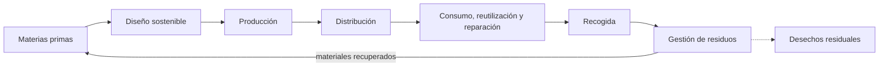
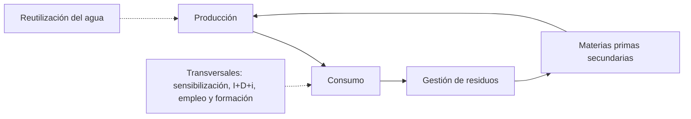
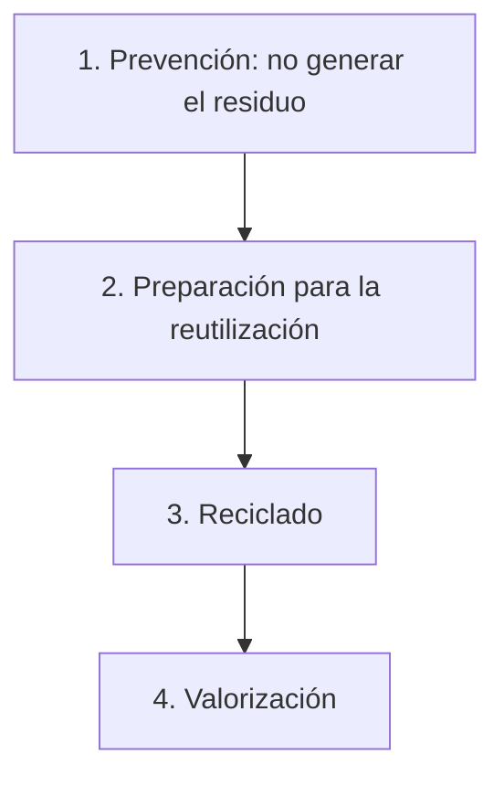

# TEORÍA tema 3: Productos y servicios responsables teniendo en cuenta los principios de la economía circular

La unidad contrapone la economía lineal y la circular; presenta los beneficios y estrategias de la economía circular y la Estrategia Española de Economía Circular (España Circular 2030) con sus objetivos, ejes, principios y orientaciones; distingue la economía verde de la circular; y desarrolla el ecodiseño, el ciclo de vida del producto y los criterios de sostenibilidad aplicados a los procesos de producción, con sus tecnologías limpias.

---

## 1. Economía Lineal vs Economía Circular

La economía lineal y la circular son dos modelos con enfoques opuestos sobre la producción, el consumo y los recursos. **La economía lineal sigue un modelo de "tomar, hacer, desechar", mientras que la economía circular se basa en mantener los recursos en uso el mayor tiempo posible mediante la reducción, reutilización y reciclaje.**

| Aspecto | Economía lineal | Economía circular |
|---|---|---|
| Modelo | Tomar, hacer, desechar | Cerrar el ciclo: reducir, reutilizar, reciclar |
| Uso de recursos | Se consideran ilimitados | Eficiencia; renovables; mínimo de no renovables |
| Impacto ambiental | Muchos residuos y emisiones | Minimización de residuos y emisiones |
| Durabilidad | Vida útil limitada; obsolescencia programada | Productos duraderos, reparables y reciclables; se evita la obsolescencia programada |
| Ejemplo | Plástico desechable que acaba en el vertedero | Botella de vidrio que se devuelve, se limpia y se reutiliza antes de reciclarse |

La diferencia se aprecia en la forma del flujo: la economía lineal es una línea que termina en el vertedero; la circular es un ciclo en el que los materiales vuelven a la producción.

El Parlamento Europeo representa el modelo circular como un ciclo de siete etapas, del que solo salen los desechos residuales que no se pueden recuperar:

**La economía circular es un concepto y modelo económico que busca optimizar el uso de recursos, minimizar residuos y cerrar los ciclos de vida de productos, servicios y materiales.** En el contexto de productos y servicios, su objetivo principal es **minimizar la generación de residuos y optimizar el uso de recursos**.

> **Error frecuente**: es **falso** que la economía circular se centre en maximizar la generación de residuos y fomentar la producción continua de nuevos productos. Esa es una caricatura del modelo lineal. También es falso que la economía lineal sea la que "reduce, reutiliza y recicla".

**Ejemplo: la industria de la moda.** En la versión lineal se fabrican prendas con materiales nuevos, se usan y se desechan en vertederos. En la circular se diseñan prendas duraderas con materiales reciclados, se reutilizan mediante intercambio, alquiler y segunda mano, se reciclan las fibras, y se pasa a **implementar modelos de suscripción o alquiler**, que es la estrategia que promueve directamente la economía circular en la moda.

La transición exige cambios en el diseño, en las cadenas de suministro y en el comportamiento del consumidor, además de políticas públicas e innovación.

## 2. Beneficios y Estrategias de la Economía circular

**Beneficios**

- **Reducción de la huella ambiental o ecológica**: la huella ecológica mide la superficie necesaria para producir los recursos consumidos y absorber los residuos generados por habitante.
- **Fomento de la innovación** en diseño, reciclaje y modelos de negocio.
- **Crecimiento económico sostenible**, que no depende de la explotación ilimitada de recursos.

**Estrategias**

| Estrategia | Contenido |
|---|---|
| Diseño circular | Durabilidad, reparabilidad, reutilización y reciclaje desde la etapa de diseño |
| Reutilización y reciclaje | Reparar y reutilizar para alargar la vida útil |
| Reciclaje y valorización de materiales | Cerrar los ciclos y depender menos de materias primas vírgenes |
| Economía del compartir | Uso y propiedad compartidos |
| Ecodiseño y ecoinnovación | Producción más limpia y nuevos materiales |
| Gestión de residuos | Recogida selectiva, separación en origen, compostaje |
| Modelos de negocio circulares | Servicio en lugar de venta: *leasing*, suscripción, compartición |
| Colaboración y redes | Empresas, gobiernos, ONG y comunidades cerrando bucles |
| Educación y sensibilización | Cambio cultural y de comportamiento |

Por eso es verdadero que **la implementación de modelos de negocio basados en la suscripción o alquiler de productos es coherente con los principios de la economía circular**. Las estrategias comunes para minimizar los impactos ambientales consisten en **fomentar la reparación, reutilización y reciclaje de productos**.

**Aplicación al sector TIC.** Las empresas de TIC incorporan los principios de la economía circular **estableciendo programas de recogida y reciclaje de dispositivos usados y diseñando productos modulares y duraderos**, en lugar de acortar los ciclos de vida o recortar el soporte técnico para forzar la compra de equipos nuevos.

### 2.1. Estrategia Española de Economía Circular y Planes de Acción

La **Estrategia Española de Economía Circular (EEEC)**, llamada **España Circular 2030**, fue aprobada en **julio de 2020**. Es **un enfoque para maximizar la eficiencia en el uso de los recursos, reducir los residuos y promover la reutilización y el reciclaje**: busca que el valor de productos, materiales y recursos se mantenga en la economía el mayor tiempo posible y que se aprovechen al máximo los residuos que no se puedan evitar. Se materializa mediante **planes de acción trienales** y se alinea con los planes de acción de economía circular de la UE (2015 y 2020), el Pacto Verde Europeo y la Agenda 2030.

En la industria de las TIC, la EEEC **incentiva la creación de tecnologías sostenibles y programas de reciclaje**.

**Seis sectores prioritarios**: construcción; agroalimentario, pesquero y forestal; industrial; bienes de consumo; turismo; textil y confección.

**Ocho líneas de actuación**:

| Cierre del círculo (5) | Transversales (3) |
|---|---|
| Producción | Sensibilización y participación |
| Consumo | Investigación, innovación y competitividad |
| Gestión de residuos | Empleo y formación |
| Materias primas secundarias | |
| Reutilización del agua | |

Las cinco primeras líneas siguen el recorrido de los materiales y cierran el círculo; las tres transversales actúan sobre todas ellas:

### 2.2. Objetivos estratégicos de Economía Circular 2030

Objetivos cuantitativos para 2030:

| Objetivo | Meta |
|---|---|
| Consumo nacional de materiales | Reducir un **30 %** en relación con el PIB, respecto a 2010 (equivale a **incrementar la productividad de los recursos en un 30 %**) |
| Generación de residuos | **Reducir la generación de residuos un 15 % respecto a 2010** |
| Residuos de alimentos | −50 % per cápita en hogares y comercio minorista; −20 % en producción y suministro (desde 2020) |
| Reutilización | Hasta el 10 % de los residuos municipales |
| Agua | **Mejorar un 10 % la eficiencia en el uso del agua** |
| Emisiones | Por debajo de 10 millones de toneladas de CO2 equivalente |

En términos generales, un objetivo estratégico de la Economía Circular 2030 es **reducir significativamente la generación de residuos y fomentar la reutilización, el reciclaje y la valorización de materiales**.

> **Error frecuente**: **no** es un objetivo de la EEEC **alcanzar una tasa de uso de agua regenerada del 20%**. El objetivo sobre el agua es mejorar un 10 % la eficiencia en su uso.

### 2.3. Planes de Acción de Economía Circular

El **I Plan de Acción de Economía Circular** ordena **116 medidas** de **once ministerios** y se divide en **5 ejes y 3 líneas de actuación**, que coinciden con las ocho líneas de §2.1:

| Eje o línea | Qué pretende |
|---|---|
| 1. Producción | Rediseñar procesos y productos; materias primas secundarias; menos sustancias nocivas |
| 2. Consumo | Reducir la huella ecológica con un consumo más responsable |
| 3. Gestión de los residuos | Aplicar el principio de jerarquía de los residuos |
| 4. Materias primas secundarias | Reincorporar al ciclo los materiales contenidos en los residuos |
| 5. Reutilización y depuración del agua | Uso eficiente del agua |
| 6. Investigación, innovación y competitividad | I+D+i y colaboración público-privada |
| 7. Participación y sensibilización | Implicar a agentes y ciudadanía |
| 8. Empleo y formación | Nuevos empleos en la economía circular |

### 2.4. Principios generales de la Estrategia Española de Economía Circular

La transición solo es posible con la **colaboración, participación e implicación de toda la sociedad**: administraciones, sectores económicos (fabricación, distribución, gestión de residuos), agentes sociales y, muy especialmente, los consumidores. De ahí que el consumidor tenga un papel crucial: **tomar decisiones de compra sostenibles y participar en la reutilización y reciclaje**, por ejemplo separando bien sus residuos.

> **Error frecuente**: es **falso** que la participación activa del consumidor no desempeñe un papel significativo en la economía circular.

Los principios generales que inspiran la EEEC son:

1. Protección y mejora del medio ambiente.
2. Acción preventiva.
3. Descarbonización de la economía.
4. **Quien contamina paga**: quien contamina asume los costes de prevenir y reparar el daño, lo que internaliza los costes ambientales.
5. Protección de la salud.
6. Racionalización y eficiencia.
7. Cooperación y coordinación entre las administraciones públicas.
8. Participación pública.
9. Desarrollo sostenible.
10. Solidaridad entre personas y territorios.
11. Integración de los aspectos ambientales en la toma de decisiones.
12. Mejora de la competitividad de la economía.
13. Generación de empleo de calidad.

Estos principios se agrupan en tres ideas: **colaboración y participación**, **competitividad** y **compromiso** de toda la sociedad. El **conservadurismo** **no** es uno de los principios generales de la EEEC.

El principio de colaboración y participación significa **involucrar a diferentes partes interesadas, incluidos gobiernos, empresas, sociedad civil y ciudadanos, en el diseño e implementación de políticas y acciones relacionadas con la economía circular**.

**Ejemplo aplicado: trabajo transversal en una empresa TIC de Castilla y León.** Un ejemplo de trabajo transversal exitoso sería **implementar soluciones sostenibles desarrolladas en conjunto por técnicos, diseñadores, clientes, proveedores y actores locales, como software energéticamente eficiente y reciclaje de hardware**. Lo contrario sería centralizar las decisiones en el departamento técnico, prescindir de alianzas o externalizar los procesos ambientales sin informar a los usuarios.

### 2.5. Orientaciones estratégicas

El decálogo de orientaciones de la EEEC:

1. Protección del medio ambiente.
2. Ciclo de vida de los productos, con ecodiseño, reparabilidad y reutilización.
3. Jerarquía de los residuos: prevención, preparación para la reutilización, reciclado y valorización.
4. Reducción de residuos alimentarios.
5. Eficiencia en la producción, con servicios digitales y sistemas de gestión ambiental.
6. Consumo sostenible, con información sobre duración, reparabilidad y eficiencia (**ecoetiqueta**).
7. Sensibilización y comunicación.
8. Empleo para la economía circular.
9. Investigación e innovación.
10. **Indicadores** comunes, transparentes y accesibles.

La jerarquía de los residuos de la orientación 3 es un orden de preferencia: cada opción se aplica solo cuando la anterior no es posible.

La última orientación explica por qué es verdadero que **la medición del impacto en la transición hacia la economía circular se puede realizar mediante indicadores como la reducción de residuos y la eficiencia en el uso de recursos**.

## 3. Los principios de la Economía Verde y Circular

La **economía verde** integra las consideraciones ambientales en todas las dimensiones de la actividad económica, partiendo de que crecimiento económico y sostenibilidad ambiental pueden coexistir y reforzarse. Promueve el crecimiento económico y la creación de empleo al tiempo que reduce el impacto ambiental y la escasez de recursos, y busca internalizar los costes ambientales en los precios de los productos y servicios (principio de quien contamina paga).

| Principios de la economía verde | Principios de la economía circular |
|---|---|
| Eficiencia en el uso de recursos | Diseño regenerativo y sostenible: productos duraderos, reparables, reutilizables y reciclables |
| Energía renovable | Cierre de ciclos de materiales |
| Conservación de la biodiversidad | Energía renovable y eficiencia energética |
| Economía baja en carbono | Reciclaje eficiente |
| Promoción de tecnologías limpias y sostenibles | Reducción del desperdicio; reutilización, reparación y segundo uso |
| Inversión en infraestructura verde | Ecocolaboración, cooperación y participación |
| Desarrollo inclusivo y equitativo | |
| Valoración de servicios ecosistémicos | |

Las nuevas formas de producir asociadas a la economía circular son *cradle to cradle* (de la cuna a la cuna), *upcycling* o suprarreciclaje, minería urbana, logística inversa y biomímesis.

Del primer principio de la economía circular se deduce que es verdadero que **el diseño de productos duraderos es un principio clave en la economía circular**. Son principios fundamentales el **diseño de productos para la durabilidad y la reutilización** y el **fomento de la reparación y el reacondicionamiento**.

> **Error frecuente**: la **maximización de la extracción de recursos naturales** **no** es un principio de la economía circular.

> **Error frecuente**: es **falso** que **la Economía Verde se centra exclusivamente en el desarrollo de tecnologías limpias y renovables**. Las tecnologías limpias son uno de sus ocho principios, junto a la biodiversidad, la inclusión o la infraestructura verde.

## 4. Beneficios de la Economía Verde y Circular frente al Modelo Clásico de Producción

El **modelo clásico de producción** es el modelo lineal de "tomar, hacer, desechar", con un flujo unidireccional de recursos, que dominó el siglo XX. Frente a él, la economía verde y circular aporta:

| Beneficio | Contenido |
|---|---|
| Sostenibilidad ambiental | Menos contaminación, emisiones y sobreexplotación; conservación de recursos |
| Eficiencia en el uso de recursos | Productos pensados para reutilizar y reciclar |
| Innovación | Tecnologías sostenibles |
| Empleo verde | Renovables, gestión de residuos, tecnologías sostenibles |
| Reducción de residuos y contaminación | Menos desechos en vertederos y menos sustancias tóxicas |
| Resiliencia económica | Menor dependencia de recursos no renovables |
| Reputación | Mejor imagen ante consumidores preocupados por el medio ambiente |

Uno de los beneficios principales de la economía circular frente al modelo clásico de producción es la **mejor gestión de los residuos y minimización del impacto ambiental**.

> **Error frecuente**: es **falso** que la economía circular solo tenga beneficios ambientales y no tenga impacto en la rentabilidad de las empresas: genera ahorro de materiales, innovación, empleo y mejor reputación.

**Aplicación a los dispositivos electrónicos.** Los beneficios de la economía circular en la producción de dispositivos electrónicos son el **ahorro de recursos naturales, reducción de residuos y disminución de la huella de carbono**. El ejemplo de referencia es la gestión sostenible de residuos electrónicos: recogida responsable con fabricantes y administraciones, desmontaje y recuperación de componentes, reacondicionamiento, recuperación de metales preciosos, campañas de concienciación y *leasing* de equipos. Así, la industria TIC contribuye a reducir los residuos electrónicos **desarrollando y promoviendo programas de reciclaje y reutilización de equipos electrónicos**.

## 5. Principios de Ecodiseño

El **ecodiseño** (diseño ecológico o sostenible) integra las consideraciones ambientales desde las primeras etapas del diseño para minimizar el impacto del producto a lo largo de su ciclo de vida. Sus principios clave son:

1. Ciclo de vida completo.
2. Eficiencia en el uso de recursos: materiales, energía y agua.
3. Diseño para la durabilidad: materiales resistentes y reparables.
4. Facilidad de desmontaje y reciclaje.
5. Minimización de sustancias peligrosas.
6. Diseño para la eficiencia energética.
7. Promoción de la economía circular.
8. Consideración del usuario.
9. Innovación sostenible.

En síntesis, los principios de diseño que promueve el ecodiseño en la economía circular son **reducir la huella de carbono y optimizar el uso de materiales**. Las herramientas del ecodiseño son el análisis del ciclo de vida, la **selección de materiales reciclados y reciclables**, la minimización de materiales y el diseño para el desmontaje. La **obsolescencia programada** es lo contrario: **no** se utiliza en el ecodiseño.

> **Error frecuente**: es **falso** que las estrategias para promover la durabilidad de los productos no sean relevantes en la economía circular; la durabilidad es uno de sus principios básicos.

En el desarrollo de productos tecnológicos, aplicar el ecodiseño implica **diseñar productos que sean fáciles de desmontar, reparar y reciclar**: portátiles con batería y memoria sustituibles, carcasas atornilladas en lugar de pegadas, componentes estándar.

## 6. Las estrategias sostenibles

Las estrategias sostenibles equilibran consideraciones económicas, sociales y ambientales para satisfacer las necesidades presentes sin comprometer las futuras. Las principales son el desarrollo sostenible, las energías renovables, la eficiencia energética, el reciclaje y la gestión de residuos, la movilidad sostenible, la agricultura sostenible, la responsabilidad social empresarial (RSE), la innovación verde, la educación y la gobernanza sostenible. Son interdependientes y se aplican en conjunto.

## 7. El Ciclo de Vida del Producto

El **Análisis del Ciclo de Vida (ACV)** es, según la SETAC, el proceso para evaluar las cargas ambientales asociadas a un producto, proceso o actividad.

El **ciclo de vida del producto** comprende **todas las etapas por las que pasa un producto, desde la extracción de materias primas hasta su disposición final**; no es solo el tiempo que permanece en el mercado ni el que tarda en fabricarse. En la economía circular se entiende como **el proceso de planificación, producción, uso y reciclaje de un producto, con el objetivo de minimizar su impacto ambiental en cada etapa**.

| Etapa | Qué ocurre |
|---|---|
| 1. Adquisición de materias primas | Extracción de recursos (minería, tala, cosecha) y transporte previo |
| 2. Producción y fabricación | Transformación con consumo de energía y emisiones |
| 3. Distribución y transporte | Logística hasta el cliente |
| 4. Uso, reutilización y consumo | Energía, agua y recursos durante el uso |
| 5. Reciclaje y disposición final | Desmontaje y recuperación, o vertedero e incineración |
| 6. Gestión de residuos | Devolución del producto al medio como residuo |

En la economía circular el ciclo de vida no termina en la última etapa: el reciclaje devuelve materiales a la primera, y el ecodiseño (§5) actúa antes que todas, porque decide cómo será cada una.

**Ejemplo: un ordenador portátil.** Extracción de metales y tierras raras; fabricación de placas y montaje; transporte desde la fábrica; años de consumo eléctrico; y al final, reacondicionamiento para un segundo usuario o recuperación de metales en un gestor autorizado de residuos electrónicos.

## 8. Los procesos de producción y los criterios de sostenibilidad aplicados

Un proceso de producción sostenible mantiene el equilibrio entre la generación de productos y el uso eficiente de recursos, minimizando su impacto ambiental, social y económico a lo largo del ciclo de vida.

| Criterio | Prácticas |
|---|---|
| **Eficiencia energética** | Auditorías energéticas; optimización de procesos; equipos eficientes; automatización; mantenimiento preventivo; aislamiento; renovables; transporte optimizado |
| **Uso responsable de recursos naturales** | Optimización de materias primas; materias primas sostenibles; menos desperdicio; conservación del agua; certificaciones; colaboración en la cadena de valor |
| **Gestión de residuos** | Reducción en la fuente; reutilización; reciclaje; residuos peligrosos; compostaje; segregación; formación; mejora continua |
| **Cumplimiento de normativas ambientales** | Conocer la regulación; evaluación de impacto ambiental; planificación; seguimiento; formación; colaboración con autoridades |
| **Condiciones laborales justas y seguras** | Salud y seguridad, derechos laborales, equidad de género |
| **Innovación y mejora continua** | I+D en tecnologías limpias; compartir buenas prácticas |

Una auditoría energética es la evaluación sistemática del uso de la energía en un edificio, instalación o proceso para identificar dónde reducir el consumo.

En la gestión de residuos, la estrategia que implica la optimización en el consumo de materias primas y la reducción del desperdicio en los procesos de producción es la **reducción en la fuente**: la mejor manera de gestionar un residuo es no generarlo. Para el uso responsable del agua, la práctica adecuada es **implementar sistemas de reciclaje de agua**, además de reparar fugas y captar agua de lluvia.

Dentro del uso responsable de recursos, la colaboración con proveedores y clientes en toda la cadena de valor explica por qué **es importante la gestión responsable de la cadena de suministro** en la economía circular: los materiales, la energía y los residuos de los proveedores forman parte del ciclo de vida del producto final.

**Tecnologías limpias**

| Tecnología | Para qué sirve |
|---|---|
| **Energía solar** (y eólica, hidroeléctrica, biomasa, geotérmica) | La solar es la que **aprovecha la energía del sol para generar electricidad** |
| **Eficiencia energética** | La que se utiliza **para reducir el consumo de energía en edificaciones y procesos industriales** |
| **Tecnología de captura y almacenamiento de carbono (CCS)** | **Capturar y almacenar las emisiones de CO2 generadas por la quema de combustibles fósiles**, en el subsuelo o para usos industriales |
| **Tratamiento de aguas residuales** | **Tratar y depurar aguas residuales industriales y urbanas** |
| Gestión de residuos | Incineración controlada, compostaje, reciclaje |
| Agricultura sostenible | Menos agroquímicos; conservación de suelo y agua |
| Transporte limpio | Vehículos eléctricos e híbridos; transporte público |
| Construcción sostenible | Materiales y técnicas de bajo impacto |

**Normativa española relacionada**: Ley 7/2021 de cambio climático y transición energética; Ley 2/2011 de Economía Sostenible; Ley 1/2023 de Cooperación para el Desarrollo Sostenible; Ley 2/2023 de protección de informantes y lucha contra la corrupción; Plan Nacional Integrado de Energía y Clima (PNIEC) 2021-2030; Estrategia Española de Economía Circular.

### 8.1. Ampliación: el sector de informática y comunicaciones ante los retos ambientales

Los procesos de producción del sector TIC también están expuestos a los retos de la unidad 2:

- **Relación con la actividad económica**: **la producción de dispositivos y el uso continuo de datos generan residuos electrónicos y altas emisiones, lo que obliga a repensar los modelos de negocio hacia la economía circular y la inclusión digital**. No es cierto que el sector tecnológico carezca de impacto ambiental ni que la digitalización elimine la necesidad de gestionar impactos sociales.
- **Efectos directos del cambio climático**: **la vulnerabilidad de los centros de datos ante olas de calor o cortes eléctricos, y el aumento del consumo energético por la refrigeración de equipos**. Las altas temperaturas empeoran el rendimiento de los servidores, no lo mejoran.

| Criterio de §8 | Aplicación en una empresa TIC |
|---|---|
| Eficiencia energética | Virtualización, refrigeración por aire exterior, PUE como indicador |
| Recursos naturales | Alargar la vida de los equipos; compra de hardware reacondicionado |
| Gestión de residuos | Gestor autorizado de residuos electrónicos; borrado seguro y donación |
| Innovación | Software energéticamente eficiente |

---

## Ideas clave

- **Lineal** = tomar, hacer, desechar; **circular** = mantener los recursos en uso el mayor tiempo posible (reducir, reutilizar, reciclar).
- Objetivo de la economía circular: **minimizar residuos y optimizar recursos**; tiene beneficios ambientales **y** económicos.
- **España Circular 2030** (julio de 2020): −30 % de consumo de materiales sobre el PIB, −15 % de residuos respecto a 2010, +10 % de eficiencia en el agua; planes trienales; 5 ejes y 3 líneas.
- Principios de la EEEC: colaboración y participación, competitividad, compromiso; entre ellos, quien contamina paga. El conservadurismo no es uno de ellos.
- La economía verde **no** se limita a las tecnologías limpias.
- **Ecodiseño**: ciclo de vida completo, durabilidad, desmontaje y reciclaje; la obsolescencia programada es su contrario.
- **Ciclo de vida**: de la extracción de materias primas a la disposición final.
- **Reducción en la fuente** es la mejor gestión de residuos; CCS captura CO2; la eficiencia energética reduce el consumo en edificios y procesos.
